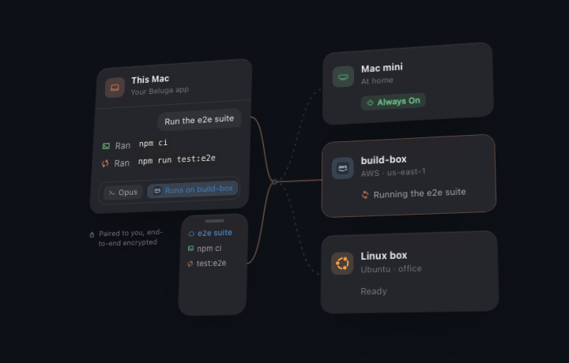

<!-- This fork's front page: GitHub shows .github/README.md before the root README.md, which stays upstream's (docs/fork.md). -->
<p align="center">
  
</p>
<h1 align="center">Beluga</h1>

<p align="center">
  <b>一个桌面应用，装下你所有的项目，和在每个项目里干活的 agent。<br>你的 agent 还能和朋友的 agent 对话，电脑直连电脑。</b>
</p>

<p align="center">
  <a href="https://github.com/dayuer/beluga/releases/latest"></a>
  <a href="https://github.com/dayuer/beluga/releases/latest"></a>
  <a href="https://github.com/dayuer/beluga/releases/latest"></a>
</p>
<p align="center">
  <sub>macOS 13+（Apple 芯片）· Linux x64（AppImage、.deb、.rpm）· Windows 10+ x64 · 自动更新</sub>
</p>
<p align="center"><b>简体中文</b> · <a href="../README.en.md">English</a></p>

## 它能做什么

- **[所有事同时推进](#所有事同时推进)**：每个任务都有自己的工作树、分支和 agent，全部并排运行。
- **[看着每个 agent 干活](#看着每个-agent-干活)**：步骤、子 agent 和截图实时出现，运行中途也能改方向。
- **[看得见的回答](#看得见的回答)**：实时表格、图表、示意图和任务卡片，直接出现在对话里。
- **[你的 agent，和朋友的 agent](#你的-agent和朋友的-agent)**：@ 一位朋友，你的 agent 会请他的 agent 在他的 Mac 上把事办了，前提是他点了允许。
- **[哨兵](#哨兵)**：一句话描述的工作，按时间或在某件事发生时自动运行，并留下一份报告。
- **[使用你的其他电脑](#使用你的其他电脑)**：Beluga 应用留在你的 Mac 上，工作在你的 Mac mini、服务器或 Linux 机器上运行。
- **[在服务器上运行](#在服务器上运行)**：放在一台常开的电脑上，用手机或任意浏览器来使用。

## 安装

1. 为你的电脑**[下载 Beluga](https://github.com/dayuer/beluga/releases/latest)**。
2. 打开它：
   - **Mac：** 打开 `.dmg`，把 Beluga 拖进“应用程序”。Beluga 暂时还没有经过 Apple 公证，所以第一次打开时 macOS 会拦下它：点**完成**，然后到**系统设置 › 隐私与安全性**，点**仍要打开**。
     如果 macOS 提示 Beluga **“已损坏”**（较早的下载会这样），在“终端”里运行一次下面这行，再重新打开：
     ```sh
     xattr -dr com.apple.quarantine /Applications/Beluga.app
     ```
   - **Windows：** 运行 `Beluga_…_x64-setup.exe`。如果 Windows 提示“已保护你的电脑”，点**更多信息 › 仍要运行**（安装程序暂时还没有签名）。另外请安装 [Git for Windows](https://git-scm.com/download/win)，Claude Code 需要它。
   - **Linux：** 给 `.AppImage` 加上可执行权限后打开（它会自动更新），或者安装 `.deb` / `.rpm`。
3. 如果还没登录 [Claude Code](https://claude.com/claude-code)，先登录（运行 `claude`，再输入 `/login`）。其余的 Beluga 都会自带。
4. 想和朋友一起用：**好友 › 打开**，然后**加好友**，把代码发给对方。
5. 界面支持简体中文和英文：**设置 › 外观 › 语言**。

---

## 所有事同时推进

<p align="center">
  <picture>
    <source media="(min-width: 700px)" srcset="assets/scenes/parallel-dark.gif">
    
  </picture>
</p>

描述一个任务，Beluga 就为它新建一个工作树：有自己的文件夹、分支和 agent，以任务命名。你的主文件夹保持不动（在那里，agent 只读不写），每个任务同时运行，无论是在一个仓库里，还是跨越所有仓库。

<p align="center">
  <picture>
    <source media="(min-width: 700px)" srcset="assets/mac/worktree-per-task.gif">
    
  </picture>
</p>
<p align="center"><sub><b>一个任务一个工作树</b>：侧栏显示谁在工作、什么可以合并、什么在等你处理。改动、diff、文件和终端都在对话旁边；提交、开 PR 或合并，一键完成。</sub></p>

## 看着每个 agent 干活

<p align="center">
  <picture>
    <source media="(min-width: 700px)" srcset="assets/scenes/agents-dark.gif">
    
  </picture>
</p>

agent 一边干活，步骤一边出现：它读了哪些文件、跑了哪些命令、启动了哪些子 agent 和后台任务。中途说一句话，它就会调整方向。

**草稿**标签页会在每个文件生成时，实时显示 agent 一路上做出来的东西：刚检查过的页面截图、测试运行、日志、API 返回的 JSON。你看到的是 agent 看到的东西，而不只是它的描述。agent 会把其中最有用的附到任务上，作为完成的证明。

<p align="center">
  <picture>
    <source media="(min-width: 700px)" srcset="assets/mac/scratch.gif">
    
  </picture>
</p>
<p align="center"><sub><b>草稿</b>：一份涨到 27 项通过的测试日志、一张登录页截图和一个 API 响应，全部实时出现。这个文件夹不会进入 git。</sub></p>

## 看得见的回答

<p align="center">
  <picture>
    <source media="(min-width: 700px)" srcset="assets/scenes/tables-dark.gif">
    
  </picture>
</p>

问到你的数据，agent 会找到数据库、连上去并执行查询；回答是一张可以排序、搜索、还能变成图表的实时表格。问某个东西怎么运作，它会画一张示意图。问还剩什么没做，你的任务会以卡片的形式出现。所有这些都可以直接探索，不用再问一遍。

<p align="center">
  <picture>
    <source media="(min-width: 700px)" srcset="assets/mac/views.gif">
    
  </picture>
</p>
<p align="center"><sub><b>图表、统计和表格</b>：折线、面积、柱状、饼图、散点、甘特、热力图、日历。表格自己就能翻页、排序和搜索，数据直接来自文件、数据库、URL 或命令。<a href="../docs/views.md">了解更多</a></sub></p>

<p align="center">
  <picture>
    <source media="(min-width: 700px)" srcset="assets/mac/graph.gif">
    
  </picture>
</p>
<p align="center"><sub>代码各部分如何组合在一起的<b>示意图</b>：把鼠标移到某个部分上，看它连着什么；点一下看详情；或者让 agent 一步步带你走一遍。<a href="../docs/graphs.md">了解更多</a></sub></p>

<p align="center">
  <picture>
    <source media="(min-width: 700px)" srcset="assets/mac/tasks.gif">
    
  </picture>
</p>
<p align="center"><sub><b>任务</b>：每个项目一块看板，可以和好友共享。你一次提出好几件事时，agent 会自己开任务，并随着工作推进它们。任务的工作树合并时，任务就完成了。<a href="../docs/tasks-and-plans.md">了解更多</a></sub></p>

普通的 Markdown 也同样用心：表格可以排序、变成图表，JSON 可以折叠，终端输出保留颜色，数学公式会排版，Mermaid 会变成真正的示意图。

<h3 align="center">还有，你的文字会着火！</h3>

<p align="center">
  <picture>
    <source media="(min-width: 700px)" srcset="assets/mac/fire.gif">
    
  </picture>
</p>
<p align="center"><sub><b>最高思考强度</b>会让输入框着火：打字时像素飞溅，打得急时火焰更旺，删掉的字会炸开。可以在<b>设置 › 火焰与彩纸</b>里换一种火焰，或者让它在所有地方都开着。</sub></p>

## 你的 agent，和朋友的 agent

<p align="center">
  <picture>
    <source media="(min-width: 700px)" srcset="assets/scenes/friends-dark.gif">
    
  </picture>
</p>

@ 一位朋友，说出你需要什么，你的 agent 就会请**他的** agent **在他的 Mac 上**把事办了：一个只有他有的文件、一个只有他能改的账号、一个他已经登录的页面。他点**允许**，结果回到你的对话里，你的 agent 接着往下做。每个 agent 都运行在主人自己的 Mac 上，用主人自己的订阅和登录；Mac 之间直接通信，端到端加密，中间没有服务器。

<p align="center">
  <picture>
    <source media="(min-width: 700px)" srcset="assets/mac/ask-a-friend.gif">
    
  </picture>
</p>
<p align="center"><sub><b>@ 一下，接着干活</b>：<code>@bob run the tests in bob-api</code>，然后“27 项通过”就回来了。</sub></p>

在对方那边，一张小卡片会在他当前所在的地方滑出来。**查看更多**会显示你的 agent 发来的全部内容；**允许**、**总是允许**或**拒绝**由他决定。下面这个例子里，kay 正在浏览 GitHub，mia 的 agent 请 kay 截一张图。

<p align="center">
  <picture>
    <source media="(min-width: 700px)" srcset="assets/mac/wants-to.gif">
    
  </picture>
</p>
<p align="center"><sub>朋友看到的<b>弹窗</b>，无论他在哪里。</sub></p>

| 你输入 | 在他的 Mac 上会发生什么 |
|---|---|
| `@mia send me a screenshot of your desktop` | 她的 agent 截图，图片出现在你的对话里。 |
| `@bob send me the contract PDF on your Desktop` | Beluga 直接把文件发过来，全程校验。 |
| `@bob run the tests in bob-api` | 他的 agent 跑测试，把通过和失败的结果发回来。 |
| `@mia make me an admin on mia/site on GitHub` | 她的 agent 用她自己的 GitHub 登录把事办了。 |
| `@bob what's on port 3000 on your Mac?` | 在他的 Mac 上运行一行终端命令，输出传回来。 |

朋友信任的人可以跳过弹窗。`.env` 文件、密钥这类机密永远不会被共享；结果作为数据交给你的 agent 使用，绝不会被当作它要服从的指令。

了解更多：[朋友的 agent 能做什么](../docs/network.md#what-your-friends-agents-can-do-here) · [安全](../docs/security.md) · [好友网络](../docs/network.md)

## 哨兵

<p align="center">
  <picture>
    <source media="(min-width: 700px)" srcset="assets/scenes/sentinel-dark.gif">
    
  </picture>
</p>

哨兵是你用一句话描述一次的工作。它等待自己的时机（早上七点、一次测试失败、一笔 Stripe 付款、你的网站没了响应），和你的 agent 一起把步骤走完，然后给你留下一份报告。它在你的 Mac 上运行，以你的身份，用你的登录。

<p align="center">
  <picture>
    <source media="(min-width: 700px)" srcset="assets/mac/sentinel.gif">
    
  </picture>
</p>
<p align="center"><sub><b>哨兵</b>：十一个现成的模板可以起步，每次运行都连同报告一起保留，还有一个修复正等着你点合并。</sub></p>

- **何时**：按计划、手动、在另一个哨兵之后，或者由 GitHub、Stripe、Sentry 的事件、一个不再响应的网站，或一个 webhook 触发。
- **做什么**：问你的 agent、跑一个脚本、调用一个服务、开一个 PR、合并、通知你，或者请朋友的 agent 帮忙。
- **默认安全**：新建的哨兵一开始是暂停的；合并永远需要检查全部通过，并由你在 Mac 或手机上点**合并**。

了解更多：[哨兵](../docs/sentinel.md)

## 应用里还有

<p align="center">
  <picture>
    <source media="(min-width: 700px)" srcset="assets/scenes/earnings-dark.gif">
    
  </picture>
  <picture>
    <source media="(min-width: 700px)" srcset="assets/scenes/archive-dark.gif">
    
  </picture>
</p>
<p align="center"><sub><b>收入</b>：连接 Stripe、RevenueCat 或两者，每个项目都会在工作旁边显示它挣了多少（[怎么算的](../docs/earnings.md)，英文）。<b>归档</b>：删掉文件夹，让磁盘保持轻盈；分支和对话都会保留。</sub></p>

<p align="center">
  
</p>
<p align="center"><sub>中间是对话，右边是改动，左边是项目和好友。</sub></p>

<p align="center">
  
</p>
<p align="center"><sub><b>动态</b>：你 Mac 上的每个 Claude Code 会话，以及它们启动的后台 agent，全部实时显示。</sub></p>

<p align="center">
  
</p>
<p align="center"><sub><b>用量</b>：你套餐的额度、每天的 token 和费用、每个项目占用的磁盘，一键清理。</sub></p>

手机应用会显示你 Mac 上的 Beluga 正在做什么，让你在任何地方回应等你处理的事情。支持浅色和深色，⌘K 可以找到任何东西，⌘J 打开终端，有菜单栏图标，还会自动更新。

<details>
<summary><b>更多截图</b></summary>
<br>
<p align="center"><br><sub><b>项目主页</b>：描述一个任务，Beluga 会建好工作树；也可以直接问关于代码的问题。</sub></p>
<p align="center"><br><sub><b>好友</b>：直连、端到端加密、没有服务器。</sub></p>
<p align="center"><br><sub><b>终端</b>在对话旁边，或者用 ⌘J 打开抽屉。</sub></p>
<p align="center"><br><sub><b>概览</b>：每个工作树和聊天，可以按“等你处理”筛选。</sub></p>
<p align="center"><br><sub>每个对话的<b>模型和思考强度</b>，用大白话说明。</sub></p>
</details>

## 使用你的其他电脑

<p align="center">
  <picture>
    <source media="(min-width: 700px)" srcset="assets/scenes/machines-dark.gif">
    
  </picture>
</p>
<p align="center"><sub>Beluga 应用留在你的 Mac 上，工作在你选的电脑上运行。</sub></p>

Beluga 应用留在你面前这台 Mac 上，用它自己的窗口和快捷键。你的其他电脑（一台 Mac mini、一台 AWS 或 Azure 服务器、一台 Linux 机器）负责干活：工作树、Claude Code 运行、计划、哨兵和开发服务器都在那里运行，你的 Mac 和手机实时显示。一个设置就能把所有新工作发到某台电脑（**设置 › 你的电脑 › 新工作运行于**，或选“最合适的”，让最空闲的那台来做），也可以在每个任务的模式和模型旁边，用**运行于**单独选择。

### 添加一台

只要你能 `ssh` 到它，两步就好：

1. 在 Beluga 里，**设置 › 你的电脑 › 添加电脑… › 通过 SSH**：从你的 ssh 配置里选主机（或输入 `you@host`），然后点**添加**。Beluga 会在那里安装自己并启动。
2. 确认四张图片一致，然后点**加入**。

没有 SSH 的话，在那台电脑上运行 `beluga pair --computer`，改用**链接或代码**。如果那里的 Claude 还没登录，它那一行会提示：[登录一次就好](../docs/headless.md#signing-claude-in-on-a-server)（英文）。

那台电脑还没有的项目，会在你第一次把工作发过去时克隆并设置好。项目里的 `.env` 文件会先按名字问过你才会发过去；它的开发服务器会在你 Mac 的 `localhost` 打开；一台从不休眠的电脑可以作为你的 **Always On**，在你的 Mac 合上时替你回应好友。

### 电脑、浏览器还是手机

这不是浏览器里的 Beluga：应用本身的任何东西都不来自那台电脑。只有你做的操作和它显示的内容，通过一条端到端的连接传输，所以应用仍然是你自己的 Mac 应用，这台 Mac 的工作和每台电脑的工作并排显示。

| | 你的电脑 | 浏览器（[见下文](#在服务器上运行)） | 手机 |
| --- | --- | --- | --- |
| 什么时候用 | 你在一台装有 Beluga 的 Mac 前 | 设备上没有 Beluga（借来的笔记本、平板） | 你不在电脑旁 |
| 应用 | 你自己的原生应用 | 由服务器提供 | 手机应用 |
| 工作在哪里运行 | 你选的电脑，按任务或按默认 | 服务器 | 你的 Mac 或你的电脑 |
| 开发服务器 | 在你 Mac 的 `localhost` | 在服务器上 | — |
| 设置 | 通过 SSH 添加，两步 | `beluga web …` 加一个加入链接 | 扫一个二维码 |

了解更多（英文）：[你的电脑](../docs/machines.md) · [什么会经过这条连接](../docs/security.md#machines-your-computers)

## 在服务器上运行

Beluga 也能在没有窗口的情况下，运行在一台常开的电脑上：一台 Linux 服务器、一台家用电脑，或者一台 Mac mini。你的项目和 agent 都在那里，你用手机来使用，或者在任意浏览器里打开完整的 Beluga 应用。如果你的 Mac 上也装了 Beluga，不如把它[添加为你的电脑](#使用你的其他电脑)。

### 安装和设置

在服务器上（Linux 或 macOS，x64 或 arm64，需要 git；不需要 sudo，Node 会一起装好）：

```sh
curl -fsSL https://github.com/dayuer/beluga/releases/latest/download/install.sh | sh
beluga setup
```

`beluga setup` 会登录 Claude、给这台电脑起名、添加第一个项目（一个文件夹或一个 git URL）、用二维码配对你的手机，并让 Beluga 开机就运行。如果安装时提示 `~/.local/bin` 不在你的 PATH 里，运行它打印出来的那一行，再打开一个新终端。

### 访问方式

| 访问方式 | 运行 | 需要 | 谁能进来 |
| --- | --- | --- | --- |
| [手机](#手机) | 在服务器上运行 `beluga pair` | Beluga 手机应用 | 你配对过的手机 |
| [Tailscale](#tailscale) | 在服务器上运行 `beluga web --tailscale` | 服务器和你的设备上都装有 Tailscale | 你自己；你 tailnet 里的其他人需要一个链接 |
| [SSH](#ssh) | 在你的笔记本上运行 `beluga connect you@your-server` | 能 SSH 到服务器，笔记本上装有 Beluga | 你自己 |
| [公开链接](#公开链接) | 在服务器上运行 `beluga web --public` | 不需要别的 | 任何打开你给的加入链接的人 |

每个浏览器只需加入一次：用一个只能用一次、10 分钟内有效的链接，之后就会保持登录。你可以查看并登出每一个浏览器：

```sh
beluga web sessions
beluga web revoke <name>
```

#### 手机

`beluga setup` 已经配对了一台。要配对另一台手机，先装好应用（Android：从[最新发布](https://github.com/dayuer/beluga/releases/latest)下载 `Beluga-<version>.apk`），然后在服务器上运行下面这行，扫描二维码（或者输入它下面的代码）：

```sh
beluga pair
```

手机从任何网络都能直接连到服务器，端到端加密，不需要开放端口。

#### Tailscale

服务器和你的笔记本或手机上都装好 Tailscale，并登录同一个 tailnet：

```sh
beluga web --tailscale
```

它会打印 `https://<server>.<tailnet>.ts.net` 和一个给手机浏览器扫的二维码。你自己的 Tailscale 登录可以直接进入；tailnet 里的其他人需要它下面打印的加入链接。只有你的 tailnet 能访问它。

#### SSH

在你的笔记本上（Linux 或 macOS），用同一行安装命令装好 `beluga` 命令（只安装，不会启动任何东西）。`~/.ssh/config` 里的任何主机都可以：

```sh
beluga connect you@your-server
```

浏览器会通过 SSH 隧道打开服务器上的 Beluga。服务器上不会开放任何东西。按 Ctrl+C 关闭。

如果笔记本上没有 Beluga，就在服务器上运行 `beluga web`：它会打印一个加入链接，以及一行要在笔记本上粘贴运行的 `ssh -N -L …`。

#### 公开链接

既没有 SSH 也没有 Tailscale 时：

```sh
beluga web --public
```

它会打印一个 `https://….trycloudflare.com` 地址，下面还有一个加入链接，在任何地方都能用。拿到加入链接的人都能进来；只有地址的话，只会看到一个要求输入加入链接的页面。要关闭它，以及所有其他浏览器访问方式：

```sh
beluga web --off
```

### 日常使用

| 命令 | 作用 |
| --- | --- |
| `beluga status` | 是否在运行、版本、项目和手机 |
| `beluga project add <folder or git URL>` | 添加一个项目（URL 会先被克隆） |
| `beluga phones` | 列出已配对的手机，或移除一台 |
| `beluga pair --computer` · `beluga computers` | 让你的 Beluga 应用添加这台服务器；列出你的设备，或在所有地方移除一台 |
| `beluga logs -f` | 跟踪日志 |
| `beluga up` · `beluga stop` | 启动、停止 |
| `beluga update` | 原地更新到最新版本 |

在服务器上登录 Claude、后台服务、更新和卸载，以及每种访问方式会暴露什么：见 [docs/headless.md](../docs/headless.md)（英文）。

## Agent

你的 agent 就是 Claude Code，用你自己的订阅登录。它也可以运行在你自己的模型上（Ollama，或任何兼容 Anthropic 接口的地址）：见[本地模型](../docs/local-models.md)。也可以换成 [OpenCode](../docs/opencode.md)，使用你在里面配置好的模型；[GitHub Copilot](../docs/copilot.md)，使用你的 GitHub 账号（Copilot Free 就够）；或 [Antigravity](../docs/antigravity.md)，使用你 Antigravity 订阅里的模型（Gemini、Claude 等）。Codex 即将支持。

## 工作原理

引擎（项目、agent、终端、好友）在你电脑的后台运行，应用是通往它的窗口。Claude 通过 [Claude Agent SDK](https://docs.claude.com/en/api/agent-sdk/overview) 运行。

了解更多（英文）：[工作原理](../docs/how-it-works.md) · [安全](../docs/security.md) · [外部 Agent](../docs/external-agents.md) · [点对点连接](../docs/p2p.md) · [更新](../docs/updates.md) · [每个操作及其位置](../docs/parity.md) · [收入](../docs/earnings.md)

## 开发

```bash
git clone https://github.com/dayuer/beluga.git && cd beluga
npm install && npm test

cd packages/mac && npm install
npm run app:dev            # Mac 应用，运行这个仓库里的 Beluga
npm run e2e                # 针对 demo 的 Playwright 测试
npm run app:build          # 打包 .app 和设计好的 .dmg
npm run release            # 构建、签名并发布一个版本（见 docs/updates.md）
node scripts/gifs.mjs      # 重新录制 README 里的应用 GIF（vite + demo daemon，需要 ffmpeg）
node scripts/readme-scenes.mjs  # 重新录制 README 里的场景 GIF（需要 ffmpeg）
node scripts/readme-stills.mjs  # 为每个 README GIF 生成一张静态图，给手机用（需要 ffmpeg）
```

```
packages/mac/        Mac 应用（React 界面在 src/，原生外壳在 src-tauri/）
packages/companion/  手机应用
src/                 引擎（核心、好友网络、agent、终端）和应用共享的模型（src/ui）
docs/                指南和设计说明（英文）
```

## Star 历史

<a href="https://www.star-history.com/?repos=kayraucklnc%2Fbeluga&type=date&legend=top-right">
 <picture>
   <source media="(prefers-color-scheme: dark)" srcset="https://api.star-history.com/chart?repos=dayuer/beluga&type=date&theme=dark&legend=top-left" />
   <source media="(prefers-color-scheme: light)" srcset="https://api.star-history.com/chart?repos=dayuer/beluga&type=date&legend=top-left" />
   
 </picture>
</a>

## 许可证

MIT
