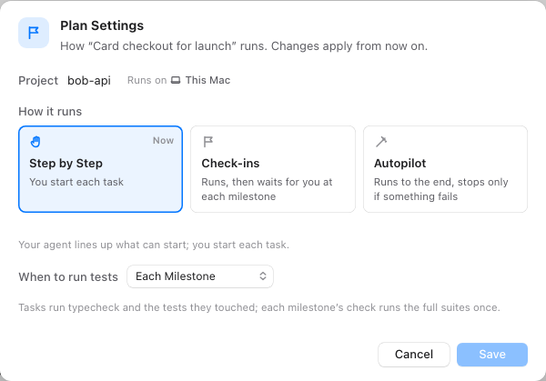
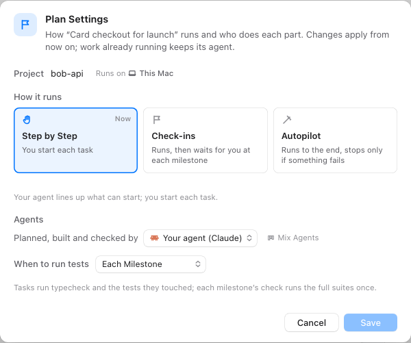
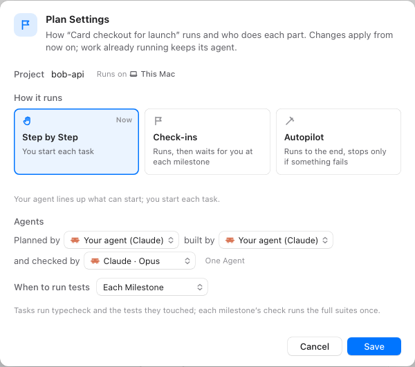

## What changes

Built on the Plan Settings PR (`feat/plan-settings`) (Plan Settings). Until that one is merged this branch carries its commit too: **review the last commit**.

New Plan lets you give the planner, the builder and the checker each an agent and a model of their own (BLG-982's Agents row, with Mix Agents). Once the plan exists, the header's agents button changes each part's agent, but not its model. Plan Settings now carries **New Plan's own Agents row** (`AgentRoles`):

- one agent for every part, or **Mix Agents** for one per part: any runtime, any model;
- it opens on the plan's agents as they are (a planner or checker it never picked reads as its builder);
- Save sends only the parts that moved, through `plans.setRoleAgent` (the builder first), and they apply to what starts from then on: work already running keeps its agent (the intro says so).

No API changes. The pure part (the plan's agents as the pickers show them, and what Save sends) is `plans/plan-settings-model.ts`.

## Before / after

Same Playwright run as the Plan Settings PR (`feat/plan-settings`): **before** is that PR, **after** is this branch.

| Before (Plan Settings) | After (this PR) |
|---|---|
|  |  |

Mix Agents, with the checker on Claude · Opus:

### Walk-through

| Before | After |
|---|---|
|  |  |
| When to run tests only | Mix Agents › Checker › Claude · Opus, then When to run tests, Save |

Full-size videos (MP4): [before](https://raw.githubusercontent.com/dayuer/beluga/2f815845e82b6f2d6f5e23d06ca4bdf89c3797cb/plan-settings/pr1-walk.mp4) / [after](https://raw.githubusercontent.com/dayuer/beluga/2f815845e82b6f2d6f5e23d06ca4bdf89c3797cb/plan-settings/pr2-walk.mp4).

## Both clients

The Mac sheet over an existing method (`plans.setRoleAgent`). The phone keeps its plan page's ⋯ › Plans with / Builds with / Checks with.

- [ ] API entry (`src/ipc/api.ts`) and handler (n/a)
- [ ] Core behavior + contract test (n/a)
- [ ] Shared model/actions (n/a)
- [ ] Terminal UI (n/a)
- [x] Mac app (`packages/mac`)
- [x] Row in `docs/parity.md` (`plans.setRoleAgent`)
- [ ] Commands, palette, menu bar, help (n/a)

## Test plan

- [x] `tests/mac-plan-settings.test.ts`: the plan's agents as the pickers show them (none, a builder only, mixed), and what Save sends (nothing when nothing moved, only the part that moved with its model, `null` for a part given back, the builder first).
- [x] `e2e/plan-settings.spec.ts`: Mix Agents, the checker on Claude · Opus, Save, reload: still mixed; One Agent gives it back.
- [x] `npm run typecheck` at the root and in `packages/mac`.
- [x] Full `npx vitest run` on the head commit: 722 files pass (1 skipped, as on `main`). The last commit's `Tested-on` matches its tree.

🤖 Generated with [Claude Code](https://claude.com/claude-code)
