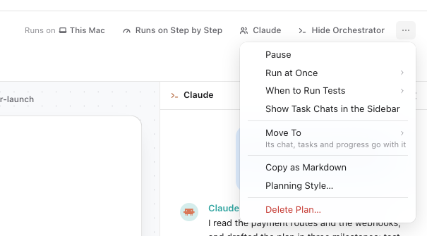
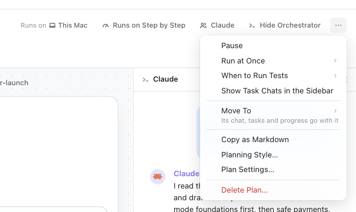
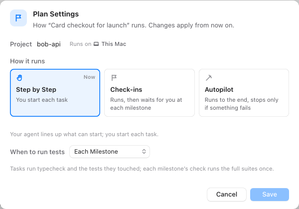

## What changes

A plan's **••• › Plan Settings…** (any plan that isn't done) opens one sheet with what New Plan asked, once the plan exists:

- its project, and where it runs (the computer it was made on), shown;
- **How it runs**: the three cards New Plan shows. Picking another says what changes before Save, in the words How It Runs uses;
- **When to run tests**: each milestone, or once at the end.

Save sends only what moved, through the plan's own setters (`plans.setAutonomy`, `plans.setTestsAt`), and one toast says what each did. Nothing changed: Save stays off. Full Autopilot stays in the header's How It Runs. No API, core or phone change.

- `plans/PlanSettingsSheet.tsx`: the sheet (`FormSheet`, New Plan's `AutonomyCards`, now exported from `PlanSheets.tsx`).
- `PlanPage.tsx`: the ••• item; `lib/sheets.ts` and `dialogs/native/WorkSheets.tsx`: the `plan_settings` sheet.
- Chinese for the item, the sheet's title, its intro and its toast. `docs/parity.md` and `docs/tasks-and-plans.md` name it.

## Before / after

The pictures are a Playwright run against the demo daemon (Chromium, 1280×820), the same script on both sides: **before** is upstream `main` at 0d159d0d8, **after** is this branch. The demo's terminal text is hidden.

| Before (upstream `main`) | After (this PR) |
|---|---|
|  |  |
| No way to change how a plan runs and when its tests run together | ••• › Plan Settings… |

The sheet:

### Walk-through

| Before (upstream `main`) | After (this PR) |
|---|---|
|  |  |
| The ••• menu has no Plan Settings… | ••• › Plan Settings… › When to run tests › Only at the End › Save: "Plan settings saved · From now on, milestone checks skip the test suites…" |

Full-size videos (MP4): [before](https://raw.githubusercontent.com/dayuer/beluga/2f815845e82b6f2d6f5e23d06ca4bdf89c3797cb/plan-settings/main-walk.mp4) / [after](https://raw.githubusercontent.com/dayuer/beluga/2f815845e82b6f2d6f5e23d06ca4bdf89c3797cb/plan-settings/pr1-walk.mp4).

## Both clients

A Mac sheet over existing API methods: no new method, view, protocol or phone change. The phone keeps its plan page's ⋯ items.

- [ ] API entry (`src/ipc/api.ts`) and handler (n/a: `plans.setAutonomy` and `plans.setTestsAt` already exist)
- [ ] Core behavior + contract test (n/a)
- [ ] Shared model/actions (n/a)
- [ ] Terminal UI (n/a)
- [x] Mac app (`packages/mac`)
- [x] Row in `docs/parity.md` (`plans.setAutonomy`, `plans.setTestsAt`)
- [ ] Commands, palette, menu bar, help (n/a)

## Test plan

- [x] New: `tests/mac-plan-settings.test.ts` (the ••• item and the sheet are wired; their Chinese is there) and `e2e/plan-settings.spec.ts` (change when tests run, Save, reload, open again: kept).
- [x] `npm run typecheck` at the root and in `packages/mac`.
- [x] Full `npx vitest run` on the head commit: 722 files pass (1 skipped, as on `main`). The last commit's `Tested-on` matches its tree.

🤖 Generated with [Claude Code](https://claude.com/claude-code)
