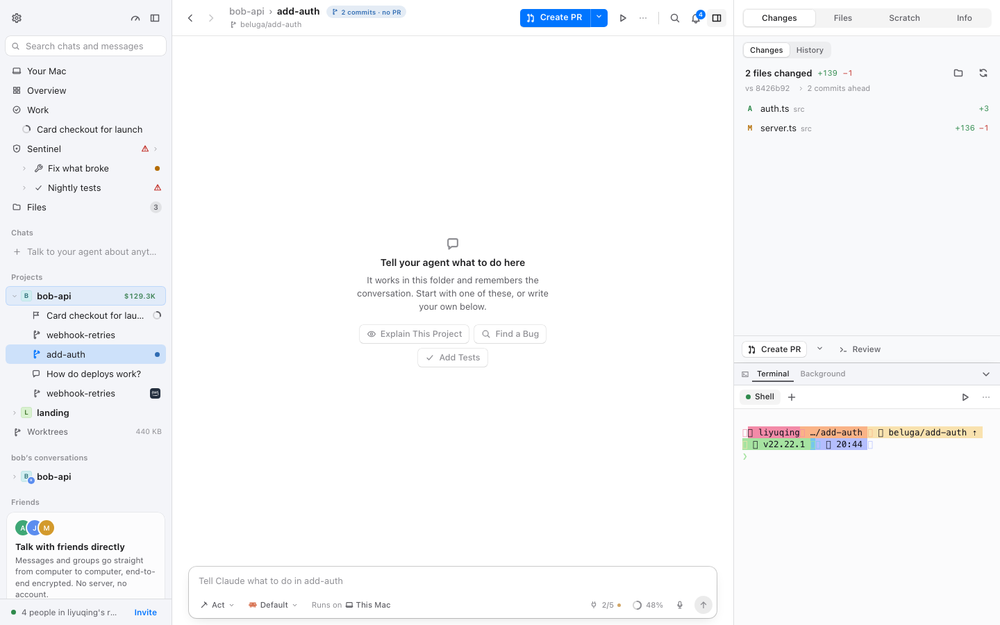
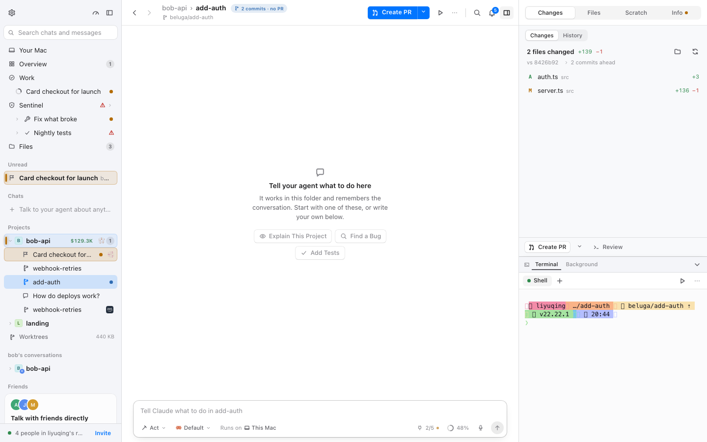
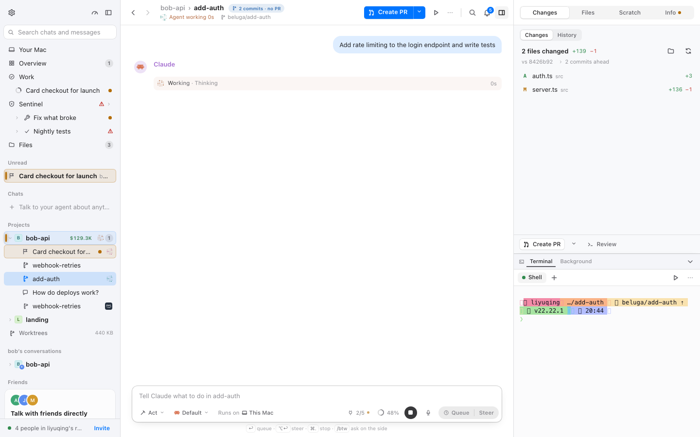
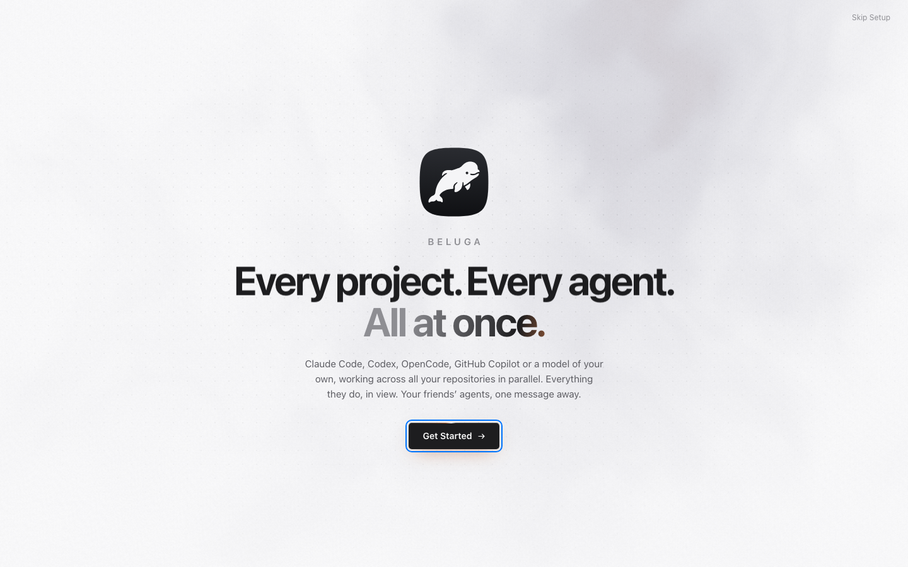
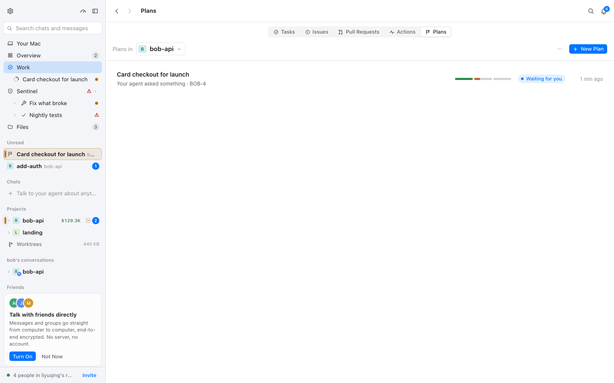
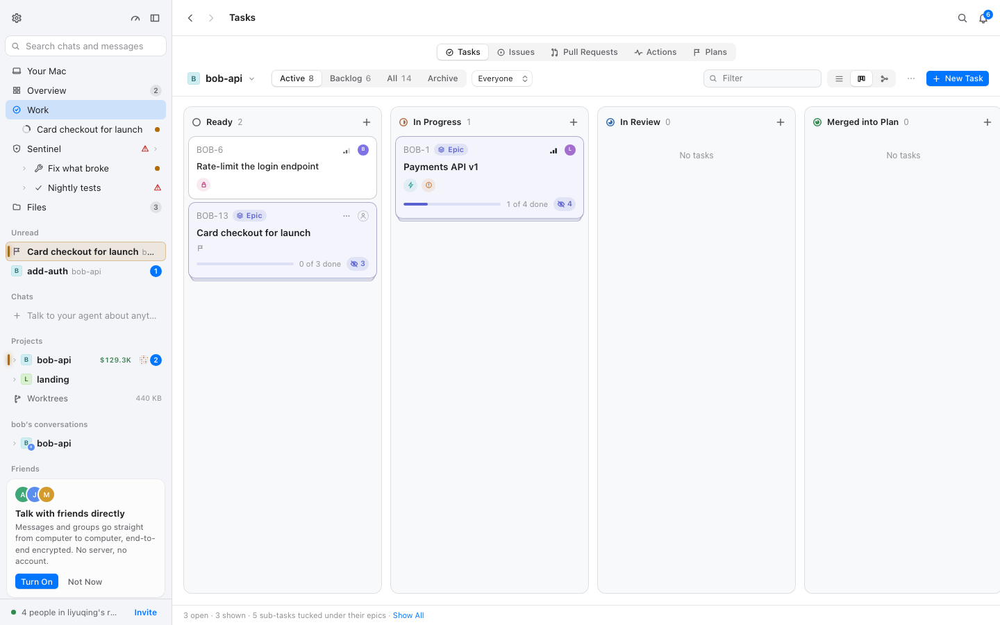
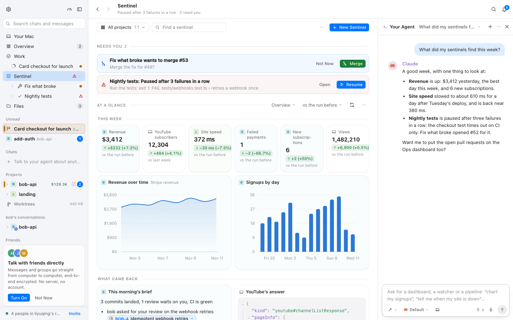
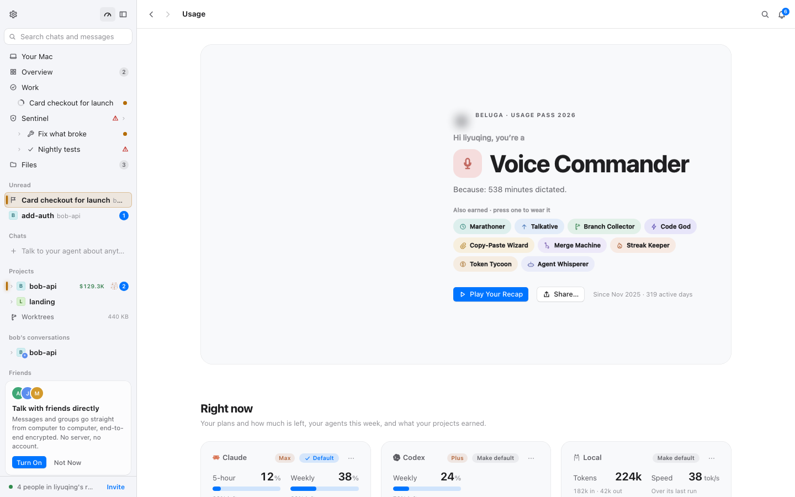

# 沉稳界面：改动前基线（M0，BLG-158）

- 采集时间：2026-11-11
- git：`ac0262200`（M0 的覆盖层还是空骨架，视觉改动为零）
- 工具：`node packages/mac/scripts/calm-check.mjs room workspace chatrun plan tasks sentinel usage onboarding`
- 场景：8 个 × 4 组合（沉稳开/关 × 动效 full/reduce），每组合独立浏览器 context
- 原始结果：`.context/calm/<场景>.json`（gitignore，随时可重跑）；代表截图：`docs/calm/img/`

## 结论（先看这一段）

1. **采集链路可用**：CLS、位移来源、仍在播放的动画、JS 改写 style 的元素、首帧 `data-calm` 都拿到了。
2. **覆盖层是空骨架**：`calm-on` 与 `calm-off` 的数字应当几乎相同。下表里的差异（room/workspace 的 jsMotion 42 对 0、sentinel 的 CLS 0.039 对 0.079）来自演示 daemon 在四个组合之间继续演化（某个 needs-you 行、某个 dot matrix 刚好在某一组合出现），不是覆盖层造成的。这正是「改动前」的基线。
3. **首帧生效**：8 个场景的 `calm-on` 组合 `firstFrame.calm` 全为 `true`，`calm-off` 全为 `false`，说明 `fork/calm/index.ts` 在应用画第一帧之前就设好了 `data-calm`。
4. **最需要 M1 处理的三件事**：侧栏 needs-you 的 `scan` 扫光（4.2s infinite）、当前步骤行的高度变化、悬停改尺寸（scale / font-weight）。

## 1. 每个场景的结果

CLS 排除 `hadRecentInput`；动画数是 `enter` 与结束两次 `getAnimations()` 合并后的条目；JS 动效元素数是 2 秒内 `style` 属性被改写的元素数；`firstFrame` 是 `DOMContentLoaded` 后第一帧 `<html data-calm>` 是否已设。

| 场景 | 组合 | CLS | 动画数 | JS 动效元素 | firstFrame |
| --- | --- | ---: | ---: | ---: | :---: |
| room | on / full | 0.000 | 0 | 42 | ✅ |
| room | on / reduce | 0.002 | 0 | 0 | ✅ |
| room | off / full | 0.000 | 0 | 0 | — |
| room | off / reduce | 0.000 | 0 | 0 | — |
| workspace | on / full | 0.000 | 0 | 0 | ✅ |
| workspace | on / reduce | 0.000 | 0 | 0 | ✅ |
| workspace | off / full | 0.000 | 2 | 42 | — |
| workspace | off / reduce | 0.000 | 0 | 0 | — |
| chatrun | on / full | 0.018 | 2 | 50 | ✅ |
| chatrun | on / reduce | 0.014 | 0 | 0 | ✅ |
| chatrun | off / full | 0.018 | 1 | 21 | — |
| chatrun | off / reduce | 0.011 | 0 | 0 | — |
| plan | on / full | 0.000 | 1 | 21 | ✅ |
| plan | on / reduce | 0.000 | 0 | 0 | ✅ |
| plan | off / full | 0.000 | 1 | 21 | — |
| plan | off / reduce | 0.000 | 0 | 0 | — |
| tasks | on / full | 0.000 | 1 | 21 | ✅ |
| tasks | on / reduce | 0.000 | 0 | 0 | ✅ |
| tasks | off / full | 0.000 | 1 | 21 | — |
| tasks | off / reduce | 0.000 | 0 | 0 | — |
| sentinel | on / full | 0.039 | 1 | 21 | ✅ |
| sentinel | on / reduce | 0.000 | 0 | 0 | ✅ |
| sentinel | off / full | 0.079 | 1 | 21 | — |
| sentinel | off / reduce | 0.000 | 0 | 0 | — |
| usage | on / full | 0.000 | 1 | 21 | ✅ |
| usage | on / reduce | 0.000 | 0 | 0 | ✅ |
| usage | off / full | 0.000 | 1 | 21 | — |
| usage | off / reduce | 0.000 | 0 | 0 | — |
| onboarding | on / full | 0.000 | 9 | 21 | ✅ |
| onboarding | on / reduce | 0.000 | 2 | 0 | ✅ |
| onboarding | off / full | 0.000 | 10 | 21 | — |
| onboarding | off / reduce | 0.000 | 2 | 0 | — |

代表截图：

| workspace · calm on | workspace · calm off（对照） |
| --- | --- |
|  |  |

| chatrun · 新消息时刻 | onboarding |
| --- | --- |
|  |  |

| plan | tasks | sentinel | usage |
| --- | --- | --- | --- |
|  |  |  |  |

## 2. 仍在播放的动画（改动前）

| 动画 | 类型 / 时长 | 出现在 | 解释 | 处置 |
| --- | --- | --- | --- | --- |
| `_scan_yhb7j_1` | CSS · 4.2s · infinite | 15 个组合（`on/full` 与 `off/full` 都有） | 侧栏 needs-you 行的扫光（`packages/mac/src/layout/signal.module.css:22-39`） | M1 `calm-state.css` 停掉扫光，只留琥珀底色与左亮边；§10 建议上游也停 |
| `_sheen_19xpr_1` | CSS · 6s · infinite | onboarding（含 reduce） | 引导页的装饰光 | keep-decor 例外；但 reduce 下仍未停，见问题表 |
| `_beam_19xpr_201` | CSS · 3.2s · infinite | onboarding（含 reduce） | 引导页的装饰光束 | 同上 |
| 未命名 `js` 动画 · 650 / 700 / 900 / 1300 / 1600ms | JS（framer-motion / WAAPI） | onboarding、chatrun、plan、tasks、sentinel、usage | `framer-motion` 的 `animate` props 与 `.animate()`；CSS 覆盖层管不到 | `fork/calm/live-gate.ts` 只管 live-motion；framer-motion 需要挂钩或上游；报告已把它列为 `framer-motion` 类别 |
| 未命名 `js` 动画 · `<1s`（多条） | JS | chatrun | 发送/到达时的 framer-motion 过渡 | 同上 |
| DotMatrix 的 `--lit` 改写 | JS style 改写 | room / workspace / chatrun / plan / tasks / sentinel / usage | `components/DotMatrix.tsx` 用 live-motion 的时钟写 25 个点的 `--lit`，2 秒约 30 次/点 | M1 `live-gate` 只放行 `[data-current]`，其余停在静止帧 |
| LiveDot 的 `--breath` | JS style 改写 | plan 视图 | `plans/marks.tsx:79-84` 的呼吸点 | 同上（live-gate） |

`reduce` 组合里 CSS 动画基本归零（`_scan_` 被 `signal.module.css` 自己的 media query 关掉）；剩下的 2 条是 onboarding 的 `_sheen_` / `_beam_`，见问题表。

## 3. 问题表

| 文件:行 | 现象 | 改法 | 状态 |
| --- | --- | --- | --- |
| `packages/mac/src/layout/signal.module.css:22-39` | needs-you 行 4.2s 无限扫光；calm-on/full 仍能看到 15 次 | `calm-state.css` 停扫光，保留琥珀底色 + 左亮边；§10 建议上游也停 | 基线 → M1（BLG-162） |
| `packages/mac/src/chat/steps/steps.module.css:35-41` 与 `:434-441` | 步骤变成「当前」时行高 22px → 26px 并加内边距，下面的行被推下 | 行高固定，当前状态只换底色/文字色；覆盖层 + 上游 PR | 基线 → M1 + §10 |
| `packages/mac/src/layout/signal.module.css:7-10` | 未读名字 `font-weight: 650`，行宽变化 | 颜色/字重放进固定宽度的槽位，或只用颜色 | 基线 → M1 + §10 |
| `packages/mac/src/components/zoom-avatar.module.css:12-13` | 悬停 `scale(1.04)` | `calm-motion` 定点：`:hover { transform: none }`；§10 上游 | 基线 → M1 |
| `packages/mac/src/dialogs/native/room.module.css:105-106` | 悬停 `scale(1.08)` | 同上 | 基线 → M1 |
| `packages/mac/src/components/views/inline.module.css:46-47` | 悬停 `scaleY(1.12)` | 同上 | 基线 → M1 |
| `packages/mac/src/components/markdown/markdown.module.css:539-542` | 悬停 `font-weight: 500` | 定点改回只改颜色；§10 上游 | 基线 → M1 |
| `packages/mac/src/views/usage/your-card.module.css:120-122` | 悬停 `translateY(-1px)` | 定点去掉位移；§10 上游 | 基线 → M1 |
| `packages/mac/src/call/call.module.css:372` | `cubic-bezier(0.34, 1.4, 0.64, 1)`，340ms | `calm-motion` 覆盖曲线/时长；§10 上游 | 基线 → M1 |
| `packages/mac/src/tasks/tasks.module.css:952` | `cubic-bezier(0.34, 1.45, 0.64, 1)`，360ms | 同上 | 基线 → M1 |
| `packages/mac/src/chat/dictation.module.css:67` | `cubic-bezier(0.3, 1.5, 0.5, 1)`，260ms | 同上 | 基线 → M1 |
| `packages/mac/src/views/usage/leaderboard.module.css:119,235,253` | 700ms / 800ms 的过渡（榜单换位滑动） | 令牌降到 ≤200ms；§10 上游 | 基线 → M1 + §10 |
| `packages/mac/src/chat/steps/steps.module.css:544-555` | `ring` 2.2s 无限、`scale(1.3)` | `calm-motion` 关关键帧；§10 上游 | 基线 → M1 |
| `packages/mac/src/components/ui.module.css:318-329` | Working 三点 `blink` 无限 | `calm-motion`/`calm-state` 关；§10 上游 | 基线 → M1 |
| `packages/mac/src/views/usage/usage.module.css:637` | `sheen` 1.3s 无限 | 同上 | 基线 → M1 |
| `packages/mac/src/layout/Shell.module.css:7-13` | 入场 1.6s、`scale(1.08)` | 一次性引导动画；reduce 已关 | keep-decor 例外 |
| `packages/mac/src/onboarding/**` | `_sheen_` / `_beam_` 在 reduce 下仍在跑（2 条） | 给 onboarding 的场景补 `prefers-reduced-motion` 停用；属 keep-decor，但 reduce 必须停 | 待修（M1 `calm-motion` 可统一兜底） |
| `packages/mac/src/chat/max-fire.ts:449` | rAF 驱动的火焰，静态扫描不报 | 用户显式开启的装饰效果；M1 先记为范围外，后续单独决定是否受沉稳模式约束 | 待定 |
| `packages/mac/src/tasks/TaskBoard.tsx`、`chat/steps/AgentSteps.tsx`、`views/usage/Recap.tsx`、`showcase/*` | framer-motion 的 `animate` props，CSS 管不到 | 报告新增 `framer-motion` 类别（6 条）；`showcase` 是独立窗口，范围外；其余挂钩/上游 | 已登记 |

## 4. 审计

**首帧**：8 个场景 × `calm-on` 全部 `firstFrame.calm = true`；8 个 `calm-off` 全部 `false`。`main.tsx` 的一行 import 在 `startI18n().then(render)` 之前执行，模块体同步设置 `data-calm`，早于第一次绘制。

**报告有没有漏写法**：`fork-calm` 原有 9 类（keyframes、infinite、element-animate、inline-motion、live-motion、hover-size、spring、overscale、long-duration）。基线运行抓到 `calm-check` 里的未命名 `js` 动画，追查后确认是 `framer-motion` 的 `animate` props；静态报告原先看不到它，本次补了第 10 类 `framer-motion`（6 条：TaskBoard、AgentSteps、Recap、showcase ×3）。快照从 436 条更新为 442 条：
`CALM_UPDATE=1 npx vitest run tests/fork-calm.test.ts`。

仍不在静态报告里的：`requestAnimationFrame` 自绘循环（`chat/max-fire.ts` 的火焰、`layout/arrange-drag.ts` 与 `tasks/TaskBoard.tsx` 的拖拽自动滚动）。前两者是行为触发、只在拖拽时跑；火焰是用户显式开启。它们由 `calm-check` 的 `jsMotion` 在真机上兜底，问题表已记为「待定」。

**覆盖层是空骨架**：`calm-on/off` 的数字应相同；表中的差异来自演示 daemon 在四组合之间继续演化。`workspace` 的 `on/full` jsMotion 0 而 `off/full` 42、`sentinel` 的 CLS 0.039 对 0.079，都是演示状态差异，不是覆盖层效果。

**检查链自身**：`docs/calm-ui.md §9` 的命令与 JSON 形状与实际输出一致；`calm-check` 探活失败时的两条启动命令包含 `BELUGA_ALLOW_ORIGINS`（普通 Chromium 的来源不在 daemon 默认白名单里）；`onboarding` 场景用 `?welcome` 强制显示，否则 reduce 组合写了 `beluga.prefs.v1`，应用会认为「引导之前就用过 Beluga」而跳过。

## 5. 下一步（M1）

1. 往 `fork/calm/calm-tokens.css`、`calm-motion.css`、`calm-overlays.css`、`calm-state.css` 填规则，然后重跑同一命令。
2. 期望：`calm-on/full` 的动画数从 1–2 降到 0（只剩 `[data-current]` 的白名单），`jsMotion` 从 21–50 降到只含当前步骤；CLS 不高于本基线。
3. `reduce` 组合的 CSS 动画应为 0（onboarding 的 `_sheen_`/`_beam_` 也要停）。
4. 完成后把本章的表格重录为「改动后」，与本文件并排对比。
