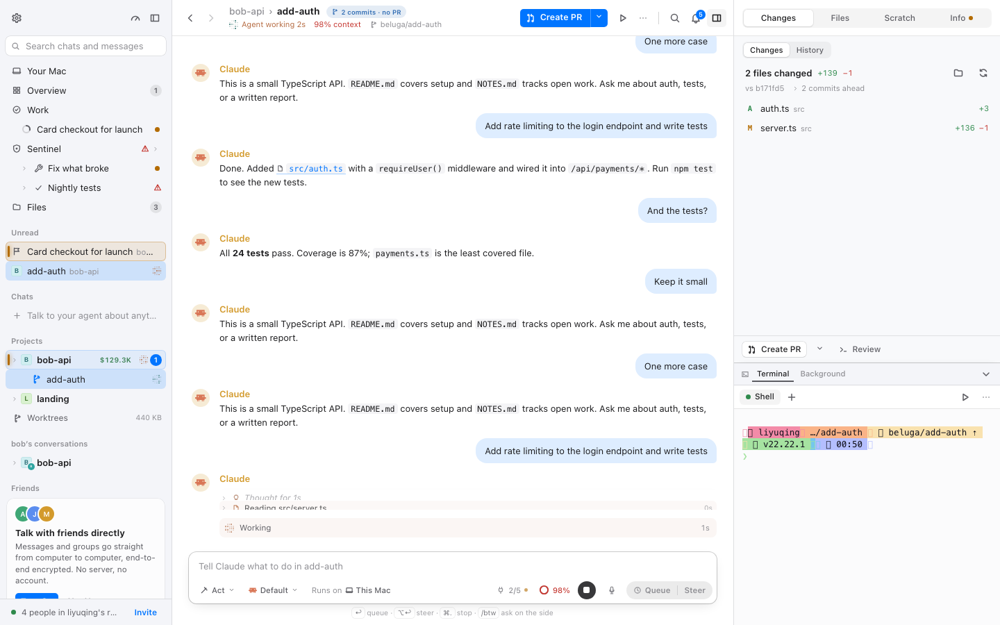
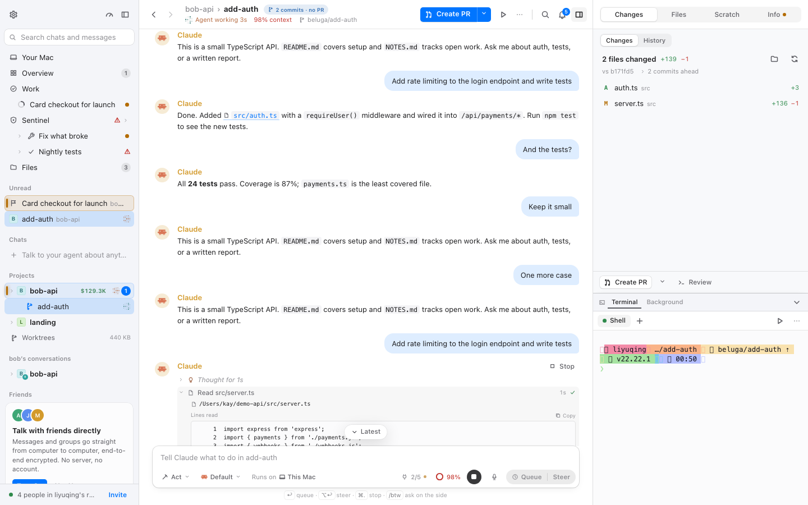
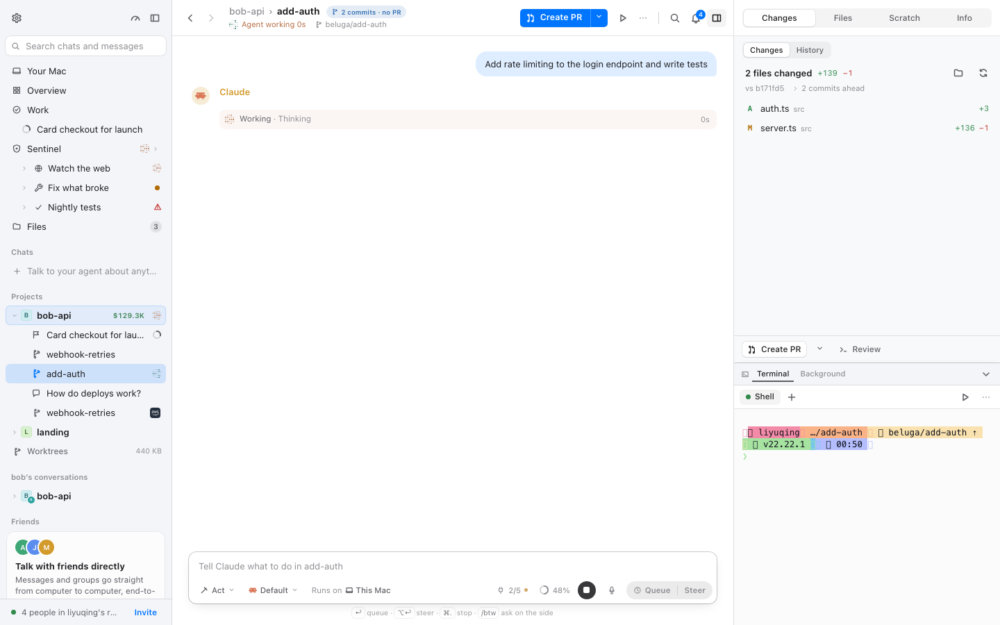
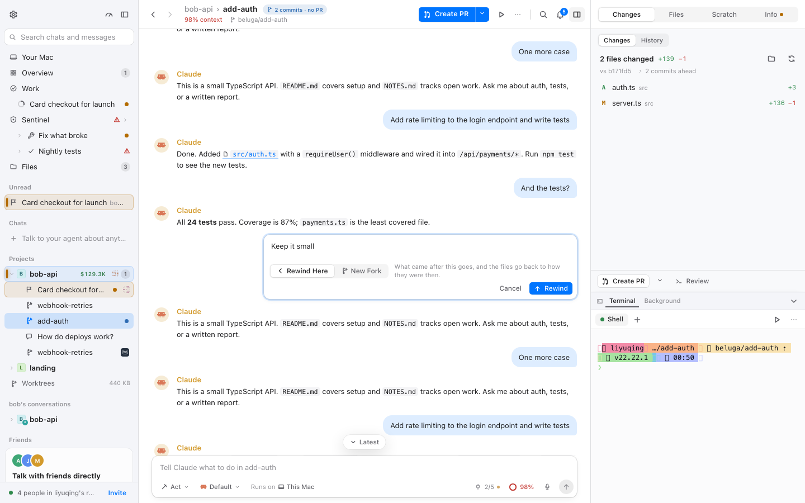
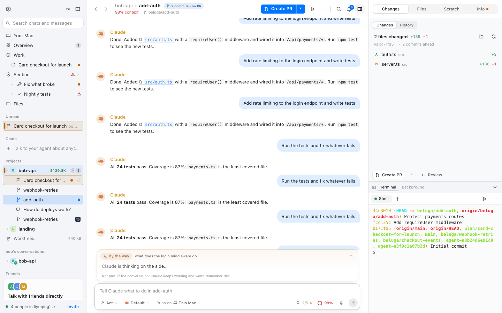
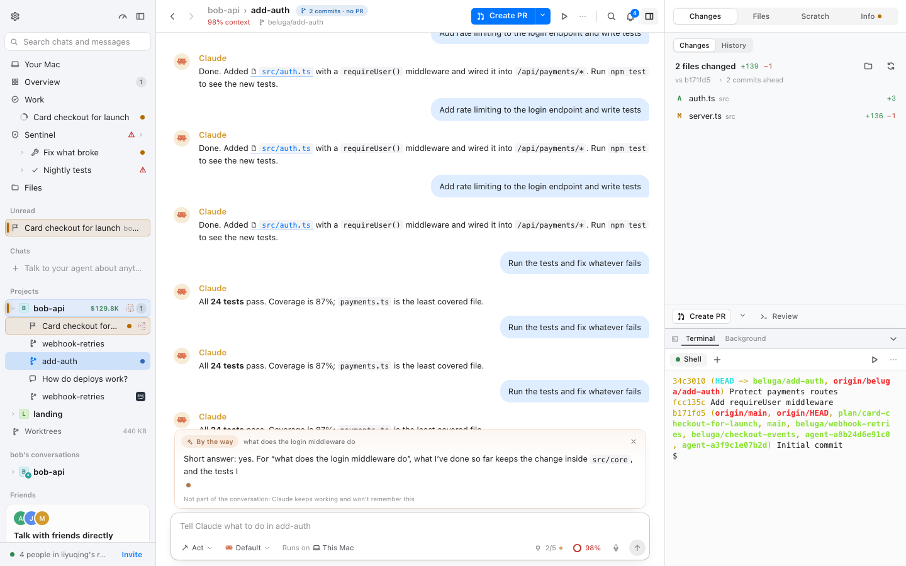
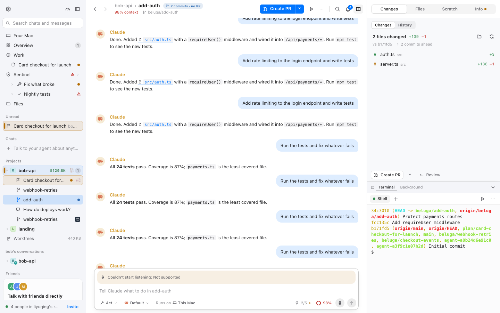
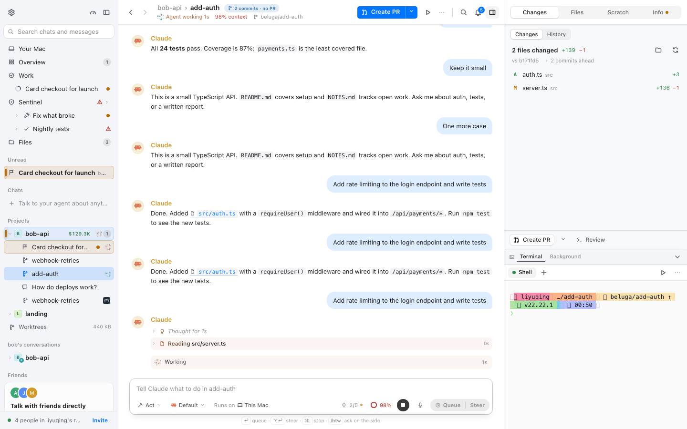

# 沉稳界面 · 对话页逐页验收（M3 · BLG-170）

- 采集时间：2026-11-12 00:50–01:24（WIB）
- git：`9f525f257`（`plan/mac-fork` 上 M2 合并后的 HEAD；本报告分支 `beluga/blg-170-m3`）
- 命令行：`BELUGA_URL=http://localhost:1421 node packages/mac/scripts/calm-check.mjs room workspace chatrun chatsteps chathover chatbtw chatdictation shellsidebar shellpanel shellnotifications overview usage search shared palette settings person diff files terminal dock picker`（分三次跑，中途修了两个被上游改名弄坏的场景选择器：`diff`/`shellpanel` 的标签现名 `Changes`，`shared` 的行现名 `Files`；`chatbtw`/`chatdictation` 后来单跑一次以补 `thinkingAnimations`/`gettingAnimations` 字段）
- 演示 daemon：`BELUGA_HOME=/tmp/calm-blg170 BELUGA_ALLOW_ORIGINS=http://localhost:1421 npm run dev`（一次性 home，演示数据）；vite 占 1421
- 原始结果：`.context/calm/<场景>.json` 与 `.context/calm/img/`（gitignore，可重跑）；代表截图拷贝在 `docs/calm/img/`
- 机器负载：采集期间 other worktrees 在跑，`uptime` 的 1 分钟负载约 20–30（10 核）。时序类数字（CLS 的到达时刻、anchor）以此为前提；e2e 的最终判定在里程碑最后统一重跑。

## 验收方法（四步）

1. **逐页录屏**：每个场景在四个组合下各起一个全新浏览器 context（`calm-on/full`、`calm-on/reduce`、`calm-off/full`、`calm-off/reduce`），记录 CLS 与位移来源、`getAnimations()` 仍在播放的动画、2 秒内被 JS 改写 style 的元素、首帧是否已有 `data-calm`，并在 enter / loaded / hover / select / 场景自定义时刻截图。
2. **时刻覆盖**：进入（enter）→ 加载完成（loaded）→ 新内容到达（chatrun 的 `new`、chatsteps 的 `running`）→ 悬停（step-hover、message-hover、侧栏行 hover）→ 选中/展开（step-open、edit-open、侧问卡、键盘收起展开）。
3. **reduced-motion**：同一个场景在 `calm-on/reduce` 下重看；CSS 动画应为 0，`getAnimations()` 应为 0。
4. **问题成表**：每条问题给出文件:行、现象、改法、建议由哪一层修（覆盖层 / 挂钩 / 上游 PR），状态列在本阶段统一写「待 BLG-174」，最终三种终值由 BLG-175 写。

## 1 页面清单：场景 ↔ 页面/视图 ↔ 导航路径

| 场景 | 页面 / 视图 | 覆盖的时刻 | 导航（脚本步骤） |
| --- | --- | --- | --- |
| `chatrun` | 工作树对话 `bob-api › add-auth` | 进入、加载完成、**新内容到达**、悬停、选中 | 侧栏 `bob-api` → `add-auth`；输入框发送 “Add rate limiting to the login endpoint and write tests”；1s 截 `new`；再上滚 400px 后连发 3 条短 prompt，测滚动锚定与「N new」 |
| `chatsteps` | 同上，Claude 运行中的步骤列表 | 运行中、悬停、展开/收起 | 打开 `add-auth`，发送同一 prompt；2.2s 截 `running`；悬停当前步骤行 `[data-step][data-current]`；点行头展开 → `step-open`；再点收起 → `step-closed` |
| `chathover` | 同上，消息悬停与编辑 | 悬停、选中 | 悬停最后一条自己的消息（`Edit message` 浮出）；打开编辑框 → `edit-open`；Esc 关闭 |
| `chatbtw` | 同上，侧问卡（`/btw`） | 新内容到达（思考→回答）、关闭 | 输入 `/btw what does the login middleware do` 回车；0.6s 截 `thinking`；4s 截 `answer`；点关闭 |
| `chatdictation` | 同上，输入框的语音条 | 展开 | 点输入框旁 `Speak instead of typing`；0.7s 截 `getting`（本机不支持麦克风/Whisper：较早一次运行停在「Getting ready…」，最终运行是「Couldn't start listening: Not supported」，见 §7） |
| `picker` | 输入框的模型/思考档浮层 | 展开 | 点输入框的 `Default`（aria-label “Agent, model and effort”） |

归属说明：`usage`（用量）、`plan`/`tasks`/`sentinel` 属数据/任务区报告（BLG-171）；`settings`、`person`、`palette`、`onboarding`、`call` 属引导/对话框区报告（BLG-172）。本次运行里顺带采集了它们，但判定写在那两份报告里，本报告不重复。

## 2 每页结果

格式：`CLS · CSS 动画数 · JS 动效元素数`；`data-calm` 首帧是 `calm-on/full` 的观测。

| 场景 | on/full | on/reduce | off/full | off/reduce | 首帧 data-calm（on） |
| --- | --- | --- | --- | --- | :---: |
| chatrun | 0.082 · 0 · 0 | 0.062 · 0 · 0 | 0.080 · 1 · 21 | 0.030 · 0 · 0 | ✅ |
| chatsteps | 0.090 · 0 · 0 | 0.069 · 0 · 0 | 0.058 · 2 · 42 | 0.079 · 0 · 0 | ✅ |
| chathover | 0.003 · 0 · 0 | 0.000 · 0 · 0 | 0.000 · 2 · 42 | 0.000 · 0 · 0 | ✅ |
| chatbtw | 0.008 · 0 · 0 | 0.005 · 0 · 0 | 0.005 · 2 · 42 | 0.005 · 0 · 0 | ✅ |
| chatdictation | 0.000 · 0 · 0 | 0.000 · 0 · 0 | 0.000 · 2 · 42 | 0.000 · 0 · 0 | ✅ |
| picker | 0.003 · 0 · 0 | 0.000 · 0 · 0 | 0.000 · 2 · 42 | 0.000 · 0 · 0 | ✅ |

代表截图：

| chatsteps · 当前步骤（calm 开） | chatsteps · 展开一步 |
| --- | --- |
|  |  |

| chatrun · 新内容到达 | chathover · 消息悬停与编辑 |
| --- | --- |
|  |  |

| chatbtw · 思考中 | chatbtw · 答案 |
| --- | --- |
|  |  |

| chatdictation · 无法开始监听 | 对照：calm 关（同场景同刻） |
| --- | --- |
|  |  |

## 3 仍在播放的动画清单及理由（calm-on/full）

| 场景 | calm-on/full 的 CSS 动画 | calm-on/reduce | 说明 |
| --- | ---: | ---: | --- |
| chatrun | 0 | 0 | 运行结束后测量；运行期间的当前步骤 Shimmer 是 JS 时钟（`getAnimations` 不含），见下 |
| chatsteps | 0 | 0 | 步骤行的进场/退场是 framer-motion（JS 驱动，不在 CSS 动画表里），见下 |
| chathover | 0 | 0 | — |
| chatbtw | 0 | 0 | 思考图标的 `twinkle` 1.4s、书写光标 `breathe` 1s、答案 `shimmer` 1.6s 都被 M1 关掉 |
| chatdictation | 0 | 0 | 「准备中」三点的 `hop` 900ms 循环被 M1 关掉（静止三点）；最终运行截到的是错误条（无动画） |
| picker | 0 | 0 | 浮层入场由 `calm-overlays.css` 统一 |

作为对照，`calm-off/full` 的同一批场景里能看到：侧栏 needs-you 行的 `_scan_`（4.2s infinite，1–2 条）、`calm-off/full` 的 jsMotion 42 个元素（DotMatrix 每点约 30 次/2s）。`chatbtw` 场景在思考时刻单独取了一次动画（JSON 的 `thinkingAnimations`）：`calm-off/full` 有 `_twinkle_` 1.4s infinite（侧问卡图标）与 `_shimmer_` 1.6s infinite（答案占位）；`calm-on/full` 为空——正是 M1 关掉的两条循环。calm 开时以上全部是 0。

说明（逐条理由）：

| 动画 | 类型 / 时长 | 出现在 | 为什么仍然在 | 处置建议 |
| --- | --- | --- | --- | --- |
| 当前步骤的 Shimmer（`StepRow.tsx:46-58`） | JS（live-motion 时钟，约 15 次/秒，无 CSS animation） | Claude 工作时，当前步骤行的文字 | `fork/calm/live-gate.ts` 有意放行的**唯一循环**：它表示「这一步正在做」，不是装饰；CSS 既关不掉也不该关 | 保留（M2 契约） |
| 步骤行的进场/退场（`AgentSteps.tsx:249-272`） | framer-motion，0.3s，高度 0→auto + 淡入 | 新步骤到达、步骤折叠 | 覆盖层是 CSS，管不到 framer；`useStill()` 只读系统/偏好里的 reduced motion，没读沉稳开关。实测单条位移 0.029–0.041，且 full 比 reduce 高约 0.02 CLS | **覆盖层做不到 → 挂钩**：`useStill()` 读 `useCalm()`（见 CH-02） |
| 消息飞入（`flight.ts:32,34,146`） | WAAPI，420ms，`cubic-bezier(.2,1.08,.32,1)` 弹簧 | 发送消息后，消息从输入框飞入列表 | 代码只在 `reducedMotion()` 时走「瞬时」分支；沉稳开关不在判断里 | **挂钩**：`calmOn()` 时走 `data-flown="instant"`（见 CH-06） |
| keep-decor 的入场（`Shell.module.css:7-13` 的 `arrive`、引导页） | CSS，1.6s 一次性 | 从欢迎页进入外壳时 | 计划批准的 keep-decor，覆盖层按锚点放行 | 保留（见 shell.md / BLG-172） |

calm-on/reduce 下以上全部为 0（CSS 被 M5 关掉；framer 的 `useStill()` 因 reduce 偏好为 true 而用 0 时长；flight 走 `reducedMotion()` 的分支：克隆不出现，只剩上游允许的 120ms 淡入）。

## 4 reduced-motion 下的结果

| 场景 | calm-on/reduce CSS 动画 | calm-on/reduce JS 动效 | 结论 |
| --- | ---: | ---: | --- |
| chatrun | 0 | 0 | 无动画 |
| chatsteps | 0 | 0 | Slot 的 0.3s 高度动画因 reduce 偏好 → 0 |
| chathover | 0 | 0 | 无动画 |
| chatbtw | 0 | 0 | 上游媒体查询 + M5 |
| chatdictation | 0 | 0 | 呼吸环隐藏、strip/dots/word 全停 |
| picker | 0 | 0 | 浮层 only 淡入也被 M5 关掉 |

- `calm-on/reduce` 的 `animations` 在所有对话场景为 0；`jsMotion` 为 0（live-gate 也需要 reduce 时停时钟）。
- 输入框的语音条在 reduce 下：`dictation.module.css:275-289` 的媒体查询停掉 strip/word/dots/stopMark 动画并隐藏呼吸环；calm 的 M5 再兜一层。
- 步骤列在 reduce 下：`AgentSteps` 的 `useStill()` 为 true → 0.3s 的 Slot 动画变成 0；`steps.module.css:597-620` 停 shimmer/wait ring。
- 结论：本区没有在 reduce 下仍在播放的动画。

## 5 CLS 表（calm-on 进入 → 加载完成）

| 场景 | calm-on/full CLS | calm-on/reduce CLS | 记录到的非输入位移 | 归因 / 处置 |
| --- | ---: | ---: | --- | --- |
| chatrun | 0.082 | 0.062 | 队列条 `_tray_` 0.0098；步骤槽 `_slot_` 0.0065+；Working 行 0.0075；`_wrap_` 0.011；完成态 `_hoverActions_` 0.0075 | 运行期间的新内容到达：队列条插入（CH-04）、步骤行展开（CH-02）、Working 行推进（CH-05）。没有加载期位移 |
| chatsteps | 0.090 | 0.069 | `_slot_` 多条 0.029–0.041；Working 行 0.0075；`_hoverActions_` 0.0075 | 与 chatrun 相同；full 比 reduce 高约 0.02 来自 framer 高度动画（CH-02） |
| chathover | 0.003 | 0.000 | `html[data-calm] > body` 0.0028 @1.3s | 首屏后的整页微小移动，见 §7；其余 0 |
| chatbtw | 0.009 | 0.005 | `body` 0.0039 @1.9s；输入框区 `_wrap_` 0.0015–0.002 ×3 | 侧问卡插入输入框上方（活内容增长，固有） |
| chatdictation | 0.000 | 0.000 | 无 | 本次运行点麦克风得到「Couldn't start listening: Not supported」错误条（本机不支持），插入不产生记录到的非输入位移 |
| picker | 0.003 | 0.000 | `body` 0.0028 @3.3s | 首屏后的整页微小移动（同 chathover），浮层本身 0 位移 |

各条非 0 的来源与归因（calm-on/full；括号里是该 shift 的 `sources[0]`）：

- `chatrun`（0.082）：`_wrap_1mryu_1`（输入框区，队列条出现时为 0.0098/0.011）、`_slot_313uy`（步骤行 0.0065）、`_working_1jak8`（Working 行 0.0075）。全部发生在 Claude 运行、消息入队、步骤到达时（t≈6–16s），不是进入页面时。
- `chatsteps`（0.090）：`_slot_313uy` 的 0.029–0.041（每次步骤到达一条）、`_working_1jak8` 0.0075。它是对话页最大的位移群，正是 CH-02 的 framer 高度动画 + 插入本身。
- `chathover`（0.003）：`html[data-calm="1"] > body` 0.0028 @1.3s。整页 body 移动约 2–3px；calm-off 同场景为 0，M1 的 room 也记录过 0.003。覆盖层没有任何改布局的规则（只改颜色、动画、过渡、行高）；暂记为「首屏后页面自身的微小移动」，由 BLG-175 复核是否可复现。
- `chatbtw`（0.008）：输入框区 `_wrap_1mryu_1` 的 0.0015–0.002，来自侧问卡插入输入框上方；活内容增长，页面层面不可避免。`chatdictation` 最终运行是错误条，未记录到位移。

**结论**：calm-on/full 的对话页 CLS 不由「加载」产生（enter → loaded 的首屏是 0 或近似 0），而由**Claude 运行期间的新内容到达**产生：步骤行用 framer-motion 做高度动画（CH-02，可修但不会归零）、消息队列条插入输入框上方（CH-04，固有/上游）、Working 行随内容增长移动（CH-05，固有）。这些都不属于「进入页面时布局抖动」。calm-on/reduce 下 Slot 动画时长为 0，同一场景的 CLS 比 full 低约 0.02（chatrun 0.082→0.062，chatsteps 0.090→0.069），佐证其中一部分位移来自高度动画；剩下的部分是内容插入的固有位移。CH-03 的锚点问题本次没有定论，未计入 CLS 归因。

## 6 问题表

| ID | 文件:行 | 现象 | 改法 | 建议归属 | 状态 |
| --- | --- | --- | --- | --- | --- |
| CH-01 | `chat/steps/steps.module.css:434-446` | 当前步骤行 `.rowCurrent` 比完成态高 4px（min-height 26 vs 22、padding 2 vs 1、margin-top 1）且标题 500；步骤从「进行中」变「完成」时行高变化，下面的行被推 | 已有覆盖层 S7/S8（`calm-state.css`）：行高固定 22px、`margin-top:0`、标题 `font-weight:inherit`。实测同一条当前步骤行：calm 开 22px、calm 关 26px（`chatsteps` 的 `currentRow`），修复生效 | 覆盖层（M1 已生效，保留） | 待 BLG-174 |
| CH-02 | `chat/steps/AgentSteps.tsx:249-272`；`chat/steps/steps.module.css:650-673` | 新步骤到达时 framer-motion 用 `height: 0 → auto` 0.3s 展开（`.folding` 另有 grid-template-rows 过渡）；calm 开、动效 full 时仍在播，实测单条位移 0.029–0.041；同场景 reduce（0 时长）的 CLS 比 full 低约 0.02，说明动画本身加剧了位移，其余是内容插入的固有位移 | 挂钩：`useStill()` 加 `useCalm()`（2 行 + import；行为接入点，补 TOUCHPOINTS 行），沉稳时 0 时长；覆盖层同时把 `.folding` 的 transition 归零。上游可进一步改成只做透明度、不做布局动画（对所有用户都稳）。注意：这个改法让到达不再「动画着挪」，但内容插入本身的位移仍在，不会让 CLS 归零 | 挂钩 + 覆盖层（上游 PR 候选） | 待 BLG-174 |
| CH-03 | `chat/ChatLog.tsx:161-180` | 虚拟列表按估算高度先画、测量后改真高，是已知的挪位风险。本次 `chatrun` 的 anchor 测量在 `calm-on/reduce` 两次独立运行都得到 −229px，其余组合 0；但该组合的 `hint` 为 null，而发送本身会触发「回到最新」（`flight.ts` 的 `launchFlight` 派发 `beluga:chat-bottom`），无法区分是列表重测还是主动回底，**本次不能证实/证伪** | `useVirtualizer` 加 `shouldAdjustScrollPositionOnItemSizeChange: () => !stick.current`（`docs/calm/hooks.md §2.2` 的一行修法，候选）；BLG-175 用更干净的测法复核：上滚后不再发送，让运行自己产生新行再测锚点。对所有用户都是修位移，适合提上游 | 上游（PR 候选）/ 挂钩兜底 | 待 BLG-174 |
| CH-04 | `chat/queue.module.css:3-14`；`chat/Composer.tsx:606` | 发送的消息进入队列条时，条插入输入框上方，整个输入框区上移（实测 0.0098–0.0107，calm 开/关都有；calm 下 `rise` 动画被关，插入仍是瞬时的） | 活内容增长，页面层面不可避免；上游若要在意，可把队列条改为覆盖在输入框上方或用固定高度槽位。本区记为固有 + 理由 | 上游（PR 候选，优先级低） | 待 BLG-174 |
| CH-05 | `chat/chat.module.css:233-259` | Working 行出现与被上方新步骤推动（实测 0.0075 起）；行自身的 min-height/等宽数字已稳，移动来自内容增长 | 不改行样式（内容插入的固有位移）；CH-02 的 Slot 修好后复测幅度。归入 §5 的固有理由 | 上游（固有位移，不改样式） | 待 BLG-174 |
| CH-06 | `chat/flight.ts:32,34,146` | 发送消息的飞入动画是 WAAPI 420ms 弹簧，只用 `reducedMotion()` 判断；沉稳开、动效 full 时仍然飞 | 挂钩：`land()`/`launchFlight()` 里 `calmOn()` 走现有的「瞬时」分支（`data-flown="instant"`，2 行 + import；行为接入点，补 TOUCHPOINTS 行） | 挂钩 | 待 BLG-174 |
| CH-07 | `chat/btw.module.css:14,45,100,116` | 侧问卡入场 `rise` 160ms、思考图标 `twinkle` 1.4s 循环、书写光标 `breathe` 1s 循环、答案 `shimmer` 1.6s 循环 | calm 的 M1 已全部关掉（循环 0、入场瞬时）；reduce 下上游媒体查询也停。若嫌「瞬时出现」太硬，可给 `[aria-label="Side question"]` 补一条 160ms 淡入（覆盖层，候选） | 覆盖层（已有的关闭 + 可选淡入） | 待 BLG-174 |
| CH-08 | `chat/dictation.module.css:20-27,67,123,218,227` | 语音按钮的 260ms 弹簧过渡、停止标记 `pop` 260ms 弹簧、「准备/书写」条的 `open` 280ms 弹簧、逐词 `wordIn` 420ms；另有 dots/blink 无限循环 | calm：M1 关 keyframes（pop/open/wordIn/dots/blink），M3 把过渡 clamp 到 160ms + ease-standard（弹簧曲线消失）；reduce 下上游媒体查询全停并隐藏呼吸环。监听态（`stopMark` 出现）需要 Whisper 模型，本机未下载，脚本只能到「准备中」，监听态按静态规则 + 人工走查确认（§7） | 覆盖层（M1/M3 已生效） | 待 BLG-174 |
| CH-09 | `chat/dictation.module.css:49-58` | 监听时呼吸环用 rAF 把 `--level` 写成 `scale(1 + level*.55)`（最大约 1.55 倍） | 这是**声音反馈**，只在按住说话时存在、不循环；它随音量连续变化，不是弹簧。沉稳模式保留。若 M3 认为幅度过大，可覆盖层把系数降到 0.3 | 覆盖层（候选，默认不改） | 待 BLG-174 |

## 7 审计备注

**演示数据的局限**

- 演示 daemon 的 agent 是回放脚本，步骤 ID 为 `toolu_demo_*`；每次运行的步骤序列相同但时序受机器负载影响。四组合顺序执行，第一个组合（`calm-on/full`）会承担面板/文件列表的冷缓存，后续组合是热缓存——`workspace` 的 CLS 只在第一个组合出现，原因就是这个，不是覆盖层。
- `/btw` 的状态存在 daemon 里，会跨浏览器 context 保留；`chatbtw` 场景结束前主动关闭，后续场景的输入框高度不受影响（`chatsteps`/`chatdictation` 开头也兜底关闭一次）。
- 语音监听态无法脚本化：本机不支持麦克风/没有 Whisper 模型。较早一次运行点麦克风停在「Getting ready…」（dots 的 hop 循环在 calm 下已被关），最终运行停在「Couldn't start listening: Not supported」。两种状态都到不了监听态；监听态的弹簧（`stopMark`）由静态规则 + 上游 reduce 媒体查询兜底，记录为人工走查。
- 「N new」按钮（`fork/calm/new-below.tsx`）在本次运行的 3 个组合里没有在测量时刻挂载（`anchor.hint` 为 null），calm-on/full 与 reduce 恰好滚回了底部——与 `hooks.md §2.4` 的预期测量方式有关（发送会触发「回到最新」）。这一项留给 BLG-175 在最终重跑时复核；本次不记问题，只记覆盖缺口。

**人工走查（`probe-shell-chat.mjs`，同一次运行后单独开浏览器）**

- 入口动画：给外壳强制加 `data-arriving`，calm 开时读到 `arrive` 1600ms（keep-decor 放行），reduce 下为 none。
- 通知中心与 toast 的出现方式、右侧面板的滑入时长：见 shell.md §7（同一次走查）。
- 飞入动画：发送后 120ms 内读到 `[data-send-flight]` 克隆上的 WAAPI 动画 **420ms、`cubic-bezier(0.2,1.08,0.32,1)`**（calm 开/full 仍播放）；reduce 下克隆不出现（走「瞬时」分支）。CH-06 由此确认。
- 侧问卡：calm 下 `.card` 的 `animation-name: none`（`rise` 被关），思考图标的 `twinkle` 也是 none。
- 语音：calm 下 `micFace` 的过渡被 clamp 成 **160ms `cubic-bezier(0.3,0.7,0.3,1)`**（上游是 260ms 弹簧）；strip 的 `open` 动画为 none。

**热点对照（任务上下文点名的五项）**

- `chat/steps`：CH-01（当前行行高，已修）、CH-02（framer 高度动画，待修）、CH-05（Working 行随内容移动，固有）。
- `dictation` 的弹簧曲线：CH-08（keyframes 关闭、过渡 clamp 到 160ms + ease-standard）、CH-09（呼吸环保留）。
- `btw`：CH-07（rise/twinkle/breathe/shimmer 全关；可选补淡入）。
- `Shell` 的 `scale(1.08)`：keep-decor，见 shell.md SH-03（不属对话页）。
- `signal-marks`：侧栏信号，见 shell.md SH-01/SH-02。
- `toast / needs-you 通知到达`：属外壳与通知，见 shell.md SH-06（toast 入场 160ms `calm-surface-drop`，实测）与 SH-01（needs-you 标记静止）；对话页本身不产生通知。

**数据与判定**

- 每个场景 × 四组合的完整数字见 `.context/calm/*.json`；报告只摘 calm-on 的判定所必需的行。
- 状态列本阶段统一「待 BLG-174」；CH-01/CH-08 已由 M1 规则覆盖，BLG-175 复核后写「已用覆盖层修好」；CH-02/CH-03/CH-06 需要 BLG-174 落地后重测。
- 交给 BLG-173 的跨区遗留：`e2e/unread.spec.ts:55` 断言未读名字 `font-weight:650`，与沉稳 S2（只换颜色）冲突；它不是对话页的问题，但属于本区侧栏证据的一部分，见 shell.md。
