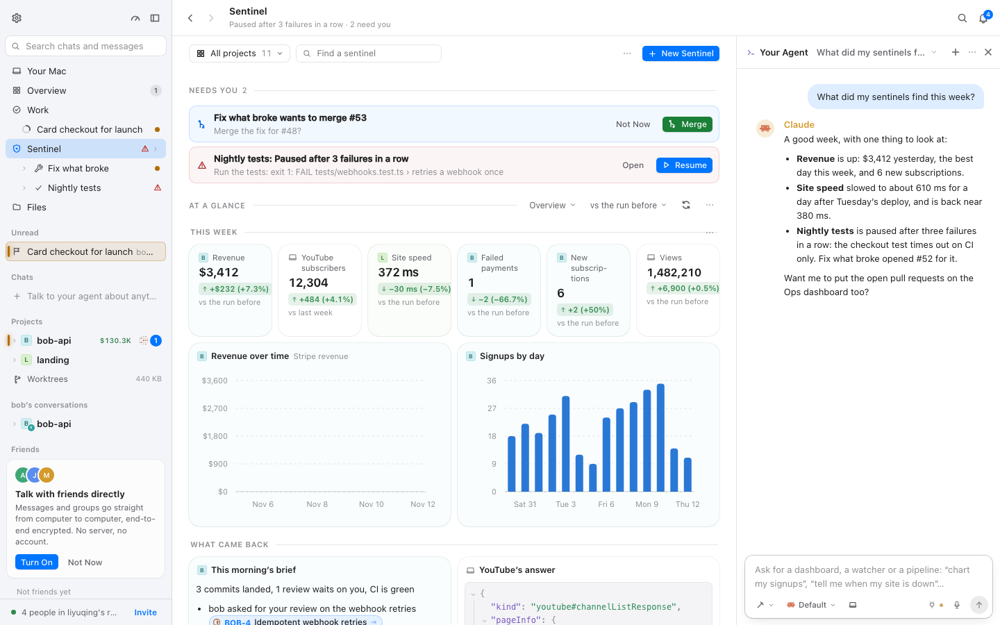
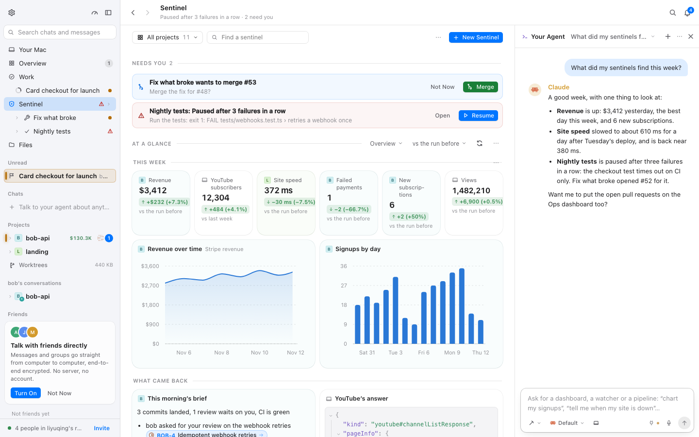
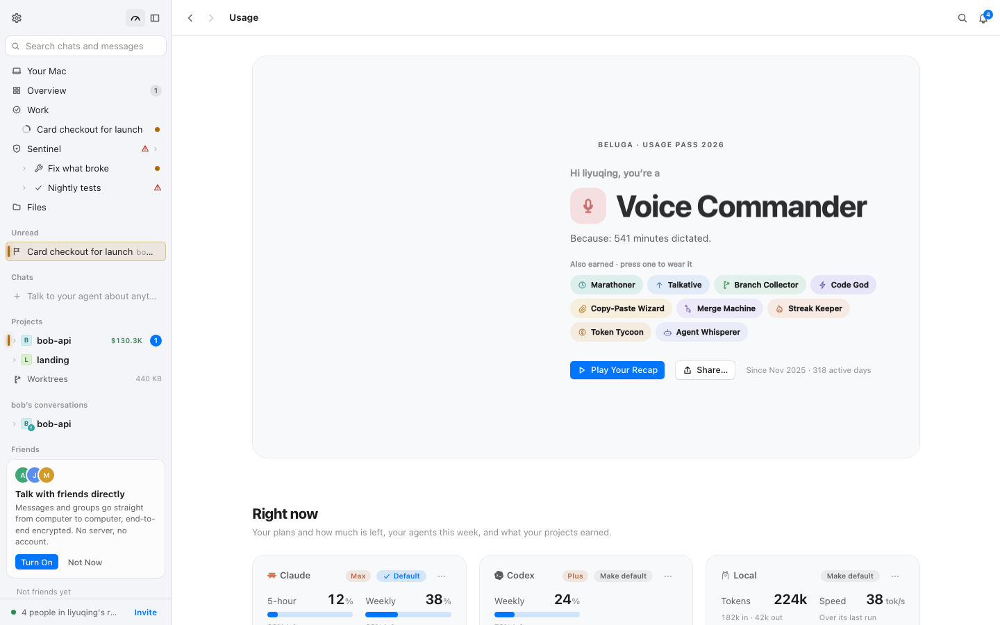
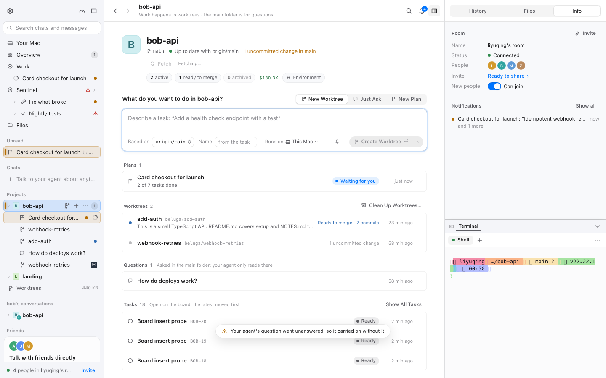

# 沉稳界面 · 仪表盘、图表、用量与项目主页逐页验收（M3 · BLG-171）

- 采集时间：2026-11-12 01:30–01:52（WIB）
- git：`8076e779b`（BLG-170 提交后的分支 HEAD；`plan/mac-fork` + M3 审计）
- 命令行：`BELUGA_URL=http://localhost:1421 node packages/mac/scripts/calm-check.mjs usage sentineldash projecthome overview`（同一次演示 daemon；Dashboard 用应用菜单 `Settings and menus → Go → Dashboard`，项目主页点侧栏项目行）
- 演示 daemon：`BELUGA_HOME=/tmp/calm-blg170 BELUGA_ALLOW_ORIGINS=http://localhost:1421 npm run dev`（一次性 home，演示数据：14 个 Dashboard 瓦片、2 张图、用量卡的「Right now」数字）；vite 占 1421
- 原始结果：`.context/calm/<场景>.json`、`.context/calm/img/`（gitignore）；代表截图 `docs/calm/img/m3-*.png`
- 机器负载：采集期间 other worktrees 在跑，1 分钟负载约 20–30（10 核）。

## 验收方法（四步）

1. **逐页录屏**：每场景四组合，独立浏览器 context；记录 CLS 与 sources、`getAnimations()`、2 秒内 JS 改写 style 的元素、首帧 `data-calm`，enter/loaded/hover/select 及场景自定义时刻截图。
2. **时刻覆盖**：进入 → 加载完成 → 悬停/选中；数字类页面额外读 `font-variant-numeric` 与数字元素宽度，Dashboard 额外检查瓦片换位的 WAAPI。
3. **reduced-motion**：`calm-on/reduce` 重看。
4. **问题成表**：文件:行、现象、改法、建议归属；审计阶段的状态列写「待 BLG-174」，终值由 BLG-175 复核后写在 §6。

## 1 页面清单：场景 ↔ 页面/视图 ↔ 导航路径

| 场景 | 页面 / 视图 | 覆盖的时刻 | 导航（脚本步骤） |
| --- | --- | --- | --- |
| `usage` | Usage（用量卡、Right now、用量明细） | 进入、加载完成 | 应用菜单 `Settings and menus → Go → Usage`（`Usage⌘5`） |
| `sentineldash` | Sentinel Dashboard（14 个瓦片、2 张图、Needs you、What came back） | 进入、加载完成、数字宽度 | 应用菜单 `Go → Dashboard`（页面与 Sentinel 首页同源，Ask Sentinel 面板停靠） |
| `projecthome` | 项目主页 `bob-api`（项目头、数字、计划、Worktrees、Tasks） | 进入、加载完成 | 侧栏项目行 `bob-api` |
| `overview` | Overview（各项目、Earnings、Archived） | 进入、加载完成、数字宽度 | 侧栏 `Overview` |

「视图」类页面：演示数据里没有聊天内联的 view 块（表/图/图表的 `ViewBlock`），本次无法逐页录屏；图表由 `sentineldash` 的折线图/柱状图覆盖。`room`（启动即 Overview）的判定在 shell.md；本报告的 `overview` 是同一页面的独立场景。

## 2 每页结果

格式：`CLS · CSS 动画数 · JS 动效元素数`；首帧列是 `calm-on/full`。

| 场景 | on/full | on/reduce | off/full | off/reduce | 首帧 data-calm（on） |
| --- | --- | --- | --- | --- | :---: |
| usage | 0.003 · 0 · 0 | 0.000 · 0 · 0 | 0.000 · 1 · 0 | 0.000 · 0 · 0 | ✅ |
| sentineldash | 0.142 · 0 · 0 | 0.001 · 0 · 0 | 0.129 · 1 · 21 | 0.000 · 0 · 0 | ✅ |
| projecthome | 0.009 · 0 · 0 | 0.000 · 0 · 0 | 0.000 · 1 · 0 | 0.000 · 0 · 0 | ✅ |
| overview | 0.003 · 0 · 0 | 0.000 · 0 · 0 | 0.000 · 1 · 21 | 0.000 · 0 · 0 | ✅ |

代表截图：

| Dashboard（calm 开） | 对照：Dashboard（calm 关） |
| --- | --- |
|  |  |

| 用量页 | 项目主页 |
| --- | --- |
|  |  |

## 3 仍在播放的动画清单及理由

| 场景 | calm-on/full CSS 动画 | calm-on/reduce | calm-off/full（对照） |
| --- | ---: | ---: | --- |
| usage | 0 | 0 | 1（`_scan_` 4.2s infinite） |
| sentineldash | 0 | 0 | 1（`_scan_`） |
| projecthome | 0 | 0 | 1（`_scan_`） |
| overview | 0 | 0 | 1（`_scan_`） |

calm-on/full 没有 CSS 循环，也没有 JS 改写 style 的元素（`jsMotion` 0）。上游会被 M1 关掉的：用量页的 `sheen` 1.3s 循环（`views/usage/usage.module.css:637`）、Dashboard 的瓦片/表格骨架（若有）与各种 `spin`。这些页面在 calm 下都静止。

**有一处动态需要单独说**：Dashboard 的瓦片换位用 WAAPI（`DashboardPage.tsx:471-482`，`id: 'glide'`，220ms / 尺寸变化 260ms，`cubic-bezier(0.22,1,0.36,1)`）。它的 `still()` 只读 reduce（媒体查询/`data-motion`），不读沉稳开关；本次导航没有触发换位（首次挂载 `was` 为空，不发动画；面板宽度变化由 ResizeObserver 重设基准），**未在 `getAnimations()` 里捕获**。见 DA-02。

## 4 reduced-motion 下的结果

| 场景 | on/reduce CSS 动画 | on/reduce JS 动效 | on/reduce CLS | 结论 |
| --- | ---: | ---: | ---: | --- |
| usage | 0 | 0 | 0.000 | 无动画 |
| sentineldash | 0 | 0 | 0.001 | Ask 面板瞬时停靠，瓦片不滑；0.0007 的残余是整页 body 级 |
| projecthome | 0 | 0 | 0.000 | 无动画 |
| overview | 0 | 0 | 0.000 | 无动画 |

没有任何 CSS 动画或 JS 动效在 reduce 下继续播放；用量页的 700/800ms 榜单过渡与 Dashboard 的 glide 都在 reduce 下被上游的 reduce 分支停掉（前者由 M3 的过渡 clamp 读 `--dur`=0，后者走 `still()`）。

## 5 CLS 表（calm-on 进入 → 加载完成）

| 场景 | calm-on/full CLS | calm-on/reduce CLS | 记录到的非输入位移 | 归因 / 处置 |
| --- | ---: | ---: | --- | --- |
| usage | 0.003 | 0.000 | body 0.0028 @1.5s | 整页 body 的固定微小位移（同 shell.md §5） |
| sentineldash | 0.142 | 0.001 | Ask 面板 `aside[data-opening]` + 瓦片 `[data-tile]` 0.1025+0.0231+0.0059+0.0050 @4.7s；body 0.0039 @1.7s | **DA-01**：Ask 面板以宽度动画停靠，看板瓦片随主区宽度连续重排；calm-off 0.129 同源，reduce 0.001——不是数据加载，是面板宽度动画 |
| projecthome | 0.009 | 0.000 | 右侧 Inspector 的 `section._panel` 0.0056 @2.7s；body 0.0028 @1.9s | **DA-05**：右栏 Info/Notifications 的异步内容加载后改变高度，把 section 推了一下；属面板异步占位 |
| overview | 0.003 | 0.000 | body 0.0028 @1.1s | 同 fixed body 位移 |

**结论**：数据页自身的内容（数字、瓦片、图表、列表）没有留下非 0 位移。两次较大的 CLS 都来自页面外壳：① Sentinel 的 Ask 面板停靠（WK-03，与 work.md 同一处）；② 项目主页右栏 Inspector 的异步内容（与 shell.md SH-07 同一族）。

## 6 问题表（BLG-175 终值）

状态只有三种：**已用覆盖层修好** / **已改上游文件并登记** / **已批准的例外（keep-decor）**。证据来自 2026-11-12 02:35 之后在新 HEAD（`120d2b06d`）上的重跑（`.context/calm/`）。

| ID | 文件:行 | 现象 | 改法 | 终值 | 复核证据 |
| --- | --- | --- | --- | --- | --- |
| DA-02 | `sentinel/DashboardPage.tsx:443`（`still()`）、`:471-482`（glide） | 瓦片换位 WAAPI 220/260ms，`still()` 不读沉稳开关 | 挂钩：`still()` 加 `calmOn()`（`docs/fork.md` M3 第 5 行，TOUCHPOINTS） | **已改上游文件并登记** | 重跑 `sentineldash`：calm-on/full 0.004、动画 0；`getAnimations()` 里不再出现 `glide`（本次导航本来也不触发，代码判据已生效） |
| DA-03 | `views/usage/leaderboard.module.css:119,235,253` | 榜单条 700ms、名次标记/圆点 800ms 的滑动 | 覆盖层 M3 过渡 clamp（无内联样式 → 160ms + ease-standard） | **已用覆盖层修好** | 重跑 `usage`：calm-on/full 过渡元素被 clamp（probe 0.16s）；演示仍是空态（没有榜单行），规则已由全局 clamp 覆盖；`usage` 的 1 条动画是 keep-decor 的 `_titleIn_`（finished） |

**迁移出问题表（BLG-173 收敛，BLG-175 落地）**

- **DA-01 = WK-03**：Ask 面板宽度动画与 work.md 的 WK-03 是同一条，已由 R3-02 修好（`sentineldash` calm-on/full 0.142→**0.004**）。
- **DA-04 → §7**：数字宽度已验证稳定（tabular-nums），不是问题。
- **DA-05 → §5**：项目主页右栏 Inspector 的异步内容是固有位移，§5 已归因。

## 7 审计备注

**演示数据的局限**

- **榜单（Leaderboard）没有行**：演示房间里没有朋友的使用数据，`Leaderboard.tsx:215` 走「Add friends to see them in the leaderboard」空态，700/800ms 的滑动无法现场观察；规则面（过渡 clamp）成立，实测留给 BLG-175。
- **Dashboard 瓦片换位**：`glide` 只在顺序/尺寸变化时触发；本次导航不触发，`getAnimations()` 未捕获。DA-02 是代码 + `still()` 的静态证据。
- **内联视图（views）**：演示数据没有聊天内的 `ViewBlock`（表格/图表）块，无法逐页录屏；Dashboard 的折线图与柱状图是本次覆盖的图表面。
- **计划骨架占位**：见 work.md §7（需要「计划正在生成」状态）。

**人工走查（`probe-data.mjs`，同一次运行后单独开浏览器）**

- 用量页：探针在空态页面上命中的 `_mark_`/`_dot_` 属于其他模块（信号/状态点），不是榜单元素；榜单专属的 `_barFill_`/`_mark_`/`_dot_` 在空态下不渲染（DA-03 只按静态规则记录）。命中的那些元素在 calm 下读到 `0.16s`、`cubic-bezier(0.3,0.7,0.3,1)`，正是 M3 过渡 clamp 的痕迹。
- 数字：Dashboard 的 `$3,412`、`12,304`、`1,482,210` 与用量页的 64%/41%/18%… 宽度都按位数稳定（tabular-nums）。
- Dashboard：14 个 `[data-tile]`，两次导航均未捕获 `id: 'glide'` 的动画（首次挂载不发，面板宽度变化只重置基准）。

**热点对照（任务上下文点名的三项）**

- **异步内容按最终尺寸占位**：Dashboard 瓦片没有骨架，但本次的 0.142 不是瓦片加载而是 Ask 面板宽度动画造成的重排（DA-01）；项目主页右栏的异步内容确有 0.0056 的推动（DA-05）。计划骨架的占位未能在演示里触发（work.md §7）。
- **新任务插入看板列是否挤开卡片**：work.md §2 的坐标表——新卡追加列底，原有卡 0 移动。
- **数字宽度抖动**：DA-04，实测全部 tabular-nums、宽度按位数固定。

**交给 BLG-173 的遗留**

- DA-01 与 work.md WK-03 是同一条规则（Ask 面板 `data-opening`），裁决一次即可。
- DA-02 的 `still()` 挂钩与 work.md WK-01（TaskBoard framer）是同一类「沉稳时瞬时、保留拖拽跟手」的挂钩，建议一起做。

**BLG-175 复核补充**

- 复核运行：`BELUGA_URL=http://localhost:1421 node packages/mac/scripts/calm-check.mjs usage sentineldash projecthome`（2026-11-12 02:35 起，HEAD `120d2b06d`，全新演示 home）。
- `usage` 在 calm-on/full 记录到 1 条 `_titleIn_` 600ms（playState finished）：Usage Pass 卡片标题的入场，属 `section[aria-label='Your card']` 的 keep-decor（overlay §7.1/§7.3），不是违规；本轮其它动画 0。
- `sentineldash` calm-on/full 0.004（原 0.142），剩下的 0.0028 是整页 body 微移、0.0007 是瓦片在面板落定后的一次一像素级重排。
- 数字宽度：Dashboard 的 `$3,412`/`12,304`/`1,482,210` 与用量页百分比仍是 tabular-nums、宽度按位数固定（DA-04 的结论不变）。

## 8 判定标准 → 证据（BLG-175）

| 判定标准 | 证据 |
| --- | --- |
| 本区报告有截图 | §2 的 `m3-*.png`（sentineldash/usage/projecthome） |
| 报告有仍在播放的动画清单及理由 | §3（calm-on/full：usage 的 `_titleIn_` 是 keep-decor；其余 0；Dashboard glide 由 DA-02 关闭） |
| 报告有 reduced-motion 结果 | §4（动画 0、jsMotion 0；sentineldash 0.001） |
| 问题表每条状态是三种之一 | §6 两行：覆盖层 1 条、上游文件 1 条；DA-01/04/05 已迁移/合并 |
| data-calm 从进入到加载完成 CLS 0 或逐条原因 | §5：sentineldash 的 0.004 原为 Ask 面板的宽度动画（R3-02 后剩余 body/一像素级），projecthome 0.003 为 body 微移，usage 0.003 为 body 微移；逐条列了 sources |
| 改动的上游文件登记 fork.md、sync-upstream 无 `!` | DashboardPage 在 `docs/fork.md`「M3 逐页补改」；`sync-upstream --report` 0 个 `!` |
