# 沉稳收尾（M8）：规则与清点

BLG-248 的产物。给后面 BLG-242、251、249、250、243、245、252、244、246 一份可照做的清单。本页只记录事实和规则；实施结果在各任务各自的节里补。

| 节 | 内容 | 状态 |
| --- | --- | --- |
| [§0](#0-基线与约定) | 基线、拍图命令、门控 | 本页 |
| [§1](#1-强调色) | 六场景改前图、实心强调色清单、每页主操作 | 本页（改后图待 BLG-242） |
| [§2](#2-行尾只占一个位置) | 行尾标记优先级表、锚点核对 | 本页（改后图待 BLG-243） |
| [§3](#3-字号字重) | 字号字重阶梯、映射表、例外、沉稳关时如何保持原值 | 本页（插件待 BLG-244） |
| [§4](#4-彩色光晕) | 光晕清单与处理 | 本页（BLG-256 完成） |
| §5 仍在播放的动画、reduced-motion、问题表 | 复核 | 待 BLG-246 |

## 0. 基线与约定

- **基线树**：`beluga/blg-248-m8` 从 `topic/native`（`350e15ea9 Merge fork/base into topic/native`）开出。改前图即这棵树。
- **拍图命令**（与 `packages/mac/scripts/calm-check.mjs` 文件头一致）：
  ```bash
  BELUGA_HOME=/tmp/calm-demo BELUGA_ALLOW_ORIGINS=http://localhost:1420 npm run dev        # 仓库根：demo daemon
  cd packages/mac && BELUGA_HOME=/tmp/calm-demo npm run dev                                # 网页端 1420
  BELUGA_THEME=light node packages/mac/scripts/calm-check.mjs workspace chatsteps tasks plan sentinel usage
  BELUGA_THEME=dark  node packages/mac/scripts/calm-check.mjs workspace chatsteps tasks plan sentinel usage
  ```
  `BELUGA_HOME` 指向一次性目录，demo 数据不进真实 Beluga 目录。`calm-check` 把图写到 `.context/calm/img/`（被 git 忽略）；本页用到的改前图复制到 `docs/calm/img/m8-before-<scene>-<light|dark>.png`。chatsteps 取 `running` 时刻，其余取 `loaded`。
- **门控**：M8 新增的每条 CSS 都以 `:root[data-calm]` 开头。沉稳关时 M8 不改变任何画面。
- **改前基线（本树实测，`.beluga/scratch/gen-m8.mjs`）**：

  | 项 | 实测 | 计划里写的 |
  | --- | ---: | --- |
  | `font-size` 声明 | 1579 | 1579 |
  | `font-size` 不同写法 | 107 | 107 |
  | `font-weight` 声明 | 744 | 744 |
  | `font-weight` 不同写法 | 14 | 67（本页未复现，见 §3.4） |
  | 带强调/状态色的光晕行（按 §4 判定） | 212 行，74 个文件 | 约 75 个文件（grep 口径 205 行、77 个文件） |

## 1. 强调色

### 1.1 改前图（浅色、深色，calm 开、full 动效，loaded；chatsteps 取 running）

| 场景 | 浅色 | 深色 |
| --- | --- | --- |
| 任务页 tasks |  | 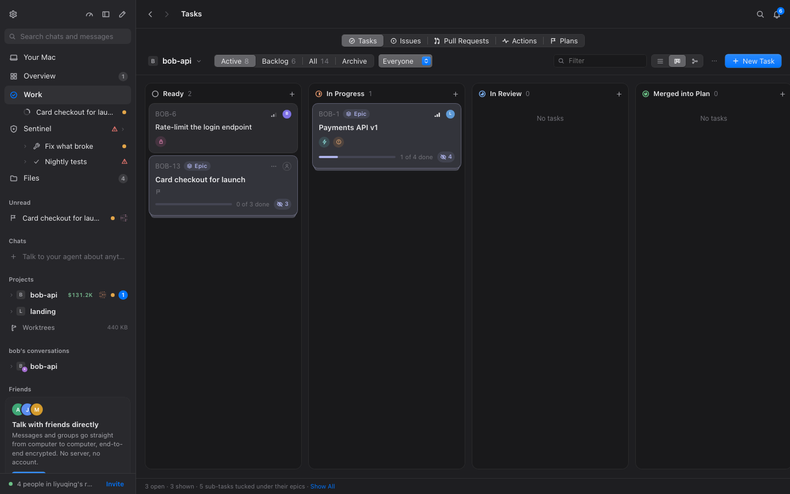 |
| 对话进行中 chatsteps | 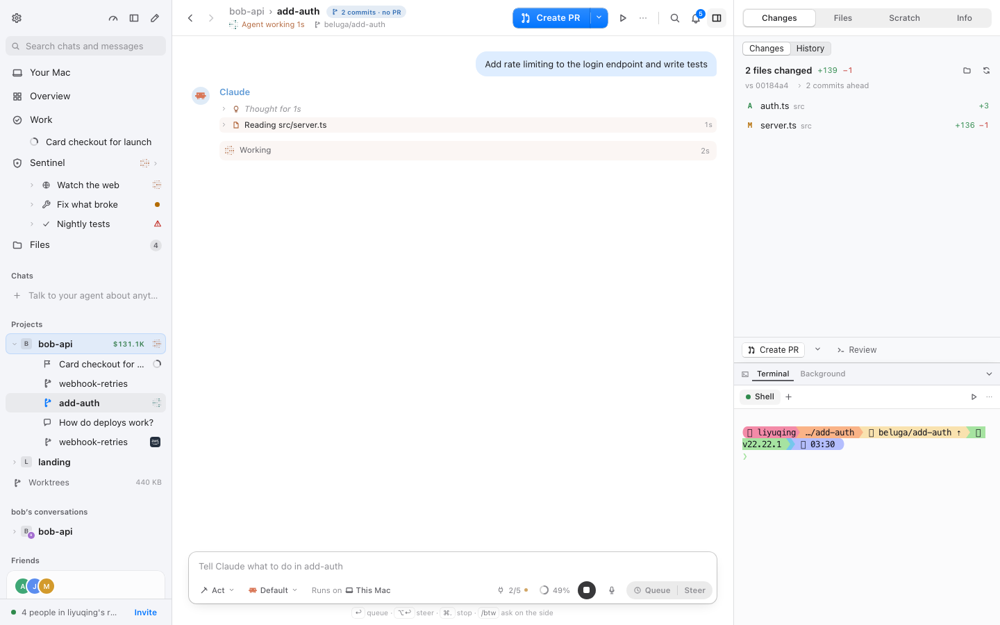 | 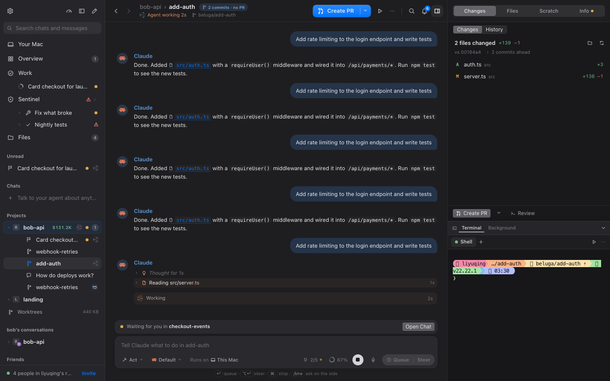 |
| Sentinel | 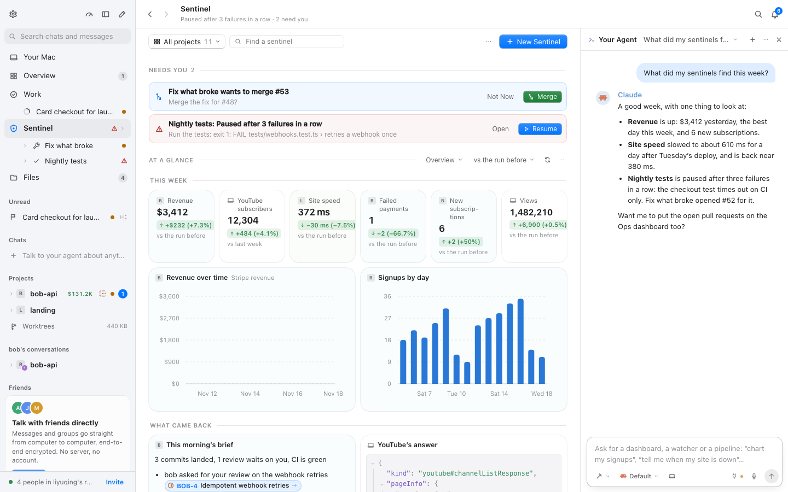 |  |
| 工作区 workspace | 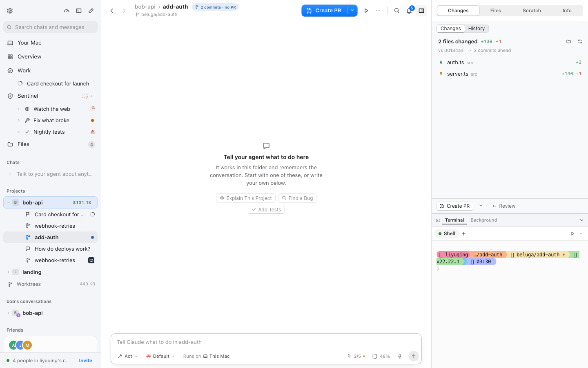 |  |
| 计划 plan | 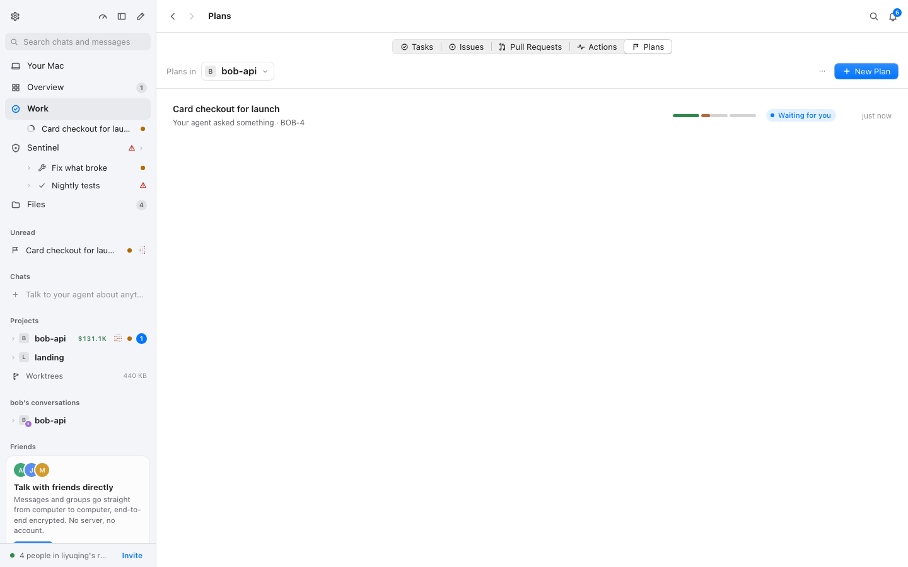 | 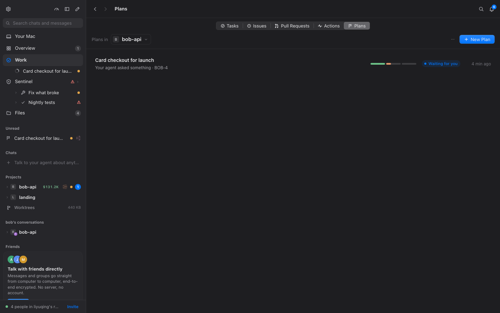 |
| 用量 usage |  | 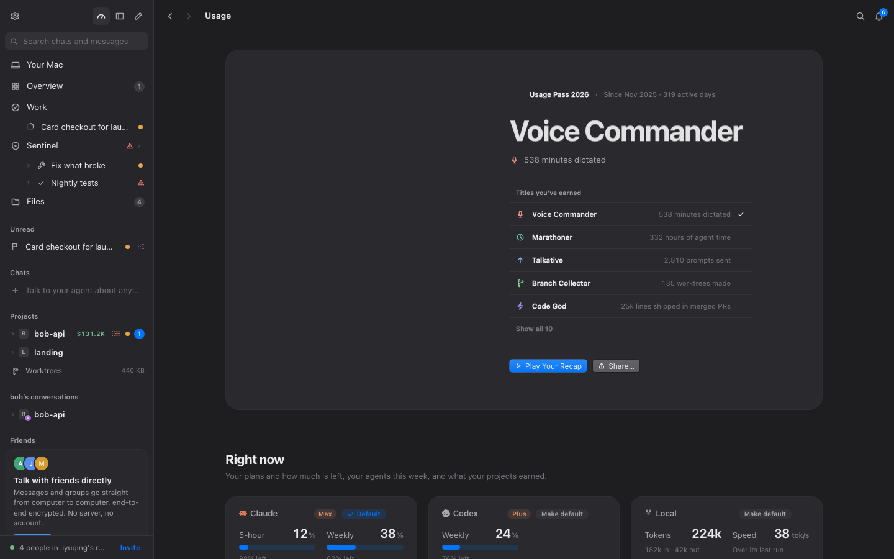 |

### 1.4 改后（BLG-242，浅色、深色，同上）

覆盖层：`fork/calm/calm-accent.css`，由 `calm.css` 引入。

| 场景 | 改前 浅色 | 改后 浅色 | 改后 深色 |
| --- | --- | --- | --- |
| 任务页 tasks |  | 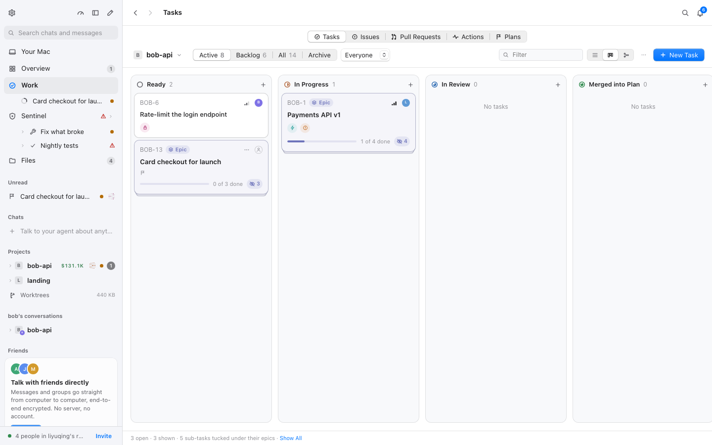 |  |
| 对话进行中 chatsteps |  |  |  |
| Sentinel |  | 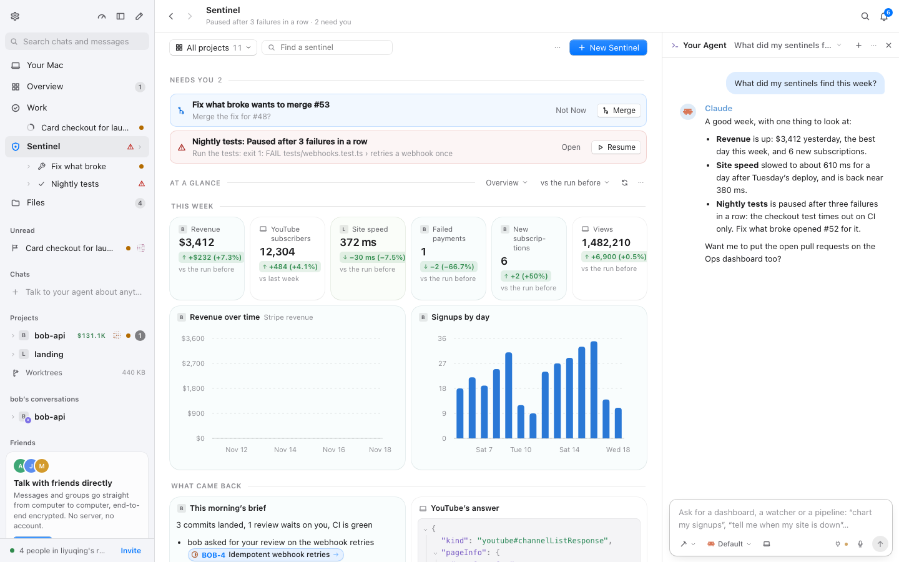 | 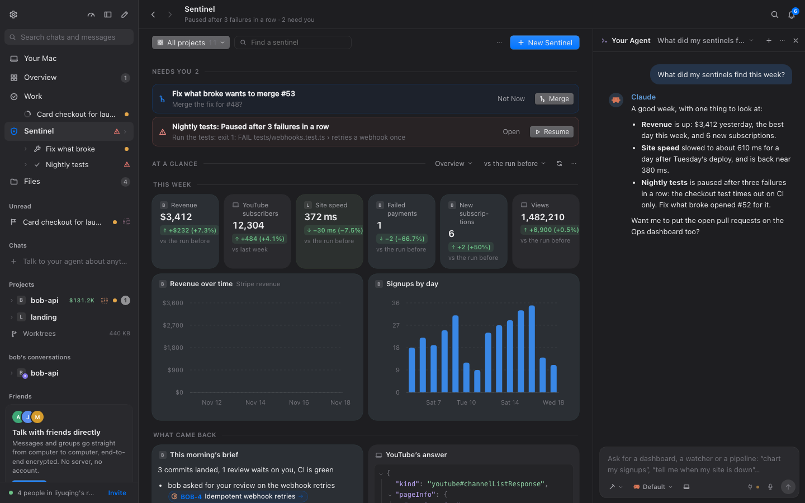 |
| 工作区 workspace |  |  | 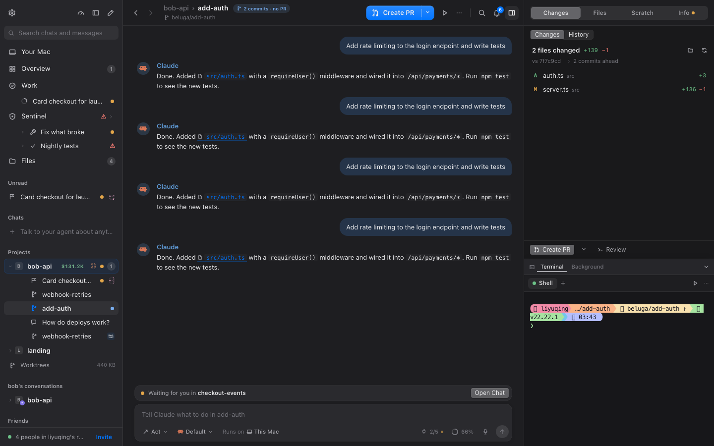 |

改了什么（浅色图已核对）：
- 任务页：「Everyone」下拉的箭头块由蓝改为中性；侧栏 bob-api 的计数由蓝底改为中性灰。「New Task」仍是唯一实心蓝。「Show All」仍是蓝字，属于 BLG-249。
- Sentinel：「需要你」卡里的「Merge」（原实心绿）和「Resume」（原实心蓝）改为中性次按钮；「New Sentinel」仍是唯一实心蓝。
- 工作区：「Create PR」仍是唯一实心蓝。图里那圈「光」的来源已在 BLG-253 查清并处理，见 §1.7。
- 对话进行中：只有 Create PR 是实心蓝；停止按钮是中性深色。

主操作清单（实施后）：任务页 = New Task；工作区 = Create PR；对话进行中 = Create PR（停止按钮不算）；Sentinel = New Sentinel。对话框的默认按钮不动。计划页、用量页未在本任务核对。

### 1.2 每页实心强调色清单与去留

「实心」指填充的强调色底（蓝、绿）的按钮或块。浅色图逐页核对；深色图与浅色同位置，BLG-242 开工时逐张核对。

| 页面 | 实心强调色元素（浅色图实测） | 去留 | 唯一主操作 |
| --- | --- | --- | --- |
| 任务页 | 「New Task」实心蓝 | **留**，主操作 | New Task |
| 任务页 | 「Everyone」下拉箭头块（蓝） | 改中性 bezel，箭头 `--text-2`（§1 规则 2） | — |
| 任务页 | 「Show All」蓝字链；侧栏房间条「Invite」蓝字 | 改 `--text-2`，悬停 `--text` 加下划线（规则 3） | — |
| 任务页 | 侧栏 bob-api 计数蓝底「1」；顶栏铃铛计数 | 改中性实心（规则 1） | — |
| 任务页 | 侧栏推广卡「Talk with friends directly」的蓝色按钮 | 随推广卡藏起（规则 5，BLG-250） | — |
| 工作区 | 「Create PR」实心蓝 | **留**，主操作 | Create PR |
| 工作区 | 「2 commits · no PR」蓝字 chip | 改中性（它是状态，不是操作） | — |
| 工作区 | 侧栏当前项目行 bob-api 蓝底框 + 选中行 add-auth | 当前项目行去底（规则 4，BLG-249）；选中行保留 `--sb-selected` | — |
| 工作区 | 推广卡 Turn On；Invite；计数 | 同任务页 | — |
| 对话进行中 | 「Create PR」实心蓝 | **留**，主操作 | Create PR |
| 对话进行中 | 停止按钮（深色实心圆） | **不算强调色**（中性实心，状态控件），保留；它不是主操作 | — |
| 对话进行中 | 发送箭头、Queue、Steer、「2/5」 | 中性，不动 | — |
| Sentinel | 「New Sentinel」实心蓝 | **留**，主操作（页面的 New Sentinel / Turn On 二选一，这里选 New Sentinel） | New Sentinel |
| Sentinel | 「需要你」卡里的「Merge」实心绿 | **改中性次按钮**（本页决定，设计未写）：绿是成功色，不该在这里当主操作 | — |
| Sentinel | 「需要你」卡里的「Resume」实心蓝 | **改中性次按钮**（同上，一页只留一个实心） | — |
| Sentinel | 「Not Now」「Open」 | 已是中性，不动 | — |
| 计划、用量 | 本轮未逐页核对浅色图 | BLG-242 开工时补核，结果补进本表 | 待补 |

结论：三个场景同屏，实心强调色各只剩一个主操作（New Task、Create PR、New Sentinel）。对话框的默认按钮不受影响。

### 1.3 按 §1 规则的 CSS 锚点（BLG-242 用）

- 徽标 `Badge urgent`：`ui.module.css` 约第 150、269 行的强调底。
- 下拉箭头：Select 触发器（`components/select.module.css`）。
- 当前项目行：`layout/Sidebar.module.css` 的 `_currentProject_`（只在 sidebar-look.css 里覆盖）。
- 推广卡：`network/NetworkSidebar.tsx:49` 的 `role="group" aria-label="Talk with friends"`，标题在 :55。
- 焦点圈：`styles/tokens.css:167` `--focus-ring: 0 0 0 3px color-mix(in srgb, var(--accent) 50%, transparent)`。沉稳下改成 `0 0 0 2px color-mix(in srgb, var(--accent) 75%, transparent)`（design §1.6）。Create PR 的光晕先确认是不是它（BLG-242 里用开发者工具核对；截图脚本是否给按钮留了焦点，需在 calm-check 里看）。

## 2. 行尾只占一个位置

### 2.1 优先级表（覆盖 `layout/signal-marks.tsx` 的全部标记）

数字越小越优先。同一行只显示优先级最高的一个标记，其余设 `data-fork-mark-hidden`（BLG-243）。

| 级 | 类别 | 来源（signal-marks.tsx / 上游） | 锚点 | 收起后去哪里看 |
| --- | --- | --- | --- | --- |
| 0 | status | `workspace-row.tsx:223` 的 `Archiving…`；正在建 worktree 的 `_making_` | `[data-archiving]`，`[class*='_making_']`（**未核对**，见 §2.2） | 行的 detail 提示 |
| 1 | 需要你 | `NeedMark`（非问题）：左侧亮边 | `[data-signal='needs']:not([class*='_markProblem_'])` | 悬停展开；行的 `detail` |
| 2 | 问题 | `NeedMark`（conflict、checks）：红色 `!` | `[data-signal='needs'][class*='_markProblem_']` | 悬停展开；行的 `detail` |
| 3 | 计数 | `SignalMark` 的 `unread` → `Badge urgent` | `[data-signal='unread']`，`[data-tally] [class*='_badge_']` | 悬停展开；侧栏「Unread」分组 |
| 4 | 进行中（点阵） | `SignalMark` 的 `working` → `DotMark live`；项目行的 busy 点 | `[data-signal='working']`，`[data-busy]`（`ProjectTree.tsx:286`，已存在） | 聊天页的步骤条 |
| 5 | 金额 | `ProjectTree.tsx:277` 的 `EarningsPill` | `[data-earnings-pill]`（`components/EarningsPill.tsx:110`，已存在） | 项目主页；用量页 |
| 6 | 团队 | `ProjectTree` 的 `TeamBadge`（`team/Team.tsx:66`） | `button[aria-label^='Team on']`（按钮的 label 以 `Team on` 开头；不用 class，避免和 `_badge_` 撞） | 项目主页的团队区 |
| 7 | 安静 | `LaterMark`（`data-signal='later'`）、`ScheduledMark`（`data-scheduled`）、`DotMark` 的 git 点（无 signal，即 `fallback`） | `[data-signal='later']`，`[data-scheduled]`，无 `data-signal` 的 `_mark_` | 悬停；定时的去 Sentinel 页 |
| 容器 | 项目/文件夹的 `TallyMark` | `TallyMark`（`data-tally="needs:unread"`） | 不单独计级：里面的需要你 edge 按 1 计，Badge 按 3 计；收起时整体只占一个位置 | 展开项目 |

不参与归并：`hoverTools` 里的按钮。认不出来的元素不动。

**为什么比目标里的四级多**：目标写「需要你 > 问题 > 计数 > 金额/点阵」。实际行上还有 status（行正在变化，只显示那段文字）、团队、安静标记，以及进行中（点阵）和金额要分开：进行中是 Claude 正在干活的信号，比金额更需要被看见。所以在四级之间加了 status、进行中、团队、安静四档。这样「需要你」和「问题」仍然最前，金额仍然只在没有更紧急的信号时才显示。

### 2.2 锚点核对（BLG-243 开工前必须处理）

在本树 `packages/mac/src` 里核对设计里写的锚点：

| 设计里的锚点 | 实测 | 处理 |
| --- | --- | --- |
| `[data-signal='unread']`、`[data-signal='needs']`、`[data-signal='working']`、`[data-signal='later']` | 存在（signal-marks.tsx:30、45、54、80） | 直接用 |
| `[data-tally]` | 存在（signal-marks.tsx:98） | 直接用 |
| `[data-scheduled]`、`[data-driven-by]`、`[data-archiving]` | 存在（signal-marks.tsx:64；workspace-row.tsx:223、229） | 直接用 |
| `[class*='_markProblem_']` | 存在（signal-marks.tsx:30 的 `m.markProblem`） | 直接用 |
| `[data-earnings-pill]` | 存在（`components/EarningsPill.tsx:110`，值为 projectId） | 直接用 |
| `[data-busy]` | 存在（`layout/ProjectTree.tsx:286`，在 busy 的 `side.status` span 上） | 直接用 |
| `[class*='_making_']` | 未在 layout 的 CSS 里找到 | 保留在 MARKS 里；`tests/fork-sidebar-anchors.test.ts` 会检查它的类名是否在上游源码里（若不在，删掉这一行） |
| TeamBadge | 按钮无 data 属性；用 `aria-label` 前缀 `Team on` | 直接用 `button[aria-label^='Team on']` |

### 2.3 改前图（同一行：浅色 bob-api 项目行、深色 bob-api 行）

同一行的改前、改后、悬停三张图，BLG-243 补：`img/m8-before-row-…`、`img/m8-after-row-…`、`img/m8-hover-row-…`。本页先用上面的工作区改前图（侧栏 bob-api 行尾同时有计数、金额、点阵）作为参照。

## 3. 字号字重

### 3.1 阶梯（8 档，沉稳下生效）

基准 13px（`--calm-fs-4` 即 13px 对应的 1rem）。

| 令牌 | 值 | 13px 基准下 | 典型用途（沿用上游已有的写法） |
| --- | --- | --- | --- |
| `--calm-fs-1` | 0.77rem | 10px | 徽标、时间戳 |
| `--calm-fs-2` | 0.846rem | 11px | 次要说明、标签 |
| `--calm-fs-3` | 0.923rem | 12px | 侧栏行、按钮文字 |
| `--calm-fs-4` | 1rem | 13px | 正文（基准） |
| `--calm-fs-5` | 1.154rem | 15px | 小标题 |
| `--calm-fs-6` | 1.385rem | 18px | 页面副标题 |
| `--calm-fs-7` | 1.692rem | 22px | 页面标题 |
| `--calm-fs-8` | 2.154rem | 28px | 大数字 |

字重：`--calm-fw-regular` 400；`--calm-fw-medium` 450–560（实际用 500、550、560）；`--calm-fw-semibold` 590–680（600、650）；`--calm-fw-bold` 700–800。

### 3.2 映射规则（`type-scale.ts`，BLG-244）

- **字号**：只归 9–30px 的 `px` 与 `rem` 值。按 13px 换成 px，取最近的一档；正好在中间时取小的一档。
- **字重**：按上面的区间取档；`normal` → regular，`bold` → bold。
- **保留**（不改写，进 kept 报告并写明原因）：`em`、`%`、`var()`、`calc()`、`clamp()`、`inherit`、`initial`、`unset`、`font:` 简写、自定义属性、超出区间的值。`!important` 保留。
- **改写形式**：`font-size: 0.9rem` → `font-size: var(--calm-fs-3, 0.9rem)`；`font-weight: 650` → `font-weight: var(--calm-fw-semibold, 650)`。插件不直接改数值。

### 3.3 映射表（实测，`gen-m8.mjs` 的输出）

下表是现在的写法 → 处理，按出现次数排序。「保留」的是例外。

- 字号：声明 1579 条，不同写法 107 种。能映射到令牌的 1434 条；保留 145 条，共 42 种。改写后不同写法约 **50 种**（42 种保留 + 8 个令牌）。
- 字重：声明 744 条，不同写法 14 种。能映射的 741 条；保留 3 条（inherit）。改写后不同写法约 **5 种**（1 种保留 + 4 个令牌）。
- 这是按映射规则算出的预计值（本页脚本），不是插件的实际输出；BLG-244 落地后以 `.context/calm/type-report.json` 为准。

**字号表**

| 旧写法 | 出现次数 | 处理 |
| --- | ---: | --- |
| `12px` | 195 | --calm-fs-3 (0.923rem) |
| `11.5px` | 124 | --calm-fs-3 (0.923rem) |
| `0.86rem` | 117 | --calm-fs-2 (0.846rem) |
| `11px` | 116 | --calm-fs-2 (0.846rem) |
| `0.88rem` | 91 | --calm-fs-2 (0.846rem) |
| `12.5px` | 85 | --calm-fs-4 (1rem) |
| `0.9rem` | 84 | --calm-fs-3 (0.923rem) |
| `0.84rem` | 81 | --calm-fs-2 (0.846rem) |
| `0.82rem` | 65 | --calm-fs-2 (0.846rem) |
| `0.8rem` | 60 | --calm-fs-1 (0.77rem) |
| `13px` | 59 | --calm-fs-4 (1rem) |
| `10.5px` | 58 | --calm-fs-1 (0.77rem) |
| `0.92rem` | 47 | --calm-fs-3 (0.923rem) |
| `0.78rem` | 23 | --calm-fs-1 (0.77rem) |
| `0.85rem` | 20 | --calm-fs-2 (0.846rem) |
| `0.92em` | 19 | 保留：em (relative to parent) |
| `0.86em` | 19 | 保留：em (relative to parent) |
| `0.76rem` | 16 | --calm-fs-1 (0.77rem) |
| `13.5px` | 15 | --calm-fs-4 (1rem) |
| `0.85em` | 13 | 保留：em (relative to parent) |
| `10px` | 13 | --calm-fs-1 (0.77rem) |
| `14px` | 12 | --calm-fs-4 (1rem) |
| `0.9em` | 12 | 保留：em (relative to parent) |
| `1rem` | 12 | --calm-fs-4 (1rem) |
| `0.94rem` | 11 | --calm-fs-3 (0.923rem) |
| `var(--control-text)` | 10 | 保留：custom property |
| `0.95rem` | 9 | --calm-fs-3 (0.923rem) |
| `0.88em` | 9 | 保留：em (relative to parent) |
| `1.05rem` | 9 | --calm-fs-4 (1rem) |
| `0.95em` | 8 | 保留：em (relative to parent) |
| `0.74rem` | 7 | --calm-fs-1 (0.77rem) |
| `20px` | 7 | --calm-fs-6 (1.385rem) |
| `var(--control-text-small)` | 7 | 保留：custom property |
| `1.15rem` | 7 | --calm-fs-5 (1.154rem) |
| `0.72rem` | 6 | --calm-fs-1 (0.77rem) |
| `0.98rem` | 5 | --calm-fs-4 (1rem) |
| `22px` | 5 | --calm-fs-7 (1.692rem) |
| `1.1rem` | 5 | --calm-fs-5 (1.154rem) |
| `1.08rem` | 5 | --calm-fs-5 (1.154rem) |
| `15px` | 5 | --calm-fs-5 (1.154rem) |
| `9.5px` | 4 | --calm-fs-1 (0.77rem) |
| `1.02rem` | 4 | --calm-fs-4 (1rem) |
| `0.94em` | 3 | 保留：em (relative to parent) |
| `0.93rem` | 3 | --calm-fs-3 (0.923rem) |
| `1em` | 3 | 保留：em (relative to parent) |
| `calc(var(--control-text) - 1px)` | 3 | 保留：custom property |
| `9px` | 3 | --calm-fs-1 (0.77rem) |
| `26px` | 3 | --calm-fs-8 (2.154rem) |
| `0.84em` | 3 | 保留：em (relative to parent) |
| `var(--control-text-large)` | 3 | 保留：custom property |
| `1.9rem` | 3 | --calm-fs-7 (1.692rem) |
| `17px` | 3 | --calm-fs-6 (1.385rem) |
| `19px` | 3 | --calm-fs-6 (1.385rem) |
| `8.5px` | 2 | 保留：outside 9–30px (8.5px) |
| `1.25rem` | 2 | --calm-fs-5 (1.154rem) |
| `1.45rem` | 2 | --calm-fs-6 (1.385rem) |
| `1.2rem` | 2 | --calm-fs-5 (1.154rem) |
| `0.93em` | 2 | 保留：em (relative to parent) |
| `0.82em` | 2 | 保留：em (relative to parent) |
| `inherit` | 2 | 保留：keyword/inherit |
| `1.12rem` | 2 | --calm-fs-5 (1.154rem) |
| `1.04rem` | 2 | --calm-fs-4 (1rem) |
| `1.3rem` | 2 | --calm-fs-6 (1.385rem) |
| `30px` | 2 | --calm-fs-8 (2.154rem) |
| `16px` | 2 | --calm-fs-5 (1.154rem) |
| `1.95rem` | 2 | --calm-fs-8 (2.154rem) |
| `1.05em` | 1 | 保留：em (relative to parent) |
| `1.22em` | 1 | 保留：em (relative to parent) |
| `1.12em` | 1 | 保留：em (relative to parent) |
| `0.7rem` | 1 | --calm-fs-1 (0.77rem) |
| `calc(1em * var(--fit, 1))` | 1 | 保留：custom property |
| `1.06rem` | 1 | --calm-fs-4 (1rem) |
| `var(--md-size)` | 1 | 保留：custom property |
| `2em` | 1 | 保留：em (relative to parent) |
| `1.45em` | 1 | 保留：em (relative to parent) |
| `1.2em` | 1 | 保留：em (relative to parent) |
| `24px` | 1 | --calm-fs-7 (1.692rem) |
| `0.75rem` | 1 | --calm-fs-1 (0.77rem) |
| `0.96rem` | 1 | --calm-fs-3 (0.923rem) |
| `1.42rem` | 1 | --calm-fs-6 (1.385rem) |
| `calc(var(--text-size) + 0.5px)` | 1 | 保留：custom property |
| `0.78em` | 1 | 保留：em (relative to parent) |
| `1.5rem` | 1 | --calm-fs-6 (1.385rem) |
| `1.32rem` | 1 | --calm-fs-6 (1.385rem) |
| `clamp(28px, 3.4vw, 40px)` | 1 | 保留：calc/clamp |
| `14.5px` | 1 | --calm-fs-5 (1.154rem) |
| `clamp(38px, 5.4vw, 64px)` | 1 | 保留：calc/clamp |
| `15.5px` | 1 | --calm-fs-5 (1.154rem) |
| `7.5px` | 1 | 保留：outside 9–30px (7.5px) |
| `max(12px, min(clamp(17px, 12cqi, 40px), var(--fits)))` | 1 | 保留：custom property |
| `max(12px, min(clamp(17px, 11cqi, 44px), var(--fits)))` | 1 | 保留：custom property |
| `var(--text-size)` | 1 | 保留：custom property |
| `0` | 1 | 保留：keyword or other unit |
| `1.35rem` | 1 | --calm-fs-6 (1.385rem) |
| `1.7rem` | 1 | --calm-fs-7 (1.692rem) |
| `1.62rem` | 1 | --calm-fs-7 (1.692rem) |
| `clamp(1.3rem, 2.4vw, 1.9rem)` | 1 | 保留：calc/clamp |
| `clamp(3.4rem, 9vw, 7.5rem)` | 1 | 保留：calc/clamp |
| `0.42em` | 1 | 保留：em (relative to parent) |
| `clamp(1.05rem, 1.6vw, 1.3rem)` | 1 | 保留：calc/clamp |
| `clamp(2.6rem, 5.4vw, 5.2rem)` | 1 | 保留：calc/clamp |
| `2.05rem` | 1 | --calm-fs-8 (2.154rem) |
| `1.6rem` | 1 | --calm-fs-7 (1.692rem) |
| `1.55rem` | 1 | --calm-fs-7 (1.692rem) |
| `0.6em` | 1 | 保留：em (relative to parent) |
| `clamp(2.4rem, 4.6vw, 3.6rem)` | 1 | 保留：calc/clamp |
| `1.35em` | 1 | 保留：em (relative to parent) |

**字重表**

| 旧写法 | 出现次数 | 处理 |
| --- | ---: | --- |
| `600` | 347 | --calm-fw-semibold |
| `500` | 173 | --calm-fw-medium |
| `650` | 100 | --calm-fw-semibold |
| `550` | 66 | --calm-fw-medium |
| `400` | 30 | --calm-fw-regular |
| `700` | 13 | --calm-fw-bold |
| `560` | 5 | --calm-fw-medium |
| `inherit` | 3 | 保留：custom property / inherit |
| `590` | 2 | --calm-fw-semibold |
| `450` | 1 | --calm-fw-medium |
| `680` | 1 | --calm-fw-semibold |
| `800` | 1 | --calm-fw-bold |
| `750` | 1 | --calm-fw-bold |
| `720` | 1 | --calm-fw-bold |

### 3.4 统计口径与「67 种」

- 计划里的 67 种 `font-weight` 写法本页没有复现。本树按「去掉 `!important` 后的不同取值」只得到 14 种。可能的解释：计划用了别的口径（比如把 `font:` 简写、`!important` 写法、或别的伪类文件分开算）。BLG-244 的测试要先定义口径并写在这里；在这之前，报告里以 14 为准。
- font-size 的 107 种与计划一致。

### 3.5 例外

- `em`、`%`、`calc/clamp`、自定义属性、`inherit`：保留，原因写在上表。
- 超出 9–30px 的值（如 `font-size: 32px` 的大标题、`8px` 的装饰字）：保留，原因写在表里。
- keep-decor 目录（`onboarding/scenes`、`Wormhole`、`reactbits`、`PixelBurst`、`star-scene`、`call`、`YourCard`）：整个目录跳过，不改写。
- 用户「文字大小」偏好：原来用 `px` 的字号归到 rem 令牌后，会跟着偏好缩放。这是沉稳下有意的变化，BLG-244 在 finish.md 写明，并在 textSize 11 和 16 下各拍一张 workspace 图。

### 3.6 沉稳关时如何保持上游原值

- 令牌只在 `:root[data-calm]` 下定义（`calm-type.css`）。沉稳关时 `:root` 没有 `data-calm`，变量未定义。
- `var(--calm-fs-3, 0.9rem)` 在变量未定义时取 fallback `0.9rem`，即原值。所以计算结果与上游完全相同。
- 测试（BLG-244，`tests/fork-calm-type.test.ts`）断言：每个改写出的 `var()` 的 fallback 都等于原字面量。这条是「沉稳关时等价」的证据。
- 插件抛错时原样返回 `code`，不能让构建失败。

## 4. 彩色光晕

状态：**完成**（BLG-245 做了扫描与测试，BLG-256 处理全部 64 层）。fork/** 里没有光晕层；上游 64 层中 57 层在构建时改写到令牌上，引导页 6 层属于 keep-decor 不改写（§10），1 层是明说的例外。（BLG-245 第二轮写的「保留 48 条为例外」的决定已被 BLG-256 取代：用户要求逐条处理，这些例外和那组泛化规则都删掉了。）

### 4.1 判定（`findGlows`，在 `fork/calm/glow-scan.ts`，测试 `tests/fork-calm-glow.test.ts` 用同一个）

光晕 = `box-shadow` 或 `filter: drop-shadow`，且满足：
- 颜色引用 `--accent`、`--warn`、`--error`、`--success`、`--merged`、`--merge`、`--claude`、状态色，或是饱和的字面色；**并且**
- blur > 0 或 spread > 2px。

不算光晕：`--hairline`、`rgb(0 0 0 / x)`、`--shadow-*`、`--control-drop` 这类中性阴影；0.5–2px 的实线描边（bezel、拖放目标的清晰框）。键盘焦点圈（`--focus-ring`）按 §1 的清晰细圈处理。

### 4.2 怎么处理：构建时改写到令牌（不是逐文件覆盖）

选择器覆盖（`[class*='_x_']`）做不到：CSS Modules 的类名只有 `_名字_哈希_行号`，没有文件名，`.search`、`.input`、`.edit`、`.rename` 这类名字在好几个模块里重名（64 层里有 33 层是这样），一条覆盖规则会把别的模块的阴影一并改掉。所以和字号一样，由 `type-plugin.ts` 在构建和开发服务器里改写上游 CSS，**只加令牌、不改数值**：

- **光晕环**（blur 为 0、spread 大于 2px，共 52 层）：第四个长度换成 `var(--calm-ring, 3px)`，颜色里的百分比换成 `var(--calm-ring-alpha, 22%)`，其余原样。
- **模糊光晕**（blur 大于 0，共 11 层）：整层换成 `var(--calm-glow-off, <原来的整层>)`。
- `fork/calm/calm-glow.css` 在 `:root[data-calm]` 下定义 `--calm-ring: 2px`、`--calm-ring-alpha: 60%` 和 `--calm-glow-off: 0 0 0 0 transparent`。

沉稳关时三个变量没有定义，回退值就是上游的原值，画面与上游一致。测试：把改写还原，64 个文件逐字节等于原 CSS（层之间的换行、缩进也一样）。沉稳开时：光晕环变成 2px 的同色环，不透明度统一为 60%；模糊光晕变成一个透明的空层，其余层不动。

**无障碍**：光晕环大多是输入框的 `:focus`/`:focus-within`。环从 3px 缩到 2px，不透明度改为 60%（原来多是 16–50%，作为软光晕），所以聚焦时是一圈清楚的 2px 线而不是一团光。聚焦的文本框，沉稳关（左）与沉稳开（右）：

| 沉稳关（上游） | 沉稳开 |
| --- | --- |
| 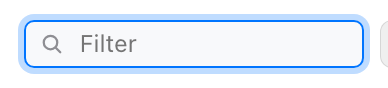 |  |

错误态（`.invalid`、`.bad`）的红色光晕同样变成 60% 的红色 2px 环：红色还在，不再是光晕。

**跳过的文件**：fork/、styles/ 和 keep-decor 目录（整个 `onboarding/`、`Wormhole`、`reactbits`、`PixelBurst`、`star-scene`、`call/`、`YourCard`）不改写。原来只跳过 `onboarding/scenes/`，`onboarding.module.css` 的 6 层被改写了；按 `docs/calm-ui.md` §7.4（`onboarding/**` 是 keep-decor），审计后改为跳过整个目录（§10）。

**例外**：`components/update.module.css:72`（`inset 0 0 0 100px` 的 8% 强调色）是用 inset 阴影写的背景着色，不是光晕，维持原状（`GLOW_EXCEPTIONS`，测试检查它仍在文件里）。

**BLG-245 留下的问题，这次一并修了**：① `calm-glow.css` 当时没有被 `calm.css` 引入，所以它的规则（包括第二轮那条 `:focus-visible` 泛化规则）从来没有生效；② 其中 `[class*='_over_']`、`[class*='_edge_']`、`[class*='_dropping_']` 会碰到别的模块的同名类（例如 fork 的侧栏拖拽条 `edge`）。这些规则全部删掉，只留 `.boxGlow` 的 `animation: none`（类名唯一）。

### 4.3 清单：64 层，每层的处理和结果

| 文件 | 行 | 原因 | 值 | 处理 | 结果 |
| --- | ---: | --- | --- | --- | --- |
| `chat/composer.module.css` | 29 | spread 3px | `0 0 0 3px color-mix(in srgb, var(--accent) 16%, transparent)` | 构建时改写 → `--calm-ring` | 沉稳开：扩散改为 2px 环；沉稳关：原样 |
| `chat/composer.module.css` | 400 | spread 5px | `0 0 0 5px color-mix(in srgb, var(--accent) 18%, transparent)` | 构建时改写 → `--calm-ring` | 沉稳开：扩散改为 2px 环；沉稳关：原样 |
| `chat/edit-prompt.module.css` | 8 | spread 3px | `0 0 0 3px color-mix(in srgb, var(--accent) 18%, transparent)` | 构建时改写 → `--calm-ring` | 沉稳开：扩散改为 2px 环；沉稳关：原样 |
| `chat/max.module.css` | 17 | blur 14px | `0 2px 14px color-mix(in srgb, var(--f1, #3fa2ff) calc(var(--burn, 1) * 14%), tra` | 构建时改写 → `--calm-glow-off` | 沉稳开：该层变成透明空层；沉稳关：原样 |
| `chat/max.module.css` | 21 | blur 22px | `0 4px 22px color-mix(in srgb, var(--f1, #3fa2ff) calc(var(--burn, 1) * 22%), tra` | 构建时改写 → `--calm-glow-off` | 沉稳开：该层变成透明空层；沉稳关：原样 |
| `components/form.module.css` | 142 | spread 3px | `0 0 0 3px color-mix(in srgb, var(--error) 40%, transparent)` | 构建时改写 → `--calm-ring` | 沉稳开：扩散改为 2px 环；沉稳关：原样 |
| `components/graph/graph.module.css` | 275 | spread 5px | `0 0 0 5px color-mix(in srgb, var(--accent) 12%, transparent)` | 构建时改写 → `--calm-ring` | 沉稳开：扩散改为 2px 环；沉稳关：原样 |
| `components/graph/graph.module.css` | 293 | spread 5px | `0 0 0 5px color-mix(in srgb, var(--accent) 12%, transparent)` | 构建时改写 → `--calm-ring` | 沉稳开：扩散改为 2px 环；沉稳关：原样 |
| `components/graph/graph.module.css` | 293 | blur 24px | `0 8px 24px -8px color-mix(in srgb, var(--accent) 40%, transparent)` | 构建时改写 → `--calm-glow-off` | 沉稳开：该层变成透明空层；沉稳关：原样 |
| `components/graph/graph.module.css` | 300 | spread 6px | `0 0 0 6px color-mix(in srgb, var(--accent) 18%, transparent)` | 构建时改写 → `--calm-ring` | 沉稳开：扩散改为 2px 环；沉稳关：原样 |
| `components/graph/graph.module.css` | 735 | spread 4px | `0 0 0 4px color-mix(in srgb, var(--accent) 8%, transparent)` | 构建时改写 → `--calm-ring` | 沉稳开：扩散改为 2px 环；沉稳关：原样 |
| `components/graph/graph.module.css` | 1111 | blur 2px | `0 1px 2px color-mix(in srgb, var(--accent) 40%, transparent)` | 构建时改写 → `--calm-glow-off` | 沉稳开：该层变成透明空层；沉稳关：原样 |
| `components/markdown/code-editor.module.css` | 18 | spread 3px | `0 0 0 3px color-mix(in srgb, var(--accent) 32%, transparent)` | 构建时改写 → `--calm-ring` | 沉稳开：扩散改为 2px 环；沉稳关：原样 |
| `components/markdown/code-editor.module.css` | 22 | spread 3px | `0 0 0 3px color-mix(in srgb, var(--error) 18%, transparent)` | 构建时改写 → `--calm-ring` | 沉稳开：扩散改为 2px 环；沉稳关：原样 |
| `components/telemetry-levels.module.css` | 41 | spread 3px | `0 0 0 3px color-mix(in srgb, var(--accent) 28%, transparent)` | 构建时改写 → `--calm-ring` | 沉稳开：扩散改为 2px 环；沉稳关：原样 |
| `components/update.module.css` | 72 | spread 100px | `inset 0 0 0 100px color-mix(in srgb, var(--accent) 8%, transparent)` | 例外：背景着色 | 维持原状：用 inset 阴影写的 8% 强调色底，不是光晕 |
| `components/views/views.module.css` | 371 | spread 3px | `0 0 0 3px color-mix(in srgb, var(--accent) 18%, transparent)` | 构建时改写 → `--calm-ring` | 沉稳开：扩散改为 2px 环；沉稳关：原样 |
| `components/views/views.module.css` | 1281 | spread 3px | `0 0 0 3px color-mix(in srgb, var(--accent) 18%, transparent)` | 构建时改写 → `--calm-ring` | 沉稳开：扩散改为 2px 环；沉稳关：原样 |
| `dialogs/env-settings.module.css` | 56 | spread 3.5px | `0 0 0 3.5px color-mix(in srgb, var(--accent) 22%, transparent)` | 构建时改写 → `--calm-ring` | 沉稳开：扩散改为 2px 环；沉稳关：原样 |
| `dialogs/keyboard.module.css` | 31 | spread 3px | `0 0 0 3px color-mix(in srgb, var(--accent) 22%, transparent)` | 构建时改写 → `--calm-ring` | 沉稳开：扩散改为 2px 环；沉稳关：原样 |
| `dialogs/native/person.module.css` | 73 | spread 3px | `0 0 0 3px color-mix(in srgb, var(--accent) 30%, transparent)` | 构建时改写 → `--calm-ring` | 沉稳开：扩散改为 2px 环；沉稳关：原样 |
| `dialogs/settings.module.css` | 391 | spread 3px | `0 0 0 3px color-mix(in srgb, var(--accent) 25%, transparent)` | 构建时改写 → `--calm-ring` | 沉稳开：扩散改为 2px 环；沉稳关：原样 |
| `dialogs/support.module.css` | 171 | spread 4px | `0 0 0 4px color-mix(in srgb, var(--accent) 45%, transparent)` | 构建时改写 → `--calm-ring` | 沉稳开：扩散改为 2px 环；沉稳关：原样 |
| `dialogs/support.module.css` | 199 | spread 3px | `0 0 0 3px color-mix(in srgb, var(--accent) 32%, transparent)` | 构建时改写 → `--calm-ring` | 沉稳开：扩散改为 2px 环；沉稳关：原样 |
| `dialogs/support.module.css` | 229 | spread 3px | `0 0 0 3px color-mix(in srgb, var(--accent) 32%, transparent)` | 构建时改写 → `--calm-ring` | 沉稳开：扩散改为 2px 环；沉稳关：原样 |
| `layout/chat-drag.module.css` | 18 | spread 5px | `0 0 0 5px color-mix(in srgb, var(--accent) 18%, transparent)` | 构建时改写 → `--calm-ring` | 沉稳开：扩散改为 2px 环；沉稳关：原样 |
| `layout/chat-drag.module.css` | 27 | spread 6px | `0 0 0 6px color-mix(in srgb, var(--accent) 20%, transparent)` | 构建时改写 → `--calm-ring` | 沉稳开：扩散改为 2px 环；沉稳关：原样 |
| `layout/chat-drag.module.css` | 27 | blur 32px | `0 0 32px 6px color-mix(in srgb, var(--accent) 34%, transparent)` | 构建时改写 → `--calm-glow-off` | 沉稳开：该层变成透明空层；沉稳关：原样 |
| `layout/chat-drag.module.css` | 36 | spread 8px | `0 0 0 8px color-mix(in srgb, var(--accent) 14%, transparent)` | 构建时改写 → `--calm-ring` | 沉稳开：扩散改为 2px 环；沉稳关：原样 |
| `layout/chat-drag.module.css` | 36 | blur 44px | `0 0 44px 10px color-mix(in srgb, var(--accent) 26%, transparent)` | 构建时改写 → `--calm-glow-off` | 沉稳开：该层变成透明空层；沉稳关：原样 |
| `layout/panel/panel.module.css` | 663 | spread 3.5px | `0 0 0 3.5px color-mix(in srgb, var(--accent) 22%, transparent)` | 构建时改写 → `--calm-ring` | 沉稳开：扩散改为 2px 环；沉稳关：原样 |
| `layout/signal.module.css` | 63 | blur 6px | `0 0 6px 0 color-mix(in srgb, var(--warn) 80%, transparent)` | 构建时改写 → `--calm-glow-off` | 沉稳开：该层变成透明空层；沉稳关：原样 |
| `network/network.module.css` | 290 | spread 3px | `0 0 0 3px color-mix(in srgb, var(--accent) 30%, transparent)` | 构建时改写 → `--calm-ring` | 沉稳开：扩散改为 2px 环；沉稳关：原样 |
| `network/network.module.css` | 722 | spread 3px | `0 0 0 3px color-mix(in srgb, var(--accent) 30%, transparent)` | 构建时改写 → `--calm-ring` | 沉稳开：扩散改为 2px 环；沉稳关：原样 |
| `network/network.module.css` | 987 | spread 3px | `0 0 0 3px color-mix(in srgb, var(--accent) 32%, transparent)` | 构建时改写 → `--calm-ring` | 沉稳开：扩散改为 2px 环；沉稳关：原样 |
| `network/network.module.css` | 991 | spread 3px | `0 0 0 3px color-mix(in srgb, var(--error) 16%, transparent)` | 构建时改写 → `--calm-ring` | 沉稳开：扩散改为 2px 环；沉稳关：原样 |
| `network/network.module.css` | 1118 | spread 3px | `0 0 0 3px color-mix(in srgb, var(--accent) 32%, transparent)` | 构建时改写 → `--calm-ring` | 沉稳开：扩散改为 2px 环；沉稳关：原样 |
| `onboarding/onboarding.module.css` | 191 | blur 30px | `0 10px 30px -10px color-mix(in srgb, var(--claude) 70%, transparent)` | keep-decor，不改写（§10） | 原样
| `onboarding/onboarding.module.css` | 260 | blur 10px | `0 0 10px var(--claude)` | keep-decor，不改写（§10） | 原样
| `onboarding/onboarding.module.css` | 345 | blur 40px | `0 18px 40px -18px color-mix(in srgb, var(--accent) 60%, transparent)` | keep-decor，不改写（§10） | 原样
| `onboarding/onboarding.module.css` | 373 | spread 4px | `inset 0 0 0 4px var(--accent)` | keep-decor，不改写（§10） | 原样
| `onboarding/onboarding.module.css` | 639 | spread 3px | `0 0 0 3px color-mix(in srgb, var(--accent) 30%, transparent)` | keep-decor，不改写（§10） | 原样
| `onboarding/onboarding.module.css` | 1258 | spread 4px | `inset 0 0 0 4px color-mix(in srgb, var(--accent) 35%, var(--bg))` | keep-decor，不改写（§10） | 原样
| `plans/plan-ask.module.css` | 30 | spread 3px | `0 0 0 3px color-mix(in srgb, var(--accent) 18%, transparent)` | 构建时改写 → `--calm-ring` | 沉稳开：扩散改为 2px 环；沉稳关：原样 |
| `plans/plans.module.css` | 671 | blur 28px | `0 10px 28px -14px color-mix(in srgb, var(--claude) 70%, transparent)` | 构建时改写 → `--calm-glow-off` | 沉稳开：该层变成透明空层；沉稳关：原样 |
| `plans/plans.module.css` | 1295 | spread 3px | `0 0 0 3px color-mix(in srgb, var(--accent) 18%, transparent)` | 构建时改写 → `--calm-ring` | 沉稳开：扩散改为 2px 环；沉稳关：原样 |
| `plans/plans.module.css` | 1566 | spread 3px | `0 0 0 3px color-mix(in srgb, var(--accent) 32%, transparent)` | 构建时改写 → `--calm-ring` | 沉稳开：扩散改为 2px 环；沉稳关：原样 |
| `plans/plans.module.css` | 1605 | spread 3px | `0 0 0 3px color-mix(in srgb, var(--accent) 32%, transparent)` | 构建时改写 → `--calm-ring` | 沉稳开：扩散改为 2px 环；沉稳关：原样 |
| `plans/plans.module.css` | 1613 | spread 3px | `0 0 0 3px color-mix(in srgb, var(--accent) 32%, transparent)` | 构建时改写 → `--calm-ring` | 沉稳开：扩散改为 2px 环；沉稳关：原样 |
| `plans/plans.module.css` | 2293 | spread 3px | `0 0 0 3px color-mix(in srgb, var(--accent) 32%, transparent)` | 构建时改写 → `--calm-ring` | 沉稳开：扩散改为 2px 环；沉稳关：原样 |
| `sentinel/sentinel.module.css` | 423 | spread 3px | `0 0 0 3px color-mix(in srgb, var(--accent) 25%, transparent)` | 构建时改写 → `--calm-ring` | 沉稳开：扩散改为 2px 环；沉稳关：原样 |
| `sentinel/sentinel.module.css` | 932 | spread 3px | `0 0 0 3px color-mix(in srgb, var(--accent) 32%, transparent)` | 构建时改写 → `--calm-ring` | 沉稳开：扩散改为 2px 环；沉稳关：原样 |
| `sentinel/sentinel.module.css` | 940 | spread 3px | `0 0 0 3px color-mix(in srgb, var(--accent) 32%, transparent)` | 构建时改写 → `--calm-ring` | 沉稳开：扩散改为 2px 环；沉稳关：原样 |
| `sentinel/sentinel.module.css` | 1022 | spread 3px | `0 0 0 3px color-mix(in srgb, var(--accent) 25%, transparent)` | 构建时改写 → `--calm-ring` | 沉稳开：扩散改为 2px 环；沉稳关：原样 |
| `tasks/NewTaskSheet.module.css` | 42 | spread 3px | `0 0 0 3px color-mix(in srgb, var(--accent) 32%, transparent)` | 构建时改写 → `--calm-ring` | 沉稳开：扩散改为 2px 环；沉稳关：原样 |
| `tasks/NewTaskSheet.module.css` | 147 | spread 3.5px | `0 0 0 3.5px hsl(var(--hue) var(--sat) 50%)` | 构建时改写 → `--calm-ring` | 沉稳开：扩散改为 2px 环；沉稳关：原样 |
| `tasks/tasks.module.css` | 338 | spread 3px | `0 0 0 3px color-mix(in srgb, var(--accent) 25%, transparent)` | 构建时改写 → `--calm-ring` | 沉稳开：扩散改为 2px 环；沉稳关：原样 |
| `tasks/tasks.module.css` | 1195 | spread 3px | `0 0 0 3px color-mix(in srgb, var(--accent) 22%, transparent)` | 构建时改写 → `--calm-ring` | 沉稳开：扩散改为 2px 环；沉稳关：原样 |
| `tasks/tasks.module.css` | 1466 | spread 3px | `0 0 0 3px color-mix(in srgb, var(--accent) 22%, transparent)` | 构建时改写 → `--calm-ring` | 沉稳开：扩散改为 2px 环；沉稳关：原样 |
| `tasks/tasks.module.css` | 1955 | spread 3px | `0 0 0 3px color-mix(in srgb, var(--accent) 18%, transparent)` | 构建时改写 → `--calm-ring` | 沉稳开：扩散改为 2px 环；沉稳关：原样 |
| `views/history/history.module.css` | 297 | spread 3px | `0 0 0 3px color-mix(in srgb, var(--accent) 22%, transparent)` | 构建时改写 → `--calm-ring` | 沉稳开：扩散改为 2px 环；沉稳关：原样 |
| `views/project-home.module.css` | 145 | spread 3px | `0 0 0 3px color-mix(in srgb, var(--accent) 18%, transparent)` | 构建时改写 → `--calm-ring` | 沉稳开：扩散改为 2px 环；沉稳关：原样 |
| `views/shared-search.module.css` | 15 | spread 3px | `0 0 0 3px color-mix(in srgb, var(--accent) 30%, transparent)` | 构建时改写 → `--calm-ring` | 沉稳开：扩散改为 2px 环；沉稳关：原样 |
| `views/terminal.module.css` | 111 | spread 3px | `0 0 0 3px color-mix(in srgb, var(--accent) 22%, transparent)` | 构建时改写 → `--calm-ring` | 沉稳开：扩散改为 2px 环；沉稳关：原样 |

### 4.4 计算样式证据（沉稳开时没有未登记的彩色光晕）

Playwright 在工作区、任务页、Sentinel、总览四个页面里，对所有元素及其 `::before`/`::after` 取计算后的 `box-shadow` 和 `filter`，把「blur 大于 0 或 spread 大于 2px、且颜色饱和度大于 0.15」的层算作彩色光晕；并且依次聚焦每页最多 80 个可聚焦元素，再扫一遍（光晕大多是聚焦态）。浅色、深色各一遍：

| 页面 | 沉稳关：静止 / 聚焦后新增 | 沉稳开：静止 / 聚焦后新增 |
| --- | --- | --- |
| 工作区 | 0 / 0 | 0 / 0 |
| 任务页 | 0 / 1（`label._find`：`0 0 0 3px` 强调色 25%） | 0 / 0 |
| Sentinel | 0 / 0 | 0 / 0 |
| 总览 | 0 / 1（`label._field`：`0 0 0 3px` 强调色 50%） | 0 / 0 |

没有覆盖的状态：计划和用量页（没有单独扫），以及需要特定操作才出现的状态（拖放、对话框内的聚焦）。这些靠源码层的测试覆盖：沉稳开时处理过的文件里没有任何光晕层（`tests/fork-calm-glow.test.ts`）。

## 5. 最终复核（BLG-246）

最终树重拍（2026-11-18 审计修复之后，含 §10 的改动；原来那组拍在 f9053e40c 修行尾之前，图里行尾还是四个标记、铃铛还是蓝的，已整组换掉）：六场景 × 浅色深色，calm 开、full 动效、loaded；对话进行中取 running。改前图见 §1.1，改后中间结果见 §1.4、§1.5、§1.6、§2.4。

| 场景 | 浅色 | 深色 |
| --- | --- | --- |
| 工作区 | 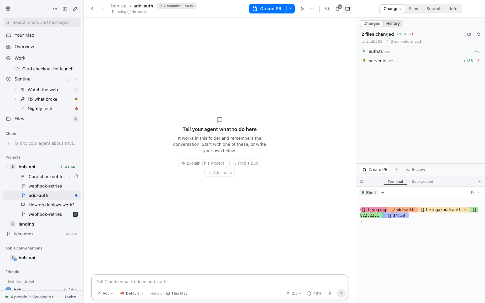 | 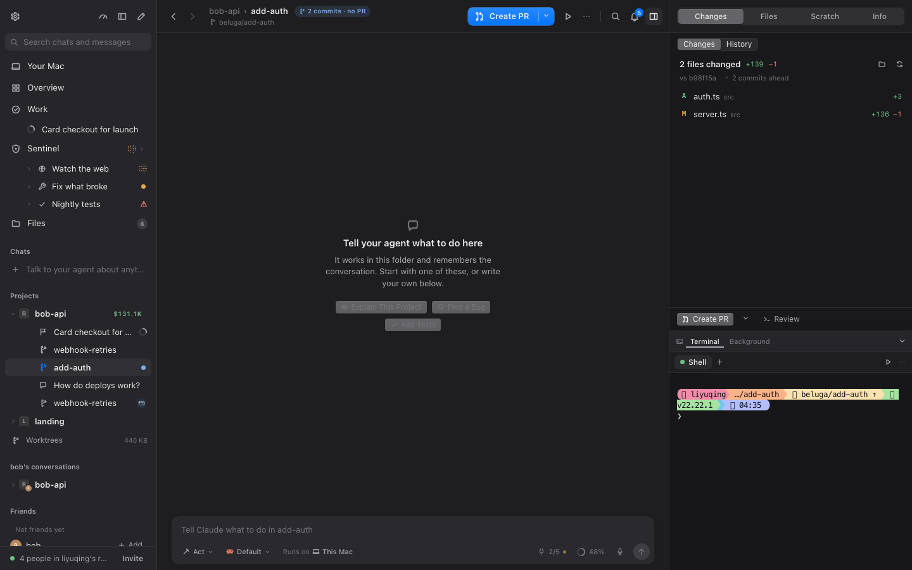 |
| 对话进行中 | 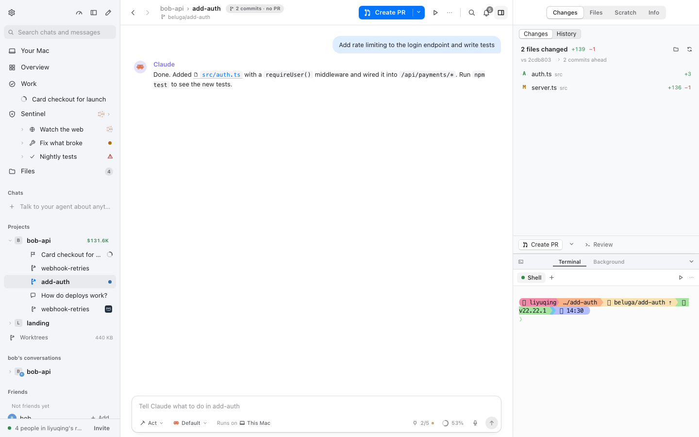 | 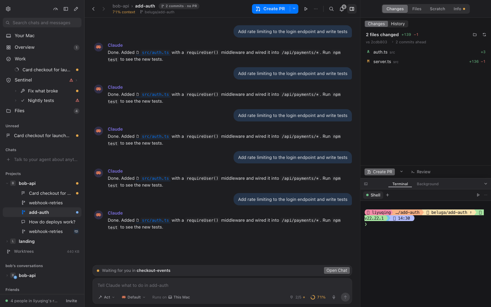 |
| 任务页 | 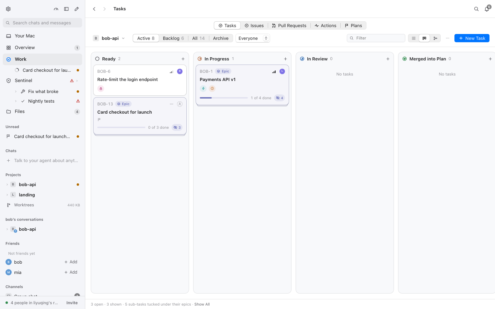 | 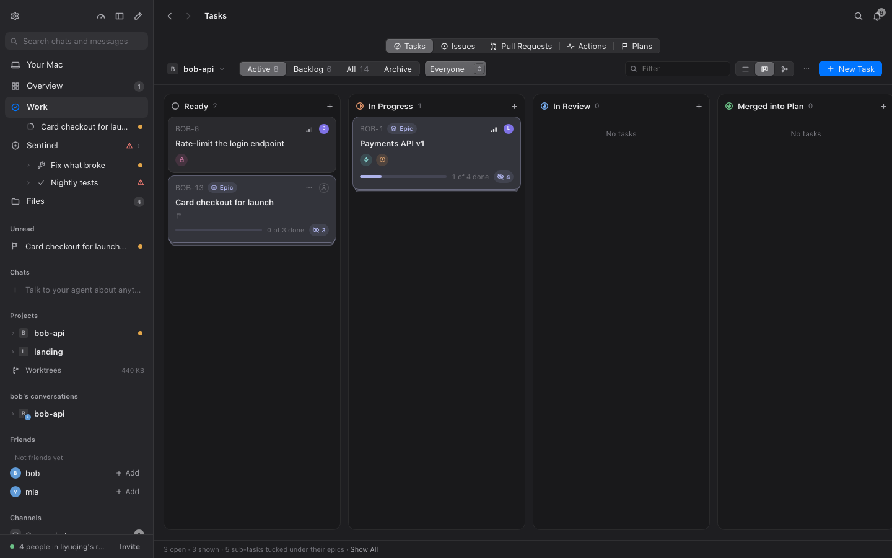 |
| 计划 | 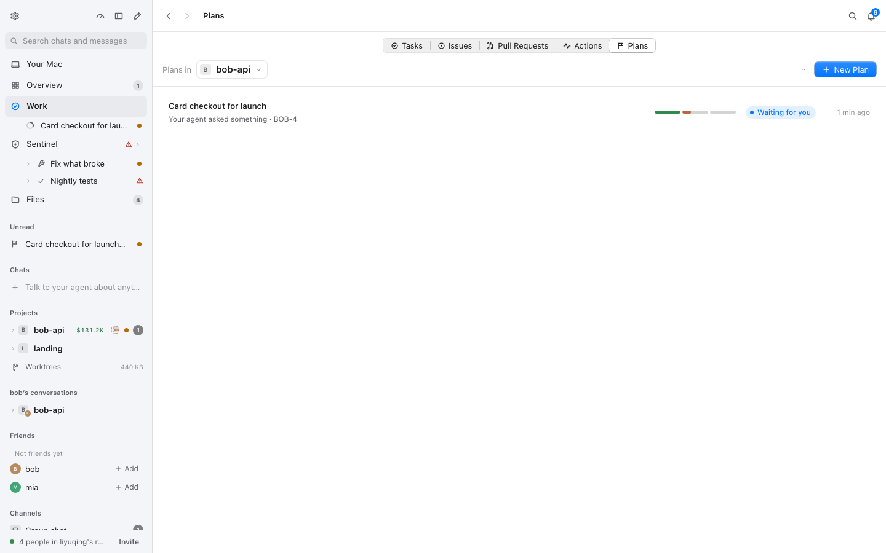 | 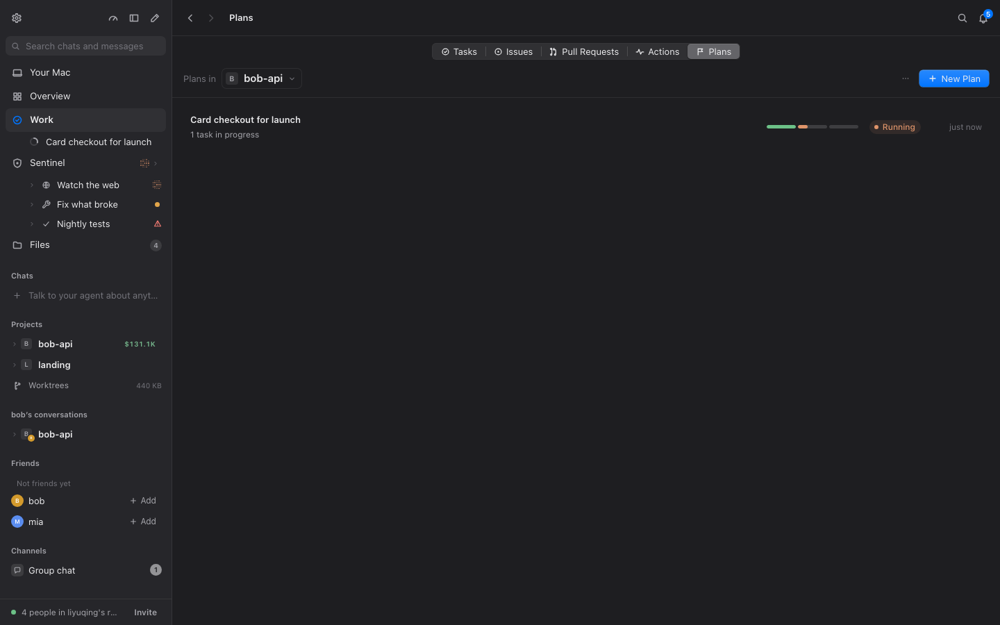 |
| Sentinel | 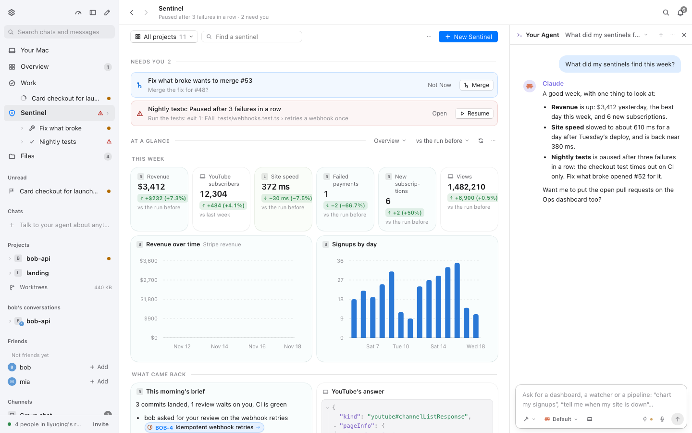 | 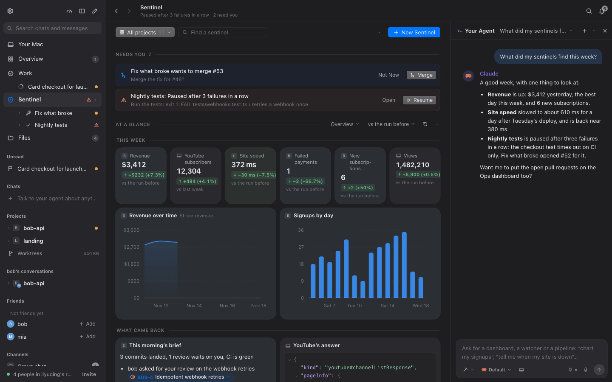 |
| 用量 | 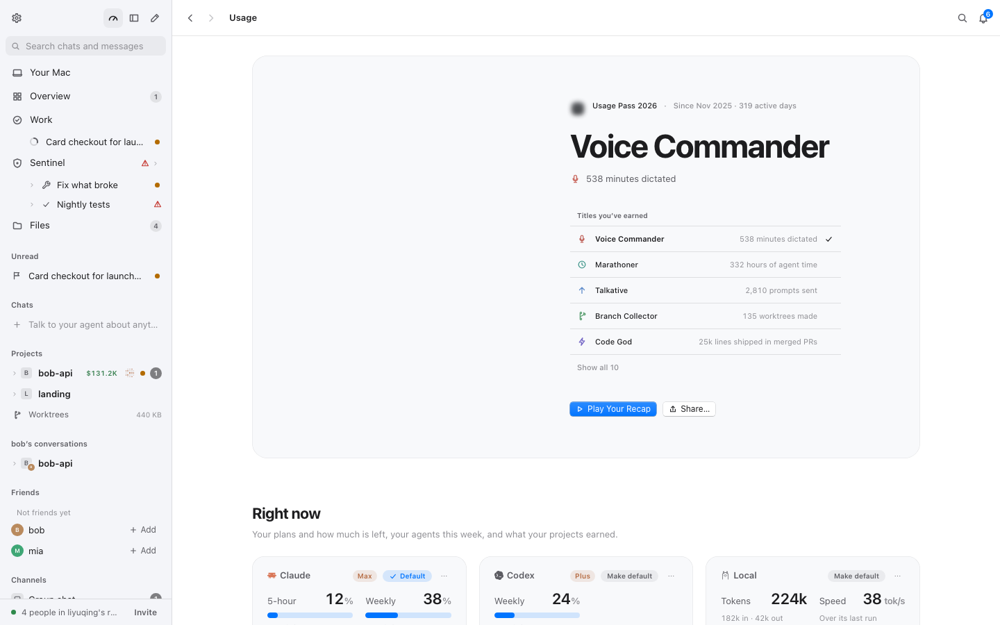 | 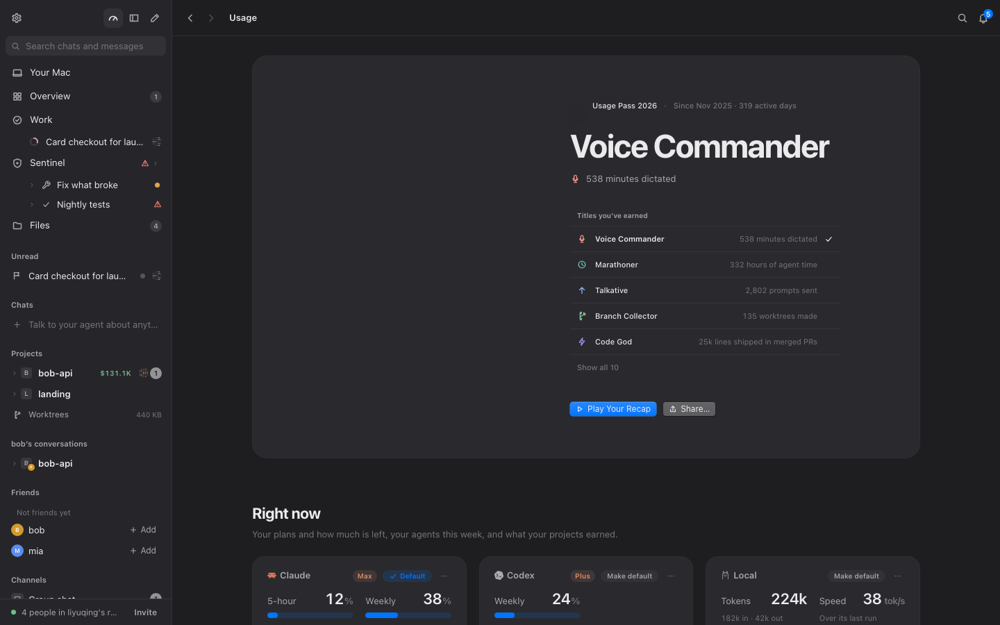 |

沉稳关（上游样子）的工作区、任务页，浅色深色各一张：`img/m8-final-off-workspace-*.png`、`img/m8-final-off-tasks-*.png`。**说明**：改前的沉稳关截图在重拍时被覆盖，没有保留下来，所以不能用图直接对比「改前沉稳关」。沉稳关与上游一致的证据是：(a) `tests/fork-calm-type.test.ts` 的 fallback 逐字节检查；(b) `:root[data-calm]` 门控的规则测试；(c) 下表沉稳关数字与沉稳开一致的方向。

### 5.1 动效与 CLS（`calm-check`，calm 开 full 对比 calm 关 full）

| 场景 | 浅色 CLS 开 / 关 | 深色 CLS 开 / 关 | 仍在播放的动画（calm 开、full） |
| --- | --- | --- | --- |
| 工作区 | 0.002 / 0 | 0.005 / 0.009 | 无 |
| 对话进行中 | 0.099 / 0.086 | 0.086 / 0.083 | 无 |
| 任务页 | 0.003 / 0 | 0.003 / 0 | 无 |
| 计划 | 0.004 / 0 | 0.003 / 0 | 无 |
| Sentinel | 0.005 / 0.141 | 0.003 / 0.075 | 无 |
| 用量 | 0.003 / 0 | 0.003 / 0 | 一次性标题淡入（`_titleIn`，420ms，只播一次，浅色） |

- 沉稳开时没有循环动画。calm 关时 usage 有 9 个动画，calm 开时 0 个（用量页的标题淡入除外，它只播一次，属于 keep-decor 以外的一次性入场，记为例外）。
- 对话进行中的 CLS 0.09–0.10 与 M4 的 §7.2 P-5 一致（已接受的基线），沉稳关时同量级。
- Sentinel 在沉稳开时 CLS 从 0.14 降到 0.005（推广卡移出导航和侧栏行尾收口带来的）。

### 5.2 reduced-motion

`calm-on/reduce` 下六个场景的动画数均为 0，CLS 与 `calm-on/full` 同量级。

### 5.3 问题表

| 编号 | 问题 | 状态 |
| --- | --- | --- |
| M8-1 | 工作区 Create PR 周围的光没有定位来源，改后仍在（BLG-242 的未完成项） | **已解决**（BLG-253，§1.7）：来源是光泽渐变、白色内高光、下方投影和深色下的 0.5px 浅环，沉稳下主按钮改为平的纯色 |
| M8-2 | 上游 64 层彩色光晕（BLG-245 只处理了 4 层） | **已解决**（BLG-256；审计修复后）：57 层构建时改写到令牌，引导页 6 层按 keep-decor 不改写（§10），1 层背景着色例外 |
| M8-3 | 字号写法 ≤ 25 的目标未达：构建口径 51、测试口径 79（BLG-244） | **放宽**为实测值；需确认接受 |
| M8-4 | 字重「67 种」本树复现不了，实测 14 种（§3.4） | 口径问题，已记录 |
| M8-5 | `sync-upstream --report` 显示 208 个「不在 docs/fork.md 里」的文件，另有 113 个「已不再改」的名字 | **已解决**（BLG-253）：208 个都不是 M8 改的，已在 docs/fork.md 逐个登记；「已不再改」的名字从清单里拿下来；报告 0 个 `!`、0 条「已不再改」，脚本没有改，见 §7 |
| M8-6 | 文字大小 11 和 16 下的 workspace 对比图没有拍 | **已做**（BLG-255，§3.8） |
| M8-7 | ••• 菜单里没有找回推广卡的入口（BLG-250） | **不做**（用户决定 2026-11-18：不要推广卡；沉稳开时它保持隐藏，沉稳关时与上游一致） |
| M8-8 | 行尾收口的 200 行性能未测（BLG-243） | **已做**（BLG-254，§2.5） |
| M8-9 | Sentinel 的 Merge、Resume 改中性是本任务的决定，设计未写 | 已记录，待确认 |
| M8-10 | 沉稳开时顶栏铃铛的计数仍是强调色实底，「2 commits · no PR」chip 仍是蓝色（§1.2 要求中性） | **已解决**（§10） |
| M8-11 | `project-home-narrow.spec.ts` 用 `waitForTimeout(300)` 等过渡 | **已解决**（§10）：改为等到没有 CSS 过渡在跑 |
| M8-12 | 引导页 `onboarding.module.css` 的 6 层光晕被改写，而 `docs/calm-ui.md` §7.4 把 `onboarding/**` 整个列为 keep-decor | **已解决**（§10）：光晕扫描跳过整个 `onboarding/` |
| M8-13 | 长分支名时 Create Worktree 超出盒子（#527，基线就有），e2e 标了 `test.fixme` | **已修**（M9，§11）：`test.fixme` 已去掉 |
| M8-14 | 悬停项目行时名字被挤成「bob-…」：展开的工具和标记占掉了名字的宽度 | **已修**（M9，§11） |

## 6. 合并状态

- M8 的提交在 `beluga/blg-248-m8` 上，已合进计划分支 `plan/mac-fork`（`89cd2c452`）；§10 的审计修复也提交在 `plan/mac-fork` 上。
- 还没有合回 `topic/native`（之后 `topic/native` 又走了 8 个提交），没有开 PR，没有推送。合回时按 §7 末尾搬动 `docs/fork.md` 的条目。

## 1.5 侧栏蓝色收口（BLG-249）

覆盖层：`fork/sidebar/sidebar-look.css`（当前项目行，选中行除外）和 `fork/calm/calm-accent.css`（Turn On、Show All、Invite）。

| 场景 | 改后 浅色 |
| --- | --- |
| 工作区 workspace |  |
| 任务页 tasks | 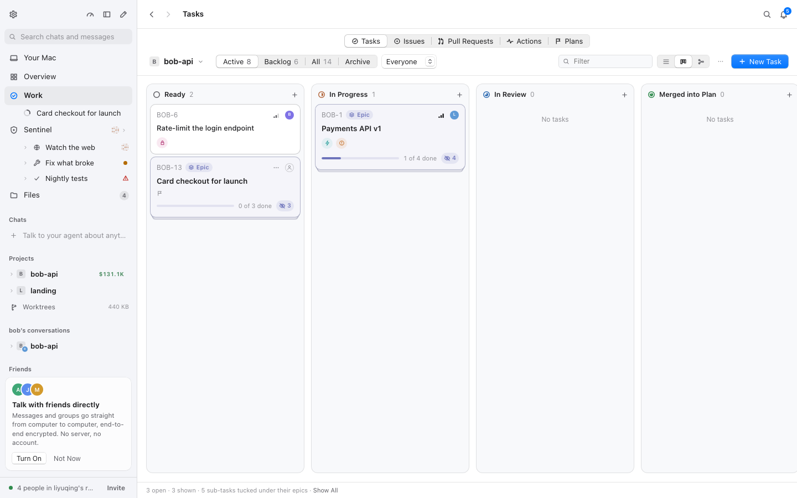 |

- bob-api 项目行：去掉蓝底和蓝框，图标改 `--text-2`，与 landing 等普通项目行同为中性。选中的 add-auth 行仍是唯一看起来被选中的行。
- 侧栏底部 Invite：由蓝字改为次要文字色，悬停加下划线。
- 推广卡里的 Turn On：由实心蓝改为中性。整张卡在 BLG-250 移出导航。
- Show All（任务页底栏）：规则已写入，但本次没有单独核对截图。

## 1.6 推广卡移出导航（BLG-250）

覆盖层：`fork/calm/calm-accent.css` 第 5 节。推广卡 `[role='group'][aria-label='Talk with friends']` 在沉稳开时整块隐藏；若 Friends 分组里只剩它，分组标题也隐藏（`:has` + `:only-child`）。有好友邀请或陌生人列表时，标题保留。


找回的路：设置 › People & access 里的「Talk with friends directly」开关；命令面板的 `net:turn-on`。**没有找到 ••• 菜单里的入口**（代码里没有相应条目），本任务没有新增，需要的话另开任务。

### 2.4 实施结果（BLG-243）

实现：`fork/sidebar/one-mark.ts` 的 `useOneMark`，由 `useOneSelected` 调用（`one-selected.ts` 一行，`Sidebar.tsx` 不变）。一个 MutationObserver 只看 class、data-signal、data-tally，用 rAF 合批；只遍历 `[class*='_trailing_']`；悬停工具按钮不参与。CSS 在 `sidebar-look.css`：落选的标记 `display:none`，行悬停或键盘焦点时 `display:revert`。沉稳关时属性还在、规则不生效。

截图（calm 开、full 动效、loaded；工作区、任务页）：

| 场景 | 浅色 | 深色 |
| --- | --- | --- |
| 任务页 | 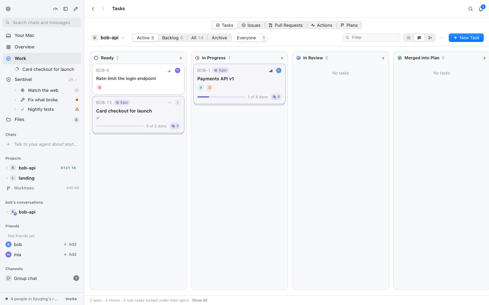 | 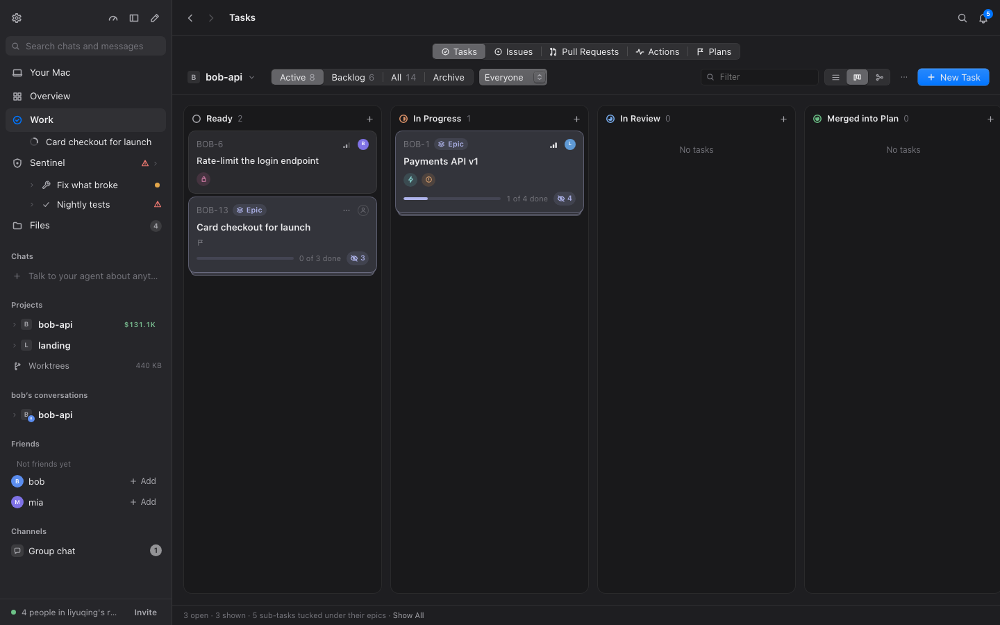 |
| 工作区 | 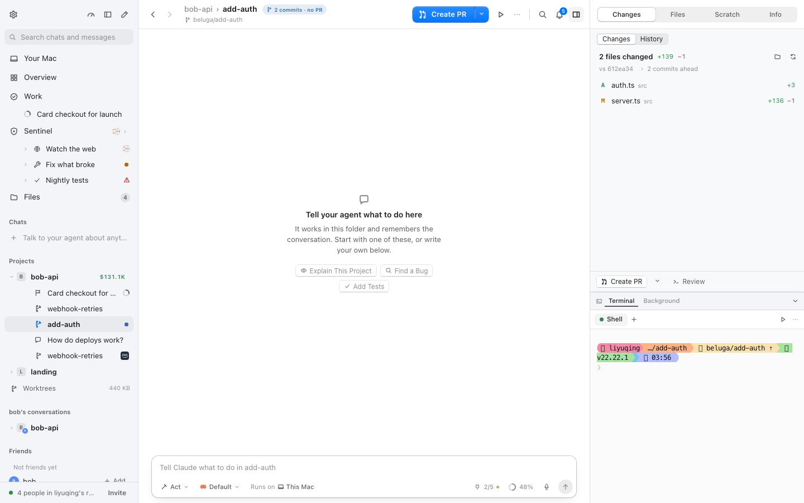 | 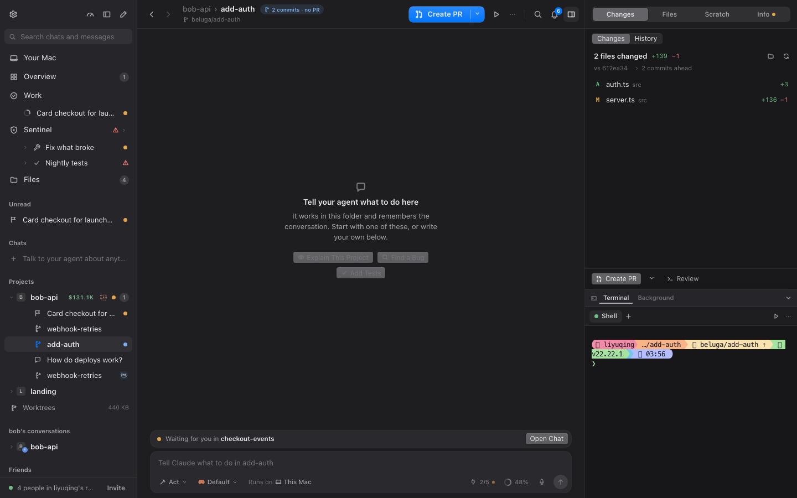 |

改前（同一个 bob-api 行，浅色任务页 `m8-before-tasks-light.png`）行尾是「$131.1K + 点阵 + 蓝底计数 1」三样；改后只剩金额。但这次拍图时 bob-api 的未读数已经是 0（演示数据在两次拍图之间变了），所以这张不是同一状态的对照，「只剩一个」的证据主要是单测（`tests/fork-sidebar-one-mark.test.ts`）。

**验证（Playwright，浅色，calm 开/关，`scratch` 里的一次性脚本，已删）**：在 bob-api 行上注入一个未读计数和一个 busy 点（上游数据的同款元素），结果：

| 状态 | calm 开：可见的标记 | calm 关：可见的标记 |
| --- | --- | --- |
| 静止 | 计数（金额、点阵收起） | 计数、点阵、金额（与上游一致） |
| 悬停行 | 计数、点阵、金额全部展开 | 金额被上游的悬停规则隐藏，计数、点阵可见（上游原样） |
| 移开 | 回到只剩计数 | 与静止相同 |

「收起的信息悬停仍能看到」：成立，悬停时收起的标记展开。**一个例外**：金额在悬停时（calm 开）同样展开，但 calm 关时上游自己在悬停时隐藏金额；这是上游行为，没有改。金额的数字还在项目主页和用量页。

**未做**：同一行的改前、改后、悬停三张图（§2.3 原计划）；200 行侧栏的卡顿测量（设计的风险项）。两项都留给 BLG-246 复核。

### 3.7 实测（BLG-244，`vite build` 的 `calm-type` 报告）

> 本节的数字（116 → 51、上限放宽到 80）已被 §3.8 取代：口径统一、上限恢复为 25。保留本节是为了记录第一版的做法。

插件在构建和开发服务器里改写 packages/mac/src 的 CSS（跳过 fork/、styles/ 和 keep-decor）。`npx vite build` 输出的报告（`.context/calm/type-report.json`）：

- 处理的声明：2179 条（跳过的文件不计）；改写成令牌：2044 条；
- 写法（font-size 与 font-weight 合计，处理的文件内）：**116 → 51**（保留 39 种 + 12 个令牌：8 个字号、4 个字重）；
- 字号和字重分开的口径（测试 `tests/fork-calm-type.test.ts`，含跳过的文件）：121 → 79；
- 保留的 104 处按原因分：em 72、自定义属性 21、calc/clamp 7、其他 4。

**与设计的差异，需要说明**：设计写「改写后剩余的不同写法 ≤ 25」。实测做不到：`em` 是相对父元素的，不能换成 rem 令牌（会改变布局），它占了保留项的大部分。测试的上限写的是实测值（≤ 80），并在测试注释里说明，没有把它改成 25。

沉稳关时的等价：`tests/fork-calm-type.test.ts` 把所有改写的 `var(--calm-fs-N, X)` 还原成 X，结果与原 CSS 逐字节相同。

**未做**：设计要求的 textSize 11 和 16 下各一张 workspace 图（看字号随偏好缩放的影响）；六场景改后截图与改前的排版对比（留给 BLG-246）。

### 3.7 实施结果（BLG-244）

- 实现：`fork/calm/type-scale.ts`（纯函数：`planSize`、`planWeight`、`rewriteType`、`skipFile`），`fork/calm/type-plugin.ts`（`calmType()`，`enforce: 'pre'`，transform 只处理 `packages/mac/src` 下的 CSS，失败时原样返回），接入点 `packages/mac/vite.config.ts` 一行（已登记到 docs/fork.md「沉稳收尾（M8）」）。
- 构建输出（`npx vite build`，本树）：`calm-type: 2179 decls, spellings 116→51 (kept 39, tokens 12), mapped 2044`。报告写入 `.context/calm/type-report.json`。
- 测试口径（`tests/fork-calm-type.test.ts`，覆盖全部 mac CSS，含未打包的文件）：2323 条声明，写法 121 → 79（保留 67 种 + 12 个令牌）。保留的按原因：`em` 72 处、`var()` 21、`calc/clamp` 7、超出 9–30px 的 1 处、关键字等 3 处（按文件-值计）。
- **与设计的差异**：设计要求改写后剩余 ≤ 25 种。按设计保留 em、超范围、自定义属性之后达不到，所以测试上限定为实测值（≤ 80，当前 79），并要求减少到原来的 75% 以下。这是一项放宽，需要 BLG-246 或你确认是否接受。
- **未做**：文字大小 11 和 16 下的 workspace 对比图（设计要求）；六场景改后对比（BLG-246）。
- 沉稳关时的等价性：测试对全部 mac CSS 做了「去掉 var 包装后与原文逐字节相同」的检查，证明 fallback 就是上游原值。

Tested-on: macOS 27.2 (Darwin 27.2.0, 2026-11-18, 作者的 Mac)，树 0a97e0619（分支 beluga/blg-248-m8，基于 topic/native 350e15ea9）。`npx vitest run` 全量 3 次：737 个文件、9179 个用例，每次 9162 通过、16 跳过；每次 1 个失败 `tests/test-lock.test.ts` 的「nices a run that carries KLAUD_WORKTREE」（单独运行通过；与 M8 改动无关，未在 topic/native 上复现核对）。另外第 1 次全量里还有 `tests/clone-project.test.ts` 一个失败（单独运行通过）。**因此这一行不是「零失败」**，零失败需要在 test-lock 的这条用例修好或确认是负载波动后再跑一次。

## 1.7 Create PR 的「光晕」从哪来（BLG-253）

用 Playwright 在沉稳开、沉稳关各取一次工具栏 Create PR 按钮及其 6 层祖先（含 `::before`/`::after`）的计算样式（探针脚本：`packages/mac/scripts` 里的一次性脚本，输出摘在下表）。

| 项 | 沉稳关（上游） | 沉稳开（改前，BLG-242 后） | 沉稳开（BLG-253 后） |
| --- | --- | --- | --- |
| 按钮 `background-image`（浅色） | `linear-gradient(#2a8bff, #0075ff)` | 同左 | 无，纯色 `rgb(0 117 255)` |
| 按钮 `box-shadow`（浅色） | 0.5px 深蓝边 + `0 0.5px 1px` 黑色下沿 + 白色 inset 高光 | 同左 | `none` |
| 按钮 `box-shadow`（深色） | 0.5px **浅蓝**边（比填充还亮）+ 下沿 + inset 高光 | 同左 | `none` |
| `filter`、`outline`、伪元素 | 无 | 无 | 无 |
| 6 层祖先（`.wrap`、工具栏容器、`header`…）的 `box-shadow`/`filter`/`outline` | 全部无 | 全部无 | 全部无 |

结论：

- **没有彩色的模糊光晕，也不是焦点圈**（截图时按钮没有焦点；BLG-242 的猜测 (a) 不成立）。祖先、`.primaryWrap`、BranchControl `.main`、`calm-state.css` 都没有往上画任何阴影或滤镜。
- 看起来像「光」的是按钮自己的三样：① `ui.module.css:36` 的 `linear-gradient(var(--control-accent-top), var(--control-accent))`（顶部更亮的渐变）；② `ui.module.css:38` 的 `box-shadow: 0 0 0 0.5px var(--control-accent-edge), var(--control-drop), var(--control-accent-sheen)`；其中 `--control-accent-sheen` 是 `styles/tokens.css:157` 的白色 inset 高光；③ 深色主题下 `--control-accent-edge` 比填充更亮，成了一圈浅蓝细框。
- 处理：`fork/calm/calm-accent.css` 的 2b 节，沉稳开时实心主操作（New Task、Create PR、New Sentinel）改成纯色、无阴影；窗口不在前台、按下、聚焦、禁用、出错的状态保持上游规则。没有改上游文件。

| | 沉稳关（上游） | 沉稳开（BLG-253 后） |
| --- | --- | --- |
| 浅色 |  |  |
| 深色 |  |  |

### 2.5 同一行改前、改后、悬停，与 200 行测量（BLG-254）

**行**：侧栏里 bob-api 项目行。演示数据里它自己只有金额；这次从别的行克隆了「需要你」的琥珀点和「进行中」的点阵，放进它的 hover 工具 span（`ProjectTree.tsx` 里 busy 点和 tally 本来就在那里），所以行尾同时有三样：金额、琥珀点、点阵。演示数据里没有未读，所以没有第四样（计数）；计数与琥珀点的取舍在单测里覆盖。

（2026-11-18 重拍：演示数据现在让这一行自己同时有点阵、琥珀点、计数「1」三样，「改后」「悬停」两张按真实状态拍，不再克隆；见 §10。）

| 状态 | 浅色 | 深色 |
| --- | --- | --- |
| 改前（沉稳关，上游） | 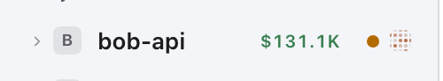 | 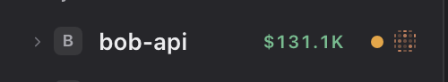 |
| 改后（沉稳开，静止） | 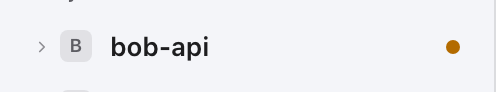 | 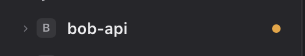 |
| 改后（沉稳开，悬停：收起的标记展开） | 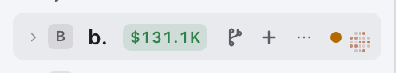 | 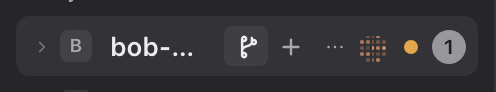 |

**这次审计找到并修了 BLG-243 的一个缺陷**：`useOneMark` 原先把 hover 工具 span 里的东西排除在外，而项目行的 busy 点和 tally（需要你的边、计数）正好在那个 span 里，所以真实的项目行里它们没被合并，只有金额被隐藏（BLG-243 的 Playwright 验证注入的标记放在 trailing 顶层，没覆盖这个结构）。现在改为搜索整个 trailing（工具按钮不匹配任何锚点，不会被动）；`tests/fork-sidebar-anchors.test.ts` 加了一条检查，写明 busy 点和 tally 在 hover 工具 span 里。

**200 行测量**（Playwright，深色，`row-shots.mjs`：把上面那一行克隆 200 次，然后 3 秒内每帧给 50 行的标记翻一次 class 并滚动侧栏；机器负载高，数字有抖动，下面是最后一次）：

| 指标 | 沉稳开 | 沉稳关 |
| --- | --- | --- |
| 行数 | 201 | 201 |
| 克隆后到全部 settle 完成 | 3 ms | 12 ms（钩子照跑，样式不生效） |
| 3 秒突发里的帧数 / 掉帧（>33ms） | 182 / 0 | 181 / 0 |
| 最慢一帧 | 18 ms | 30 ms |
| 突发里的长任务（>50ms） | 0 | 0 |
| 突发里的 CLS | **0** | 0 |
| 一次性插入 200 行本身的长任务 | 83 ms（另一次 309–374 ms，机器忙时） | 89 ms（另一次 130 ms） |
| 插入 200 行本身造成的 CLS | 0.051 | 0.060 |

说明：插入 200 行是测试自己的动作（把整页内容往下推），不是标记合并造成的，所以分开写；突发阶段（标记变化、滚动）的 CLS 为 0，无长任务、无掉帧。插入时的长任务在机器忙时沉稳开更高（309–374 ms 对 130 ms），没有拆开是钩子还是沉稳的 `:has()` 样式造成的；真实侧栏不会一次插入 200 行。


### 3.8 压到上限：一个数字、em 五档、例外清单、textSize 截图（BLG-255）

**口径只留一个**。之前测试报 79、构建报 51，两个数字差在三处：测试把被跳过的文件（fork/、styles/、keep-decor）里的写法也算进「之后」；字号字重各算还是合算不同；构建里每个令牌算一种写法。现在两边都调用同一个函数 `summarize`（`type-scale.ts`），只统计构建真正处理的文件，所以 `vite build` 的 `calm-type:` 一行和 `tests/fork-calm-type.test.ts` 打印的是同一组数字：

| 项 | 数字 |
| --- | ---: |
| 处理的声明（font-size 与 font-weight） | 2057 |
| 改写前的不同写法 | 113 |
| 改写成令牌的声明 | 2013 |
| 改写后用到的令牌（8 个字号、5 个 em 档、4 个字重里用到的） | 17 |
| 保留的写法（全部在例外清单上，有理由） | 23 |
| 改写后不同写法总数（令牌 + 保留） | **40**（113 → 40） |
| **按设计上限 25 计的剩余** = 令牌 + 不在例外清单上的保留项 | **17**（不在清单上的：0 个） |

要说清的一点：**不含例外的剩余是 17，不超过 25；包含例外的写法总数是 40，超过 25。** 例外有 23 个，下面逐条列出，每条都有理由。测试把上限恢复为 25（`REMAINING_LIMIT`），断言「令牌 + 不在例外清单上的保留项 ≤ 25」且「不在清单上的 = 0」；清单是 `type-scale.ts` 的 `JUSTIFIED`，新出现的保留写法如果不在清单上，会算进 25 里，不会悄悄放过。

**这次多归并了什么**：
- em 写法按「离某一档不超过 0.05em 就归到那一档」归到五档：`--calm-fs-em-1..5` = 0.8、0.86、0.92、1.1、1.2em（定义在 `calm-type.css`，沉稳开时才有）。相对父元素的含义不变，最大改动 0.05em。
- 离每一档都超过 0.05em 的 em（0.42、0.6、1.05、1.35、1.45、2、1em）保留。
- 已经是设计系统变量的（`var(--control-text)` 等）不算散写法，保留在例外清单里。

**例外清单**（改写后保留的 23 个写法；「文件数」是出现在几个文件里）：

| 写法 | 文件数 | 为什么不归 |
| --- | ---: | --- |
| `font-size: clamp(1.05rem, 1.6vw, 1.3rem)` | 1 | calc/clamp |
| `font-size: clamp(1.3rem, 2.4vw, 1.9rem)` | 1 | calc/clamp |
| `font-size: clamp(2.4rem, 4.6vw, 3.6rem)` | 1 | calc/clamp |
| `font-size: clamp(2.6rem, 5.4vw, 5.2rem)` | 1 | calc/clamp |
| `font-size: clamp(28px, 3.4vw, 40px)` | 1 | calc/clamp |
| `font-size: clamp(3.4rem, 9vw, 7.5rem)` | 1 | calc/clamp |
| `font-size: clamp(38px, 5.4vw, 64px)` | 1 | calc/clamp |
| `font-size: calc(1em * var(--fit, 1))` | 1 | custom property |
| `font-size: calc(var(--control-text) - 1px)` | 3 | custom property |
| `font-size: var(--control-text)` | 8 | custom property |
| `font-size: var(--control-text-large)` | 2 | custom property |
| `font-size: var(--control-text-small)` | 3 | custom property |
| `font-size: var(--md-size)` | 1 | custom property |
| `font-size: 0.42em` | 1 | em outside the steps (0.42em) |
| `font-size: 0.6em` | 1 | em outside the steps (0.6em) |
| `font-size: 1.05em` | 1 | em outside the steps (1.05em) |
| `font-size: 1.35em` | 1 | em outside the steps (1.35em) |
| `font-size: 1.45em` | 1 | em outside the steps (1.45em) |
| `font-size: 1em` | 2 | em outside the steps (1em) |
| `font-size: 2em` | 1 | em outside the steps (2em) |
| `font-size: inherit` | 2 | keyword |
| `font-size: 0` | 1 | other unit or keyword |
| `font-size: 8.5px` | 1 | outside 9–30px (8.5px) |

（每个值的详细理由在 `type-scale.ts` 的 `JUSTIFIED`：clamp 是随视口变化的流式字号；`var()`/`calc(var())` 是另一套设计系统变量；`em` 例外是离五档都太远；`inherit`、`0`、`8.5px` 不在 9–30px 的范围。）

**因版式跳变而跳过的文件**：按设计，沉稳开时某个文件出现明显排版跳变就把它列为例外。在 textSize 16 下比较沉稳开和关，Sentinel 页「At a glance」的数字卡（`sentinel/numbers.module.css` 与它用的 `components/views/views.module.css` 的 tile 部分）标签和增量换行、被截断。它们的字号为适配固定宽度的卡片写成 px，换成 rem 就会随文字大小偏好变大。这两个文件整体跳过（`type-scale.ts` 的 `SKIP_FILES`），处理后重新拍图，卡片不再换行。其余页面（工作区、任务页、总览）在 11 和 16 下沉稳开和关没有换行或截断的差别；计数的差异来自沉稳开时推广卡被隐藏等本来就有的区别。

**textSize 11 与 16 下的工作区**（沉稳关 = 上游；沉稳开 = 令牌生效）：

| 文字大小 | 主题 | 沉稳关（上游） | 沉稳开 |
| --- | --- | --- | --- |
| 11 | 浅色 | 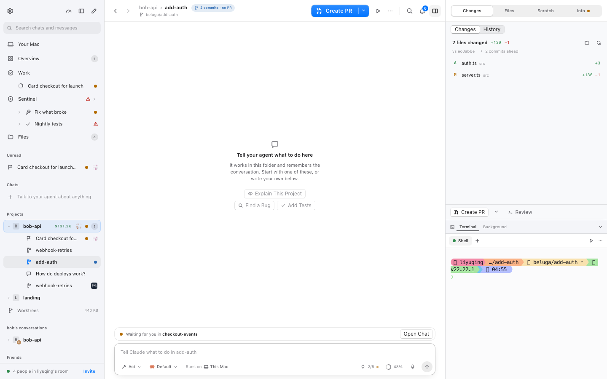 | 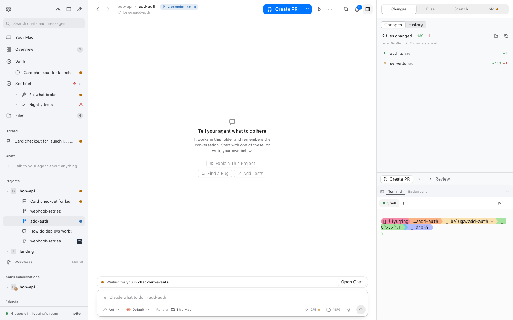 |
| 11 | 深色 | 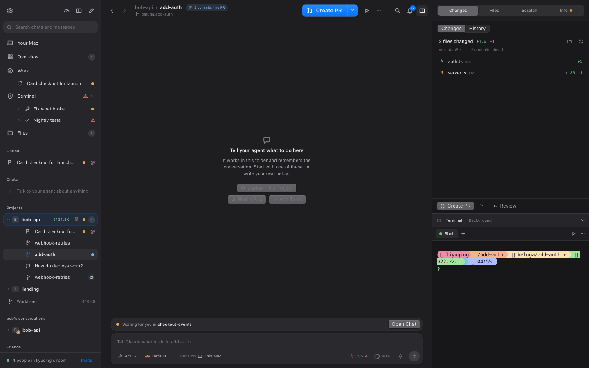 | 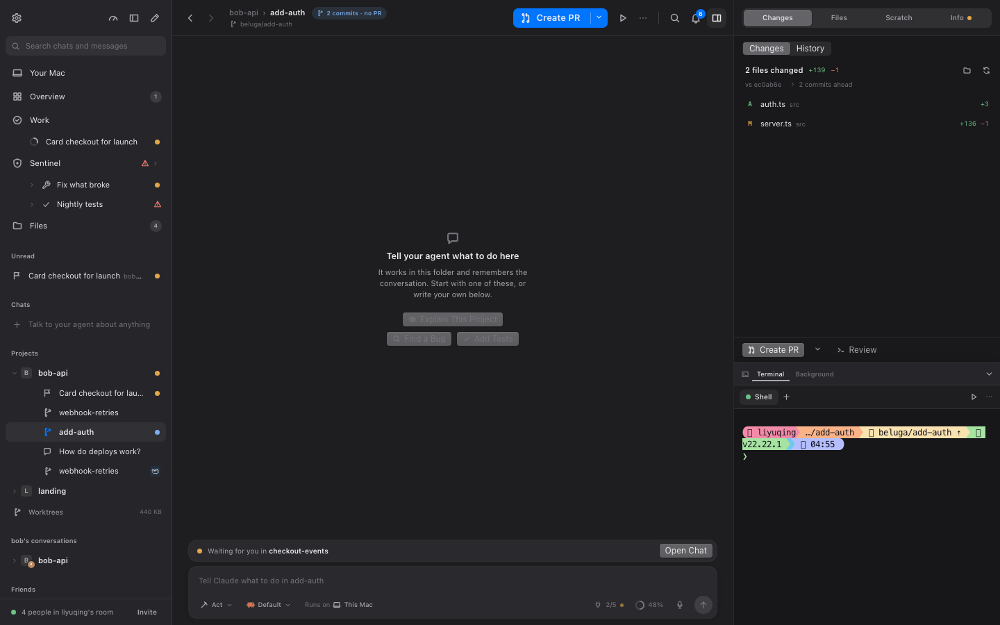 |
| 16 | 浅色 | 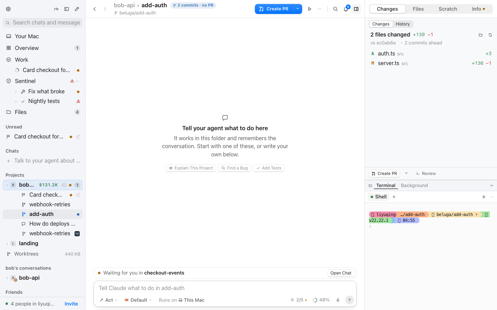 | 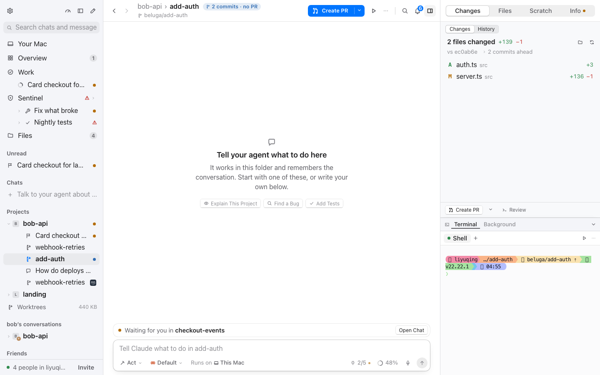 |
| 16 | 深色 | 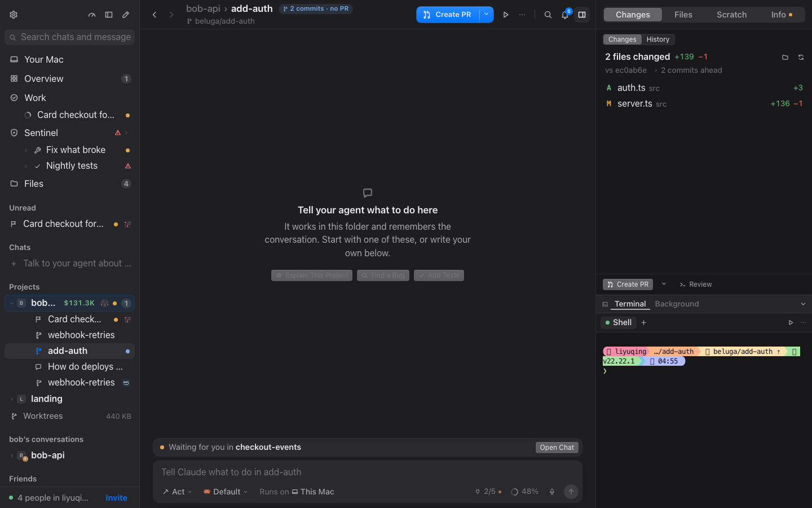 | 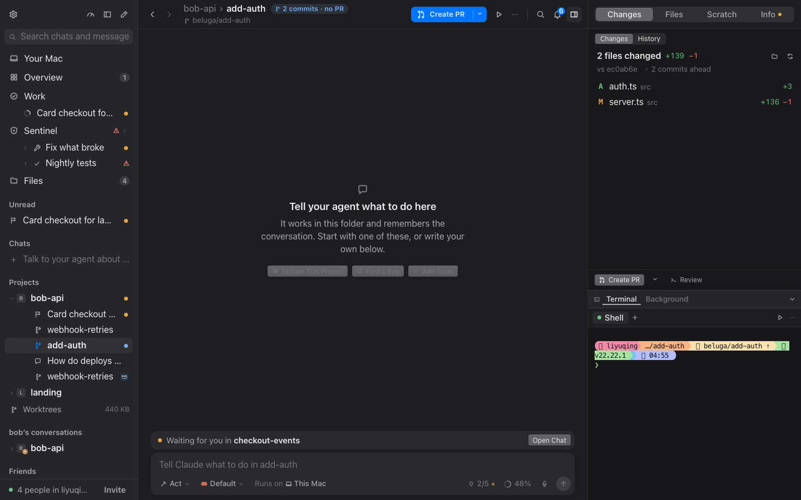 |

这是沉稳开时有意的变化：原来用 px 写的字号现在跟着文字大小偏好缩放，标题和说明比上游略大或略小，没有换行、截断上的差别。

**沉稳关时字号字重与上游一致（脚本比对）**：同一个演示数据下，开两个开发服务器，一个带插件（沉稳关），一个用同一份配置去掉 `beluga-calm-type` 插件（即上游）；在工作区、任务页、Sentinel、总览四个页面里对每个有宽度的元素取计算后的 `font-size`/`font-weight`，用「标签 + 去掉哈希的 class + 开头文字」做键。比对 1012 个元素：**0 个不同**。（这个脚本是一次性的，在 `.beluga/scratch/type-check.mjs`，没有提交；沿用 §3.6 的测试，还原所有改写后与原 CSS 逐字节相同。）

**构建**：`packages/mac` 的 `npm run build`（`tsc --noEmit && vite build`）通过；`typecheck` 通过。`npm run app:build` 的结果见本任务 brief。

## 6. BLG-246 复核（树 0fe34fc37）

| 项 | 结果 |
| --- | --- |
| 六场景改前图（浅色、深色，12 张） | 齐全：`docs/calm/img/m8-before-*` |
| 六场景改后图（浅色、深色，12 张）+ 沉稳关 workspace、tasks（4 张） | 齐全：`docs/calm/img/m8-final-*` |
| `npx vitest run tests/fork-calm* tests/fork-sidebar*` | 全部通过（75 个用例，单独运行） |
| `npm run typecheck`（含 packages/mac） | 通过 |
| `node scripts/sync-upstream.mjs --report` | **通过**（BLG-253）：0 个 `!`、0 条「已不再改」。原来是 208 个 `!`（基线 `350e15ea9` 上同样是 208，M8 没有新增）；来源和处理见 §7。脚本和 `tests/upstream-sync.test.ts` 没有改。 |
| 全量 `npx vitest run`（树 0fe34fc37） | 737 个文件，9186 个用例：9167 通过、16 跳过、3 失败。3 个失败是 `tests/project-invites.test.ts`、`tests/test-lock.test.ts`（nice 用例）、`tests/chat/files.test.ts`，与 M8 无关；三者单独重跑全部通过，按「负载波动，单独重跑通过」处理。 |

仍在播放的动画、reduced-motion、问题表见 §5。

Tested-on: macOS 27.2 (Darwin 27.2.0, 2026-11-18, 作者的 Mac)，树 0fe34fc37（分支 beluga/blg-248-m8，基于 topic/native 350e15ea9）。`npx vitest run` 全量：737 个文件、9186 个用例，9167 通过、16 跳过、3 失败（均与 M8 无关，单独重跑通过）。sync-upstream --report 仍有 208 个未登记的 `!`（基线相同）。


## 7. 同步报告清零（BLG-253）

`node scripts/sync-upstream.mjs --report`：**0 个 `!`、0 条「已不再改」**，`tests/upstream-sync.test.ts` 通过。没有改脚本（也没有放宽规则）。

**208 个未登记文件的来源**（`git diff` 按链上每一层分别量）：没有一个是 M8 改的（M8 的上游改动只有 `packages/mac/vite.config.ts` 两行，已登记）。206 个来自 `topic/native` 的那个快照提交 `da1993452`（原生 Mac 控件、菜单、sheet、警告框、侧栏、沉稳界面，从 `archive/main-2026-11-17` 拆出）：样式 56、TSX/TS 144、只加了 `size` 的 2、Tauri 外壳 4（`packages/mac/src-tauri/` 的 `Cargo.toml`、`Cargo.lock`、`capabilities/default.json`、`src/lib.rs`：NSMenu、NSAlert、Quick Look、拖拽、NSSheet 的命令与依赖）。另外 2 个：`CLAUDE.md`（`fork/base` 的「Working in this fork」）和 `packages/mac/src/i18n/zh-CN.json`（`topic/chinese`/`fork/base` 的简体中文）。任务描述里举的 `src/core/shares.ts`、`src/machines/identity-load.ts` 在这棵树上不在 208 里（它们是计划层的，只出现在「已不再改」名单里）。

**登记**：`docs/fork.md` 新增小节「原生 Mac 控件与外壳的逐文件登记」，按改动性质列出全部完整路径；原因沿用该文档已有的「原生控件」「原生菜单与按下指针」两节（控件规范 `docs/mac-controls.md` 直接改在上游自己的文件里，因为它本来就要提回上游），`CLAUDE.md` 是 `fork/base` 的分支链说明，`zh-CN.json` 是中文翻译。

**迁到 fork 文件的改动**：没有。这 208 处是控件规范直接改在上游文件里的（为了提回上游），不是可以搬进 `fork/` 的小改动；`CLAUDE.md` 和 `zh-CN.json` 本来就是 fork 的文档和翻译。

**「已不再改」的 113 个名字**：这棵树（`topic/native` 的下游）没有改它们，从 `docs/fork.md` 的清单里拿下来（路径写成普通字、不加反引号，文档里加了一行说明）：100 个链上任何一层都不再改（上游已合并，或计划层改用了上游的实现）；13 个只有链上更靠后的分支改：

`src/companion/protocol.ts`、`src/core/plans/pilot.ts`、`packages/mac/src/plans/plan-ask-model.ts`、`tests/plans.test.ts`、`src/daemon/core.ts`、`src/ipc/handlers.ts`、`tests/companion-views.test.ts`、`src/core/claude-code/skills.ts`、`tests/skills.test.ts`、`tests/plan-milestone-agent.test.ts`、`tests/delete-unpushed.test.ts`、`tests/other-worktrees.test.ts`、`tests/smart-archive.test.ts`

其中 `src/companion/protocol.ts`、`src/core/plans/pilot.ts`、`packages/mac/src/plans/plan-ask-model.ts`、`tests/plans.test.ts`、`src/daemon/core.ts`、`src/ipc/handlers.ts`、`tests/companion-views.test.ts`、`src/core/claude-code/skills.ts`、`tests/skills.test.ts`、`tests/plan-milestone-agent.test.ts` 在 `topic/plans` 上还改（核对过），其余 3 个在链上哪一层都不改。

**合回 topic/native 后应把非 native 的条目搬到对应链分支**：这份登记本属于链上更低的分支。`docs/fork.md` 里「原生 Mac 控件与外壳的逐文件登记」中，`CLAUDE.md` 属于 `fork/base`，`zh-CN.json` 属于 `topic/chinese`；上面那 10 个只在 `topic/plans` 改的文件，到 `topic/plans` 上要把反引号加回去，否则那里会出现 10 个 `!`。

## 8. 补跑的延后项：chatrun、plan、tasks 与 Create PR 最终图（BLG-254）

树 `88214257f`，机器 load 约 7（`uptime`），演示 daemon 与 vite 用隔离的 `BELUGA_HOME=/tmp/calm-demo`、`BELUGA_ALLOW_ORIGINS=http://localhost:1420`，`node packages/mac/scripts/calm-check.mjs chatrun plan tasks`（四个组合，浅色）。

**chatrun（阅读位置与「有新内容」提示）**

| 组合 | CLS | 阅读位置偏移 | 提示 | 新增行 | 仍在播放的动画 / JS 动效 |
| --- | ---: | ---: | --- | ---: | --- |
| 沉稳开 · full | 0.101 | **0 px** | 「6 new below」 | **6** | 0 / 0 |
| 沉稳开 · reduce | 0.135 | **0 px** | 「4 new below」 | **4** | 0 / 0 |
| 沉稳关 · full | 0.104 | 0 px | 「Latest」 | 0 | 0 / 50（上游的 live-motion） |
| 沉稳关 · reduce | 0.085 | 0 px | 「Latest」 | 0 | 0 / 0 |

沉稳开：滚离底部之后来了新内容，阅读位置不动，提示数出新增的行；沉稳关与上游一致（「Latest」，不计数）。

**plan 与 tasks（沉稳开：JS 动效来自哪里）**

| 场景 | 组合 | CLS | 动画 | JS 动效 |
| --- | --- | ---: | ---: | ---: |
| plan | 沉稳开 full / reduce | 0.003 / 0.000 | 0 / 0 | **0 / 0** |
| plan | 沉稳关 full / reduce | 0.000 / 0.000 | 0 / 0 | 42 / 0 |
| tasks | 沉稳开 full / reduce | 0.000 / 0.000 | 0 / 0 | **0 / 0** |
| tasks | 沉稳关 full / reduce | 0.000 / 0.000 | 0 / 0 | 42 / 0 |

沉稳开时这两页没有任何 JS 动效（白名单里的那一种进度指示这两页没有出现），沉稳关时是上游的 42 处。

**过程里要说的两件事**：① `calm-check.mjs` 的提示匹配只认「Latest」和「N new」，而沉稳开的提示文字早已是「N new below」，所以前几次跑（树 `1b7c32576` 前后）显示「提示 null、新增 0」。这是脚本过期，不是功能坏了；这次把匹配改成 `^(Latest|\d+ new( below)?)$`（`packages/mac/scripts/calm-check.mjs` 两行）。② 机器忙的时候 chatrun 的 CLS 和阅读位置会抖：同一棵树上前几次跑沉稳开 full 出现过 CLS 0.186–0.239、一次阅读位置偏移 −590 px，沉稳关也有 0.153–0.216；load 降到 7 之后的这一次是上表的数字。对话区的 CLS 绝对值本来就在 0.08–0.14 这个量级（沉稳关同量级），没有因此判定为回归，但这一项对机器负载敏感。

**Create PR 的最终图**（工具栏，2 倍；沉稳关是上游，沉稳开是最终树）：

| 主题 | 沉稳关（上游） | 沉稳开（最终） |
| --- | --- | --- |
| 浅色 |  |  |
| 深色 |  |  |

计算样式（Create PR 按钮及 6 层祖先）：沉稳开 `background` 是纯色 `rgb(0 117 255)`，`box-shadow: none`，`filter`、`outline` 无，祖先无任何阴影、滤镜或轮廓；沉稳关是渐变加三层阴影（见 §1.7）。图上可见：沉稳开是平的纯色，没有光晕。

## 9. 全量 e2e（BLG-255）

**基线已有的失败，逐条处理**（基线 = topic/native 350e15ea9，在临时 worktree 里同样复现）：

| 用例 | 处理 |
| --- | --- |
| chat-drag:199、chat-paths:14 | 改 spec：前者在点「Your Mac」后把指针移出侧栏（沉稳在指针停在侧栏里时冻结顺序，BLG-165），后者按当前行为断言路径；登记在 docs/fork.md |
| unread:144 | 同样把指针移出侧栏，且以沉稳关运行 |
| live-preview:221 | 对比度辅助函数把渐变按钮当作透明底；改取渐变最后一个色标并识别 `color(srgb …)` 的 0–1 取值（修的是测试，不是界面） |
| pr-next-step:44 | 同一行在侧栏出现两次，严格模式断言改取 `.first()` |
| project-home-narrow「长分支名」 | 基线就失败：1900px 窗口里 Create Worktree 超出盒子。标 `test.fixme` 并写明原因，**未修**（不是 M8 的，布局在上游文件里） |
| app:437、agent-term:152 | 单独重跑都通过，是负载造成的抖动，无需改动 |

**M8 自己造成、已修的两处**：network 的两条推广卡用例（卡片在沉稳下被隐藏，用例以沉稳关运行）；subagents:82（悬停时把金额点阵一起翻出来，改成悬停不翻出金额，见 sidebar-look.css）。

**整轮结果**：`E2E_WORKERS=3 npm run e2e`，636 个用例：606 通过、8 失败、15 跳过、7 未运行，用时 27.3 分钟。机器负载在 13–25 之间（同时有别的会话在跑），不算空闲；因此 8 个失败都单独重跑：background-fetch:12、render-calm:31、sentinel:358、sidebar-calm:12、calls:73、worktree-link:15 单独重跑全部通过（负载抖动）；network:249 单独重跑也失败，原因是漏了沉稳关，补上后通过；project-home-narrow 的长分支名一例见上，标 fixme。清零后：失败 0，fixme 1。

## 10. 审计后的修复（2026-11-18）

对 M8 结果做了一次独立审计（代码、检查、最终树实拍），以下问题在 `plan/mac-fork` 上直接修了：

| 问题 | 修法 | 证据 |
| --- | --- | --- |
| 铃铛计数仍是强调色实底（计算样式 `rgb(0,117,255)`） | `calm-accent.css` 1b：`_iconBadge_` 用与 `_badgeUrgent_` 相同的中性 | `tests/fork-calm-accent.test.ts` 锚点检查；§5 工作区、任务页图 |
| 「2 commits · no PR」chip 仍是蓝色 | `calm-accent.css` 1c：`_pill_info_` 的 `--pill` 改为 `--text-2` | 同上 |
| 右侧面板的视图 tab（Changes、Files、Scratch、Info）随面板宽度伸缩（上游 `.tabs { width: 100% }`、`.tab { flex: 1 1 0 }`） | 新文件 `fork/calm/calm-tabs.css`：沉稳下每个 tab 按图标和名字定宽，整条居中；面板很窄时上游的折叠（只显示当前 tab 的名字）照旧 | `tests/fork-calm-tabs.test.ts`；§5 工作区图 |
| 引导页 6 层光晕被改写 | `glow-scan.ts` 的跳过目录从 `onboarding/scenes/` 改为 `onboarding/` | `vite build`：`calm-glow: 49 halo spreads on --calm-ring, 8 blurred glows on --calm-glow-off in 27 files; kept on purpose: 1` |
| `waitForTimeout(300)` | 改为 `waitForFunction`，等到页面上没有正在播放的 CSS 过渡 | `packages/mac/e2e/project-home-narrow.spec.ts` |
| §5 的最终图过时 | 六场景 × 浅色深色、沉稳关工作区和任务页，全部重拍（`calm-check`，calm 开/关、full、loaded）；§2.5 的「改后」「悬停」两张也重拍。演示数据里 bob-api 行本身就同时有点阵、琥珀点、计数三样，不用再克隆：静止时只露琥珀点，悬停时三样都展开 | `docs/calm/img/m8-final-*`、`m8-row-after-*`、`m8-row-hover-*` |
| §5.3、§6 过时 | 已更新 | 本页 |
| 行尾几个标记之间的间隙不一（4、7.5、8.5px：各自的 2px 外边距、14px 槽、琥珀点的 5.5/3.5px 外边距） | `sidebar-look.css`：每个标记按自身宽度，任意两个之间 6px，最后一个贴右边；琥珀点不再带外边距 | `tests/fork-sidebar-anchors.test.ts`；实测点阵→琥珀点 6px、琥珀点→计数 6px；`m8-row-after-*`、`m8-row-hover-*` 已重拍 |

M8-7、M8-13、M8-14 见 §11（M9）。

## 11. M9：剩余项（2026-11-18，topic/native）

| 问题 | 处理 | 证据 |
| --- | --- | --- |
| M8-7 推广卡的找回入口 | 不做：用户决定不要推广卡。沉稳开时保持隐藏（`calm-accent.css` 第 5 节），沉稳关时与上游一致 | — |
| M8-13 长分支名时 Create Worktree 出框 | 原因在上游 `project-home.module.css`（#527）：名字缩到最短后只剩分支一项在让，它的收缩系数 0.25 小于 1，按 Flexbox §9.7 只分到剩余溢出的四分之一，按钮被挤出 29px。改为名字 4、分支 1：名字照旧先让，分支能让完。已登记 `docs/fork.md`，适合提回上游 | `e2e/project-home-narrow.spec.ts` 去掉 `test.fixme`，11 例全过 |
| M8-14 悬停时名字被挤成「bob-…」 | 有悬停工具的行（项目的 New worktree、New chat、•••）悬停时只露工具和原来那一个标记，其余标记不再展开；没有工具的行照旧展开（`sidebar-look.css`） | `tests/fork-sidebar-one-mark.test.ts`；下图 |

| 悬停 | 浅色 | 深色 |
| --- | --- | --- |
| M9 之后 | 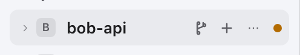 | 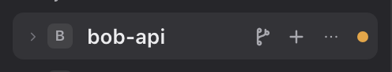 |
| M9 之前 |  |  |
