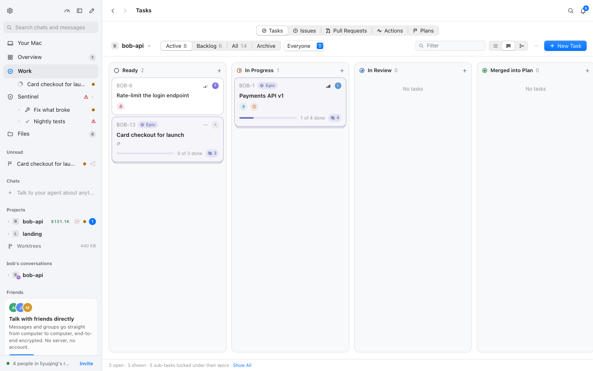
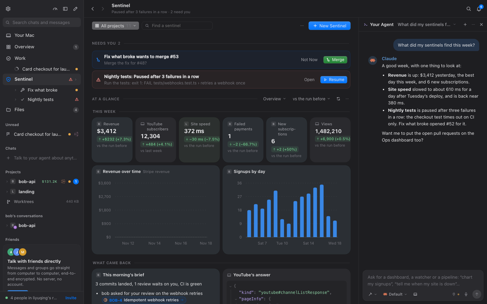
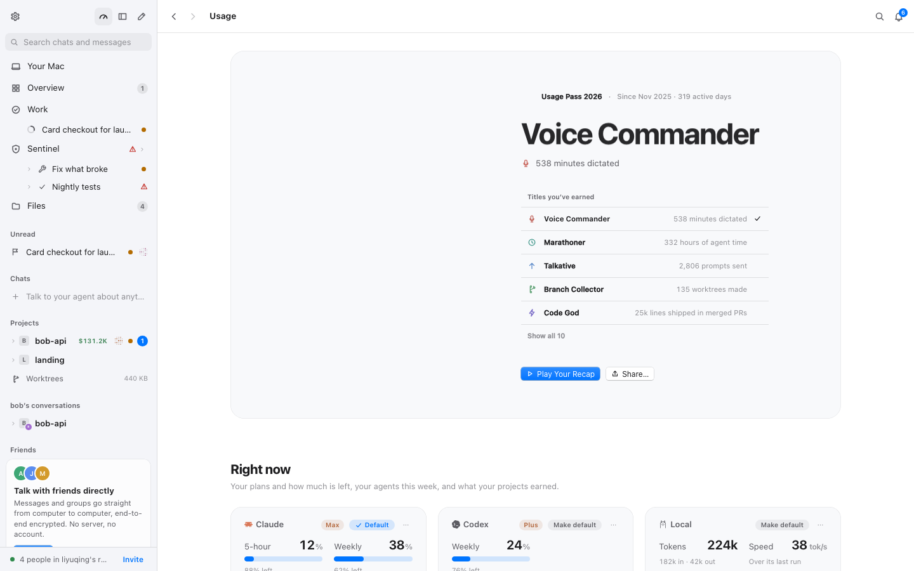

# 沉稳收尾（M8）：规则与清点

BLG-248 的产物。给后面 BLG-242、251、249、250、243、245、252、244、246 一份可照做的清单。本页只记录事实和规则；实施结果在各任务各自的节里补。

| 节 | 内容 | 状态 |
| --- | --- | --- |
| [§0](#0-基线与约定) | 基线、拍图命令、门控 | 本页 |
| [§1](#1-强调色) | 六场景改前图、实心强调色清单、每页主操作 | 本页（改后图待 BLG-242） |
| [§2](#2-行尾只占一个位置) | 行尾标记优先级表、锚点核对 | 本页（改后图待 BLG-243） |
| [§3](#3-字号字重) | 字号字重阶梯、映射表、例外、沉稳关时如何保持原值 | 本页（插件待 BLG-244） |
| [§4](#4-彩色光晕) | 光晕清单逐文件分类 | 本页（清理待 BLG-245） |
| §5 仍在播放的动画、reduced-motion、问题表 | 复核 | 待 BLG-246 |

## 0. 基线与约定

- **基线树**：`beluga/blg-248-m8` 从 `topic/native`（`350e15ea9 Merge fork/base into topic/native`）开出。改前图即这棵树。
- **拍图命令**（与 `packages/mac/scripts/calm-check.mjs` 文件头一致）：
  ```bash
  BELUGA_HOME=/tmp/calm-demo BELUGA_ALLOW_ORIGINS=http://localhost:1420 npm run dev        # 仓库根：demo daemon
  cd packages/mac && BELUGA_HOME=/tmp/calm-demo npm run dev                                # 网页端 1420
  BELUGA_THEME=light node packages/mac/scripts/calm-check.mjs workspace chatsteps tasks plan sentinel usage
  BELUGA_THEME=dark  node packages/mac/scripts/calm-check.mjs workspace chatsteps tasks plan sentinel usage
  ```
  `BELUGA_HOME` 指向一次性目录，demo 数据不进真实 Beluga 目录。`calm-check` 把图写到 `.context/calm/img/`（被 git 忽略）；本页用到的改前图复制到 `docs/calm/img/m8-before-<scene>-<light|dark>.png`。chatsteps 取 `running` 时刻，其余取 `loaded`。
- **门控**：M8 新增的每条 CSS 都以 `:root[data-calm]` 开头。沉稳关时 M8 不改变任何画面。
- **改前基线（本树实测，`.beluga/scratch/gen-m8.mjs`）**：

  | 项 | 实测 | 计划里写的 |
  | --- | ---: | --- |
  | `font-size` 声明 | 1579 | 1579 |
  | `font-size` 不同写法 | 107 | 107 |
  | `font-weight` 声明 | 744 | 744 |
  | `font-weight` 不同写法 | 14 | 67（本页未复现，见 §3.4） |
  | 带强调/状态色的光晕行（按 §4 判定） | 212 行，74 个文件 | 约 75 个文件（grep 口径 205 行、77 个文件） |

## 1. 强调色

### 1.1 改前图（浅色、深色，calm 开、full 动效，loaded；chatsteps 取 running）

| 场景 | 浅色 | 深色 |
| --- | --- | --- |
| 任务页 tasks |  |  |
| 对话进行中 chatsteps |  |  |
| Sentinel |  |  |
| 工作区 workspace |  |  |
| 计划 plan |  |  |
| 用量 usage |  |  |

改后图在 BLG-242 补：`img/m8-after-<scene>-<theme>.png`，与上表并排。

### 1.2 每页实心强调色清单与去留

「实心」指填充的强调色底（蓝、绿）的按钮或块。浅色图逐页核对；深色图与浅色同位置，BLG-242 开工时逐张核对。

| 页面 | 实心强调色元素（浅色图实测） | 去留 | 唯一主操作 |
| --- | --- | --- | --- |
| 任务页 | 「New Task」实心蓝 | **留**，主操作 | New Task |
| 任务页 | 「Everyone」下拉箭头块（蓝） | 改中性 bezel，箭头 `--text-2`（§1 规则 2） | — |
| 任务页 | 「Show All」蓝字链；侧栏房间条「Invite」蓝字 | 改 `--text-2`，悬停 `--text` 加下划线（规则 3） | — |
| 任务页 | 侧栏 bob-api 计数蓝底「1」；顶栏铃铛计数 | 改中性实心（规则 1） | — |
| 任务页 | 侧栏推广卡「Talk with friends directly」的蓝色按钮 | 随推广卡藏起（规则 5，BLG-250） | — |
| 工作区 | 「Create PR」实心蓝 | **留**，主操作 | Create PR |
| 工作区 | 「2 commits · no PR」蓝字 chip | 改中性（它是状态，不是操作） | — |
| 工作区 | 侧栏当前项目行 bob-api 蓝底框 + 选中行 add-auth | 当前项目行去底（规则 4，BLG-249）；选中行保留 `--sb-selected` | — |
| 工作区 | 推广卡 Turn On；Invite；计数 | 同任务页 | — |
| 对话进行中 | 「Create PR」实心蓝 | **留**，主操作 | Create PR |
| 对话进行中 | 停止按钮（深色实心圆） | **不算强调色**（中性实心，状态控件），保留；它不是主操作 | — |
| 对话进行中 | 发送箭头、Queue、Steer、「2/5」 | 中性，不动 | — |
| Sentinel | 「New Sentinel」实心蓝 | **留**，主操作（页面的 New Sentinel / Turn On 二选一，这里选 New Sentinel） | New Sentinel |
| Sentinel | 「需要你」卡里的「Merge」实心绿 | **改中性次按钮**（本页决定，设计未写）：绿是成功色，不该在这里当主操作 | — |
| Sentinel | 「需要你」卡里的「Resume」实心蓝 | **改中性次按钮**（同上，一页只留一个实心） | — |
| Sentinel | 「Not Now」「Open」 | 已是中性，不动 | — |
| 计划、用量 | 本轮未逐页核对浅色图 | BLG-242 开工时补核，结果补进本表 | 待补 |

结论：三个场景同屏，实心强调色各只剩一个主操作（New Task、Create PR、New Sentinel）。对话框的默认按钮不受影响。

### 1.3 按 §1 规则的 CSS 锚点（BLG-242 用）

- 徽标 `Badge urgent`：`ui.module.css` 约第 150、269 行的强调底。
- 下拉箭头：Select 触发器（`components/select.module.css`）。
- 当前项目行：`layout/Sidebar.module.css` 的 `_currentProject_`（只在 sidebar-look.css 里覆盖）。
- 推广卡：`network/NetworkSidebar.tsx:49` 的 `role="group" aria-label="Talk with friends"`，标题在 :55。
- 焦点圈：`styles/tokens.css:167` `--focus-ring: 0 0 0 3px color-mix(in srgb, var(--accent) 50%, transparent)`。沉稳下改成 `0 0 0 2px color-mix(in srgb, var(--accent) 75%, transparent)`（design §1.6）。Create PR 的光晕先确认是不是它（BLG-242 里用开发者工具核对；截图脚本是否给按钮留了焦点，需在 calm-check 里看）。

## 2. 行尾只占一个位置

### 2.1 优先级表（覆盖 `layout/signal-marks.tsx` 的全部标记）

数字越小越优先。同一行只显示优先级最高的一个标记，其余设 `data-fork-mark-hidden`（BLG-243）。

| 级 | 类别 | 来源（signal-marks.tsx / 上游） | 锚点 | 收起后去哪里看 |
| --- | --- | --- | --- | --- |
| 0 | status | `workspace-row.tsx:223` 的 `Archiving…`；正在建 worktree 的 `_making_` | `[data-archiving]`，`[class*='_making_']`（**未核对**，见 §2.2） | 行的 detail 提示 |
| 1 | 需要你 | `NeedMark`（非问题）：左侧亮边 | `[data-signal='needs']:not([class*='_markProblem_'])` | 悬停展开；行的 `detail` |
| 2 | 问题 | `NeedMark`（conflict、checks）：红色 `!` | `[data-signal='needs'][class*='_markProblem_']` | 悬停展开；行的 `detail` |
| 3 | 计数 | `SignalMark` 的 `unread` → `Badge urgent` | `[data-signal='unread']`，`[data-tally] [class*='_badge_']` | 悬停展开；侧栏「Unread」分组 |
| 4 | 进行中（点阵） | `SignalMark` 的 `working` → `DotMark live` | `[data-signal='working']`，`[data-busy]`（**未找到**，见 §2.2） | 聊天页的步骤条 |
| 5 | 金额 | `ProjectTree.tsx:277` 的 `EarningsPill` | `[data-earnings-pill]`（**未找到**，见 §2.2） | 项目主页；用量页 |
| 6 | 团队 | `ProjectTree` 的 `TeamBadge`（`team/Team.tsx:66`） | 待定（BLG-251 确认类名，避免和 `_badge_` 撞） | 项目主页的团队区 |
| 7 | 安静 | `LaterMark`（`data-signal='later'`）、`ScheduledMark`（`data-scheduled`）、`DotMark` 的 git 点（无 signal，即 `fallback`） | `[data-signal='later']`，`[data-scheduled]`，无 `data-signal` 的 `_mark_` | 悬停；定时的去 Sentinel 页 |
| 容器 | 项目/文件夹的 `TallyMark` | `TallyMark`（`data-tally="needs:unread"`） | 不单独计级：里面的需要你 edge 按 1 计，Badge 按 3 计；收起时整体只占一个位置 | 展开项目 |

不参与归并：`hoverTools` 里的按钮。认不出来的元素不动。

**为什么比目标里的四级多**：目标写「需要你 > 问题 > 计数 > 金额/点阵」。实际行上还有 status（行正在变化，只显示那段文字）、团队、安静标记，以及进行中（点阵）和金额要分开：进行中是 Claude 正在干活的信号，比金额更需要被看见。所以在四级之间加了 status、进行中、团队、安静四档。这样「需要你」和「问题」仍然最前，金额仍然只在没有更紧急的信号时才显示。

### 2.2 锚点核对（BLG-243 开工前必须处理）

在本树 `packages/mac/src` 里核对设计里写的锚点：

| 设计里的锚点 | 实测 | 处理 |
| --- | --- | --- |
| `[data-signal='unread']`、`[data-signal='needs']`、`[data-signal='working']`、`[data-signal='later']` | 存在（signal-marks.tsx:30、45、54、80） | 直接用 |
| `[data-tally]` | 存在（signal-marks.tsx:98） | 直接用 |
| `[data-scheduled]`、`[data-driven-by]`、`[data-archiving]` | 存在（signal-marks.tsx:64；workspace-row.tsx:223、229） | 直接用 |
| `[class*='_markProblem_']` | 存在（signal-marks.tsx:30 的 `m.markProblem`） | 直接用 |
| `[data-earnings-pill]` | **不存在**：`EarningsPill` 没有这个属性 | BLG-251 在 `EarningsPill` 根元素加 `data-earnings-pill`（1 行，登记到 docs/fork.md）；或改用 `[class*='_pill_']`（不稳，不推荐） |
| `[data-busy]` | **不存在**：`ProjectTree` 的 busy 点没有这个属性 | BLG-251 在 busy 的 `Dot claude live` 外层加 `data-busy`（1 行，登记）；或用 `[data-signal='working']` 的点，这是已存在的锚点 |
| `[class*='_making_']` | 未在 layout 的 CSS 里找到 | 实施时先 grep；找不到就删掉这一行，不要硬写 |
| TeamBadge 的类名 | 未核对 | BLG-251 看 `team/team.module.css` 后确定 |

### 2.3 改前图（同一行：浅色 bob-api 项目行、深色 bob-api 行）

同一行的改前、改后、悬停三张图，BLG-243 补：`img/m8-before-row-…`、`img/m8-after-row-…`、`img/m8-hover-row-…`。本页先用上面的工作区改前图（侧栏 bob-api 行尾同时有计数、金额、点阵）作为参照。

## 3. 字号字重

### 3.1 阶梯（8 档，沉稳下生效）

基准 13px（`--calm-fs-4` 即 13px 对应的 1rem）。

| 令牌 | 值 | 13px 基准下 | 典型用途（沿用上游已有的写法） |
| --- | --- | --- | --- |
| `--calm-fs-1` | 0.77rem | 10px | 徽标、时间戳 |
| `--calm-fs-2` | 0.846rem | 11px | 次要说明、标签 |
| `--calm-fs-3` | 0.923rem | 12px | 侧栏行、按钮文字 |
| `--calm-fs-4` | 1rem | 13px | 正文（基准） |
| `--calm-fs-5` | 1.154rem | 15px | 小标题 |
| `--calm-fs-6` | 1.385rem | 18px | 页面副标题 |
| `--calm-fs-7` | 1.692rem | 22px | 页面标题 |
| `--calm-fs-8` | 2.154rem | 28px | 大数字 |

字重：`--calm-fw-regular` 400；`--calm-fw-medium` 450–560（实际用 500、550、560）；`--calm-fw-semibold` 590–680（600、650）；`--calm-fw-bold` 700–800。

### 3.2 映射规则（`type-scale.ts`，BLG-244）

- **字号**：只归 9–30px 的 `px` 与 `rem` 值。按 13px 换成 px，取最近的一档；正好在中间时取小的一档。
- **字重**：按上面的区间取档；`normal` → regular，`bold` → bold。
- **保留**（不改写，进 kept 报告并写明原因）：`em`、`%`、`var()`、`calc()`、`clamp()`、`inherit`、`initial`、`unset`、`font:` 简写、自定义属性、超出区间的值。`!important` 保留。
- **改写形式**：`font-size: 0.9rem` → `font-size: var(--calm-fs-3, 0.9rem)`；`font-weight: 650` → `font-weight: var(--calm-fw-semibold, 650)`。插件不直接改数值。

### 3.3 映射表（实测，`gen-m8.mjs` 的输出）

下表是现在的写法 → 处理，按出现次数排序。「保留」的是例外。

- 字号：声明 1579 条，不同写法 107 种。能映射到令牌的 1434 条；保留 145 条，共 42 种。改写后不同写法约 **50 种**（42 种保留 + 8 个令牌）。
- 字重：声明 744 条，不同写法 14 种。能映射的 741 条；保留 3 条（inherit）。改写后不同写法约 **5 种**（1 种保留 + 4 个令牌）。
- 这是按映射规则算出的预计值（本页脚本），不是插件的实际输出；BLG-244 落地后以 `.context/calm/type-report.json` 为准。

**字号表**

| 旧写法 | 出现次数 | 处理 |
| --- | ---: | --- |
| `12px` | 195 | --calm-fs-3 (0.923rem) |
| `11.5px` | 124 | --calm-fs-3 (0.923rem) |
| `0.86rem` | 117 | --calm-fs-2 (0.846rem) |
| `11px` | 116 | --calm-fs-2 (0.846rem) |
| `0.88rem` | 91 | --calm-fs-2 (0.846rem) |
| `12.5px` | 85 | --calm-fs-4 (1rem) |
| `0.9rem` | 84 | --calm-fs-3 (0.923rem) |
| `0.84rem` | 81 | --calm-fs-2 (0.846rem) |
| `0.82rem` | 65 | --calm-fs-2 (0.846rem) |
| `0.8rem` | 60 | --calm-fs-1 (0.77rem) |
| `13px` | 59 | --calm-fs-4 (1rem) |
| `10.5px` | 58 | --calm-fs-1 (0.77rem) |
| `0.92rem` | 47 | --calm-fs-3 (0.923rem) |
| `0.78rem` | 23 | --calm-fs-1 (0.77rem) |
| `0.85rem` | 20 | --calm-fs-2 (0.846rem) |
| `0.92em` | 19 | 保留：em (relative to parent) |
| `0.86em` | 19 | 保留：em (relative to parent) |
| `0.76rem` | 16 | --calm-fs-1 (0.77rem) |
| `13.5px` | 15 | --calm-fs-4 (1rem) |
| `0.85em` | 13 | 保留：em (relative to parent) |
| `10px` | 13 | --calm-fs-1 (0.77rem) |
| `14px` | 12 | --calm-fs-4 (1rem) |
| `0.9em` | 12 | 保留：em (relative to parent) |
| `1rem` | 12 | --calm-fs-4 (1rem) |
| `0.94rem` | 11 | --calm-fs-3 (0.923rem) |
| `var(--control-text)` | 10 | 保留：custom property |
| `0.95rem` | 9 | --calm-fs-3 (0.923rem) |
| `0.88em` | 9 | 保留：em (relative to parent) |
| `1.05rem` | 9 | --calm-fs-4 (1rem) |
| `0.95em` | 8 | 保留：em (relative to parent) |
| `0.74rem` | 7 | --calm-fs-1 (0.77rem) |
| `20px` | 7 | --calm-fs-6 (1.385rem) |
| `var(--control-text-small)` | 7 | 保留：custom property |
| `1.15rem` | 7 | --calm-fs-5 (1.154rem) |
| `0.72rem` | 6 | --calm-fs-1 (0.77rem) |
| `0.98rem` | 5 | --calm-fs-4 (1rem) |
| `22px` | 5 | --calm-fs-7 (1.692rem) |
| `1.1rem` | 5 | --calm-fs-5 (1.154rem) |
| `1.08rem` | 5 | --calm-fs-5 (1.154rem) |
| `15px` | 5 | --calm-fs-5 (1.154rem) |
| `9.5px` | 4 | --calm-fs-1 (0.77rem) |
| `1.02rem` | 4 | --calm-fs-4 (1rem) |
| `0.94em` | 3 | 保留：em (relative to parent) |
| `0.93rem` | 3 | --calm-fs-3 (0.923rem) |
| `1em` | 3 | 保留：em (relative to parent) |
| `calc(var(--control-text) - 1px)` | 3 | 保留：custom property |
| `9px` | 3 | --calm-fs-1 (0.77rem) |
| `26px` | 3 | --calm-fs-8 (2.154rem) |
| `0.84em` | 3 | 保留：em (relative to parent) |
| `var(--control-text-large)` | 3 | 保留：custom property |
| `1.9rem` | 3 | --calm-fs-7 (1.692rem) |
| `17px` | 3 | --calm-fs-6 (1.385rem) |
| `19px` | 3 | --calm-fs-6 (1.385rem) |
| `8.5px` | 2 | 保留：outside 9–30px (8.5px) |
| `1.25rem` | 2 | --calm-fs-5 (1.154rem) |
| `1.45rem` | 2 | --calm-fs-6 (1.385rem) |
| `1.2rem` | 2 | --calm-fs-5 (1.154rem) |
| `0.93em` | 2 | 保留：em (relative to parent) |
| `0.82em` | 2 | 保留：em (relative to parent) |
| `inherit` | 2 | 保留：keyword/inherit |
| `1.12rem` | 2 | --calm-fs-5 (1.154rem) |
| `1.04rem` | 2 | --calm-fs-4 (1rem) |
| `1.3rem` | 2 | --calm-fs-6 (1.385rem) |
| `30px` | 2 | --calm-fs-8 (2.154rem) |
| `16px` | 2 | --calm-fs-5 (1.154rem) |
| `1.95rem` | 2 | --calm-fs-8 (2.154rem) |
| `1.05em` | 1 | 保留：em (relative to parent) |
| `1.22em` | 1 | 保留：em (relative to parent) |
| `1.12em` | 1 | 保留：em (relative to parent) |
| `0.7rem` | 1 | --calm-fs-1 (0.77rem) |
| `calc(1em * var(--fit, 1))` | 1 | 保留：custom property |
| `1.06rem` | 1 | --calm-fs-4 (1rem) |
| `var(--md-size)` | 1 | 保留：custom property |
| `2em` | 1 | 保留：em (relative to parent) |
| `1.45em` | 1 | 保留：em (relative to parent) |
| `1.2em` | 1 | 保留：em (relative to parent) |
| `24px` | 1 | --calm-fs-7 (1.692rem) |
| `0.75rem` | 1 | --calm-fs-1 (0.77rem) |
| `0.96rem` | 1 | --calm-fs-3 (0.923rem) |
| `1.42rem` | 1 | --calm-fs-6 (1.385rem) |
| `calc(var(--text-size) + 0.5px)` | 1 | 保留：custom property |
| `0.78em` | 1 | 保留：em (relative to parent) |
| `1.5rem` | 1 | --calm-fs-6 (1.385rem) |
| `1.32rem` | 1 | --calm-fs-6 (1.385rem) |
| `clamp(28px, 3.4vw, 40px)` | 1 | 保留：calc/clamp |
| `14.5px` | 1 | --calm-fs-5 (1.154rem) |
| `clamp(38px, 5.4vw, 64px)` | 1 | 保留：calc/clamp |
| `15.5px` | 1 | --calm-fs-5 (1.154rem) |
| `7.5px` | 1 | 保留：outside 9–30px (7.5px) |
| `max(12px, min(clamp(17px, 12cqi, 40px), var(--fits)))` | 1 | 保留：custom property |
| `max(12px, min(clamp(17px, 11cqi, 44px), var(--fits)))` | 1 | 保留：custom property |
| `var(--text-size)` | 1 | 保留：custom property |
| `0` | 1 | 保留：keyword or other unit |
| `1.35rem` | 1 | --calm-fs-6 (1.385rem) |
| `1.7rem` | 1 | --calm-fs-7 (1.692rem) |
| `1.62rem` | 1 | --calm-fs-7 (1.692rem) |
| `clamp(1.3rem, 2.4vw, 1.9rem)` | 1 | 保留：calc/clamp |
| `clamp(3.4rem, 9vw, 7.5rem)` | 1 | 保留：calc/clamp |
| `0.42em` | 1 | 保留：em (relative to parent) |
| `clamp(1.05rem, 1.6vw, 1.3rem)` | 1 | 保留：calc/clamp |
| `clamp(2.6rem, 5.4vw, 5.2rem)` | 1 | 保留：calc/clamp |
| `2.05rem` | 1 | --calm-fs-8 (2.154rem) |
| `1.6rem` | 1 | --calm-fs-7 (1.692rem) |
| `1.55rem` | 1 | --calm-fs-7 (1.692rem) |
| `0.6em` | 1 | 保留：em (relative to parent) |
| `clamp(2.4rem, 4.6vw, 3.6rem)` | 1 | 保留：calc/clamp |
| `1.35em` | 1 | 保留：em (relative to parent) |

**字重表**

| 旧写法 | 出现次数 | 处理 |
| --- | ---: | --- |
| `600` | 347 | --calm-fw-semibold |
| `500` | 173 | --calm-fw-medium |
| `650` | 100 | --calm-fw-semibold |
| `550` | 66 | --calm-fw-medium |
| `400` | 30 | --calm-fw-regular |
| `700` | 13 | --calm-fw-bold |
| `560` | 5 | --calm-fw-medium |
| `inherit` | 3 | 保留：custom property / inherit |
| `590` | 2 | --calm-fw-semibold |
| `450` | 1 | --calm-fw-medium |
| `680` | 1 | --calm-fw-semibold |
| `800` | 1 | --calm-fw-bold |
| `750` | 1 | --calm-fw-bold |
| `720` | 1 | --calm-fw-bold |

### 3.4 统计口径与「67 种」

- 计划里的 67 种 `font-weight` 写法本页没有复现。本树按「去掉 `!important` 后的不同取值」只得到 14 种。可能的解释：计划用了别的口径（比如把 `font:` 简写、`!important` 写法、或别的伪类文件分开算）。BLG-244 的测试要先定义口径并写在这里；在这之前，报告里以 14 为准。
- font-size 的 107 种与计划一致。

### 3.5 例外

- `em`、`%`、`calc/clamp`、自定义属性、`inherit`：保留，原因写在上表。
- 超出 9–30px 的值（如 `font-size: 32px` 的大标题、`8px` 的装饰字）：保留，原因写在表里。
- keep-decor 目录（`onboarding/scenes`、`Wormhole`、`reactbits`、`PixelBurst`、`star-scene`、`call`、`YourCard`）：整个目录跳过，不改写。
- 用户「文字大小」偏好：原来用 `px` 的字号归到 rem 令牌后，会跟着偏好缩放。这是沉稳下有意的变化，BLG-244 在 finish.md 写明，并在 textSize 11 和 16 下各拍一张 workspace 图。

### 3.6 沉稳关时如何保持上游原值

- 令牌只在 `:root[data-calm]` 下定义（`calm-type.css`）。沉稳关时 `:root` 没有 `data-calm`，变量未定义。
- `var(--calm-fs-3, 0.9rem)` 在变量未定义时取 fallback `0.9rem`，即原值。所以计算结果与上游完全相同。
- 测试（BLG-244，`tests/fork-calm-type.test.ts`）断言：每个改写出的 `var()` 的 fallback 都等于原字面量。这条是「沉稳关时等价」的证据。
- 插件抛错时原样返回 `code`，不能让构建失败。

## 4. 彩色光晕

### 4.1 判定（BLG-245 用 `findGlows` 时照这个）

光晕 = `box-shadow` 或 `filter: drop-shadow`，且满足：
- 颜色引用 `--accent`、`--warn`、`--error`、`--success`、`--merged`、`--merge`、`--claude`、状态色，或是饱和的字面色；**并且**
- blur > 0 或 spread > 2px。

不算光晕：`--hairline`、`rgb(0 0 0 / x)`、`--shadow-*`、`--control-drop` 这类中性阴影；0.5–2px 的实线描边（bezel、拖放目标的清晰框）。键盘焦点圈按 §1.3 的清晰细圈处理，归为无障碍例外。

### 4.2 清单（实测，74 个文件、212 行）

分类含义：
- **fork 自有**：在 `fork/` 下，我们自己的文件，可以直接覆盖。
- **例外：keep-decor**：维持原状，不动。
- **上游文件**：默认先试 `fork/calm/calm-glow.css` 覆盖（门控 `:root[data-calm]`）；覆盖不了（内联 style、JS 写的阴影）才改上游文件，并登记到 docs/fork.md。

「首个值」只显示第一条，供核对。BLG-245 逐行确认，结果写进 §4 的状态列。

| --- | ---: | --- | --- |
| `agent-term/agent-term.module.css` | 2 | box-shadow: inset 0 0 0 1px color-mix(in srgb, var(--chip-accent, #a99ad9) 42%, transparen | 上游文件：先试 calm-glow.css 覆盖；覆盖不了才改上游并登记 |
| `call/notes.module.css` | 3 | box-shadow: inset 0 0 0 1.5px var(--accent) | 例外：keep-decor 目录，维持原状 |
| `call/pointer.module.css` | 1 | box-shadow: 0 0 0 1.5px #ffffff | 例外：keep-decor 目录，维持原状 |
| `callfloat/callfloat.module.css` | 1 | box-shadow: var(--lift), inset 0 0 0 1.5px color-mix(in srgb, var(--error) 50%, transparen | 上游文件：先试 calm-glow.css 覆盖；覆盖不了才改上游并登记 |
| `chat/attention.module.css` | 2 | box-shadow: 0 0 0 1px color-mix(in srgb, var(--warn) 55%, transparent), 0 2px 12px rgba(0, | 上游文件：先试 calm-glow.css 覆盖；覆盖不了才改上游并登记 |
| `chat/chat-keys.module.css` | 1 | box-shadow: inset 0 0 0 1px var(--error) | 上游文件：先试 calm-glow.css 覆盖；覆盖不了才改上游并登记 |
| `chat/composer.module.css` | 2 | box-shadow: 0 0 0 1px color-mix(in srgb, var(--accent) 70%, transparent), 0 0 0 3px color- | 上游文件：先试 calm-glow.css 覆盖；覆盖不了才改上游并登记 |
| `chat/draft.module.css` | 1 | box-shadow: 0 0 0 2px color-mix(in srgb, var(--accent) 60%, transparent) | 上游文件：先试 calm-glow.css 覆盖；覆盖不了才改上游并登记 |
| `chat/key-paste.module.css` | 1 | box-shadow: inset 0 0 0 1px var(--error) | 上游文件：先试 calm-glow.css 覆盖；覆盖不了才改上游并登记 |
| `chat/max.module.css` | 2 | box-shadow: 0 2px 14px color-mix(in srgb, var(--f1, #3fa2ff) calc(var(--burn, 1) * 14%), t | 上游文件：先试 calm-glow.css 覆盖；覆盖不了才改上游并登记 |
| `chat/mention.module.css` | 3 | box-shadow: 0 0 0 2px color-mix(in srgb, var(--accent) 16%, transparent) | 上游文件：先试 calm-glow.css 覆盖；覆盖不了才改上游并登记 |
| `chat/picker.module.css` | 1 | box-shadow: 0 0 0 2px color-mix(in srgb, var(--accent) 45%, transparent) | 上游文件：先试 calm-glow.css 覆盖；覆盖不了才改上游并登记 |
| `claude-code/agent-monitor.module.css` | 1 | box-shadow: 0 0 0 2px color-mix(in srgb, var(--claude) 35%, transparent) | 上游文件：先试 calm-glow.css 覆盖；覆盖不了才改上游并登记 |
| `claude-code/claude-code.module.css` | 1 | box-shadow: inset 0 0 0 1px color-mix(in srgb, var(--accent) 55%, transparent) | 上游文件：先试 calm-glow.css 覆盖；覆盖不了才改上游并登记 |
| `components/ProjectIcon.module.css` | 1 | box-shadow: inset 0 0 0 0.5px hsl(var(--h) 40% 50% / 0.25) | 上游文件：先试 calm-glow.css 覆盖；覆盖不了才改上游并登记 |
| `components/code/code.module.css` | 1 | box-shadow: inset 2px 0 0 color-mix(in srgb, var(--accent) 70%, transparent) | 上游文件：先试 calm-glow.css 覆盖；覆盖不了才改上游并登记 |
| `components/form.module.css` | 1 | box-shadow: inset 0 0 0 0.5px var(--error), 0 0 0 3px color-mix(in srgb, var(--error) 40%, | 上游文件：先试 calm-glow.css 覆盖；覆盖不了才改上游并登记 |
| `components/graph/graph.module.css` | 11 | box-shadow: inset 0 0 0 1px color-mix(in srgb, var(--accent) 18%, transparent) | 上游文件：先试 calm-glow.css 覆盖；覆盖不了才改上游并登记 |
| `components/markdown/code-editor.module.css` | 1 | box-shadow: inset 0 0 0 1px color-mix(in srgb, var(--error) 70%, transparent), 0 0 0 3px c | 上游文件：先试 calm-glow.css 覆盖；覆盖不了才改上游并登记 |
| `components/preview/preview.module.css` | 2 | box-shadow: inset 0 0 0 1.5px color-mix(in srgb, var(--accent) 70%, transparent) | 上游文件：先试 calm-glow.css 覆盖；覆盖不了才改上游并登记 |
| `components/reactbits/GlassSurface.css` | 3 | box-shadow: 0 0 2px 1px light-dark(color-mix(in oklch, black, transparent 85%), color-mix( | 例外：keep-decor 目录，维持原状 |
| `components/select.module.css` | 1 | box-shadow: 0 0 0 2px color-mix(in srgb, var(--accent) 45%, transparent) | 上游文件：先试 calm-glow.css 覆盖；覆盖不了才改上游并登记 |
| `components/telemetry-levels.module.css` | 3 | box-shadow: inset 0 0 0 1.5px color-mix(in srgb, var(--accent) 60%, transparent) | 上游文件：先试 calm-glow.css 覆盖；覆盖不了才改上游并登记 |
| `components/update.module.css` | 1 | box-shadow: 0 0 0 2px color-mix(in srgb, var(--accent) 55%, transparent) | 上游文件：先试 calm-glow.css 覆盖；覆盖不了才改上游并登记 |
| `components/views/inline.module.css` | 3 | box-shadow: inset 0 0 0 1px color-mix(in srgb, var(--ok) 22%, transparent) | 上游文件：先试 calm-glow.css 覆盖；覆盖不了才改上游并登记 |
| `components/views/views.module.css` | 15 | box-shadow: inset 0 0 0 1px color-mix(in srgb, var(--accent) 22%, transparent) | 上游文件：先试 calm-glow.css 覆盖；覆盖不了才改上游并登记 |
| `dialogs/env-settings.module.css` | 4 | box-shadow: 0 0 0 1px var(--accent), 0 0 0 3.5px color-mix(in srgb, var(--accent) 22%, tra | 上游文件：先试 calm-glow.css 覆盖；覆盖不了才改上游并登记 |
| `dialogs/fire-settings.module.css` | 2 | box-shadow: 0 0 0 1.5px var(--accent) | 上游文件：先试 calm-glow.css 覆盖；覆盖不了才改上游并登记 |
| `dialogs/keyboard.module.css` | 3 | box-shadow: 0 0 0 1px color-mix(in srgb, var(--accent) 45%, transparent) | 上游文件：先试 calm-glow.css 覆盖；覆盖不了才改上游并登记 |
| `dialogs/menubar-settings.module.css` | 1 | box-shadow: 0 0 0 0.5px rgb(255 255 255 / 0.08) | 上游文件：先试 calm-glow.css 覆盖；覆盖不了才改上游并登记 |
| `dialogs/native/person.module.css` | 2 | box-shadow: 0 0 0 3px color-mix(in srgb, var(--accent) 30%, transparent), 0 0 0 0.5px var( | 上游文件：先试 calm-glow.css 覆盖；覆盖不了才改上游并登记 |
| `dialogs/native/shared.module.css` | 1 | box-shadow: 0 0 0 0.5px color-mix(in srgb, var(--accent) 40%, transparent) | 上游文件：先试 calm-glow.css 覆盖；覆盖不了才改上游并登记 |
| `dialogs/settings.module.css` | 1 | box-shadow: 0 0 0 3px color-mix(in srgb, var(--accent) 25%, transparent), inset 0 0 0 1px  | 上游文件：先试 calm-glow.css 覆盖；覆盖不了才改上游并登记 |
| `dialogs/sound/sound.module.css` | 1 | box-shadow: 0 0 0 1px color-mix(in srgb, var(--accent) 70%, transparent) | 上游文件：先试 calm-glow.css 覆盖；覆盖不了才改上游并登记 |
| `dialogs/support.module.css` | 3 | box-shadow: 0 0 0 2px var(--bg-raised), 0 0 0 4px color-mix(in srgb, var(--accent) 45%, tr | 上游文件：先试 calm-glow.css 覆盖；覆盖不了才改上游并登记 |
| `dialogs/terminal-settings.module.css` | 1 | box-shadow: 0 0 0 2px var(--accent) | 上游文件：先试 calm-glow.css 覆盖；覆盖不了才改上游并登记 |
| `dialogs/themes.module.css` | 1 | box-shadow: 0 0 0 2px var(--accent) | 上游文件：先试 calm-glow.css 覆盖；覆盖不了才改上游并登记 |
| `fork/calm/calm-status.css` | 1 | box-shadow: 0 0 0 2px color-mix(in srgb, var(--accent) 32%, transparent) | fork 自有：覆盖层或改成清晰细圈（BLG-245 逐条） |
| `fork/sidebar/sidebar-look.css` | 1 | box-shadow: inset 0 0 0 1.5px color-mix(in srgb, var(--accent) 60%, transparent) | fork 自有：覆盖层或改成清晰细圈（BLG-245 逐条） |
| `gateway/gateway.module.css` | 1 | box-shadow: 0 0 0 1px color-mix(in srgb, var(--error) 32%, transparent) | 上游文件：先试 calm-glow.css 覆盖；覆盖不了才改上游并登记 |
| `layout/Sidebar.module.css` | 5 | box-shadow: inset 0 0 0 2px color-mix(in srgb, var(--accent) 60%, transparent) | 上游文件：先试 calm-glow.css 覆盖；覆盖不了才改上游并登记 |
| `layout/SidebarSearch.module.css` | 1 | box-shadow: 0 0 0 1.5px color-mix(in srgb, var(--accent) 60%, transparent) | 上游文件：先试 calm-glow.css 覆盖；覆盖不了才改上游并登记 |
| `layout/chat-drag.module.css` | 3 | box-shadow: 0 0 0 2px var(--accent), 0 0 0 5px color-mix(in srgb, var(--accent) 18%, trans | 上游文件：先试 calm-glow.css 覆盖；覆盖不了才改上游并登记 |
| `layout/panel/panel.module.css` | 3 | box-shadow: inset 2px 0 0 var(--accent) | 上游文件：先试 calm-glow.css 覆盖；覆盖不了才改上游并登记 |
| `layout/people-here.module.css` | 1 | box-shadow: inset 0 0 0 1px #c9c9cf, 0 0 0 1.5px var(--bg) | 上游文件：先试 calm-glow.css 覆盖；覆盖不了才改上游并登记 |
| `layout/project-groups.module.css` | 2 | box-shadow: 0 0 0 2px color-mix(in srgb, var(--accent) 55%, transparent) | 上游文件：先试 calm-glow.css 覆盖；覆盖不了才改上游并登记 |
| `layout/signal.module.css` | 2 | box-shadow: inset 0 0 0 1px color-mix(in srgb, var(--warn) 32%, transparent) | 上游文件：先试 calm-glow.css 覆盖；覆盖不了才改上游并登记 |
| `lib/undo-toast.module.css` | 1 | box-shadow: 0 0 0 2px color-mix(in srgb, var(--accent) 55%, transparent) | 上游文件：先试 calm-glow.css 覆盖；覆盖不了才改上游并登记 |
| `network/network.module.css` | 3 | box-shadow: 0 0 0 3px color-mix(in srgb, var(--accent) 30%, transparent), 0 0 0 0.5px var( | 上游文件：先试 calm-glow.css 覆盖；覆盖不了才改上游并登记 |
| `onboarding/onboarding.module.css` | 9 | box-shadow: inset 0 0 0 0.5px color-mix(in srgb, var(--claude) 30%, transparent) | 上游文件：先试 calm-glow.css 覆盖；覆盖不了才改上游并登记 |
| `onboarding/scenes/machines.module.css` | 2 | box-shadow: 0 0 0 1px oklch(0.75 0.08 250 / 0.7), 0 30px 80px -20px rgba(0, 0, 0, 0.35) | 例外：keep-decor 目录，维持原状 |
| `onboarding/scenes/scenes.module.css` | 5 | box-shadow: 0 0 0 0 color-mix(in srgb, var(--claude) 60%, transparent) | 例外：keep-decor 目录，维持原状 |
| `onboarding/scenes/together.module.css` | 4 | box-shadow: 0 0 0 1px var(--accent) | 例外：keep-decor 目录，维持原状 |
| `onboarding/scenes/tour-scenes.module.css` | 2 | box-shadow: 0 0 0 1.5px var(--accent) | 例外：keep-decor 目录，维持原状 |
| `plans/PlanCanvas.module.css` | 10 | box-shadow: 0 0 0 1.5px color-mix(in srgb, var(--ok) 55%, transparent) | 上游文件：先试 calm-glow.css 覆盖；覆盖不了才改上游并登记 |
| `plans/plan-ask.module.css` | 1 | box-shadow: inset 0 0 0 1px color-mix(in srgb, var(--accent) 60%, transparent), 0 0 0 3px  | 上游文件：先试 calm-glow.css 覆盖；覆盖不了才改上游并登记 |
| `plans/plans.module.css` | 21 | box-shadow: 0 0 0 2px color-mix(in srgb, var(--accent) 55%, transparent) | 上游文件：先试 calm-glow.css 覆盖；覆盖不了才改上游并登记 |
| `sentinel/add-tile.module.css` | 3 | box-shadow: inset 0 0 0 1px color-mix(in srgb, var(--accent) 55%, transparent) | 上游文件：先试 calm-glow.css 覆盖；覆盖不了才改上游并登记 |
| `sentinel/home.module.css` | 4 | box-shadow: inset 0 0 0 1px color-mix(in srgb, var(--accent) 50%, transparent), 0 1px 2px  | 上游文件：先试 calm-glow.css 覆盖；覆盖不了才改上游并登记 |
| `sentinel/numbers.module.css` | 3 | box-shadow: inset 0 0 0 1.5px color-mix(in srgb, var(--accent) 60%, transparent) | 上游文件：先试 calm-glow.css 覆盖；覆盖不了才改上游并登记 |
| `sentinel/sentinel.module.css` | 6 | box-shadow: 0 0 0 3px color-mix(in srgb, var(--accent) 25%, transparent), inset 0 0 0 1px  | 上游文件：先试 calm-glow.css 覆盖；覆盖不了才改上游并登记 |
| `sentinel/showcase.module.css` | 2 | box-shadow: inset 0 0 0 1.5px color-mix(in srgb, var(--accent) 55%, transparent) | 上游文件：先试 calm-glow.css 覆盖；覆盖不了才改上游并登记 |
| `tasks/NewTaskSheet.module.css` | 4 | box-shadow: 0 0 0 3px color-mix(in srgb, var(--accent) 32%, transparent) | 上游文件：先试 calm-glow.css 覆盖；覆盖不了才改上游并登记 |
| `tasks/task-ref.module.css` | 2 | box-shadow: inset 0 0 0 1px color-mix(in srgb, var(--accent) 24%, transparent), 0 1px 1.5p | 上游文件：先试 calm-glow.css 覆盖；覆盖不了才改上游并登记 |
| `tasks/tasks.module.css` | 10 | box-shadow: 0 0 0 3px color-mix(in srgb, var(--accent) 25%, transparent), inset 0 0 0 1px  | 上游文件：先试 calm-glow.css 覆盖；覆盖不了才改上游并登记 |
| `views/diff.module.css` | 1 | box-shadow: inset 2px 0 0 color-mix(in srgb, var(--accent) 70%, transparent) | 上游文件：先试 calm-glow.css 覆盖；覆盖不了才改上游并登记 |
| `views/earnings-card.module.css` | 2 | box-shadow: inset 0 0 0 2px color-mix(in srgb, var(--accent) 60%, transparent) | 上游文件：先试 calm-glow.css 覆盖；覆盖不了才改上游并登记 |
| `views/history/history.module.css` | 3 | box-shadow: inset 0 0 0 2px color-mix(in srgb, var(--accent) 45%, transparent) | 上游文件：先试 calm-glow.css 覆盖；覆盖不了才改上游并登记 |
| `views/overview/filter-bar.module.css` | 1 | box-shadow: 0 0 0 2px color-mix(in srgb, var(--accent) 55%, transparent) | 上游文件：先试 calm-glow.css 覆盖；覆盖不了才改上游并登记 |
| `views/overview.module.css` | 1 | box-shadow: inset 0 0 0 2px color-mix(in srgb, var(--accent) 60%, transparent) | 上游文件：先试 calm-glow.css 覆盖；覆盖不了才改上游并登记 |
| `views/project-home.module.css` | 3 | box-shadow: inset 0 0 0 2px color-mix(in srgb, var(--accent) 60%, transparent) | 上游文件：先试 calm-glow.css 覆盖；覆盖不了才改上游并登记 |
| `views/shared-search.module.css` | 1 | box-shadow: 0 0 0 3px color-mix(in srgb, var(--accent) 30%, transparent), 0 0 0 0.5px var( | 上游文件：先试 calm-glow.css 覆盖；覆盖不了才改上游并登记 |
| `views/terminal.module.css` | 1 | box-shadow: 0 0 0 1px var(--accent), 0 0 0 3px color-mix(in srgb, var(--accent) 22%, trans | 上游文件：先试 calm-glow.css 覆盖；覆盖不了才改上游并登记 |
| `views/usage/usage.module.css` | 2 | box-shadow: inset 0 0 0 0.5px color-mix(in srgb, var(--accent) 28%, transparent) | 上游文件：先试 calm-glow.css 覆盖；覆盖不了才改上游并登记 |

### 4.3 已知的几处（设计所列，BLG-245 核对；优先）

- `layout/chat-drag.module.css:18`：5px 外晕 → 覆盖成 2px 实线（design §4 的例子）。
- `layout/project-groups.module.css`、`layout/Sidebar.module.css`：拖放环。
- `callfloat/callfloat.module.css`：`inset` 的 1.5px 实线可保留；`var(--lift)` 的外晕要去掉。
- `dialogs/support.module.css`：`0 0 0 4px` 的 accent 半透明外环，是焦点型的光晕，按 §1.3 改成细圈。

## 5. 待填（后续任务）

- §5 仍在播放的动画（只剩那一种进度指示和 keep-decor）、reduced-motion 下的表现、问题表：BLG-246。
- 改后图：BLG-242（强调色）、BLG-243（行尾）、BLG-244（字号）、BLG-246（全量复核）。
- Tested-on 行：BLG-246。
