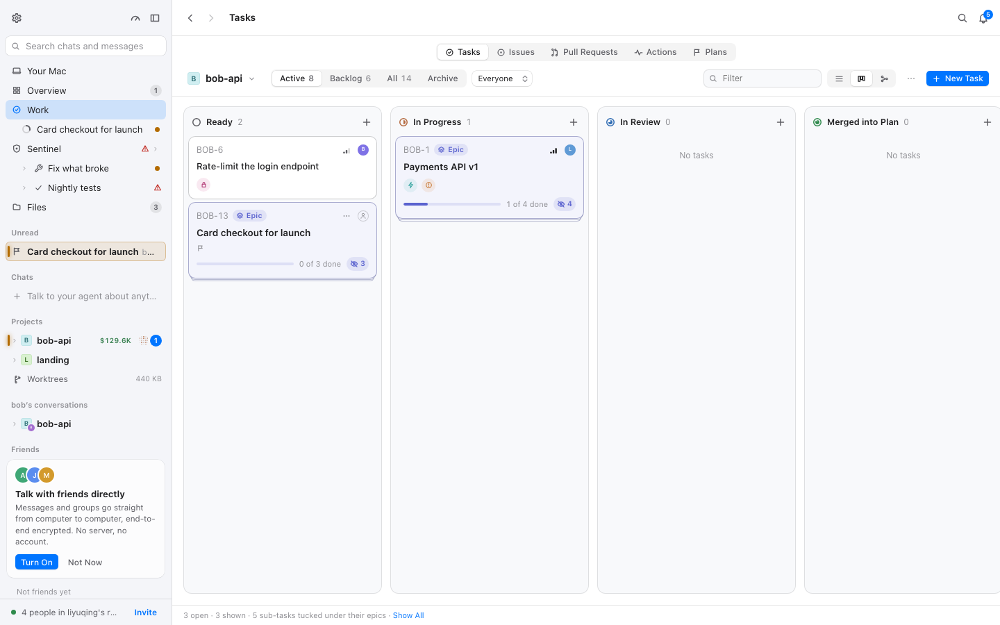
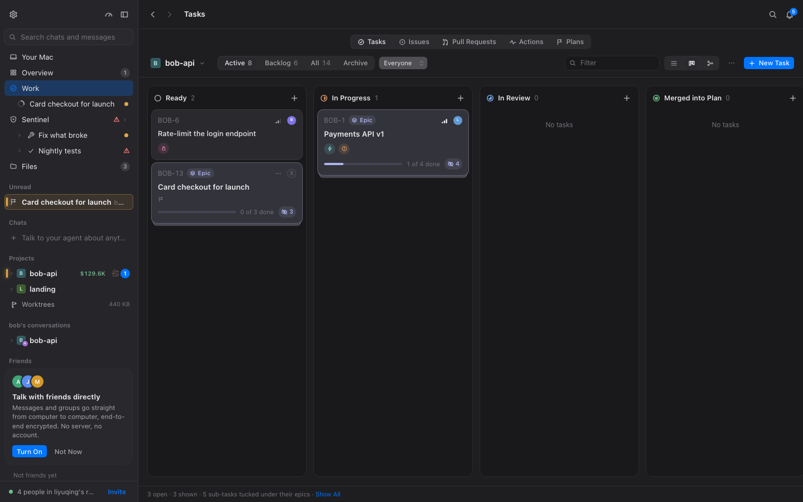
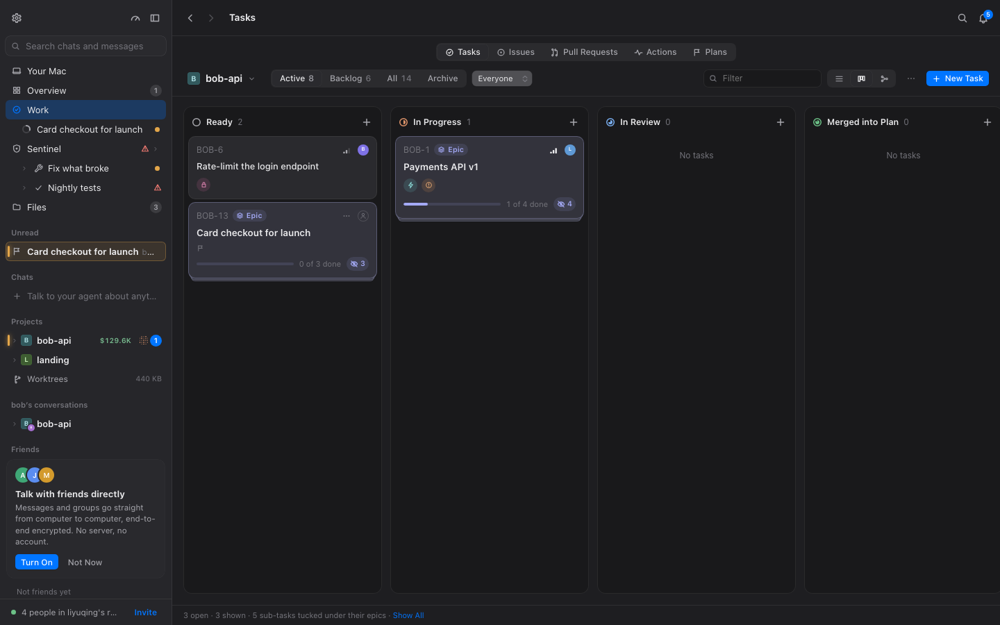

# 沉稳模式：覆盖层规则稿（M1 · BLG-159）

- 状态：**规则定稿**。BLG-160/162 照 §2、§5 写 `calm-motion.css`、`calm-tokens.css`；BLG-161 照 §3、§4 写
  `calm-overlays.css`、`calm-state.css`；BLG-163 在 §10 补开关前后证据。
- 依据：`docs/calm-ui.md`（规范与检查方式）、`docs/calm/baseline.md`（改动前基线）、计划决定 **keep-decor**
  （装饰性动效保留，见 §7）。
- 范围：只写 `packages/mac/src/fork/calm/*.css` 里的规则。**不改任何上游文件**；上游问题一律进 §8 或 §11。
- 每条规则下面写三件事：为什么、上游位置、**失效时怎么发现**（上游改了类名/行号时规则会静默不匹配，必须能查出来）。

规则分四类，与四个骨架文件一一对应：

| 类 | 文件 | 实施任务 | 解决 |
| --- | --- | --- | --- |
| motion | `calm-motion.css` | BLG-160 | 关关键帧、统一过渡、reduce |
| overlays | `calm-overlays.css` | BLG-161 | 菜单/对话框/浮层/toast 一致出现 |
| state | `calm-state.css` | BLG-161 | 悬停、需要你、当前步骤、数字、冻帧 |
| tokens | `calm-tokens.css` | BLG-162 | 时长/曲线令牌、强调色降饱和 |

---

## 1. 三条机制（决定下面所有写法）

### 1.1 层叠：模块 CSS 后插入，覆盖层必须 `!important`

懒加载视图的 CSS Modules 分块（`lib/lazy-view.tsx`）后插入文档，与覆盖层同特异性时会赢。因此：

- **全局规则一律 `!important`**；
- **定点规则靠 `:root[data-calm]` 前缀拿到更高特异性**（(0,3,0) 对上游的 (0,1,0)/(0,2,0)），不需要 `!important`，
  但为了不受上游将来加 `!important` 的影响，除明确写「不加」的条目外都加；
- 覆盖层内部同特异性的两条 `!important` 规则，**按 `calm.css` 的 import 顺序**决胜负：
  `tokens → motion → overlays → state`。所以「授予」类规则（浮层动画）写在 overlays，天然晚于 motion 的「关闭」。

**伪元素不能写进 `:is()`**：计划设计里的 `:is(*, *::before, *::after)` 不成立——选择器规范不允许
`:is()`/`:where()` 的参数里出现伪元素，而 `:is()` 是宽容列表，会**静默丢掉** `*::before` 那一段，只匹配元素。
后果是 `signal.module.css` 的 `.needsRow::after` 扫光关不掉（基线表里最显眼的问题）。本稿改成三条并列选择器：

```css
/* 元素 */
:root[data-calm] *:not(:where(<锚点>)) { … }
/* 伪元素（:not 写在宿主元素上，::before 仍能跟在其后） */
:root[data-calm] *:not(:where(<锚点>))::before,
:root[data-calm] *:not(:where(<锚点>))::after { … }
```

### 1.2 keep-decor 的粒度：只能按子树排除

CSS Modules 的 `@keyframes` 名带哈希（`_sheen_19xpr_1`），fork 无法按名放行。唯一可行的粒度是
**按装饰所在的子树排除**，写进全局规则自己的 `:not(:where(...))`。锚点表见 §7，全库碰撞已核对。

### 1.3 reduce 两段式

上游 `styles/tokens.css:118-127` 在 `:root[data-motion='reduce']` 和 `@media (prefers-reduced-motion: reduce)`
里把 `--dur`/`--dur-fast` 归零。我们的 `:root[data-calm]`（同样 (0,2,0)）**文件在后**，会把 reduce 的 0ms 覆盖回
160ms。所以 `calm-tokens.css` 必须**显式**写两段归零：

- `:root[data-calm][data-motion='reduce']`
- `@media (prefers-reduced-motion: reduce) { :root[data-calm] { … } }`

motion 侧同理：reduce 下的全局关闭**不带装饰排除**（引导页的 sheen/beam 必须停），只留 `[data-opening]`
（功能例外，靠 `animationend` 推进状态）。

---

## 2. motion 类规则 → `packages/mac/src/fork/calm/calm-motion.css`（BLG-160）

### 2.1 规则表

| # | 规则 | 声明 | 解决 |
| --- | --- | --- | --- |
| M1 | 全局关关键帧 | `animation: none !important`，排除 §7 锚点与 `[data-opening]` | §2.3：不留装饰性循环 |
| M2 | 白名单槽位 | `:root[data-calm] [data-step][data-current]` 及其子元素/伪元素 `animation: none !important`（M1 占位） | §7：唯一允许的循环，M2 换视觉 |
| M3 | 过渡统一 | `transition-duration: var(--dur)`、`transition-timing-function: var(--ease-standard)`、`transition-delay: 0s`，全部 `!important`；**拖动时整体退场** | §2.1：120–200ms、ease-out |
| M4 | 功能例外 | `[data-opening]` 的 `animation-duration: var(--dur)`、`animation-timing-function: var(--ease-standard)` | 让折叠/面板开合的 animationend 照常触发 |
| M5 | reduce | 无锚点排除的全局关闭重申（装饰也停），只留 `[data-opening]` | §2.5 |

**M3 不碰 `transition-property`**：卡片/磁贴拖动靠 `transform`/`left` 的过渡跟手，只改时长与曲线。
拖动中 `<html>` 带 `data-dragging`（`tasks/TaskBoard.tsx:280` 写 `card`、`views/usage/…` 写 `tile`/`resize`）
或 `data-arranging`（`layout/project-groups.module.css:72`），此时 **clamp 整体退场**（选择器前缀
`:root[data-calm]:not([data-dragging]):not([data-arranging])`），否则跟手性被 160ms 缓动毁掉。

**M4 为什么只收时长、不换动画**：全应用只有两处靠 `animationend` 推进状态（全量 grep 已证，见 §8.3）——
`AgentSteps` 的折叠（`steps.module.css:661` `unfold`）与 Sentinel 面板（`sentinel/home.module.css:37` `askIn`）。
它们既要能开合，又必须落进 120–200ms。`animation: none` 不触发任何事件，而 **0s 时长的动画照样发
`animationend`**，所以只覆盖 `animation-duration`/`timing-function`，名字与关键帧留给上游。
折叠的开合对称性：折叠走 `transition`（`steps.module.css:652-657`，上游 `calc(var(--dur) * 2)`），由 M3 统一成
`var(--dur)`；展开走 `unfold` 动画，由 M4 统一成 `var(--dur)` —— 同档、同曲线。

### 2.2 完整 CSS（照抄）

锚点列表见 §7.0。下面把三份 `:where()` 都写全了（CSS 不能复用选择器变量），照抄即可。

```css
/* M1 全局关关键帧：元素与伪元素（伪元素不能进 :is，见 §1.1） */
:root[data-calm] *:not(:where(
  [data-welcome], [data-welcome] *,
  [data-arriving],
  .glass-surface, .glass-surface *,
  [class*="_incoming_"], [class*="_incoming_"] *,
  [class*="_ringIcon_"], [class*="_ringIcon_"] *,
  [class*="_askCard_"], [class*="_askCard_"] *,
  [class*="_askPill_"], [class*="_askPill_"] *,
  [class*="_scene_"], [class*="_scene_"] *,
  section[aria-label='Your card'], section[aria-label='Your card'] *,
  [data-opening]
)) {
  animation: none !important;
}
/* 同一份 §7.0 列表再写两遍（:where() 不能复用变量）：伪元素也要排除 keep-decor 的宿主 */
:root[data-calm] *:not(:where(
  [data-welcome], [data-welcome] *,
  [data-arriving],
  .glass-surface, .glass-surface *,
  [class*="_incoming_"], [class*="_incoming_"] *,
  [class*="_ringIcon_"], [class*="_ringIcon_"] *,
  [class*="_askCard_"], [class*="_askCard_"] *,
  [class*="_askPill_"], [class*="_askPill_"] *,
  [class*="_scene_"], [class*="_scene_"] *,
  section[aria-label='Your card'], section[aria-label='Your card'] *,
  [data-opening]
))::before,
:root[data-calm] *:not(:where(
  [data-welcome], [data-welcome] *,
  [data-arriving],
  .glass-surface, .glass-surface *,
  [class*="_incoming_"], [class*="_incoming_"] *,
  [class*="_ringIcon_"], [class*="_ringIcon_"] *,
  [class*="_askCard_"], [class*="_askCard_"] *,
  [class*="_askPill_"], [class*="_askPill_"] *,
  [class*="_scene_"], [class*="_scene_"] *,
  section[aria-label='Your card'], section[aria-label='Your card'] *,
  [data-opening]
))::after {
  animation: none !important;
}

/* M2 白名单槽位（唯一循环）：M1 先占位为关；M2 在此换成唯一指示的 animation，锚点不变 */
:root[data-calm] [data-step][data-current],
:root[data-calm] [data-step][data-current] *,
:root[data-calm] [data-step][data-current]::before,
:root[data-calm] [data-step][data-current] *::before,
:root[data-calm] [data-step][data-current]::after,
:root[data-calm] [data-step][data-current] *::after {
  animation: none !important;
}

/* M3 过渡统一；拖动中退场。排除表 = §7.0 去掉 [data-opening]（折叠的 transition 要被压到 160ms） */
:root[data-calm]:not([data-dragging]):not([data-arranging]) *:not(:where(
  [data-welcome], [data-welcome] *,
  [data-arriving],
  .glass-surface, .glass-surface *,
  [class*="_incoming_"], [class*="_incoming_"] *,
  [class*="_ringIcon_"], [class*="_ringIcon_"] *,
  [class*="_askCard_"], [class*="_askCard_"] *,
  [class*="_askPill_"], [class*="_askPill_"] *,
  [class*="_scene_"], [class*="_scene_"] *,
  section[aria-label='Your card'], section[aria-label='Your card'] *
)),
:root[data-calm]:not([data-dragging]):not([data-arranging]) *:not(:where(
  [data-welcome], [data-welcome] *,
  [data-arriving],
  .glass-surface, .glass-surface *,
  [class*="_incoming_"], [class*="_incoming_"] *,
  [class*="_ringIcon_"], [class*="_ringIcon_"] *,
  [class*="_askCard_"], [class*="_askCard_"] *,
  [class*="_askPill_"], [class*="_askPill_"] *,
  [class*="_scene_"], [class*="_scene_"] *,
  section[aria-label='Your card'], section[aria-label='Your card'] *
))::before,
:root[data-calm]:not([data-dragging]):not([data-arranging]) *:not(:where(
  [data-welcome], [data-welcome] *,
  [data-arriving],
  .glass-surface, .glass-surface *,
  [class*="_incoming_"], [class*="_incoming_"] *,
  [class*="_ringIcon_"], [class*="_ringIcon_"] *,
  [class*="_askCard_"], [class*="_askCard_"] *,
  [class*="_askPill_"], [class*="_askPill_"] *,
  [class*="_scene_"], [class*="_scene_"] *,
  section[aria-label='Your card'], section[aria-label='Your card'] *
))::after {
  transition-duration: var(--dur) !important;
  transition-timing-function: var(--ease-standard) !important;
  transition-delay: 0s !important;
}

/* M4 功能例外：靠 animationend 推进的两处，只收时长与曲线 */
:root[data-calm] [data-opening] {
  animation-duration: var(--dur) !important;
  animation-timing-function: var(--ease-standard) !important;
}

/* M5 reduce：装饰也停，只留 [data-opening]（0ms 仍会发 animationend） */
:root[data-calm][data-motion='reduce'] *:not([data-opening]),
:root[data-calm][data-motion='reduce'] ::before,
:root[data-calm][data-motion='reduce'] ::after {
  animation: none !important;
}
@media (prefers-reduced-motion: reduce) {
  :root[data-calm] *:not([data-opening]),
  :root[data-calm] ::before,
  :root[data-calm] ::after {
    animation: none !important;
  }
}
```

> **M3 的排除表里不要放 `[data-opening]`**：折叠的「合上」靠 transition，必须被压到 160ms 才能与 `unfold`
> 的 160ms 对称。`[data-opening]` 只从「关动画」里排除。
>
> 伪元素也必须 clamp：全库扫描发现 `views/usage/stats.module.css` 的 `.cell::after` 是 `transform 220ms`——
> 超过 200ms 的过渡就这一条。所以 M3 的三个 `:where()` 都要写全。
>
> reduce 下不需要单独的过渡规则：M3 用的是 `var(--dur)`，令牌归零后过渡自然为 0ms（§5.3）。

### 2.3 边界与自检

- **静止帧不崩**：被关掉的循环会停在基础样式。已逐条核对基础样式（§4.3）：`.working i` 停成三颗实心点、
  `.countNow` 直接显示新数字、`.statusLive .dot` 停成实心点——都可接受；只有等待中的堆叠条需要静态底色（§4.3）。
- **不写进本文件的字面值**：`>200ms` 时长、超界 bezier（y 不在 [0,1]）、`scale(...>1)`、禁用动画名
  （`pop hop bounce ripple sheen shimmer breathe pulse shake blink glow`）。`tests/fork-calm.test.ts` 会对
  `fork/` 下的这些写法失败。
- **懒加载视图**：`M1`/`M3` 是 `:is`/`*` 级全局规则 + `!important`，后插入的模块 CSS 也压得住；BLG-160 用
  `calm-check` 的 `tasks`/`sentinel`（懒加载视图）场景复核 `animations[]`。
- **关掉开关**：所有选择器都以 `:root[data-calm]` 开头，`data-calm` 不存在时零匹配（§9）。

---

## 3. overlays 类规则 → `packages/mac/src/fork/calm/calm-overlays.css`（BLG-161）

### 3.1 规则表

| # | 规则 | 声明 | 解决 |
| --- | --- | --- | --- |
| O1 | 统一出现关键帧 | `from { opacity: 0; translate: 0 -4px }`，160ms `--ease-standard` | §5.1：同一方式、同一位置 |
| O2 | 授予浮层 | `[role='menu'|'listbox'|'dialog'|'alertdialog'|'tooltip']`，排除 keep-decor | 菜单/对话框/弹出层一致 |
| O3 | 授予 toast | `[class*="_toast_"]`、`[class*="_toasts_"]`，同一关键帧 | 两套 toast（App/Undo）视觉一致 |

**O1 只动 `translate` + `opacity`，绝不动 `transform`**：radix/Popper 用 `transform` 给浮层定位，覆盖 `transform`
会撕掉位置。独立 `translate` 属性与 `transform` 叠加，不冲突。方向统一「自上 4px 落下」——多数浮层自触发器
向下展开。

**O2 的特异性**：`:root[data-calm]` (0,2,0) + `:is(...)` 里最高的属性选择器 (0,1,0) = **(0,3,0)**，高于 M1 的
(0,2,0)，所以授予能压过「全局关」。同特异性时 `overlays` 在 `motion` 之后 import，顺序也赢。

**toast 碰撞核对**：全库只有 `layout/Shell.module.css:48`（App 的 `Toasts`）与 `lib/undo-toast.module.css:9`
两个类名恰好是 `.toast`，只有 `Shell` 有 `.toasts`；`.toastText` 生成 `_toastText_…`，不含 `_toast_`。

**已知代价（登记，不算缺陷）**：

- 背板（`Dialog.Overlay`，`aria-hidden`、无结构锚点）与没有 role 的抽屉（`layout/panel/panel.module.css:793`
  `drawerIn`、`:833` `focusIn`）被「全局关」后**瞬时出现**。可接受，留 M3 决定是否给它们补锚点。
- 行内也有 `role='listbox'` 的列表（Background commands、Scratch、Changed files、Outputs、搜索建议）。它们
  挂载时也会淡入一次（160ms、不占布局）。若 BLG-163 截图觉得吵，M3 再把 O2 收窄到
  `[data-radix-popper-content-wrapper]` 内。

### 3.2 完整 CSS（照抄）

```css
@keyframes calm-surface-in {
  from {
    opacity: 0;
    translate: 0 -4px;
  }
}

:root[data-calm] :is(
  [role='menu'], [role='listbox'], [role='dialog'], [role='alertdialog'], [role='tooltip'],
  [class*='_toast_'], [class*='_toasts_']
):not(:where(
  [data-welcome], [data-welcome] *,
  .glass-surface, .glass-surface *,
  [class*="_incoming_"], [class*="_incoming_"] *,
  [class*="_askCard_"], [class*="_askCard_"] *,
  [class*="_askPill_"], [class*="_askPill_"] *,
  [class*="_scene_"], [class*="_scene_"] *
)) {
  animation: calm-surface-in var(--dur) var(--ease-standard) !important;
}

/* reduce 下浮层直接出现：0ms 的动画仍会留下一条 getAnimations() 记录，这里整体关掉 */
:root[data-calm][data-motion='reduce'] :is(
  [role='menu'], [role='listbox'], [role='dialog'], [role='alertdialog'], [role='tooltip'],
  [class*='_toast_'], [class*='_toasts_']
) {
  animation: none !important;
}
@media (prefers-reduced-motion: reduce) {
  :root[data-calm] :is(
    [role='menu'], [role='listbox'], [role='dialog'], [role='alertdialog'], [role='tooltip'],
    [class*='_toast_'], [class*='_toasts_']
  ) {
    animation: none !important;
  }
}
```

- 来电横幅是 `role='alertdialog'`（`call/CallLayer.tsx:28`），必须排除——它属 keep-decor（§7）。
- reduce 下浮层**不播动画**（`animation: none`）：令牌为 0 时动画虽然看不见，但 0ms 动画仍会留下
  `getAnimations()` 记录，否则「reduce 下 CSS 动画为 0」的验收会多出一串 0ms 条目。
- 设计稿写的是 `var(--ease-out)`；实施统一用 `var(--ease-standard)`，让浮层与过渡同一条曲线（两种都在
  §2.1 允许范围内，这是一处有意偏差）。

---

## 4. state 类规则 → `packages/mac/src/fork/calm/calm-state.css`（BLG-161）

目标：**悬停/选中只改颜色；「需要你」是稳定标记；当前步骤不改变行高；数字不抖。**

### 4.1 定点修正表

每条都写：选择器、上游位置、改什么、**失效时怎么发现**。

| # | 选择器（`calm-state.css`） | 上游位置 | 改什么 | 失效检测 |
| --- | --- | --- | --- | --- |
| S1 | `:root[data-calm] [class*='_needsRow_']::after { display: none !important }` | `layout/signal.module.css:22-39` | 停 4.2s 无限扫光；琥珀底色（`:12-20`）与左侧亮边保留 | `calm-check room workspace` 的 `calm-on/full` `animations[]` 不再出现 `_scan_`；截图仍有琥珀底+左亮边。命令：`grep -n "^\.needsRow::after" packages/mac/src/layout/signal.module.css` |
| S2 | `:root[data-calm] [class*='_unreadName_'] { font-weight: inherit }` | `layout/signal.module.css:7-10` | 未读名字不加粗，只留颜色（`--text`） | 切换已读/未读前后行宽与换行不变（截图）；`grep -n "^\.unreadName"`。**碰撞已核对**：`network/network.module.css:121` 也叫 `.unreadName`，一并去掉加粗 —— 同样是「未读只换颜色」，符合规范 |
| S3 | `:root[data-calm] [class*='_trigger_']:hover { transform: none !important }` | `components/zoom-avatar.module.css:12-13` | 去掉 `scale(1.04)` | 悬停截图前后元素 bounding box 相同；`grep -n "^\.trigger:hover" packages/mac/src/components/zoom-avatar.module.css`。**碰撞已核对**：`tasks/board-people.module.css:13`、`components/select.module.css:25` 也叫 `.trigger`，它们的悬停只改背景色，`transform: none` 对它们无影响 |
| S4 | `:root[data-calm] [class*='_avatarButton_']:hover { transform: none !important }` | `dialogs/native/room.module.css:105-106` | 去掉 `scale(1.08)` | 同上；`grep -n "^\.avatarButton:hover"`（全库唯一） |
| S5 | `:root[data-calm] [class*='_stripCell_']:hover { transform: none !important }` | `components/views/inline.module.css:46-47` | 去掉 `scaleY(1.12)` | 同上；`grep -n "^\.stripCell:hover"`（全库唯一） |
| S6 | `:root[data-calm] [class*='_outlineOn_'] { font-weight: inherit !important }` | `components/markdown/markdown.module.css:538-543`（`.outlineOn, .outlineOn:hover` 同一个块） | 目录当前项不加粗，只留颜色与左侧色条。**注意选择器不要带 `:hover`**：上游把 `.outlineOn` 和 `.outlineOn:hover` 写在一条规则里，选中态本身就加粗，只改 `:hover` 是无效的 | 点击目录项截图，行宽不变；`grep -n "^\.outlineOn"`（全库唯一） |
| S7 | `:root[data-calm] [data-step][data-current] { margin-top: 0 }`<br>`:root[data-calm] [data-step][data-current] [class*='_head_'] { min-height: 22px; padding-top: 1px; padding-bottom: 1px }` | `chat/steps/steps.module.css:434-442`（`.rowCurrent`、`.rowCurrent .head`；基础值在 `:35-41`） | 步骤变成「当前」时不再 22→26px、不再加内边距、不再 +1px margin，下方内容不被推走 | `calm-check chatrun` 的 `calm-on/full`：步骤转当前时 `shifts[]` 无新增；截图 `.head` 高度两种状态都是 22px。`grep -n "rowCurrent" packages/mac/src/chat/steps/steps.module.css` |
| S8 | `:root[data-calm] [data-step][data-current] [class*='_title_'] { font-weight: inherit !important }` | `chat/steps/steps.module.css:443-446` | 当前步骤标题不加粗，只换颜色（`.rowCurrent .icon` 的换色保留） | 截图：当前/已完成行标题字重相同；见 §3 规范「当前步骤行的 shimmer 与加粗」 |

- S3–S6 只加 `!important` 是防上游将来写 `!important`；不加也能赢特异性（(0,3,0) vs (0,2,0)）。
- **`_chip_` 悬停修正从 M0 §0.1 表删除**：`views/usage/your-card.module.css:120-122` 的 `translateY(-1px)` 不再
  在覆盖层修。计划把整张 Usage Pass 卡片（`section[aria-label='Your card']` 子树）列为 keep-decor（§7），
  覆盖层不碰它。冲突与裁决记录在 §7.3。
- 上游改名/迁移文件时这些规则**静默失效**：选择器不再匹配，不会报错、不会误伤。检测靠两件事：
  ① 上表的 grep 仍能命中（文件+类名还在）；② `calm-check` 对应场景把症状重新演出来（扫光复活、悬停又变大、
  行高又变）。BLG-163 逐条跑一遍。

### 4.2 数字等宽：已核实，只留一条兜底

要求是「计时和计数变化时宽度不变」。逐条核对上游，**五处目标位置都已经有 `font-variant-numeric: tabular-nums`**：

| 位置 | 上游位置 | 状态 |
| --- | --- | --- |
| 步骤耗时 / 关闭计数 | `chat/steps/steps.module.css:116-127`（`.time`）、`:468-476`（`.fold`）、`:475` tabular | ✅ |
| 侧栏未读计数与汇总 | `components/ui.module.css:173-185`（`.badge`，tabular；`signal-marks.tsx:70,88` 的 `.count`/`.tally` 容器继承） | ✅ |
| 任务板计数 | `tasks/tasks.module.css:170-176, 379, 442, 488, 509, 542, 912, 928` | ✅ |
| Sentinel 数字 | `sentinel/numbers.module.css:26, 113, 524, 1007, 1020` | ✅ |
| 通话计时 | `call/call.module.css:75-80`（`.stripTime`）、`:522`、`:1084` | ✅ |

因此**不新增逐类规则**，只写一条面向将来的兜底（也覆盖徽标继承）：

```css
:root[data-calm] [data-signal],
:root[data-calm] [data-tally] {
  font-variant-numeric: tabular-nums;
}
```

检测：`calm-check` 的 `chatrun`/`usage` 场景在 tick 前后各截一张，比较计数元素宽度（BLG-163）。
上游若删掉某处 tabular，症状是「数字从 9 到 10 时行内元素跳一下」。

### 4.3 冻帧善后

被关掉的循环停在基础样式。逐条核对，只有一处需要补静态底：

| 上游位置 | 关掉后停在什么 | 处置 |
| --- | --- | --- |
| `views/usage/usage.module.css:634-637` `.stackWaiting`（`sheen` 1.3s infinite） | 静态渐变带（背景是 200% 宽的渐变） | **补平底色**：`[class*='_stackWaiting_'] { animation: none; background: var(--track) }` |
| `components/ui.module.css:313-340` `.working i`（`blink` 1.2s infinite） | 三颗实心点（基础 opacity 1） | 保持，读起来就是一个省略号 |
| `layout/signal.module.css:22-39` `.needsRow::after` | 已被 S1 隐藏 | — |
| `chat/steps/steps.module.css:482-485` `.countNow`（`tick` 270ms） | 新数字直接出现 | 保持 |
| `components/views/views.module.css:146-165` `.statusLive .dot`（`pulse` 2s） | 实心绿点（阴影 0 扩散 = 不可见） | 保持 |

### 4.4 完整 CSS（照抄）

```css
/* S1 需要你：稳定标记 */
:root[data-calm] [class*='_needsRow_']::after { display: none !important; }

/* S2 未读：只换颜色 */
:root[data-calm] [class*='_unreadName_'] { font-weight: inherit !important; }

/* S3–S5 悬停只改颜色 */
:root[data-calm] [class*='_trigger_']:hover { transform: none !important; }
:root[data-calm] [class*='_avatarButton_']:hover { transform: none !important; }
:root[data-calm] [class*='_stripCell_']:hover { transform: none !important; }

/* S6 目录当前项不加粗（不要写成 :hover，见 §4.1） */
:root[data-calm] [class*='_outlineOn_'] { font-weight: inherit !important; }

/* S7 当前步骤不改变行高（也不 +1px margin） */
:root[data-calm] [data-step][data-current] { margin-top: 0; }
:root[data-calm] [data-step][data-current] [class*='_head_'] {
  min-height: 22px;
  padding-top: 1px;
  padding-bottom: 1px;
}

/* S8 当前步骤标题不加粗，只换颜色 */
:root[data-calm] [data-step][data-current] [class*='_title_'] { font-weight: inherit !important; }

/* 数字等宽兜底 */
:root[data-calm] [data-signal],
:root[data-calm] [data-tally] { font-variant-numeric: tabular-nums; }

/* 冻帧：等待中的堆叠条用平底色 */
:root[data-calm] [class*='_stackWaiting_'] { animation: none; background: var(--track); }
```

> `[data-step][data-current]` 是**结构性锚点**，不是类名：`chat/steps/StepRow.tsx:138` 的当前步骤行。
> 不能退化成裸 `[data-current]`——`AgentSteps.tsx:343` 的 WaitingRow（头像有 `ring` 2.2s infinite）、
> `layout/ProjectTree.tsx:224` 的项目标记也带 `data-current`（详见 §6）。

---

## 5. tokens 类规则 → `packages/mac/src/fork/calm/calm-tokens.css`（BLG-162）

### 5.1 令牌表

| 令牌 | 上游（`styles/tokens.css:29-31`） | 沉稳模式下 | 理由 |
| --- | --- | --- | --- |
| `--dur-fast` | 120ms | 120ms（沿用） | 已在规范档位内 |
| `--dur` | 180ms | **160ms** | 规范 §5 只允许 120/160/200 三档 |
| `--dur-slow` | 无 | **200ms**（新增） | 最慢一档，给一次性入场 |
| `--ease-standard` | 无（有 `--ease-out`） | `cubic-bezier(0.3, 0.7, 0.3, 1)`（新增） | 无超调、落点稳；y ∈ [0,1] |

- **偏差登记**：任务文案写「浮层 150ms」，规范 §5 只允许令牌档位 120/160/200，浮层统一用 `var(--dur)`=160ms。
- `--ease-out`（上游 `cubic-bezier(0.22, 1, 0.36, 1)`）不覆盖：它本身合规，重叠的浮层/过渡统一用 `--ease-standard`。

**为什么颜色选择器要带 `[data-theme]`（BLG-162 实测发现）**：tokens.css 的浅色值是
`:root[data-theme='light']`（(0,2,0)），和裸 `:root[data-calm]` 同特异性；而 Vite 开发模式下样式表的注入
顺序并不保证（实测 calm.css 在 sheet 27、tokens.css 在 sheet 142），同特异性时后注入的赢——裸写法会让浅色
主题回到上游的鲜艳色。带上主题后 (0,3,0) 靠特异性取胜，与顺序无关。用户自选的调色板
（`:root[data-theme][data-palette]`，同样 (0,3,0)、运行时注入且最晚）**仍然赢我们**：自选调色板保留用户
自己的颜色，沉稳模式只收 Beluga 自带的浅色/深色。

### 5.2 强调色降饱和

方法：HSL 色相与明度不变，饱和度降到约 70%，让强调色只出现在主操作与关键状态上。

| 令牌 | 浅色 · 上游 `tokens.css:41-84` | 浅色 · 沉稳 | 深色 · 上游 `:85-117` | 深色 · 沉稳 |
| --- | --- | --- | --- | --- |
| `--subagent` | `#7656c9` | `#7d6bb3` | `#ab93f3` | `#b2a1e5` |
| `--worktree` | `#24877f` | `#337873` | `#66c6bb` | `#74b8b0` |
| `--plan` | `#b84d8a` | `#a85d88` | `#e892c3` | `#db9fc1` |
| `--epic` | `#5a62cf` | `#6e74bb` | `#a4aaf6` | `#aeb3ea` |

- **实测值**（BLG-162 在 Chromium 里读 `getComputedStyle`，见 §10.6）：开启时浅色、深色都正是上表；
  关闭时四个令牌分别回到上游的 `#7656c9/#24877f/#b84d8a/#5a62cf` 与 `#ab93f3/#66c6bb/#e892c3/#a4aaf6`，
  `--dur` 回到 180ms。
- 计划给的首发值里有两个偏离了「同色相、饱和度 70%」的方法，已按方法改正：
  浅色 `--worktree` 原写 `#436865`（实际去饱和到 38%，明显更灰）→ `#337873`；
  深色 `--subagent` 原写 `#a2b3e4`（色相从 255° 偏到 225°，看起来是另一种蓝）→ `#b2a1e5`。
- 其余颜色令牌不动：中性色与语义色（`--error`/`--warn`/`--ok`）保持上游。

### 5.3 完整 CSS（照抄）

```css
:root[data-calm] {
  --dur-fast: 120ms;
  --dur: 160ms;
  --dur-slow: 200ms;
  --ease-standard: cubic-bezier(0.3, 0.7, 0.3, 1);
}

:root[data-calm][data-theme='light'] {
  --subagent: #7d6bb3;
  --worktree: #337873;
  --plan: #a85d88;
  --epic: #6e74bb;
}

:root[data-calm][data-theme='dark'] {
  --subagent: #b2a1e5;
  --worktree: #74b8b0;
  --plan: #db9fc1;
  --epic: #aeb3ea;
}

/* reduce 两段式（§1.3）：上游 :root[data-motion='reduce'] 与我们的 :root[data-calm] 同特异性 */
:root[data-calm][data-motion='reduce'] {
  --dur-fast: 0ms;
  --dur: 0ms;
  --dur-slow: 0ms;
}

@media (prefers-reduced-motion: reduce) {
  :root[data-calm] {
    --dur-fast: 0ms;
    --dur: 0ms;
    --dur-slow: 0ms;
  }
}
```

验收：浅色、深色两套截图进 `docs/calm/img/`，附在本节；`data-calm` 关闭时变量全部不生效（§9）。
`calm-check.mjs` 需要按主题切换时，给 fork 自己的脚本加 `BELUGA_THEME` 环境变量（fork 文件，不算上游改动）。

---

## 6. 白名单：唯一允许的循环

M1 结束时，CSS 里**一个循环都不跑**；唯一在动的「进行中」指示是 **JS 驱动的 Shimmer**
（`chat/steps/StepRow.tsx:46-58`，走 `lib/live-motion.ts` 的时钟，CSS 关不掉也不该关）。它挂在当前步骤行上。
M2 的 `live-gate` 会把它收束成「同一时刻只有一个」。

**锚点修正（相对 M0 规范 §7.2 的裸 `[data-current]`）**：全库有三个地方带 `data-current`：

| 位置 | 是什么 | 白名单是否包含 |
| --- | --- | --- |
| `chat/steps/StepRow.tsx:138`（`data-step` + `data-current`） | 当前步骤行 | ✅ |
| `chat/steps/AgentSteps.tsx:343`（WaitingRow，`data-current="true"`） | 等待朋友 Claude 的行；头像 `::after` 有 2.2s infinite 的 `ring`（`steps.module.css:544-555`） | ❌（用 `[data-step][data-current]` 天然排除） |
| `layout/ProjectTree.tsx:224`（`data-current`） | 项目树里的当前项目标记 | ❌ |

所以白名单选择器固定为 **`:root[data-calm] [data-step][data-current]` + 其子元素/伪元素**。
M1 里它写 `animation: none !important` 占位；M2 只把这个槽位换成最终视觉（小、安静、不前推布局），
**锚点与位置不变**。这是 M1→M2 的契约。

其余 JS 动效（DotMatrix、LiveDot、framer-motion、WAAPI）不在 CSS 覆盖层范围内，见 §8。

---

## 7. keep-decor 例外表（覆盖层不碰的）

计划决定：装饰性、一次性、不在工作表面的动效保留。**reduce 下仍必须停**（M5 的 reduce 规则不带排除）。
本表即「已批准例外」清单。

### 7.0 锚点列表（照抄进 `:not(:where(...))`）

```css
[data-welcome], [data-welcome] *,
[data-arriving],
.glass-surface, .glass-surface *,
[class*="_incoming_"], [class*="_incoming_"] *,
[class*="_ringIcon_"], [class*="_ringIcon_"] *,
[class*="_askCard_"], [class*="_askCard_"] *,
[class*="_askPill_"], [class*="_askPill_"] *,
[class*="_scene_"], [class*="_scene_"] *,
section[aria-label='Your card'], section[aria-label='Your card'] *,
[data-opening]
```

两份用法：

- **关动画**（M1、M5 之外的全局规则）用**全表**，含 `[data-opening]`。
- **过渡 clamp**（M3）用全表**减掉 `[data-opening]`**，让折叠的 transition 一并压到 160ms。

### 7.1 锚点与保留内容

| 锚点（写进 `:not(:where(...))`） | 上游位置 | 保留什么 | 理由 |
| --- | --- | --- | --- |
| `[data-welcome]`, `[data-welcome] *` | `onboarding/Onboarding.tsx:218` | scenes 的 `shimmer`/`ping`/`breathe`/`weave-in`、Wormhole、framer-motion 入场 | 引导页是一次性场景，不在工作表面 |
| `[data-arriving]`（只元素本身） | `layout/Shell.module.css:6-16` | `arrive` 1.6s 一次性入场 | 应用落位的一次性整体动画，reduce 下上游已停 |
| `.glass-surface`, `.glass-surface *` | `components/reactbits/GlassSurface.css:1` | reactbits 的玻璃面（全局类名，非 module） | 装饰组件；当前 CSS 里无 animation，作为守卫保留 |
| `[class*="_incoming_"]`, `… *` | `call/CallLayer.tsx:28`、`call/call.module.css:363-435` | 来电横幅 `ringIn`（340ms）+ `ripple` 2.2s 循环 | 必须提示的来电，不是工作表面 |
| `[class*="_ringIcon_"]`, `… *` | `call/call.module.css:108-118` | 来电响铃图标的 `nudge` 1.6s | 同上（`ring*`） |
| `[class*="_askCard_"]`, `… *` | `call/call.module.css:741-800` | Ask Claude 卡片 `ringIn` 320ms、等待三点的 `breathe` 1.2s | 通话中的临时卡片；`spinner`（`:715`）在其内 |
| `[class*="_askPill_"]`, `… *` | `call/call.module.css:1227-1243` | `bloom` 240ms | 通话中 Ask 的入口标记 |
| `[class*="_scene_"]`, `… *` | `dialogs/star-scene.module.css:2` | 星空 `drift` 9s alternate | 关于/支持页的星空装饰 |
| `section[aria-label='Your card']`, `… *` | `views/usage/YourCard.tsx:178` | Usage Pass 的 `titleIn` 600ms、挂件摇摆、`_chip_` 悬停 `translateY(-1px)` | 成就卡是装饰性展示面（见 §7.3 的裁决） |
| `[data-opening]`（只元素本身） | `chat/steps/AgentSteps.tsx:322`、`sentinel/SentinelChat.tsx:147` | 折叠 `unfold`、面板 `askIn` | **功能例外**：靠 `animationend` 推进状态；只由 M4 收时长 |

### 7.2 锚点碰撞核对（全库 grep，已做）

| 锚点 | 撞到什么 | 结论 |
| --- | --- | --- |
| `_incoming_` | `views/history/history.module.css:53` `.rowIncoming`、`:71` `.incomingDot` | **不命中**：CSS Modules 类名保留大小写，`_rowIncoming_` 的 `I` 是大写；`_incomingDot_` 在 `incoming` 后是 `D` 不是 `_`。只有 `call` 的 `.incoming*` 命中 |
| `_scene_` | `sentinel/showcase.module.css:25` 也有 `.scene` | 命中两处；`showcase` 是独立窗口（不加载覆盖层），命中无害 |
| `_ringIcon_` / `_askCard_` / `_askPill_` / `_askWait_` | 无 | 全库唯一 |
| `.glass-surface` | 仅 `components/reactbits/GlassSurface.css` | 全局类名，无哈希 |
| `section[aria-label='Your card']` | 仅 `views/usage/YourCard.tsx:178`（字面量，非 i18n） | 唯一 |
| `[data-welcome]` / `[data-arriving]` / `[data-opening]` | 见 `Onboarding.tsx:218`、`Shell.module.css:6`、`AgentSteps.tsx:322`+`SentinelChat.tsx:147` | 均为结构性属性 |

**没有排除但被关掉的通话界面元素**：CallStrip 的 `.liveDot` 的 `breathe`（`call.module.css:62-70`）会被关掉，
静成一颗实心点——更安静，符合规范；`_liveDot_` 与其他模块（`ci`、`preview`、`callfloat`）撞名，不做子树排除。

### 7.3 冲突与裁决：YourCard

- M0 规范 §0.1 曾把 `views/usage/your-card.module.css:120-122`（`_chip_` 悬停 `translateY(-1px)`）列为定点修正。
- 计划决定 **keep-decor 覆盖整张 Usage Pass 卡片**：它是成就展示（挂件、称号入场），不是工作表面。于是：
  - 定点修正**删除**（不再写 `_chip_` 规则）；
  - 卡片子树进锚点表，覆盖层不碰它的动画与过渡；
  - 代价：`usage` 场景的 `calm-check` 里仍能看到卡片自己的 `titleIn`（600ms）等一次性动画，**记为已批准例外**；
  - reduce 下 M5 的全局关闭不带排除，卡片动画会停（符合 §2.5）。
- BLG-163 若认为卡片仍显得热闹，M3 再谈把它移出 keep-decor（那就必须同时恢复 `_chip_` 修正）。

### 7.4 覆盖层碰不到、也不该碰的

- `components/PixelBurst.tsx` / `pixel-burst-model.ts`：canvas 粒子，CSS 关不到；一次性庆祝。
- `chat/max-fire.ts:449`：rAF 火焰，用户显式开启的装饰；范围外，M1 不决定。

---

## 8. 覆盖层做不到的（不写进 `fork/calm/*.css`）

### 8.1 运行时动效（JS 驱动，CSS 覆盖层管不到）

| 类别 | 位置 | 归属 |
| --- | --- | --- |
| framer-motion `animate`/`AnimatePresence` | `tasks/TaskBoard.tsx`（弹簧、拖拽）、`chat/steps/AgentSteps.tsx`、`views/usage/Recap.tsx`、`onboarding/**`、`showcase/**` | TaskBoard/Recap 需挂钩或上游；onboarding 属 keep-decor；showcase 是独立窗口 |
| WAAPI `.animate()` | `chat/flight.ts:141`、`sentinel/DashboardPage.tsx:480`（220/260ms）、`call/NotesBox.tsx:157`（900ms 背景一闪） | 挂钩（M2 之后）或上游；900ms 那条进上游 PR |
| live-motion 时钟 | `lib/live-motion.ts:25-41` → `DotMatrix`、`plans/marks.tsx:79-84`（LiveDot 呼吸）、`StepRow` 的 Shimmer | **M2 `live-gate.ts`**：只放行 `[data-step][data-current]` |
| rAF 自绘 | `chat/max-fire.ts:449`、`layout/arrange-drag.ts`、`tasks/TaskBoard.tsx` 拖拽自动滚动 | 范围外/行为触发 |

### 8.2 行为（不是 CSS）

| 问题 | 位置 | 归属 |
| --- | --- | --- |
| 新消息不自动滚动 / 「下面有 N 条」 | `chat/ChatLog.tsx:186-203, 326-339` | M2 `new-below.tsx` |
| 悬停/拖拽/菜单打开时列表不重排 | `layout/CategorySections.tsx:28`、`layout/attention-model.ts:408-411` | M2 `hold-order.ts` |
| 同一时刻只有一条 toast | `App.tsx:51-71, 258, 262`、`lib/undo-toast.tsx:16-27` | M2 `one-toast.ts`（覆盖层只统一出现方式） |
| 虚拟列表按估算高度画再改真高 | `chat/ChatLog.tsx:161-180` | 上游 PR（占位尺寸，覆盖层补不出来） |

### 8.3 依赖 `animationend` 的组件（覆盖层必须绕开）

全量 grep `onAnimationEnd` / `animationend`，**只有两处**，都在 §7 的 `[data-opening]` 例外里：

| 组件 | 上游位置 | 动画 | M1 处理后 |
| --- | --- | --- | --- |
| `AgentSteps` 折叠/展开 | `chat/steps/AgentSteps.tsx:322-327` | `steps.module.css:661` `unfold` | 保留名字，时长 160ms；0ms 也发事件 |
| Sentinel `AskPanel` | `sentinel/SentinelChat.tsx:147` | `sentinel/home.module.css:37` `askIn` | 同上 |

注意 `transitionend` 只有 `components/graph/sharp-zoom.ts:43`（图谱缩放后重绘），我们的过渡只改时长不改属性，
不影响它。

### 8.4 范围外

- **独立窗口**（不加载 `fork/calm`）：`popup/`、`callfloat/`、`overlay/`、`showcase/`。
- **第三方渲染**：xterm、pdf.js。
- **系统层**：macOS 窗口 vibrancy 与原生菜单。

### 8.5 建议提回上游的

沿用 `docs/calm-ui.md §10` 的六条（扫光、blink/pulse 尊重 reduce、悬停只改色、一次性时长收拢、当前步骤行高、
toast 合流）。M1 之后如需补充：`call/NotesBox.tsx:157` 的 900ms 背景闪烁、行内 `role='listbox'` 列表的入场一致性。

---

## 9. 关掉开关：与上游一致

- 覆盖层所有选择器都以 `:root[data-calm]` 开头；`data-calm` 不在 `<html>` 上时**零匹配**。
- 唯一不在选择器里的东西是 `@keyframes calm-surface-in` 的定义本身——没人引用它，不影响任何元素。
- `calm.css` 的 `@import` 顺序（tokens→motion→overlays→state）只影响覆盖层内部；对上游模块 CSS 无影响。
- 验证：`calm-check` 的 `calm-off/*` 四组合与 `docs/calm/baseline.md` 的代表截图逐像素比对（BLG-163），
  以及 `git diff upstream/main -- packages/mac/src` 为空（只看 M1 的文件清单：`fork/calm/*.css`、`docs/calm/*`）。

---

## 10. 开关前后对比（BLG-163 填）

结构固定，证据直接写在下面：

### 10.1 场景 × 组合（`node packages/mac/scripts/calm-check.mjs room workspace chatrun plan tasks sentinel usage onboarding`）

| 场景 | 组合 | CLS | 动画数 | 无限循环（除白名单） | JS 动效元素 | 截图 |
| --- | --- | ---: | ---: | ---: | ---: | --- |
| … | calm-on/full | | | | | |
| … | calm-off/full | | | | | |

要写清的结论：`calm-on/full` 的 CSS 动画归零（onboarding 只剩 keep-decor 的 sheen/beam，记为批准例外；
当前步骤的循环是 JS Shimmer，体现在 `jsMotion`）；`calm-on/reduce` 的 CSS 动画为 0；CLS 不高于基线；
`firstFrame.calm` 全为 true。

### 10.2 开关前后截图

| 场景 | calm on | calm off（基线） |
| --- | --- | --- |
| workspace | | `img/workspace-calm-off-full-loaded.png` |

四组合 × enter/loaded/hover/select（chatrun 另含新消息时刻）截图放 `docs/calm/img/`。

### 10.3 依赖 `animationend` 的组件核查

- [ ] AgentSteps 折叠后能展开（`unfold` 的 `animationend` 已触发）
- [ ] Sentinel Ask 面板滑入后宽度/overflow 正常
- [ ] 全量再 grep 一次 `animationend`，没有新增的第三处

### 10.4 e2e 与检查

- [ ] `npm run typecheck`（`packages/mac`）
- [ ] `npx vitest run tests/fork-calm.test.ts`
- [ ] `npm run e2e`
- [ ] 拖动（`data-dragging`）跟手：卡片/tile 拖动时无 160ms 缓动延迟

### 10.5 问题表（现象 / 文件 / 改法 / 状态）

| 文件:行 | 现象 | 改法 | 状态 |
| --- | --- | --- | --- |
| `layout/panel/panel.module.css:793,833` | 抽屉/聚焦面板被关后瞬时出现（无 role） | M1 接受；M3 决定补锚点 | 登记 |
| `dialogs/native/parts.tsx`（Dialog.Overlay） | 背板瞬时出现（无结构锚点） | 同上 | 登记 |
| radix 关闭动画 | 被全局关闭后立即卸载 | 验收看有无闪烁；有则在 M3 给关闭补 `[data-state='closed']` 例外 | 待验证 |
| 行内 `role='listbox'` | 挂载时淡入一次（160ms、不占布局） | 可接受；嫌吵就在 M3 收窄 O2 | 登记 |
| 深色 `--subagent` | 色相偏蓝（255°→225°） | BLG-162 截图核对，需要就换 `#b2a1e5` | 待定 |

### 10.6 令牌：两主题实测（BLG-162）

`BELUGA_THEME=light|dark node packages/mac/scripts/calm-check.mjs tasks`（`calm-check` 为此加了
`BELUGA_THEME`，fork 自己的脚本）。同一场景、同一份演示数据，只切沉稳开关：

| 主题 | calm on | calm off（上游原样） |
| --- | --- | --- |
| 浅色 |  |  |
| 深色 |  |  |

在页面里读 `getComputedStyle(document.documentElement)`（Chromium，`appearance` 经 `beluga.prefs.v1` 设置）：

```console
calm on  light: --subagent #7d6bb3  --worktree #337873  --plan #a85d88  --epic #6e74bb  --dur 160ms
calm off light: --subagent #7656c9  --worktree #24877f  --plan #b84d8a  --epic #5a62cf  --dur 180ms
calm on  dark : --subagent #b2a1e5  --worktree #74b8b0  --plan #db9fc1  --epic #aeb3ea  --dur 160ms
calm off dark : --subagent #ab93f3  --worktree #66c6bb  --plan #e892c3  --epic #a4aaf6  --dur 180ms
```

关掉 `data-calm` 时四个颜色令牌与 `--dur` 全部回到上游值（§9 的「与上游一致」由此佐证）。
强调色的降饱和是渐进的：Epic 徽标、epic 卡片底色这类 6–20% 混色的地方变化很小，这正是目的——
强调色退到主操作与关键状态，而不是换一套皮肤。

---

## 11. 实施对照（任务 → 检查）

| 任务 | 写什么 | 验收 |
| --- | --- | --- |
| BLG-160 | §2 全部（`calm-motion.css`） | `animations[]` 只剩白名单/keep-decor；reduce 为 0；`tests/fork-calm.test.ts` 通过 |
| BLG-162 | §5 全部（`calm-tokens.css`）+ 两主题截图 | 关掉 `data-calm` 颜色与上游一致；浅/深截图进 §10 |
| BLG-161 | §3 + §4（`calm-overlays.css`、`calm-state.css`） | 浮层截图方式一致；悬停 CLS 0；计时/计数宽度不变 |
| BLG-163 | §10 全部 | 对比页、animationend 核查、e2e、问题表 |

**每步都要**：`packages/mac` 的 `npm run typecheck`；改动只落在 `fork/calm/*.css` 与 `docs/calm/*`。
