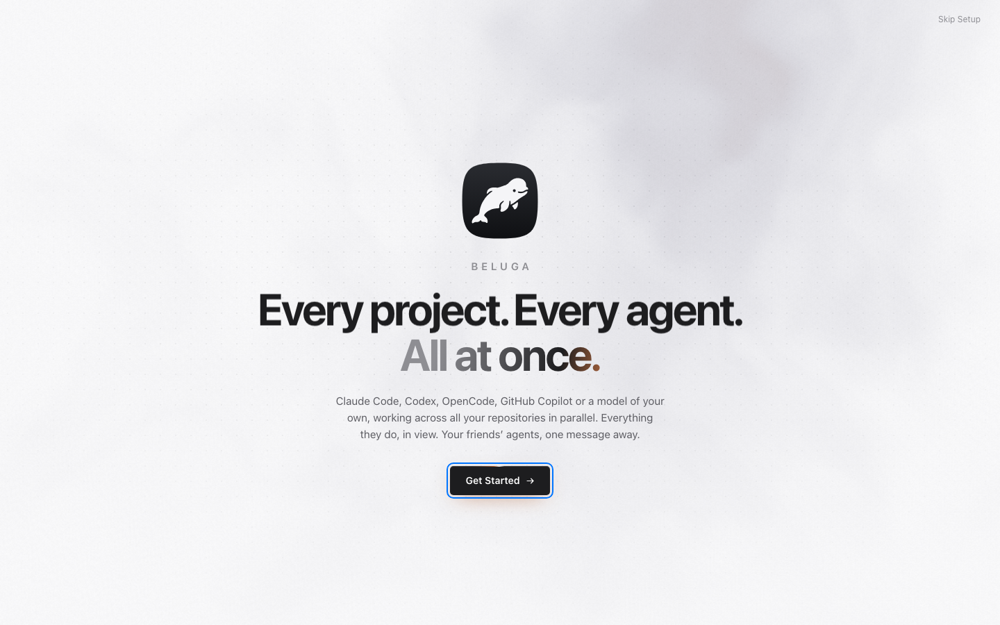
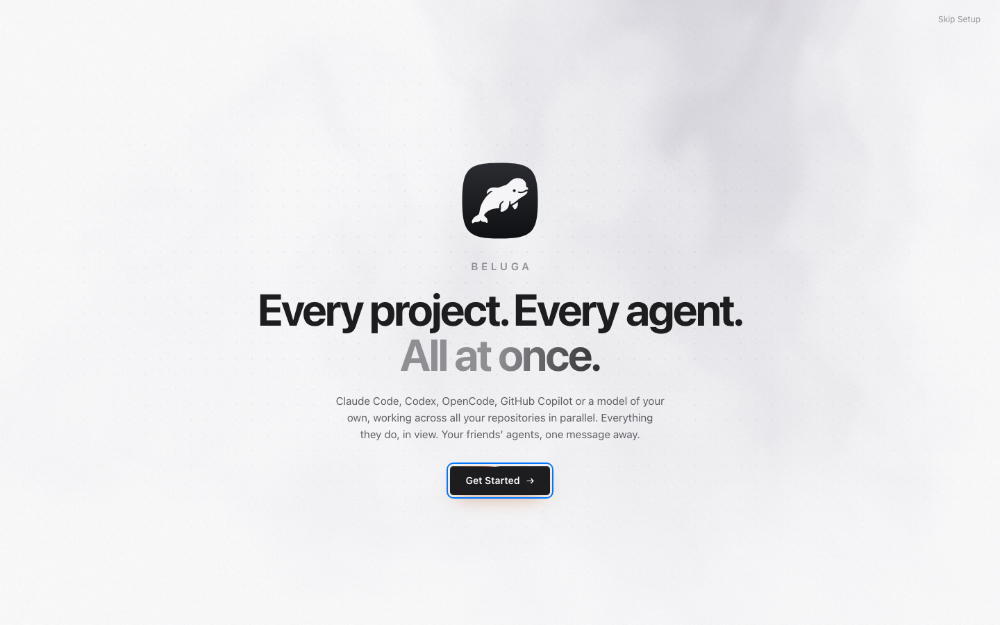
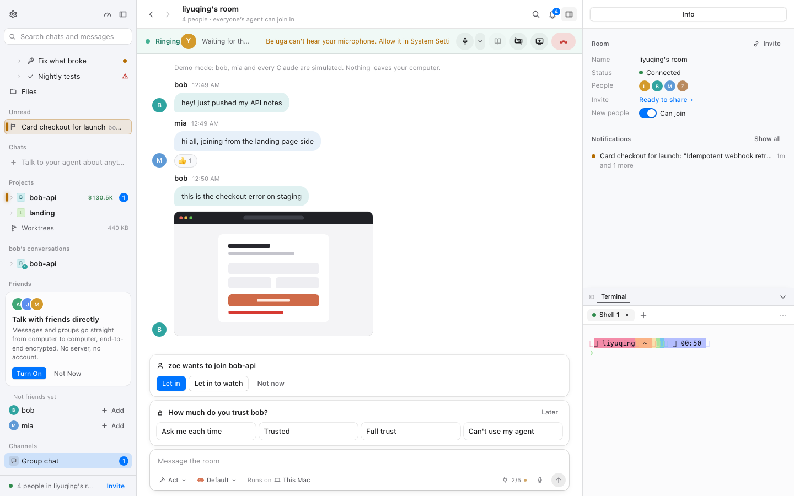
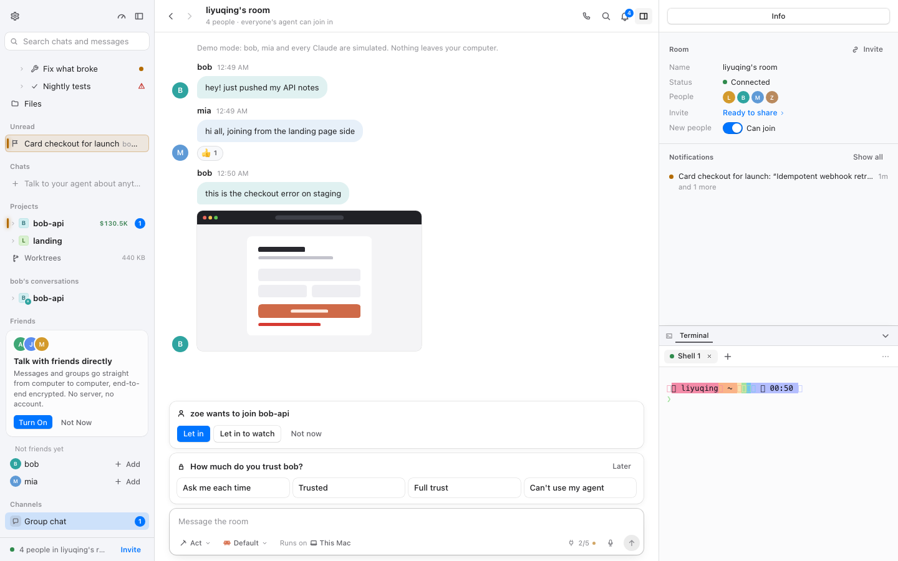
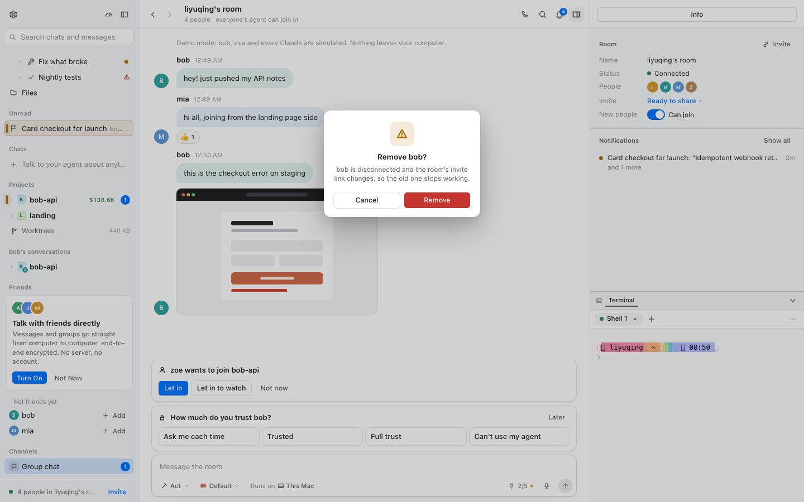
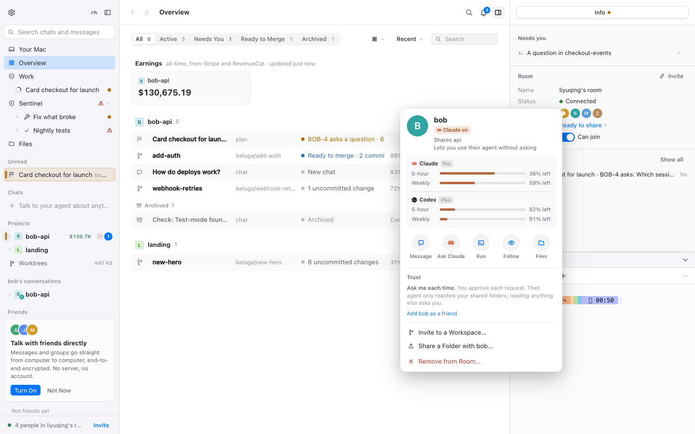
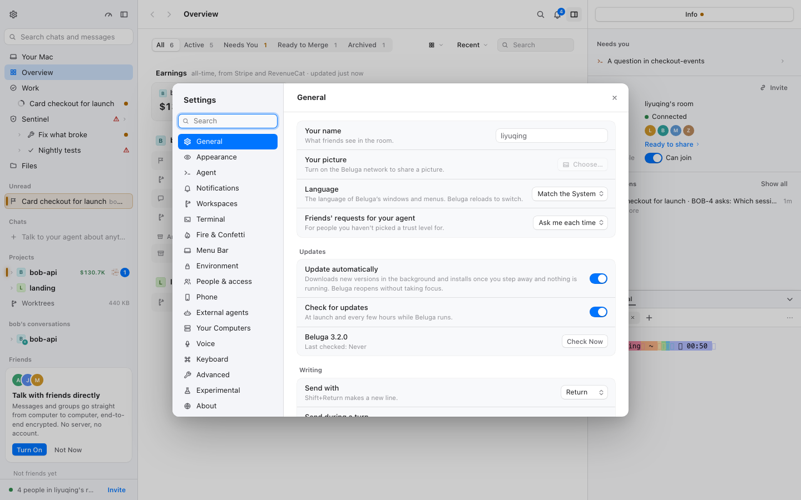
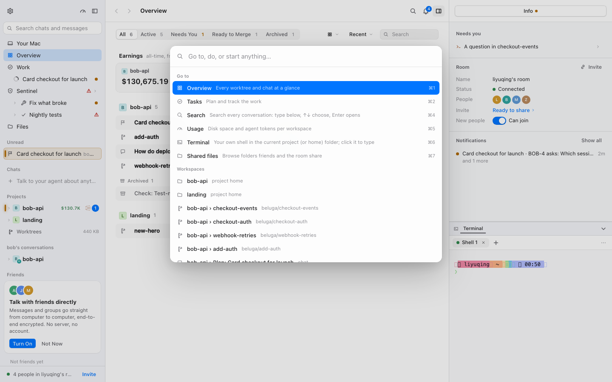

# 沉稳界面 · 通话、引导、设置与对话框逐页验收（M3 · BLG-172）

- 采集时间：2026-11-12 02:00–02:10（WIB）
- git：`8fab9b836`（BLG-171 提交后的分支 HEAD；`plan/mac-fork` + M3 审计）
- 命令行：`BELUGA_URL=http://localhost:1421 node packages/mac/scripts/calm-check.mjs onboarding call network confirmremove settings person palette`
- 演示 daemon：`BELUGA_HOME=/tmp/calm-blg170 BELUGA_ALLOW_ORIGINS=http://localhost:1421 npm run dev`（一次性 home，演示数据：4 人房间、bob/mia 两个朋友、两条待决策卡片）；vite 占 1421
- 原始结果：`.context/calm/<场景>.json`、`.context/calm/img/`（gitignore）；代表截图 `docs/calm/img/m3-*.png`
- 机器负载：采集期间 other worktrees 在跑，1 分钟负载约 20–30（10 核）。

## 验收方法（四步）

1. **逐页录屏**：每场景四组合，独立浏览器 context；记录 CLS 与 sources、`getAnimations()`、JS 改写 style、首帧 `data-calm`，enter/loaded/hover/select 及场景自定义时刻截图。
2. **时刻覆盖**：进入 → 加载完成 → 悬停/选中 → 打开/关闭；通话另覆盖「呼叫中」，对话框另覆盖「破坏性确认」。
3. **reduced-motion**：`calm-on/reduce` 重看。
4. **问题成表**：文件:行、现象、改法、建议归属；审计阶段的状态列写「待 BLG-174」，终值由 BLG-175 复核后写在 §6。

**本轮的两条判定线**（任务上下文）：① keep-decor 的引导动画、来电提醒、纯装饰组件**维持原状**，只确认没被覆盖层误伤；② 对话框属于「重」反馈，检查后果与按钮是否写清。

## 1 页面清单：场景 ↔ 页面/视图 ↔ 导航路径

| 场景 | 页面 / 视图 | 覆盖的时刻 | 导航（脚本步骤） |
| --- | --- | --- | --- |
| `onboarding` | 欢迎/引导页（一次性场景，keep-decor） | 进入、加载完成 | 启动时 `?welcome` 强制显示，等 3.6s |
| `call` | 房间群聊 + 呼叫中（主窗口 CallStrip/CallRoom） | 进入、呼叫中、挂断 | 侧栏 `Group chat` → 标题栏 `Call the Room`；截 `in-call` 后点 `Leave Call` |
| `network` | 房间群聊（网络页：消息、待加入/信任决策卡） | 进入、悬停决策按钮 | 侧栏 `Group chat` |
| `confirmremove` | 朋友卡 + 破坏性确认「Remove bob?」 | 打开对话框、阅读后果/按钮、取消 | 侧栏 `Group chat` → 朋友 `bob` → `Remove from Room…` → 截 `remove` → Esc（**不确认**） |
| `settings` | 设置对话框（General 等 18 个分区） | 打开 | `⌘,` |
| `person` | 朋友卡（bob：信任、用量、动作） | 打开 | 侧栏朋友 `bob` |
| `palette` | 命令面板（⌘K，`role=dialog`） | 打开 | `⌘K` |

手机页：演示环境没有 Phone 标签（`panel-model.ts:103` 需要手机端能力打开；本 demo 的 `Your Mac` 页签只有 New chat/Scratch/Info/Terminal），无法逐页录屏，见 §7。通话的**来电**铃声/波纹需要真实入站通话，演示里触不到；本轮录到的是呼叫方（Ringing）状态，keep-decor 的来电横幅按静态锚点验证。

## 2 每页结果

格式：`CLS · CSS 动画数 · JS 动效元素数`；首帧列是 `calm-on/full`。

| 场景 | on/full | on/reduce | off/full | off/reduce | 首帧 data-calm（on） |
| --- | --- | --- | --- | --- | :---: |
| onboarding | 0.000 · **9** · 0 | 0.000 · 0 · 0 | 0.000 · 10 · 0 | 0.000 · 2 · 0 | ✅ |
| call | 0.003 · 0 · 0 | 0.000 · 0 · 0 | 0.000 · 1 · 0 | 0.000 · 0 · 0 | ✅ |
| network | 0.000 · 0 · 0 | 0.000 · 0 · 0 | 0.000 · 1 · 0 | 0.000 · 0 · 0 | ✅ |
| confirmremove | 0.003 · 0 · 0 | 0.000 · 0 · 0 | 0.006 · 1 · 21 | 0.000 · 0 · 0 | ✅ |
| settings | 0.003 · 0 · 0 | 0.000 · 0 · 0 | 0.000 · 1 · 21 | 0.000 · 0 · 0 | ✅ |
| person | 0.003 · 0 · 0 | 0.000 · 0 · 0 | 0.000 · 1 · 21 | 0.000 · 0 · 0 | ✅ |
| palette | 0.003 · 0 · 0 | 0.000 · 0 · 0 | 0.000 · 1 · 21 | 0.000 · 0 · 0 | ✅ |

代表截图：

| 引导页（calm 开，keep-decor 保留） | 引导页 reduce（动画全停） |
| --- | --- |
|  |  |

| 呼叫中（房间） | 网络页与待决策卡 |
| --- | --- |
|  |  |

| 破坏性确认：Remove bob? | 朋友卡 |
| --- | --- |
|  |  |

| 设置 | 命令面板 |
| --- | --- |
|  |  |

## 3 仍在播放的动画清单及理由

| 场景 | calm-on/full CSS 动画 | calm-on/reduce | calm-off/full（对照） | calm-off/reduce |
| --- | ---: | ---: | ---: | ---: |
| onboarding | **9**（keep-decor） | 0 | 10 | **2**（上游 reduce 未停） |
| call | 0 | 0 | 1（`_scan_`） | 0 |
| network | 0 | 0 | 1（`_scan_`） | 0 |
| confirmremove / settings / person / palette | 0 | 0 | 1（`_scan_`） | 0 |

`calm-on/full` 的 9 条全部来自引导页的 keep-decor：`_sheen_` 6s infinite（标题高光）、`_beam_` 3.2s infinite（按钮光束）、以及场景的一次性入场（1600/1300/900/700/650ms 等，`onboarding/scenes`）。它们按计划批准保留，覆盖层的 `[data-welcome]` 锚点没有误伤它们——**这正是 keep-decor 复核要看的「未被误伤」**。

其余页面在 calm-on/full 是 0：对话框内容走 `calm-surface-drop` 160ms（一次性，不是循环），命令面板同理；通话条没有循环（呼叫方的 `_liveDot_` 呼吸按 overlay §7.2 有意关掉，静成实心点）。

## 4 reduced-motion 下的结果

| 场景 | on/reduce CSS 动画 | on/reduce JS 动效 | on/reduce CLS |
| --- | ---: | ---: | ---: |
| onboarding | 0 | 0 | 0.000 |
| call | 0 | 0 | 0.000 |
| network | 0 | 0 | 0.000 |
| confirmremove / settings / person / palette | 0 | 0 | 0.000 |

- 引导页：M5 的 reduce 规则不带 keep-decor 排除，9 条全部停止（截图对照）；上游 `calm-off/reduce` 仍有 2 条（`_sheen_`/`_beam_` 自己没写 reduce 媒体查询）——这是上游的 reduce 缺口，见 RE-01。
- 对话框：`calm-overlays.css` 的 reduce 分支把 menu/dialog/popover/toast 的入场全部关掉，实测 `animations` 0。
- 通话：呼叫条没有动画；来电横幅的 `ringIn`/`ripple`（keep-decor）若真的响铃，calm 的 reduce 规则会停掉它们（M5 全局 + 无锚点排除），符合「reduce 下必须停」。

## 5 CLS 表（calm-on 进入 → 加载完成）

| 场景 | calm-on/full CLS | calm-on/reduce CLS | 记录到的非输入位移 | 归因 / 处置 |
| --- | ---: | ---: | --- | --- |
| onboarding | 0.000 | 0.000 | — | 欢迎页无位移 |
| call | 0.003 | 0.000 | body 0.0028 | 固定整页微小位移（同 shell.md §5） |
| network | 0.000 | 0.000 | — | 群聊加载无位移 |
| confirmremove | 0.003 | 0.000 | body 0.0028 | 同上（calm-off 的 0.006 是朋友卡/确认框打开时的整块移动） |
| settings / person / palette | 0.003 | 0.000 | body 0.0028 | 同上 |

**对话与对话框的「重」反馈检查**

- **Remove bob?**（破坏性确认）：正文写清后果「bob is disconnected and the room's invite link changes, so the old one stops working.」；按钮 `Cancel`（默认）与红色 `Remove`。后果与按钮都清楚。
- **朋友卡**：信任说明「Ask me each time. You approve each request. Their agent only reaches your shared folders; reading anything else asks you.」；动作分区清楚；`Remove from Room…` 用红色。清楚。
- **房间的两条待决策卡**：「zoe wants to join bob-api」（`Let in` / `Let in to watch` / `Not now`）与「How much do you trust bob?」（`Ask me every time` / `Trusted` / `Full trust` / `Can't use my agent`，`Later`）。按钮齐全、有退路（Not now / Later）；但**卡片本身没有写每种选择的后果**（例如 Let in to watch 与 Let in 的区别、信任三档的差别）。这是文案问题，见 RE-03。
- **设置**：每个分区用一句副标题说明作用（General 的 Your name/Your picture/Language/Requests/Updates…），开关有即时说明；命令面板只有一个输入框与结果列表，无破坏性动作。

## 6 问题表（BLG-175 终值）

状态只有三种：**已用覆盖层修好** / **已改上游文件并登记** / **已批准的例外（keep-decor）**。证据来自 2026-11-12 02:35 之后在新 HEAD（`120d2b06d`）上的重跑与 probe（`.context/calm/`、`.beluga/scratch/probe-rest.mjs`）。

| ID | 文件:行 | 现象 | 改法 | 终值 | 复核证据 |
| --- | --- | --- | --- | --- | --- |
| RE-01 | `onboarding/onboarding.module.css:147,213` | 引导页的 sheen 6s、beam 3.2s 等 keep-decor 动画；calm-off/reduce 原先不尊重 Reduce motion | keep-decor 保留（calm 的 M5 在 reduce 下停）；上游补 reduce 媒体查询（`docs/fork.md` M3） | **已批准的例外（keep-decor）** | 重跑 `onboarding`：calm-on/full **8 条**（sheen/beam + 一次性入场），calm-on/reduce **0**；上游修好后 calm-off/reduce 也是 **0**（原 2 条） |
| RE-02 | `call/call.module.css:363-435,108-118`；overlay §7.0 锚点 | 来电 ringIn/ripple、铃铛 nudge 属 keep-decor；演示没有入站来电 | keep-decor：锚点排除覆盖层；reduce 下 M5 停 | **已批准的例外（keep-decor）** | 静态：`_incoming_`/`_ringIcon_`/`_askCard_`/`_askPill_` 在 `calm-motion.css` 的排除表、`fork-calm` 快照认可；重跑 `call`：呼叫方 Ringing 条动画 0、控件齐全、`Leave Call` 可点 |
| RE-03 | `dialogs/native/parts.tsx`（Dialog.Overlay）；`settings.module.css:6`、`palette.module.css:6` | 对话框背板 `fade` 被 M1 关成瞬现，内容 160ms 淡入，两层不同步 | 覆盖层 R3-03：`[data-state='open'][class*='_overlay_']` 160ms 淡入 | **已用覆盖层修好** | probe：设置打开时背板 `calm-surface-in` 160ms、内容 `calm-surface-drop` 160ms；命令面板同；`settings`/`palette` calm-on/full 动画 0（入场已结束） |

**迁移出问题表（BLG-173 收敛，BLG-175 落地）**

- **RE-04 → §7**：待加入/信任决策卡的选项后果文案是上游文案改进（PR 候选），不是沉稳问题。

## 7 审计备注

**演示数据的局限**

- **来电**：房间有 4 人，`Call the Room` 可以起呼叫（Ringing，等待对方接听），但入站来电（Incoming 横幅、响铃波纹、Ask 卡片）需要另一个真人/agent 打进来，演示环境没有。keep-decor 的来电图形按静态锚点与 `fork-calm` 快照验证，见 RE-02。
- **手机页**：没有 Phone 面板标签（手机端能力未开），无法录屏；`PhoneView` 的页面本身不在本轮证据里。
- 引导页的 9 条动画来自演示的 `?welcome` 场景；引导页的 hero 文本入场是 650–1600ms 的一次性动画，属 keep-decor，reduce 下停。
- 房间的待决策卡在 `calm-on/full` 的截图里可见；`network` 场景的 `pending` 计数返回 0 是因为我的选择器按按钮文字过滤没匹配到卡片标题，卡片本身在截图里（见 `m3-network-calm-on-full-group.png`）。

**人工走查（`probe-rest.mjs`，同一次运行后单独开浏览器）**

- 设置：背板 `animation-name: none`（0.16s 的声明还在，但名字被 M1 关），对话框内容 `calm-surface-drop` 160ms、`cubic-bezier(0.3,0.7,0.3,1)`。命令面板同（背板 none、内容 160ms）。
- 朋友卡：没有背板（popover），内容 `calm-surface-drop` 160ms。
- 通话条：`Leave Call` 可见，控件 `Mute` / `Microphone and Speaker` / `Resume Notes` / `Turn Camera On` / `Share Screen` / `Leave Call`；`getAnimations()` 为空（呼叫方没有循环）。
- 破坏性确认的文案是从截图逐字读的（`getByRole('dialog')` 在该实现里拿不到，对话框是自定义 sheet）。

**交给 BLG-173 的遗留**

- RE-03 与 `overlay.md §10.5` 的「Dialog.Overlay 背板瞬时出现」是同一条；若 173 决定补规则，需要一并核对 `_overlay_` 的锚点碰撞（settings/palette/native parts 共用一个类名片段）。
- RE-01 的「keep-decor 在 reduce 下必须停」在 calm 内已由 M5 满足；上游那两条是 PR 候选，不影响本里程碑的 calm 判定。
- 手机页、入站来电的覆盖缺口需要在后续里程碑或 BLG-175 的最终重跑里补（如果能造出对应状态）。

**BLG-175 复核补充**

- 复核运行：`BELUGA_URL=http://localhost:1421 node packages/mac/scripts/calm-check.mjs onboarding call network confirmremove settings person palette`（2026-11-12 02:35 起，HEAD `120d2b06d`，全新演示 home）。
- `onboarding` 的 keep-decor 条数从 170 采集时的 9 条变为 8 条：演示场景的入场时序/哪几个一次性动画在测量窗口内结束不同，不是被覆盖层误伤（calm-off/full 同次 10 条，reduce 0）。
- `socket`/`call` 的 keep-decor 动画本机无法造出入站来电；结论依赖锚点与快照的静态验证（RE-02）。
- 对话框的「重」反馈复核未发现新问题：Remove bob? 仍写清后果 + Cancel/Remove；朋友卡信任说明清楚；决策卡的按钮/退路齐全（RE-04 只是文案建议）。

## 8 判定标准 → 证据（BLG-175）

| 判定标准 | 证据 |
| --- | --- |
| 本区报告有截图 | §2 的 `m3-*.png`（onboarding/call/network/confirmremove/settings/person/palette） |
| 报告有仍在播放的动画清单及理由 | §3（calm-on/full：只有引导页 8 条 keep-decor；通话/对话框 0） |
| 报告有 reduced-motion 结果 | §4（calm-on/reduce 0；引导页 reduce 截图） |
| 问题表每条状态是三种之一 | §6 三行：keep-decor 2 条、覆盖层 1 条；RE-04 已迁移 |
| data-calm 从进入到加载完成 CLS 0 或逐条原因 | §5：最大 0.006（朋友卡/确认框打开时的整块移动），其余 0.003–0.004 是 body 微移；逐条与 shell.md §5 同源 |
| 改动的上游文件登记 fork.md、sync-upstream 无 `!` | onboarding.module.css 在 `docs/fork.md`「M3 逐页补改」；`sync-upstream --report` 0 个 `!` |
