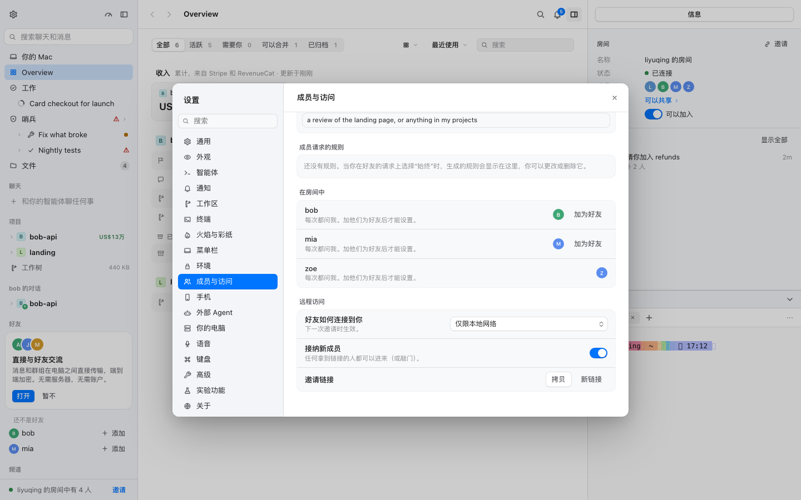
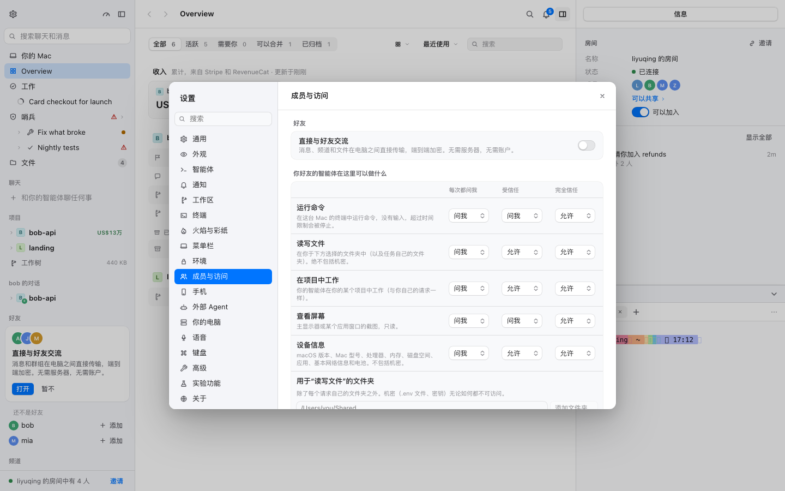
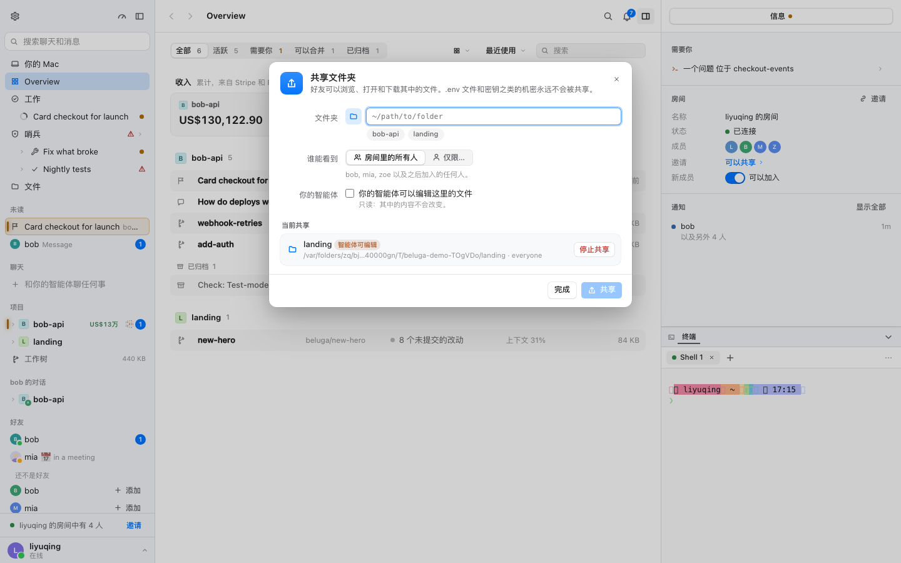
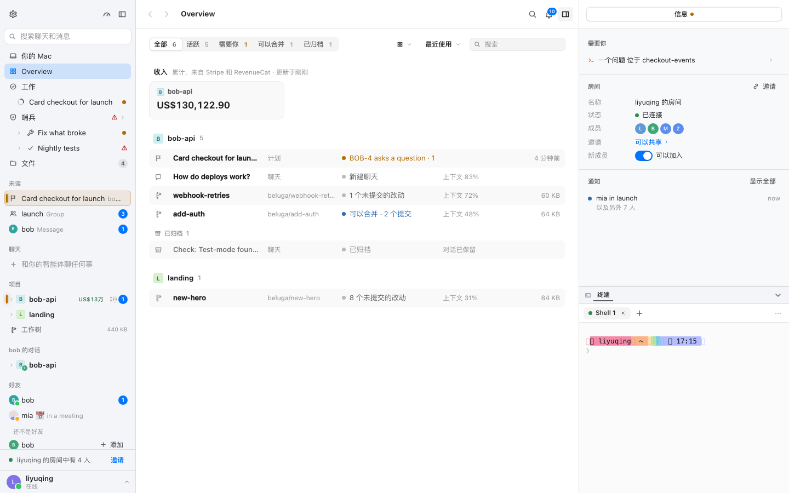
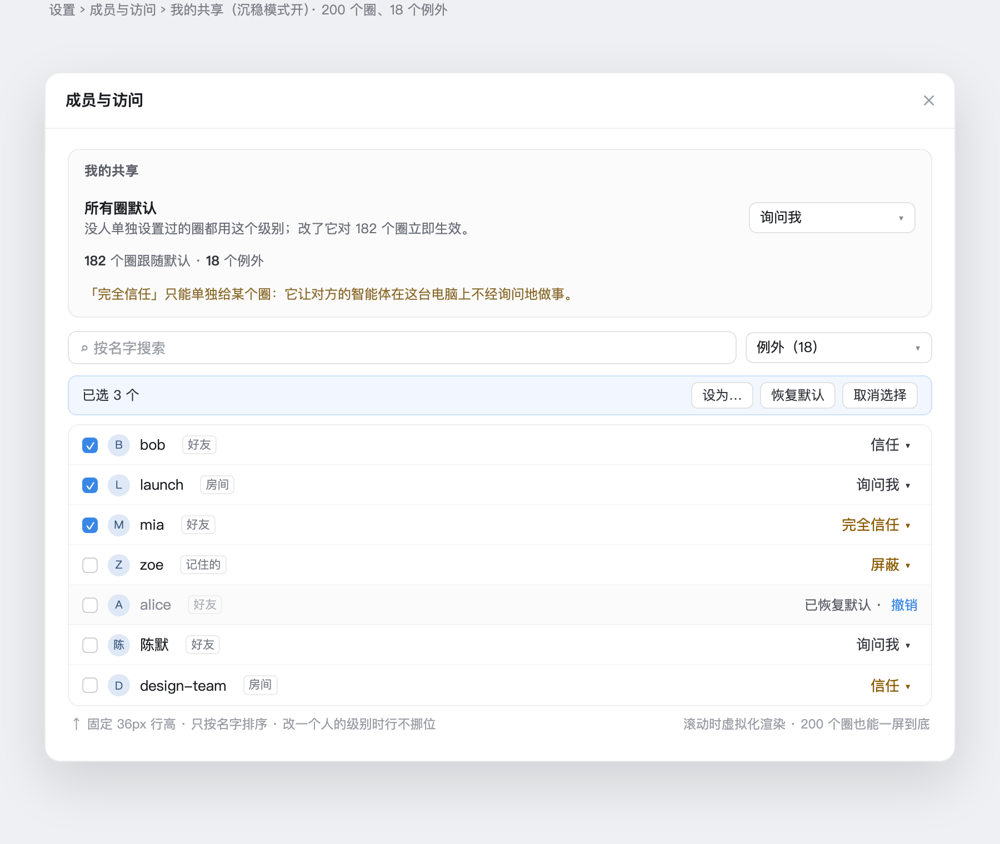
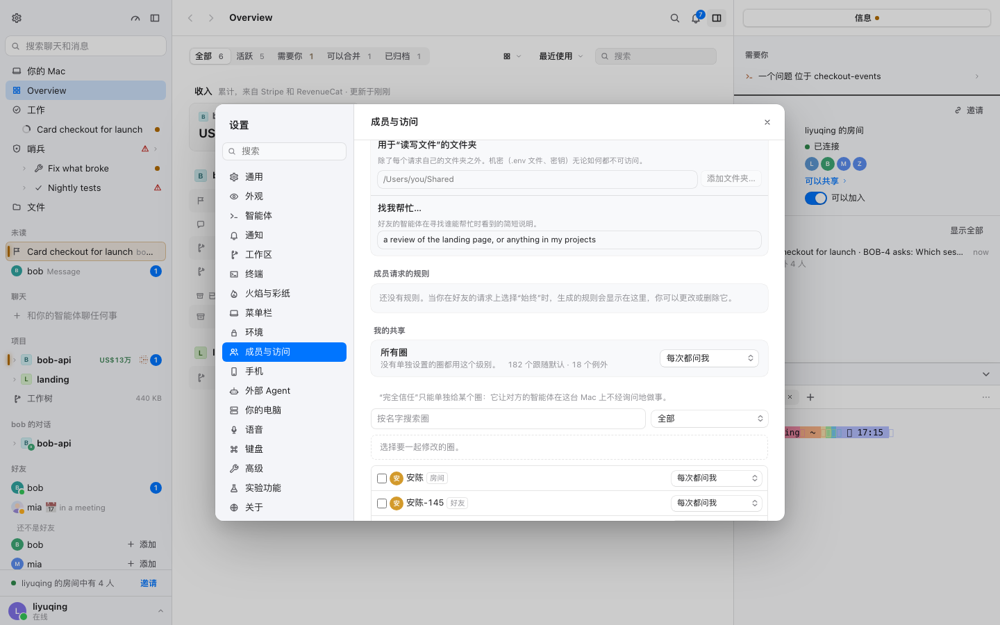
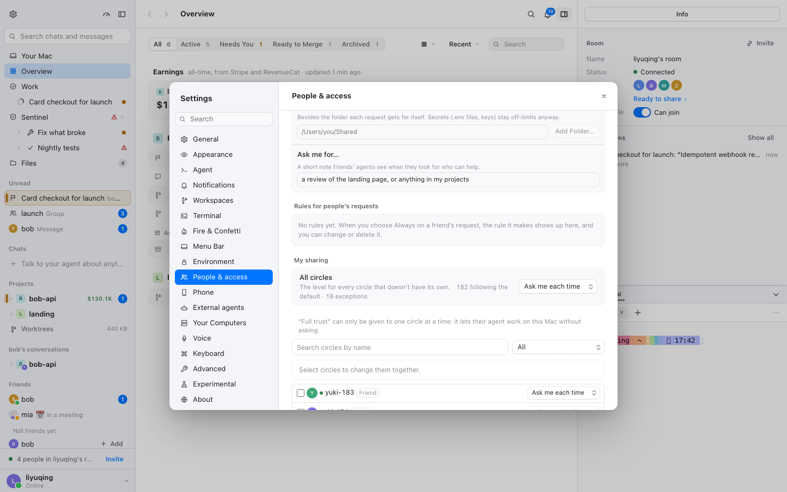
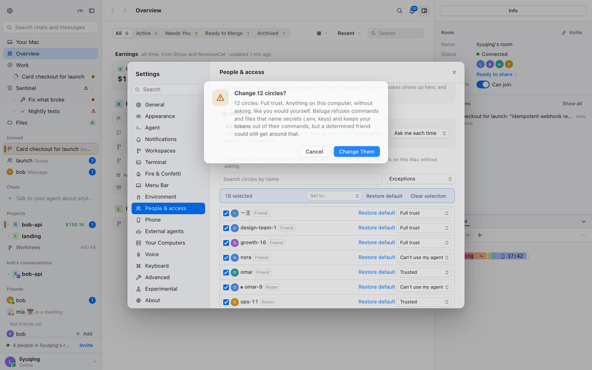
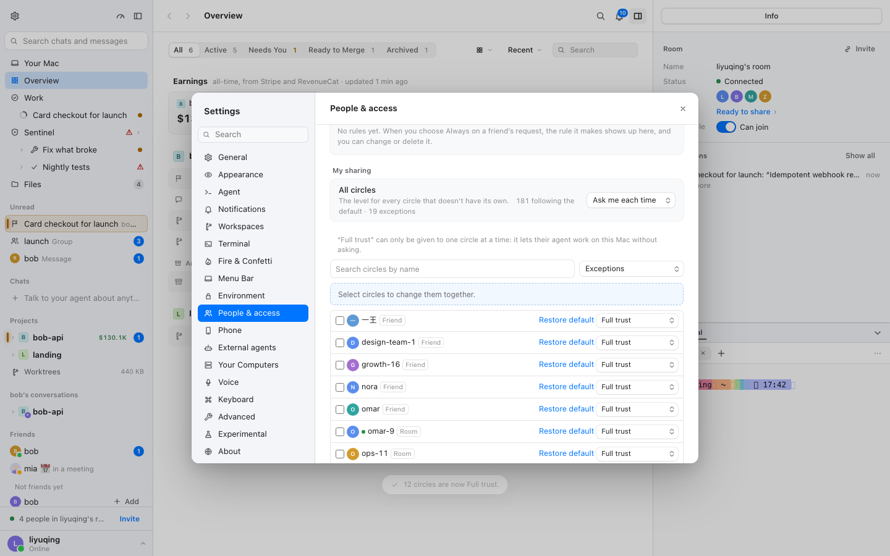
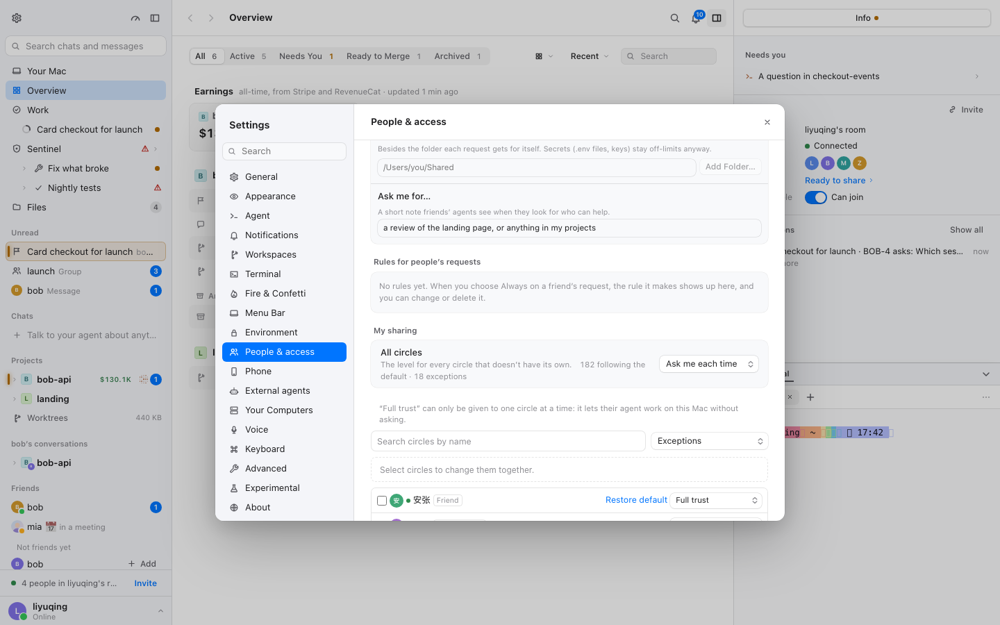

# 我的共享：一个默认 + 少数例外（M7 · BLG-217）

- 采集时间：2026-11-13 17:12–17:16（WIB）
- git：`6b0fd2ab7`（`plan/mac-fork`；本报告分支 `beluga/blg-217-m7`）
- 演示 daemon：`rm -rf /tmp/calm-blg217 && BELUGA_HOME=/tmp/calm-blg217 BELUGA_ALLOW_ORIGINS=http://localhost:1420 npm run dev`
- 网页：`cd packages/mac && BELUGA_HOME=/tmp/calm-blg217 npx vite --port 1420 --strictPort`
- 截图：Playwright（1440×900，浅色，界面语言 `zh-CN`），原始图在 `.context/`，代表图已拷入本文。

本文先回答「这是哪一页、数据从哪来」，再列 200 个圈下的问题、定「默认 + 例外」的模型与线框，最后写清迁移、IPC 与 200 圈演示数据的做法。§1.3 记录了用户对页面归属的确认（2026-11-13），BLG-218 可以按本文实施。

## 1. 页面是哪一页，数据从哪来

### 1.1 结论（主假设）

**「我的共享」= 设置 › 成员与访问（People & access）里的信任级别。**「圈」= 房间里的人、好友、记住的人；「共享级别」= `TrustLevel`（`blocked` / `ask` / `trusted` / `full`，文案沿用 `TRUST_INFO`）。

理由：全仓只有信任级别是「按人设置、有默认值、有例外」的数据；频道（`GroupView`）没有任何共享字段，共享文件夹是「按文件夹，不按圈」。

| 项 | 位置 |
| --- | --- |
| 页面组件 | `packages/mac/src/dialogs/Settings.tsx:575` `People()` |
| 「在房间中」一组 | `Settings.tsx:586`–`613`（`state.peers` 去掉自己；好友给「他们的名片…」，非好友给「加为好友」） |
| 「之前记住的」一组 | `Settings.tsx:616`–`625`（`state.remembered` 去掉已在房间里的人；只有一个「忘记」按钮） |
| 默认共享设置 | `Settings.tsx:163`–`172` 设置 › 通用 ›「好友对你的智能体的请求」（`api.session.setClaudeSharing`） |
| 默认值映射 | `src/core/trust.ts:34` `defaultTrust()`：`deny→blocked`、`auto→trusted`、`ask→ask` |
| 实际生效值的唯一读法 | `src/core/trust.ts:47` `trustOf()`：`levels[id] ?? remembered[id].trust ?? defaultTrust()` |
| 默认策略字段 | `src/core/store.ts:643` `policy` |
| 房间内逐人级别 | `src/core/store.ts:645` `levels` |
| 保存下来的逐人级别 | `src/core/work-store.ts:206` `remembered: Settings['people']` |
| 改一个人的级别 | `src/network/ConversationInspector.tsx:49`–`53`（会话右侧面板）；好友名片只显示、不提供修改（`PersonProfile.tsx:127`、`PersonMenu.tsx:88`） |
| 写入实现 | `src/core/people.ts:25` `People`、`:71` `setTrust()`、`:92` `forget()` |
| IPC（都已存在） | `src/ipc/api.ts:168` `session.setClaudeSharing`、`:223` `people.setTrust`、`:228` `people.forget`；实现在 `src/ipc/handlers.ts:102`、`:150`、`:158` |

数据语义（与 `trustOf` 一致）：

```
实际级别(圈) = 逐人设置(levels 或 remembered) ?? 所有圈默认(policy 映射)
```

房间里的值优先（`levels`），人离开房间后回落到 `remembered`，都没有才用默认。`levels` 只存房间里的人；好友走 `remembered`。**迁移不得改变 `trustOf` 对任何一个 id 的结果**——这是 M7 第 5 条标准。

### 1.2 现状截图

在 `/tmp/calm-blg217` 的一次性演示数据上采集：房间里 3 人（bob / mia / zoe），2 个好友请求未接受，频道 2 个（所有好友、launch），已共享 1 个文件夹。

| 候选一（主假设）：设置 › 成员与访问 | 设置 › 成员与访问（往上：能力表） |
| --- | --- |
|  |  |

「在房间中」的 bob / mia / zoe 每人一行，只写「每次都问我。加他们为好友后才能设置。」——**这一页本身不能改级别**；改级别要么打开好友名片，要么打开会话右侧面板。

| 候选二：共享文件夹的「当前共享」 | 候选三：频道 + 右侧频道信息 |
| --- | --- |
|  |  |

- 候选二（`packages/mac/src/dialogs/native/ShareFolderSheet.tsx:179`「Shared now」）：列表按**文件夹**，每项写「路径 · everyone / only A, B」；「谁能看到」也是给一个文件夹选「房间里的所有人 / 仅限…」。它回答的是「这个文件夹给谁看」，不是「这个圈能做什么」。
- 候选三（`src/network/NetworkSidebar.tsx:239` `GroupRow`、`src/net/mesh/views.ts:135` `GroupView`）：频道有成员、邀请链接、未读数，**没有任何逐频道的共享内容或共享级别字段**；右侧「频道信息」只列成员。要做成「按频道共享」必须改 daemon 与协议，超出本计划范围。

侧栏的频道入口：



### 1.3 用户确认

用户说「每个圈各占一块、单独调整」。现状里「一块 + 单独调整」最接近的是**好友名片 / 会话右侧面板**：每个好友或频道各有一块，里面是信任级别下拉框 + 规则（`ConversationInspector.tsx:47`–`56`、`PersonCards.tsx`、`Gateway/AccessSettings.tsx:186` `PersonRules`）。而「成员与访问」页本身是**汇总页**：每人一行、只读级别、不提供修改。

两种理解指向同一份数据、同一组 IPC，只是入口不同。**2026-11-13 17:20 已请用户确认，选择「成员与访问 + 信任级别」**：M7 用「成员与访问」做汇总页（它是唯一能看见所有圈的地方），名片/右栏保留为单个圈的详情入口；批量改仍写 `setTrust` / `forget`，数据与 IPC 都不动。用户另两个选项（共享文件夹、频道）已排除。

## 2. 200 个圈下的问题清单

按现状代码推演，200 个圈（好友 + 房间成员 + 记住的人）时：

| # | 问题 | 现状依据 | 影响 |
| --- | --- | --- | --- |
| P-1 | 没有搜索 | `People()` 直接 `map` 全部 `peers` / `remembered` | 200 行里找不到某个名字 |
| P-2 | 没有筛选 | 同上，两组混排 | 想看「哪些圈和默认不同」不可能 |
| P-3 | 不能多选、不能批量改 | 改级别只能一个人一个人来 | 200 个圈要 200 次操作 |
| P-4 | **这一页不能改级别** | 每行只写 `TRUST_INFO[...].label` + 「在他们的名片上改」 | 每次修改都要先打开名片/右栏，改完再回来，上下文丢失 |
| P-5 | **有些好友根本不出现** | `others = state.peers`（房间里的人），`remembered` 只含保存过的级别；离线且从未设置过级别的好友两边都不在 | 想找的圈可能不在列表里，而它实际跟随默认 |
| P-6 | 默认设置藏在「通用」页 | `Settings.tsx:163` | 用户不会把「默认」和「逐人设置」联系起来；没有「多少圈跟随默认、多少例外」的总览 |
| P-7 | 没有排序承诺 | 行序跟随 `peers` / `remembered` 的对象顺序 | 有人进出房间时行会挪位，点错行 |
| P-8 | 行里没有来源与在线状态 | 行只有名字 + 级别文字 | 「bob」是好友还是房间成员分不清；同名无法区分 |
| P-9 | guest 混在房间里但不可设置 | `p.guests[p.peerId]` 时右侧不渲染任何控件 | 占一行却不说明「权限由邀请链接决定」 |
| P-10 | 每次改动都弹长 toast | `core/people.ts:82`：`${name}: ${label}. ${detail}`，`success` 级 | 批量改 37 人会刷 37 条，必须按沉稳规范压成一条 |
| P-11 | 没有空/空搜索/无例外状态 | 「没有其他人」一句；其余没有 | 用户不知道是「没有例外」还是「没加载」 |
| P-12 | 行高不固定、控件常驻 | 每行一个可换文字的 `Row` | 长列表下重绘多；批量控件若常驻会挤压列表 |

## 3. 新模型：一个默认 + 少数例外

参考 macOS 通知设置、Slack 频道通知：**顶部一个默认，下面只列和默认不同的圈。**

```
所有圈默认  [询问我 ▾]        ← 对所有没有单独设置的圈立即生效
182 个圈跟随默认 · 18 个例外  ← 一行总览，数字 tabular-nums
「完全信任」只能单独给某个圈：它让对方的智能体在这台电脑上不经询问地做事。
```

- **默认只允许三种**：`询问我`（`ask`）、`信任`（`trusted`）、`屏蔽`（`blocked`）。默认不能是 `完全信任`（`full`）——它等于「这台电脑上的任何东西都不经询问」，只能作为单个圈的例外，页面上常驻一行说明。
- **例外 = `pinned !== undefined && pinned !== def`**。`pinned` 取 `levels[id] ?? remembered[id].trust`。
- 列表**只列例外**（默认筛选）；可切到「全部」或按级别筛选。单个圈按需展开/点名字打开名片改，不在每行常驻一整块控件。
- 排序**只按名字**（`localeCompare('zh')`），不按级别——改级别不改变行位置，列表不跳。

不变的部分：`levels` / `remembered` / `policy` 的字段含义与 `trustOf()` 完全不动。新页面是同一份数据的另一种编排，不是新存储。

### 3.1 线框



结构（自上而下）：

1. **默认行**：「所有圈默认」+ 级别选择 + 效果说明 + 「N 个跟随默认 · M 个例外」。
2. **工具行**：搜索（按名字，NFKC + 小写包含）+ 筛选（例外（默认）/ 全部 / 完全信任 / 信任 / 询问我 / 屏蔽）。
3. **批量条**：固定 36px 占位，未选中时显示计数说明；选中后「已选 N 个 · 设为… / 恢复默认 / 取消选择」；进行中显示「正在更改 12/37」。
4. **虚拟列表**：固定 36px 行高、`@tanstack/react-virtual`（已是依赖，`ChatLog.tsx:161` 在用）、overscan 8、容器高 `min(60vh, 行数 × 36)`。行：复选框、头像、名字、来源标签（好友 / 房间 / 记住的）、右侧级别文字按钮；例外行有「恢复默认」。

「例外」筛选下把某人恢复默认后，该行**原地保留**并显示「已恢复默认 · 撤销」（组件内 `kept: Set<id>`，同 `fork/calm/hold-order` 的思路），直到改搜索、改筛选或离开页面才消失。这样列表不因一次操作整行消失而跳动。

### 3.2 反馈分级（沉稳规范）

| 操作 | 级别 | 表现 |
| --- | --- | --- |
| 改单个圈的级别 | 轻 | 行内文字立刻变，**不弹 toast**（压掉 daemon 每次 `setTrust` 的 success toast） |
| 单个圈恢复默认 | 轻 | 行内「已恢复默认 · 撤销」，原地不跳 |
| 批量改 < 10 个 | 中 | 不弹确认；顺序完成后一条汇总 toast「已改 7 个圈为信任」 |
| 批量改 ≥ 10 个，或改默认 | 重 | 先 `ConfirmAlert` 写清后果（例：「37 个圈的 agent 请求将不经询问直接运行」「将影响 182 个跟随默认的圈」），再顺序执行，进度写在批量条里；完成后一条汇总 toast |
| 有失败 | 重 | 一条 error toast，列出失败的名字（error 级不压） |

批量**顺序 `await`，不并发**：`People.persist` 每次都先读盘再写（`core/people.ts:41` `refresh()`），并发会互相覆盖。进度只更新批量条，不逐条 toast。

### 3.3 所有状态

| 状态 | 页面表现 |
| --- | --- |
| 加载 | 保留固定高的占位行（36px × 可见行数），不产生位移；默认行先可用 |
| 没有人（0 个圈） | 「还没有好友或房间里的人」+「添加好友」按钮 |
| 网络关 | 只列房间里的人和记住的人，顶部一行「打开 Beluga 网络后，好友才会出现在这里」 |
| 没有例外 | 例外筛选下安静一行「全部跟随默认」 |
| 有例外 | 默认「例外」筛选；数字总览 |
| 搜索无结果 | 「没有叫“x”的圈」+「清除搜索」 |
| 200 个圈 | 虚拟化；滚动不卡；改一行时其他行不挪位 |
| 批量进行中 | 批量条「正在更改 12/37」，操作按钮暂时禁用；列表仍可滚动 |
| 沉稳关 | `People()` 原样不动（与上游一致） |

## 4. 数据迁移与 IPC 结论

### 4.1 迁移

- **迁移动作**：页面打开时，若存在 `pinned === def` 的圈（`redundantPins`），对这些人逐个 `api.people.forget(id)`；**不改 `policy`**。
- **为什么安全**：`trustOf` 读到 `remembered` 与默认值相同，删掉 remembered 后回落到默认，结果按构造相同。迁移幂等，可重复运行。
- **时机**：页面打开时跑一次；**改默认之前再跑一次**，保证「默认对所有跟随默认的圈生效」不会被一条恰好等于旧默认的 pinned 值挡住。
- **单测**：种子随机生成 500 个状态（`policy` × `levels` × `remembered` × `friends` × `guests` × 自己），迁移前后对每个 id 比较 `trustOf`，必须相等（`tests/sharing-defaults.test.ts`，BLG-218）。

### 4.2 是否改 daemon / IPC：**不改**

- 需要的三个动作都已经在 IPC 里：`session.setClaudeSharing`（改默认）、`people.setTrust`（设例外）、`people.forget`（恢复默认）。
- 批量期间的 toast 压制放在前端：`fork/sharing/quiet.ts` 在 `fork/calm/one-toast.ts` 的 global 门里加一个 `muted()` 判断，只压 `success` 级，`error` 照常显示。`core/people.ts:71` 的 `setTrust(peerId, level, quiet)` 本身支持 quiet，但 IPC 没有暴露——为了不在本计划里动协议，选择前端压制；将来若要少这一层，只需给 `people.setTrust` 加一个可选布尔参数（新增参数不新增方法，`src/companion/coverage.ts` 无需分类）。
- 因此 `src/companion/coverage.ts` 不动，手机端不在本计划范围。

## 5. 200 个圈演示数据怎么来

不新增 demo daemon 场景，也不往 daemon 里塞测试数据。做法是**页面自己的适配器 + DEV 演示源**：

- 新文件 `packages/mac/src/fork/sharing/demo.ts`：
  - `demoCircles(n = 200, seed = 7)`：确定性生成，名字中英混合（如 `mia`、`陈默`、`design-team`、`launch`），约 85% 跟随默认，其余在四个级别间分布（约 18 个例外），含 `online` 与来源（好友 / 房间 / 记住的）。
  - `demoSource()`：返回内存版数据源；`setTrust` / `forget` 只改内存，不发 IPC。
- **启用条件（都满足才启用）**：`import.meta.env.DEV` 且 `localStorage['beluga.fork.sharing.demo.v1']` 是数字（圈的个数）。
- 用法：
  ```bash
  cd packages/mac
  npx vite --port 1420
  # 浏览器控制台：localStorage.setItem('beluga.fork.sharing.demo.v1', '200'); location.reload()
  # 关掉：localStorage.removeItem('beluga.fork.sharing.demo.v1'); location.reload()
  ```
- e2e 用同一个键（`page.addInitScript` 里写入），不依赖 daemon 里真有 200 个人；calm-check 的 `sharing` 场景也用它。生产构建里该文件不会启用（`DEV` 为假），真实数据路径不受影响。

## 6. 实施与验收（交给 BLG-218 / BLG-219）

BLG-218 按本文件实现：

- 新文件都在 `packages/mac/src/fork/sharing/`：`model.ts`（纯函数）、`MySharing.tsx`、`sharing.module.css`、`demo.ts`、`quiet.ts`。
- 唯一的上游改动：`packages/mac/src/dialogs/Settings.tsx` 的 `People()` 里一处 `useCalm() ? <MySharing/> : (原两组)`；登记 `docs/fork.md`。`fork/settings-index.ts` 加搜索行（关键词「我的共享 共享 圈 信任 默认 例外 批量 sharing trust default」）。
- 中文进 `zh-CN.fork.json`，代码里英文。
- 测试：`tests/sharing-defaults.test.ts`（迁移不变性 500 例、搜索/排序、`planBatch` 计数、默认不为 `full`）；`packages/mac/e2e/sharing-defaults.spec.ts`（例外 → 恢复默认 → 原地撤销、批量确认与一条 toast、200 圈打开 < 500ms、第 49/51 行 y 差 0、搜索）；`calm-check.mjs` 加 `sharing` 场景（CLS 0、无循环动画）。

BLG-219 独立实测，把数据填进本文（新增「§7 实测」）：打开到可操作时间、CLS、滚动、搜索、批量改、改单行不跳位，问题表逐条给状态；跑 `sync-upstream --report` 要求 0 个 `!`。

### 6.1 实施记录（BLG-218，2026-11-13）

- 新文件：`packages/mac/src/fork/sharing/{model,demo,quiet}.ts`、`MySharing.tsx`、`sharing.module.css`。
- 上游接点只有一处：`packages/mac/src/dialogs/Settings.tsx` 的 `People()` 里 `calm ? <MySharing /> : (原两组)`；`docs/fork.md` 已登记。
- fork 文件：`fork/settings-index.ts` 加「我的共享」搜索行；`fork/calm/one-toast.ts` 加 `suppressed` 门（quiet 窗口里的 toast 永不显示）；`zh-CN.fork.json` 加文案。
- 同名圈（演示里有一个房间 bob 和一个好友 bob）靠来源标签区分；无障碍名字带上来源（`Trust for bob (Friend)`），测试据此定位。
- 验证命令：
  ```bash
  npx vitest run tests/sharing-defaults.test.ts
  cd packages/mac && npm run e2e -- e2e/sharing-defaults.spec.ts
  node scripts/calm-check.mjs sharing          # 需要 demo daemon + vite
  ```
- 演示源：`localStorage['beluga.fork.sharing.demo.v1'] = '200'` 后重载（仅开发构建），见 §5。
- 218 的初步实测（不是 219 的独立审计）：e2e 里 200 圈从点「人与权限」到默认下拉可用、首行可见约 110–140ms；改列表中间一行前后该行 y 差 ≤1px；`calm-check sharing` 在 calm-on/full 与 calm-on/reduce 下 CLS 0.000、动画 0。正式数字见 §7。

## 7. 实测与问题表（BLG-219，2026-11-13）

独立实测：只看实现后的代码与真实运行，不沿用 218 的数字。环境与条件：

- git `5b8dde349`（BLG-218 提交）；演示源 200 圈（`localStorage['beluga.fork.sharing.demo.v1']='200'`，仅开发构建）。
- 一次性 home `/tmp/calm-blg217` 的 demo daemon + `npx vite --port 1420`；每次测量用新的 browser context（1440×900、浅色、英文界面）。
- 机器负载：`uptime` 1 分钟约 6.7（10 核，其他 worktree 同时在跑）。
- 脚本：`packages/mac/.context/audit-sharing.mjs`、`audit-single.mjs`、`audit-misc.mjs`（gitignore，可重跑）；数字在 `.context/audit-sharing.json`。

### 7.1 结果

| 指标 | 结果 | 说明 |
| --- | --- | --- |
| 打开到可操作（点「人与权限」→ 默认下拉可用 + 首行可见） | **87–131 ms**（两轮共 10 次；中位数约 97ms） | 远低于 500ms；e2e 也断言 <500ms |
| CLS（calm-check `sharing` 场景） | **0.000**（calm-on/full 与 calm-on/reduce 都是） | 场景自带 200 圈演示源；无循环动画，动画数 0，JS 改写样式 0 |
| CLS（审计脚本，含打开设置窗口的全过程） | 0–0.006 | 位移来自设置窗口自身出现，不是列表；列表行高固定 |
| 滚动到列表底部 | 47–48ms；内容 7200px / 视口 538px | 没有空白或卡住 |
| 滚动流畅度（程序化滚 600px，30 帧） | 平均 19ms/帧（约 53fps），最差 35–41ms | 采集时 10 核负载约 6.7；不是 60fps，但没有长卡顿 |
| 搜索「mia」 | 13–18ms，6 行（`mia`、`mia-128`、`mia-153`、`mia-189`、`mia-80`、`mia-98`） | 中英与大小写都覆盖；无结果状态显示「没有叫“x”的圈」+ 清除 |
| 改列表中间一行 | 该行 y 458 → 458；列表内滚动 1441 → 1441；外层设置滚动 1340 → 1340 | 只按名字排序，行不重排；上方/下方行位置不变 |
| 批量改 18 个选中 | 确认框「Change 12 circles?」（6 个本来就是 Full trust，不重复改）；完成后**只有 1 条** toast「12 circles are now Full trust.」 | 逐条成功 toast 被压掉；error 不受影响 |
| 改默认 | 先弹「Use Trusted for every circle?」，确认后一条汇总 toast | 文案写明影响「跟随默认」的圈 |
| 沉稳关 | `People & access` 仍是上游的「In the room」「Remembered from before」，没有 `[data-sharing]` | e2e 断言 |
| 控制台 | 全部测量中 page error / console error 均为 0 | — |

截图（200 圈演示源）：

| 全部 200 个圈 | 列表底部 | 搜索「mia」 |
| --- | --- | --- |
|  |  |  |

| 批量确认（12 个会变） | 完成后一条汇总 toast | calm-check 场景 |
| --- | --- | --- |
|  |  |  |

### 7.2 问题表逐条状态

| # | 问题 | 状态 | 依据 |
| --- | --- | --- | --- |
| P-1 | 没有搜索 | **已解决** | 搜索 13–18ms；中英、大小写、无结果都实测 |
| P-2 | 没有筛选 | **已解决** | 例外（默认）/全部/四个级别；实测切换 |
| P-3 | 不能多选、不能批量 | **已解决** | 18 选 12 改；确认 + 一条汇总 |
| P-4 | 这一页不能改级别 | **已解决** | 每行级别按钮直接改；单行轻反馈不弹 toast |
| P-5 | 有些好友根本不出现 | **已解决** | 好友 ∪ 房间 ∪ 记住的人，按 id 去重；离线好友也在 |
| P-6 | 默认设置藏在「通用」 | **已解决** | 页面顶部「所有圈默认」+「N 跟随默认 · M 例外」 |
| P-7 | 没有排序承诺 | **已解决** | 只按名字（`localeCompare('zh')`，同名按 id）；改一行 y 不变 |
| P-8 | 行里没有来源与在线状态 | **已解决** | 好友 / 房间 / 记住的标签、在线绿点；无障碍名字带来源 |
| P-9 | guest 混在房间里但不可设置 | **已解决** | guest 不再入列（权限由邀请链接决定），页面没有点了没反应的行 |
| P-10 | 每次改动都弹长 toast | **已解决** | 单行无 toast；批量/改默认一条汇总；error 照常 |
| P-11 | 没有空/无例外/搜索无结果状态 | **已解决** | 三种状态都有文案与操作（清除搜索、添加好友） |
| P-12 | 行高不固定、控件常驻 | **已解决** | 固定 36px + 虚拟化；级别是文字按钮，不是常驻大控件 |
| P-13 | 同名不同来源（演示里两个 bob） | **已缓解（不是 bug）** | 它们是不同 id、不同权限，不能合并；来源标签 + 无障碍名字区分。若将来要按显示名合并，需要产品决定 |
| P-14 | 设置窗口较矮时，540px 的列表要外层滚动才能看全 | **记录，可接受** | 列表本身可滚；窗口够高时一屏。若 M8 再动设置布局，可改成按可用高度算 |
| P-15 | 审计脚本里一次「改中间行」出现整列 +360px 位移 | **不是应用问题** | 定位器在点击前被 Playwright 自动滚入视口；按 `data-circle` 固定元素复测，y 与内外滚动都不变（见 7.1） |

结论：M7 的六条标准里，与页面可用性、性能、CLS、数据语义、上游登记相关的项都已在实测中满足；剩下的是 M8 才考虑的布局取舍（P-14）。

### 7.3 同步上游报告

`node scripts/sync-upstream.mjs --report`：

- **0 个 `!`**；覆盖层失效的选择器 0 条。
- 「合并时检查」列出 3 个 fork 与上游都改过的文件：`src/companion/protocol.ts`、`src/companion/views.ts`、`src/ipc/api.ts`——都是本计划之前就有的改动；M7 没有新增 IPC/协议改动。
- 本 fork 改动的上游文件里，M7 只新增 `packages/mac/src/dialogs/Settings.tsx` 一处（`docs/fork.md` 已登记，报告里没有未解释的接点）。
