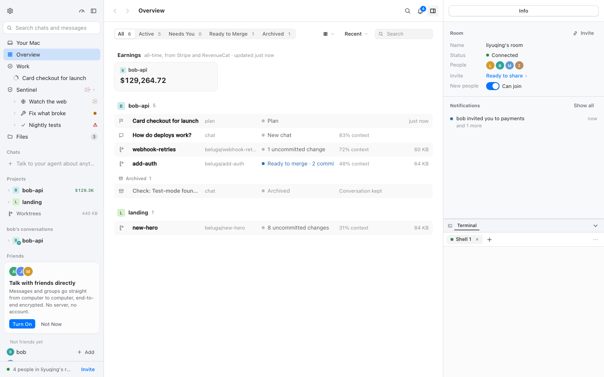
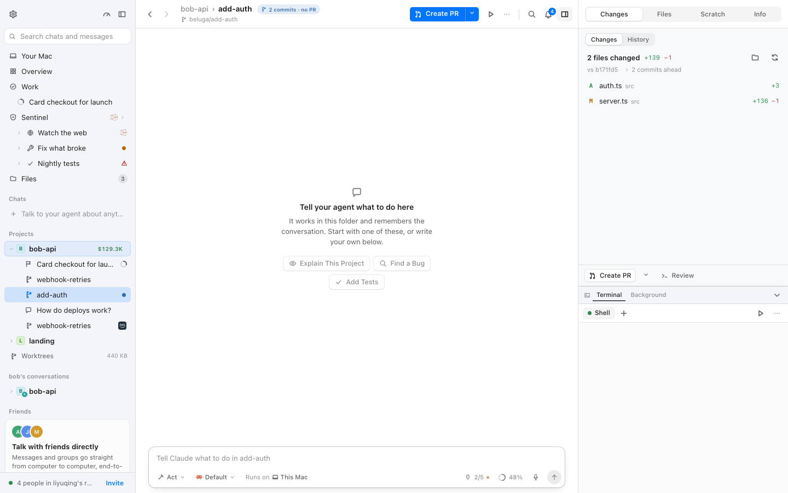
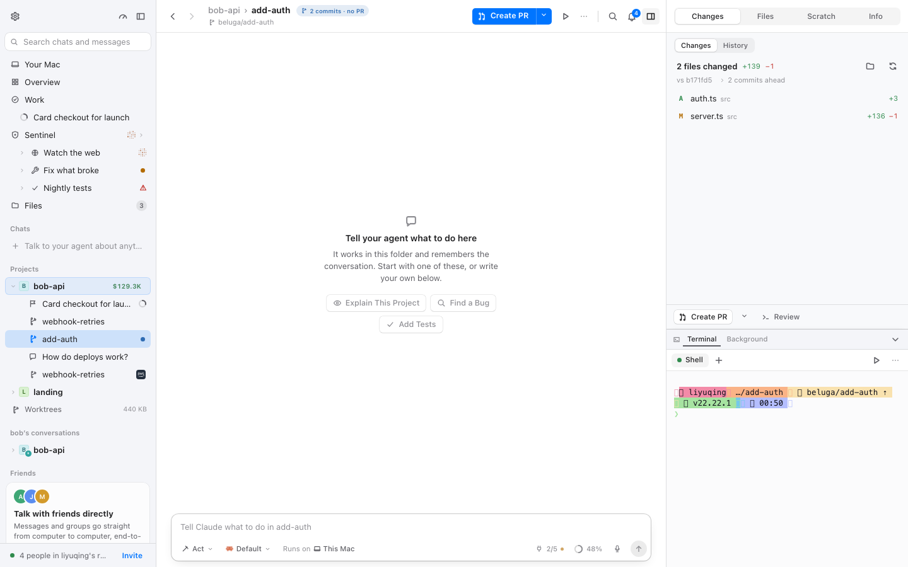
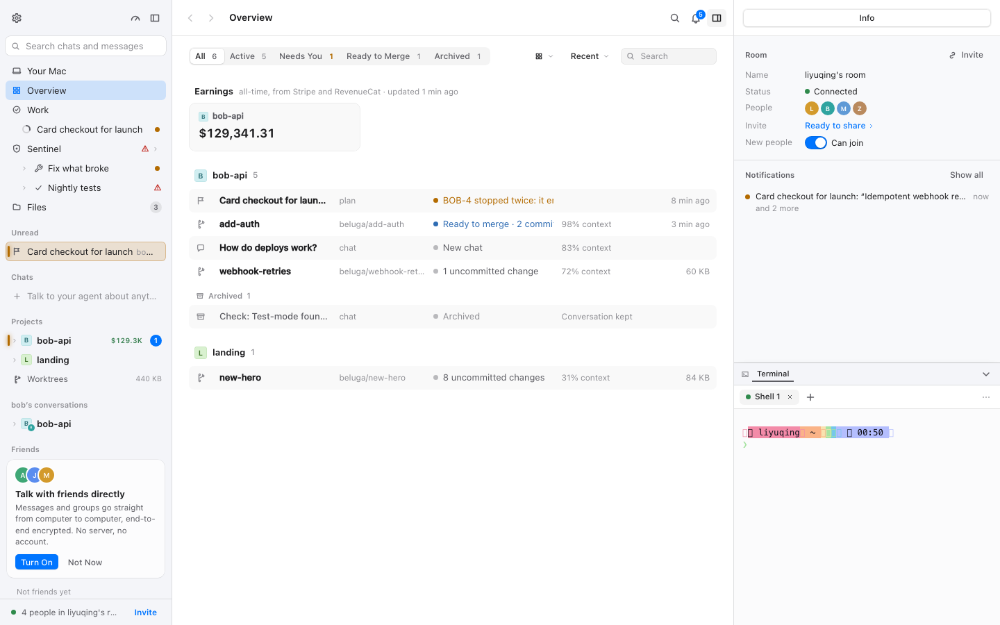
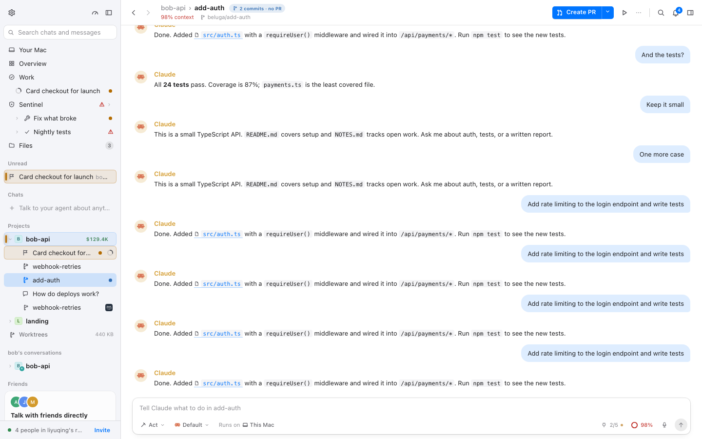
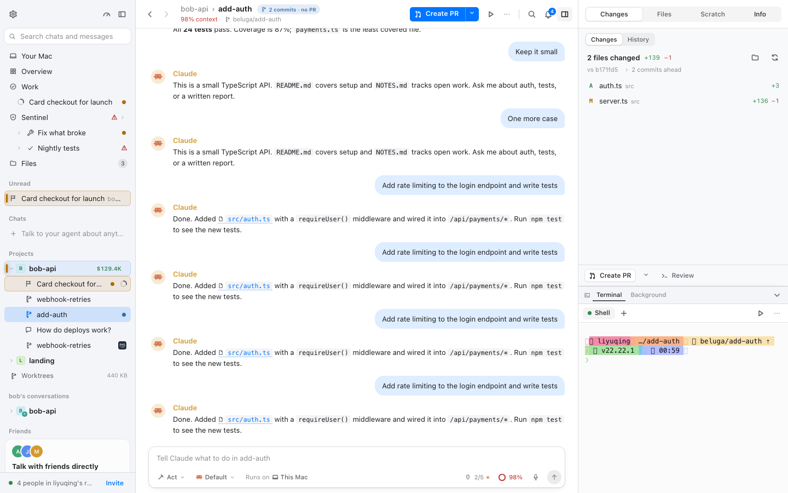
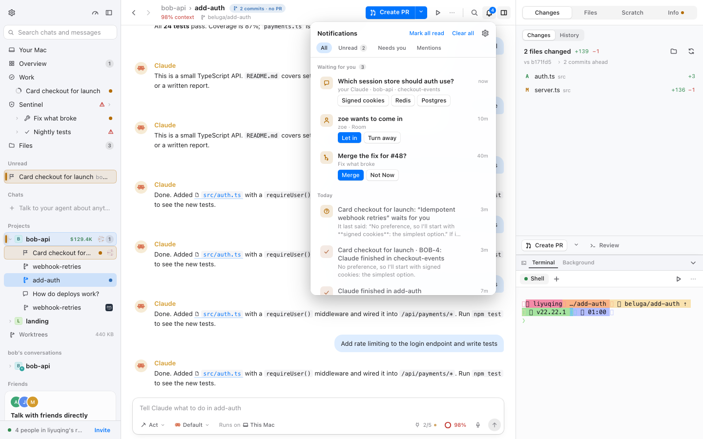
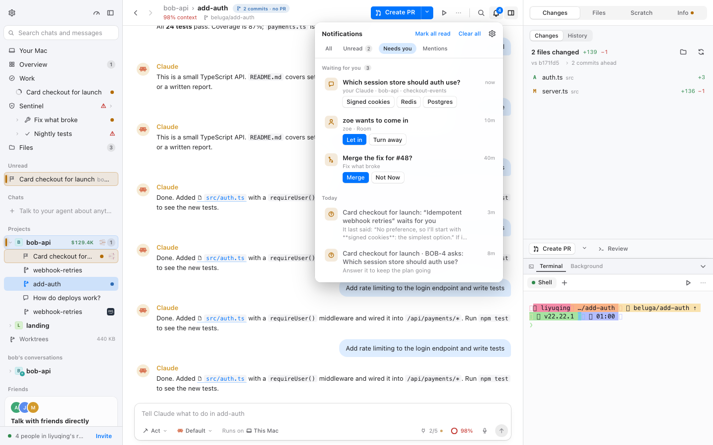
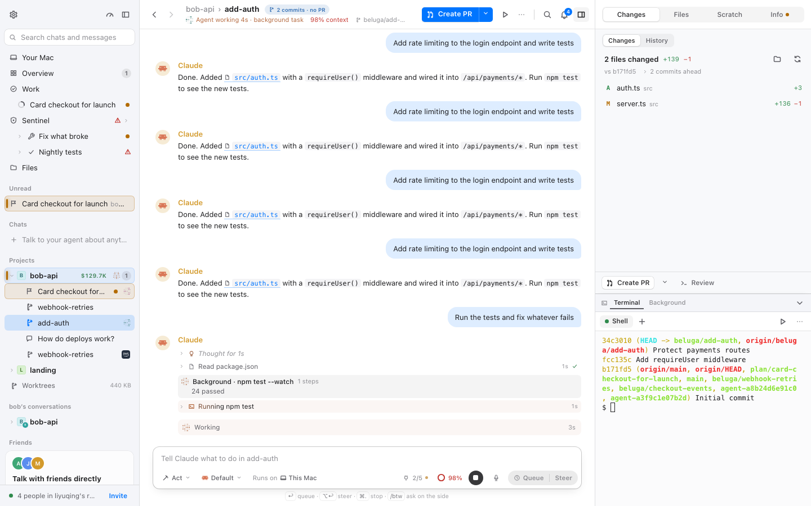
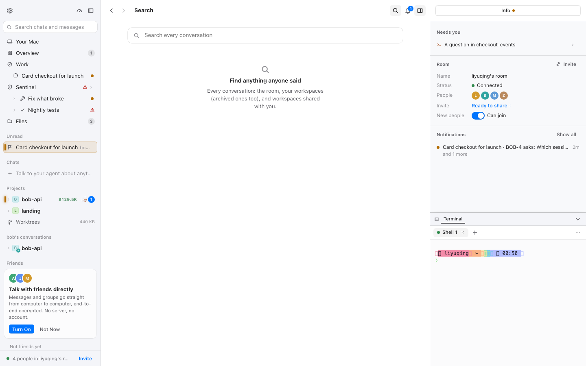

# 沉稳界面 · 外壳与侧栏逐页验收（M3 · BLG-170）

- 采集时间：2026-11-12 00:50–01:24（WIB）
- git：`9f525f257`（`plan/mac-fork` 上 M2 合并后的 HEAD；本报告分支 `beluga/blg-170-m3`）
- 命令行：`BELUGA_URL=http://localhost:1421 node packages/mac/scripts/calm-check.mjs room workspace shellsidebar shellpanel shellcollapse shellnotifications overview usage search shared palette settings person diff files terminal dock picker`（分三次跑；`shellcollapse` 因 `⌘B` 在 web view 里没生效，改为点 `Hide sidebar`/`Show sidebar` 按钮后重跑）
- 演示 daemon：`BELUGA_HOME=/tmp/calm-blg170 BELUGA_ALLOW_ORIGINS=http://localhost:1421 npm run dev`（一次性 home，演示数据）；vite 占 1421
- 原始结果：`.context/calm/<场景>.json` 与 `.context/calm/img/`（gitignore，可重跑）；代表截图拷贝在 `docs/calm/img/`
- 机器负载：采集期间 other worktrees 在跑，`uptime` 的 1 分钟负载约 20–30（10 核）；报告标注了受负载影响的时序项。

## 验收方法（四步）

1. **逐页录屏**：每个场景在四个组合下各起一个全新浏览器 context（`calm-on/full`、`calm-on/reduce`、`calm-off/full`、`calm-off/reduce`），记录 CLS 与位移来源、`getAnimations()`、2 秒内被 JS 改写 style 的元素、首帧是否已有 `data-calm`，并在 enter / loaded / hover / select / 自定义时刻截图。
2. **时刻覆盖**：进入（room 的 enter）→ 加载完成（loaded）→ 新内容到达（通知中心的内容、聊天到达）→ 悬停（侧栏 needs 行 hover）→ 选中（needs 行 select）→ 展开收起（右侧面板、侧栏、通知中心）。
3. **reduced-motion**：`calm-on/reduce` 重看；CSS 动画与 JS 动效应为 0。
4. **问题成表**：文件:行、现象、改法、建议归属（覆盖层 / 挂钩 / 上游 PR），状态本阶段统一「待 BLG-174」。

本报告覆盖：**侧栏**（含 needs-you / unread 信号）、**工具栏**、**右侧面板**（Changes/Files/Terminal 与开合）、**通知中心与 toast**、以及外壳入口。`palette`/`settings`/`person` 属对话框区（BLG-172），`usage` 属数据区（BLG-171）；本次运行顺带采集，判定写在那两份报告里。

## 1 页面清单：场景 ↔ 页面/视图 ↔ 导航路径

| 场景 | 页面 / 视图 | 覆盖的时刻 | 导航（脚本步骤） |
| --- | --- | --- | --- |
| `room` | 启动后的 Overview + 右侧 Inspector（Room、Notifications） | 进入、加载完成 | 启动应用，1.2s 截 `enter`，场景空等后截 `loaded` |
| `workspace` | 工作树对话 `bob-api › add-auth`：侧栏、标题栏工具栏、右侧面板 | 进入、加载完成 | 侧栏 `bob-api` → `add-auth`（`openWs`） |
| `shellsidebar` | 侧栏的 needs-you 行（琥珀底 + 左亮边） | 悬停、选中 | 在 `room` 页悬停 `[data-signal-row="needs"]` → `needs-hover`；点开 → `needs-select` |
| `shellpanel` | 右侧面板（Changes 标签页） | 展开、收起、再展开 | `add-auth` → 点面板标签 `Changes` → `panel-open`；工具栏 `Hide the panel` → `panel-closed`；`Show the panel: …` → `panel-reopened` |
| `shellcollapse` | 侧栏与右侧面板的收起/展开 | 收起、展开 | `⌘B` 隐藏/显示侧栏；`⌥⌘0` 隐藏/显示面板 |
| `shellnotifications` | 工具栏铃铛 + 通知中心 | 打开、筛选、关闭 | 点 `Notifications` → `open`；切 `Needs you` → `filter`；Esc → `closed` |
| `diff` / `files` / `terminal` | 右侧面板三个标签页 | 切换、加载 | `add-auth` → 点对应标签（`Files` 里点开 README；`Terminal` 里 `ls -la && git log`） |
| `dock` | 对话 + 终端抽屉（⌘J） | 展开、输入 | `add-auth` → `⌘J` → 终端里跑 `git log` → 发一条 prompt |
| `overview` | Overview 视图 | 加载 | 侧栏 `Overview` |
| `search` | 工具栏搜索 | 展开、输入 | 点 `Search` → 输入 `auth` |
| `shared` | 共享文件（侧栏 `Files`） | 加载 | 侧栏 `Files` |
| `palette` / `settings` / `person` / `usage` | ⌘K 面板、设置、人物卡、用量 | — | 见 BLG-172 / BLG-171；本次采集仅作对照 |

## 2 每页结果

格式：`CLS · CSS 动画数 · JS 动效元素数`；`data-calm` 首帧是 `calm-on/full` 的观测。

| 场景 | on/full | on/reduce | off/full | off/reduce | 首帧 data-calm（on） |
| --- | --- | --- | --- | --- | :---: |
| room | 0.003 · 0 · 0 | 0.000 · 0 · 0 | 0.000 · 0 · 42 | 0.000 · 0 · 0 | ✅ |
| workspace | 0.012 · 0 · 0 | 0.000 · 0 · 0 | 0.000 · 0 · 42 | 0.000 · 0 · 0 | ✅ |
| shellsidebar | 0.003 · 0 · 0 | 0.000 · 0 · 0 | 0.000 · 1 · 0 | 0.000 · 0 · 0 | ✅ |
| shellpanel | 0.003 · 0 · 0 | 0.000 · 0 · 0 | 0.000 · 2 · 0 | 0.000 · 0 · 0 | ✅ |
| shellcollapse | 0.003 · 0 · 0 | 0.000 · 0 · 0 | 0.000 · 2 · 42 | 0.000 · 0 · 0 | ✅ |
| shellnotifications | 0.003 · 0 · 0 | 0.000 · 0 · 0 | 0.000 · 2 · 42 | 0.000 · 0 · 0 | ✅ |
| overview | 0.003 · 0 · 0 | 0.000 · 0 · 0 | 0.000 · 1 · 21 | 0.000 · 0 · 0 | ✅ |
| search | 0.003 · 0 · 0 | 0.000 · 0 · 0 | 0.000 · 1 · 21 | 0.000 · 0 · 0 | ✅ |
| shared | 0.003 · 0 · 0 | 0.000 · 0 · 0 | 0.000 · 1 · 21 | 0.000 · 0 · 0 | ✅ |
| diff | 0.003 · 0 · 0 | 0.000 · 0 · 0 | 0.000 · 2 · 0 | 0.000 · 0 · 0 | ✅ |
| files | 0.003 · 0 · 0 | 0.000 · 0 · 0 | 0.000 · 2 · 0 | 0.000 · 0 · 0 | ✅ |
| terminal | 0.003 · 0 · 0 | 0.000 · 0 · 0 | 0.000 · 2 · 42 | 0.000 · 0 · 0 | ✅ |
| dock | 0.013 · 0 · 0 | 0.003 · 0 · 0 | 0.010 · 1 · 21 | 0.003 · 0 · 0 | ✅ |

代表截图：

| room · 进入后的外壳（calm 开） | workspace · 工具栏 + 侧栏 + 右侧面板 |
| --- | --- |
|  |  |

| 对照：workspace · calm 关 | 侧栏 needs-you 行悬停 |
| --- | --- |
|  |  |

| 右侧面板展开 | 收起 | 再展开 |
| --- | --- | --- |
|  |  |  |

| 通知中心打开 | Needs you 筛选 |
| --- | --- |
|  |  |

| 终端抽屉（⌘J） | 工具栏搜索 |
| --- | --- |
|  |  |

## 3 仍在播放的动画清单及理由

| 场景 | calm-on/full CSS 动画 | calm-on/reduce | calm-off/full（对照） |
| --- | ---: | ---: | --- |
| room | 0 | 0 | 0 |
| workspace | 0 | 0 | 0 |
| shellsidebar | 0 | 0 | 1（`_scan_` 4.2s infinite） |
| shellpanel | 0 | 0 | 2（`_scan_` ×2） |
| shellcollapse | 0 | 0 | 2（`_scan_` ×2） |
| shellnotifications | 0 | 0 | 2（`_scan_` ×2） |
| overview | 0 | 0 | 1（`_scan_`） |
| search | 0 | 0 | 1（`_scan_`） |
| shared | 0 | 0 | 1（`_scan_`） |
| diff / files / terminal | 0 | 0 | 2（`_scan_` ×2） |
| dock | 0 | 0 | 1（`_scan_`） |

calm-on/full 的 CSS 动画全部为 0；`calm-off/full` 里唯一的循环是侧栏 needs-you 行的扫光（`layout/signal.module.css:22-39`）。JS 动效方面，`calm-off/full` 的 `jsMotion` 是 21–42 个元素（DotMatrix 每点约 30 次/2s），`calm-on/full` 为 0（live-gate 只放行当前步骤行）。

说明（逐条理由）：

| 动画 | 类型 / 时长 | 出现在 | 为什么仍然在 | 处置建议 |
| --- | --- | --- | --- | --- |
| `needsRow::after` 的扫光（`layout/signal.module.css:22-39`，`scan` 4.2s infinite） | CSS 关键帧 | 侧栏 needs-you 行 | **calm-off/full 才在**（本次运行 2 个场景各 1 条）；calm 的 S1 把 `::after` 设为 `display:none`，`calm-on/full` 为 0 | 保持（M1 已修） |
| 侧栏 Claude 工作中的呼吸点（`components/ui.tsx` 的 Dot + `lib/live-motion.ts`） | JS（live-motion 时钟） | 侧栏工作中的行 | live-gate 只放行 `[data-step][data-current]`，侧栏点被冻在静止帧；`jsMotion` 在 calm-on 为 0 | 保持（M2 契约） |
| 外壳入场 `arrive`（`layout/Shell.module.css:7-13`，1.6s `scale(1.08) → none`） | CSS 关键帧，一次性 | 从欢迎页进入时 | keep-decor 锚点 `[data-arriving]` 放行；本次 calm-check 的导航路径不经过欢迎页，未触发，改用人工探针验证（§7）；reduce 下上游媒体查询停，probe 也是 none | 保留（已批准例外） |
| 通知/菜单/对话框入场 | CSS（`calm-overlays.css` 的 `calm-surface-in` / `calm-surface-drop`，160ms） | 打开铃铛、⌘K、设置 | 覆盖层统一的出现方式，不是循环 | 保持 |

calm-on/reduce 下 CSS 动画为 0；通知中心、面板的过渡为 0ms（`--dur` 在 reduce 下为 0）。侧栏的 needs-you 标记在 reduce 下仍显示（静态的琥珀底 + 亮边），这是状态不是动画。

## 4 reduced-motion 下的结果

| 场景 | on/reduce CSS 动画 | on/reduce JS 动效 | on/reduce CLS |
| --- | ---: | ---: | ---: |
| room | 0 | 0 | 0.000 |
| workspace | 0 | 0 | 0.000 |
| shellsidebar | 0 | 0 | 0.000 |
| shellpanel | 0 | 0 | 0.000 |
| shellcollapse | 0 | 0 | 0.000 |
| shellnotifications | 0 | 0 | 0.000 |
| overview | 0 | 0 | 0.000 |
| search | 0 | 0 | 0.000 |
| shared | 0 | 0 | 0.000 |
| diff / files / terminal | 0 | 0 | 0.000 |
| dock | 0 | 0 | 0.003 |

- `calm-on/reduce` 的所有外壳场景 `animations` 为 0、`jsMotion` 为 0。
- 外壳入场 `arrive`：上游 `:root[data-motion='reduce'] .app[data-arriving] { animation: none }`，probe 实测 none。
- 通知中心 `drop`、面板 `settle`、抽屉 `drawerIn/Out`：calm 的 M5 与 reduce 两段式都关掉；面板的滑动时长读 `--dur`（reduce 为 0），`useSlide` 的 `reduce ? 0 : SLIDE_MS` 让内容立刻 settled。
- 结论：本区 reduce 下没有仍在播放的动画。

## 5 CLS 表（calm-on 进入 → 加载完成）

| 场景 | calm-on/full CLS | calm-on/reduce CLS | 记录到的非输入位移 | 归因 / 处置 |
| --- | ---: | ---: | --- | --- |
| room | 0.0028 | 0.000 | `html[data-calm] > body` 0.0028 @1.7s | 首屏后的整页微小移动，见下 |
| workspace | 0.0116 | 0.000 | 面板 `_top_`/`_list_` 0.0045+0.0052 @5.6s | 异步 review 到达后文件列表/自动选中改变分栏（SH-07） |
| shellsidebar | 0.0028 | 0.000 | body 0.0028 @3.1s | 同上 |
| shellpanel | 0.0028 | 0.000 | body 0.0028 @4.2s | 面板开合本身没有位移；同上 |
| shellcollapse | 0.0028 | 0.000 | body 0.0028 @1.9s | 侧栏/面板收起展开没有额外位移；同上 |
| shellnotifications | 0.0028 | 0.000 | body 0.0028 @1.4s | 通知中心出现没有位移；同上 |
| overview / search / shared | 0.0028 | 0.000 | body 0.0028 | 同上 |
| diff / files / terminal | 0.0028 | 0.000 | body 0.0028 | 标签切换没有额外位移；同上 |
| dock | 0.0125 | 0.0027 | `_working_` 0.0075 @8.6s + `_slot_` 0.0006；body 0.0028 @1.0s | 终端抽屉打开后，聊天里的 Working 行/步骤仍在到达（活内容，同 chat.md CH-05） |

**body 0.0028 的含义**：多数外壳场景（room、shellsidebar、shellpanel、shellcollapse、shellnotifications、overview、search、shared、diff/files/terminal、dock）在 `calm-on/full` 有同一条 0.00279 的整页 body 位移，时间在 1.0–4.2s 之间（首个异步状态/布局稳定前）；`workspace` 的最大位移是面板，`usage` 为 0。`calm-on/reduce` 与 `calm-off/full` 都没有这条。整页移动约 2–3px；人工探针在 800ms/2500ms 读到 `bodyTop=0、scrollTop=0、docH=clientH=900`，即不是文档滚动，是首屏后一次性的页面自身布局稳定（也可能是被 clamp 的某条过渡在收尾）。覆盖层没有任何改布局的规则（`calm-tokens/motion/overlays/state` 只改颜色、动画名、过渡时长和步骤行高），小于可感知阈值。BLG-175 复核是否可复现；若要彻底定位，需要在 DevTools 里抓一次 layout-shift 的时间线。

**结论**：外壳的「进入 → 加载完成」只剩两类非 0：① 多数场景都有的整页 body 0.0028（见上，亚像素感知、与覆盖层规则无关）；② `workspace` 的 0.012（右侧面板首次取回 changes 后绘制列表并自动选中文件，SH-07）和 `dock` 的 0.013（终端抽屉打开期间聊天仍在到达新步骤，属活内容）。侧栏悬停、选中、面板/侧栏开合、通知中心开合本身都不产生非输入位移。`workspace` 的差异只出现在首个组合，因为 daemon 随后缓存了 review 结果——是采集顺序造成的，不是覆盖层。

## 6 问题表

| ID | 文件:行 | 现象 | 改法 | 建议归属 | 状态 |
| --- | --- | --- | --- | --- | --- |
| SH-01 | `layout/signal.module.css:22-39` | needs-you 行 4.2s 无限扫光 | 覆盖层 S1：`:root[data-calm] [class*='_needsRow_']::after { display:none }`；保留琥珀底与左亮边。本次 calm-on 动画 0、calm-off/full 1 条 | 覆盖层（M1 已生效，保留） | 待 BLG-174 |
| SH-02 | `layout/signal.module.css:7-10` | 未读名字 `font-weight:650`，行宽变化 | 覆盖层 S2：`font-weight:inherit`，只留颜色。**注意**：`e2e/unread.spec.ts:55` 仍断言 650，与 S2 冲突，BLG-173 必须裁决（改 fork 侧断言 / 提上游让「未读只换颜色」成为上游行为） | 覆盖层（已生效）+ 上游 PR（裁决项） | 待 BLG-174 |
| SH-03 | `layout/Shell.module.css:6-18` | 外壳入场 1.6s、`scale(1.08)` | keep-decor：`[data-arriving]` 锚点放行；reduce 下上游停。probe 实测 calm full 1600ms、reduce none | keep-decor（已批准例外） | 待 BLG-174 |
| SH-04 | `layout/panel/panel.module.css:27-53,793-806,833` | 右侧面板滑入/滑出 160ms（calm，实测 transform 160ms）；滑动结束后 tab 内容的 `settle` 淡入被 M1 关掉，内容**瞬时出现**；抽屉 `drawerIn/Out`、focus `focusIn` 同样被关，开合是瞬时的 | 覆盖层候选：给 `.settled .body` 一条 160ms 淡入（`calm-surface-in`），让面板内容与滑动顺接；抽屉/focus 瞬时开合是沉稳一致的，确认接受（overlay §10.5 的「抽屉/聚焦面板被关后瞬时出现」就是这一条，正常路径下不出错，只是硬切） | 覆盖层（候选） | 待 BLG-174 |
| SH-05 | `layout/notifications.module.css:1-28` | 通知中心 popover 的 `drop`（淡入 + 下移 4px + 缩放到 .98）被 M1 关掉 | 实测 role=`dialog`，覆盖层的 `calm-surface-drop`（淡入 + 4px，160ms）接管；落位与铃铛右缘对齐、距铃铛底 6px，没有被入场位移带偏。无需再补 | 覆盖层（已生效） | 待 BLG-174 |
| SH-06 | `layout/Shell.module.css:55-70` | 全局 toast 的 `toastIn`（上移 6px + 淡入，180ms）被 M1 关掉 | 覆盖层 `calm-surface-drop`（淡入 + 4px，160ms）接管（实测）；同一时刻只有一条 toast（M2 `one-toast`）。`shellcollapse` 场景里还拍到了一条真实到达的全局 toast | 覆盖层（已生效）+ 挂钩（已有） | 待 BLG-174 |
| SH-07 | `layout/panel/ChangesTab.tsx:266-302,395-402` | 首次打开 Changes 时异步取回 review，随后文件列表与自动选中的 diff 才出现；`_top_`/`_list_` 位置变化（calm-on/full 0.0116，仅首个组合） | 上游：加载期按最终尺寸占位（骨架行），或先定 split 再填内容；对所有用户都减少位移 | 上游（PR 候选） | 待 BLG-174 |
| SH-08 | `fork/calm/hold-order.ts:115-130`（hooks §9.2） | 侧栏冻结的是**整组内容**：操作期间「需要你」标记晚到也不会显示，直到释放 | 复议「只冻结顺序」：冻结 id 顺序、内容取 fresh（按冻结 id 重排），新增行按规则插入；接口不变。副作用是要处理新增/删除行 | 挂钩（复议候选） | 待 BLG-174 |
| SH-09 | `fork/calm/hold-order.ts:32-42`（hooks §1.5/§9.6） | 菜单启发式：非 `role=menu` 的浮层（如 `role=dialog` 的选择器）从侧栏打开时，指针离开侧栏 600ms 后顺序仍可能变 | 本次运行未复现（场景不覆盖从侧栏打开非 menu 浮层的组合）；人工确认上限「600ms 后换序」可接受。若要消除，需要在浮层关闭事件上补 `holdEnd` | 挂钩（人工确认项） | 待 BLG-174 |
| SH-10 | `App.tsx:51-71`；`lib/undo-toast.tsx:16-27`（hooks §3.6） | 被后到 toast 压制的撤销不可见、也不响应 ⌘Z（M2 有意取舍） | 人工确认：可接受（不可见的提示不应响应快捷键）；若不可接受，需把撤销并入后到 toast 作为动作，接入面变大 | 挂钩（已批准取舍） | 待 BLG-174 |

## 7 审计备注

**演示数据的局限**

- 侧栏的 needs-you 行由演示 daemon 的 plan/sentinel 状态决定；本次 `shellsidebar` 悬停的是 `[data-signal-row="needs"]` 第一行（`Card checkout for launch`，琥珀底 + 左亮边，见 `m3-shellsidebar-calm-on-full-needs-hover.png`）。演示数据在四组合之间继续演化，`room` 的 needs 计数与截图可能相差一行。
- 面板/文件列表的首次加载只在 `calm-on/full` 组合出现位移（冷缓存）；`calm-off/full` 已是热缓存，0 是采集顺序造成的。
- 通知中心里「等待你」的条目来自演示的 approval；`Needs you` 筛选在本次运行有内容可切。

**人工走查（`probe-shell-chat.mjs` / `probe-btw-toast.mjs`，同一次运行后单独开浏览器）**

- 侧栏信号（calm）：needs 行 `::after` 的 `display: none`、`animation-name: none`；未读名字 `font-weight: 400`（S1/S2 生效）。
- 外壳入场：强制 `data-arriving` 后读到 `_arrive_` 1600ms（`cubic-bezier(0.16,1,0.3,1)`，running），calm 放行；reduce 下 `animation: none`。
- 通知中心：`role="dialog"`；calm 的出现动画 `calm-surface-drop` 160ms（`cubic-bezier(0.3,0.7,0.3,1)`）；落位 right=1016 与铃铛 right=1016 对齐、top=45 = 铃铛 bottom 39 + sideOffset 6——没有被入场位移带偏（SH-05 确认）。
- 面板：滑入 `transition: transform` 160ms、曲线 `cubic-bezier(0.22,1,0.36,1)`（这是上游 `--ease-out`：面板 `.inner` 带内联 `width`，被 M3 的 `[style]` 排除，时长仍读 `--dur`）；reduce 下 0s。关闭时读到 `CSSTransition transform 160ms`（另有 scrollbar-color 160ms，无视觉意义）。tab 内容的 `settle` 淡入被 M1 关掉，内容瞬时出现（SH-04）。
- toast：`Copy the answer` 触发（需要 `clipboard-write` 权限）——calm 的 toast 动画 `calm-surface-drop` 160ms；calm 关是上游 `_toastIn_` 180ms（上移 6px）。同一时刻只有一条（M2）。
- 侧栏收起的点击路径：`Hide sidebar` / `Show sidebar` 按钮；`⌘B` 在本窗口没有生效（场景第一次尝试失败，改用按钮），所以收起/展开的截图与数值来自按钮路径。

**热点对照（任务上下文点名的项）**

- `Shell.module.css:7-13` 的入场 `scale(1.08)`：SH-03（keep-decor，1.6s，reduce 停；probe 实测）。
- `signal` 扫光：SH-01（calm 关掉扫光，保留琥珀底 + 左亮边）；未读名字：SH-02（只换颜色）。
- 右侧面板开合：SH-04（滑入 160ms；内容 settle 被关后的硬切是候选补一条淡入）。
- 通知到达（toast）：SH-06（160ms `calm-surface-drop`，实测；`shellcollapse` 场景拍到真实 toast）。
- 外壳的工具栏：`layout/Toolbar.module.css` 没有声明任何 transition/transform，按钮只换底色/文字色；悬停不产生位移。

**交给 BLG-173 的跨区遗留**

- `e2e/unread.spec.ts:55`（SH-02）与 `overlay.md §10.5` 的「抽屉/面板瞬时出现」「Dialog.Overlay 背板」「行内 listbox 淡入」需要在 173 一并定案；本报告给出的是现状与可选改法。
- `hooks.md §9.2`（SH-08）与 §9.6（SH-09、SH-10）按设计必须在 M3 裁决；本报告的建议分别是「只冻结顺序」「人工确认上限」「确认取舍」。
