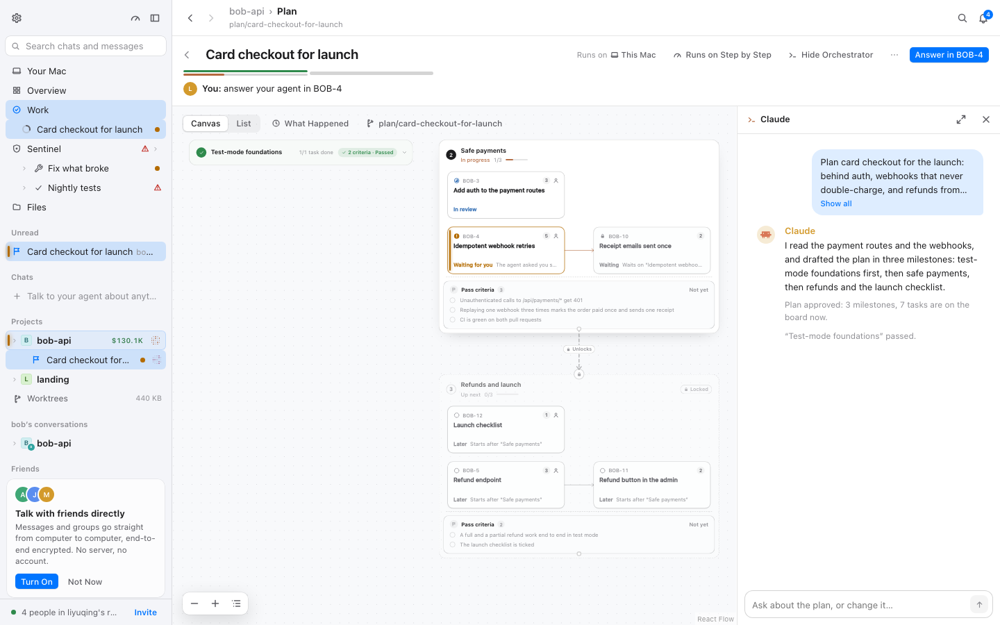
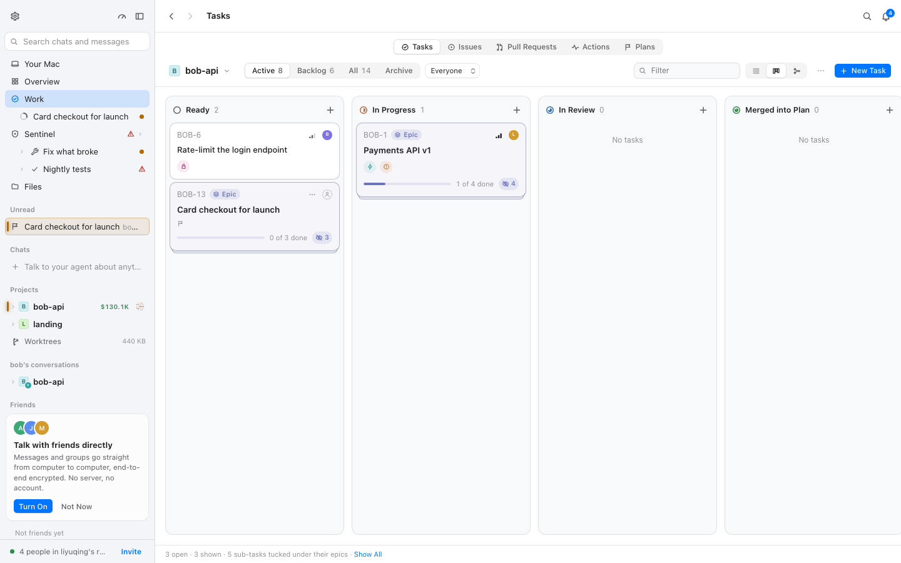
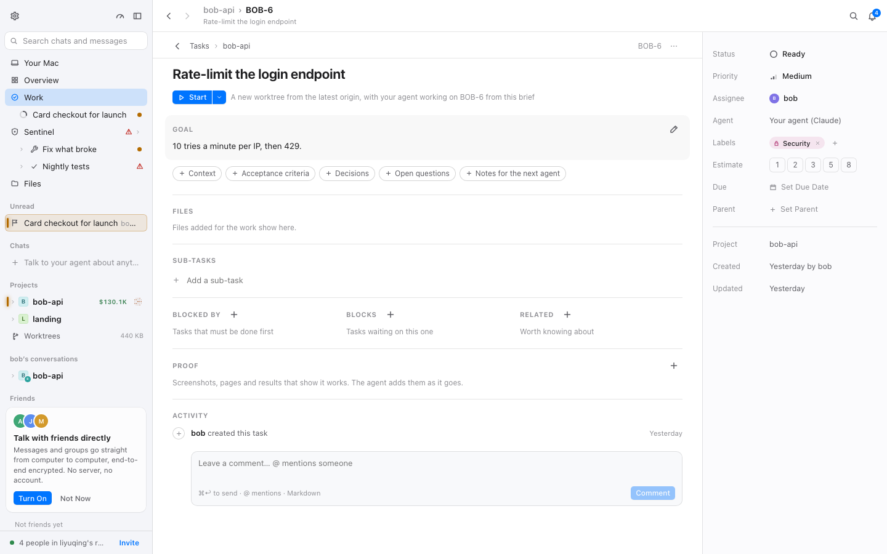
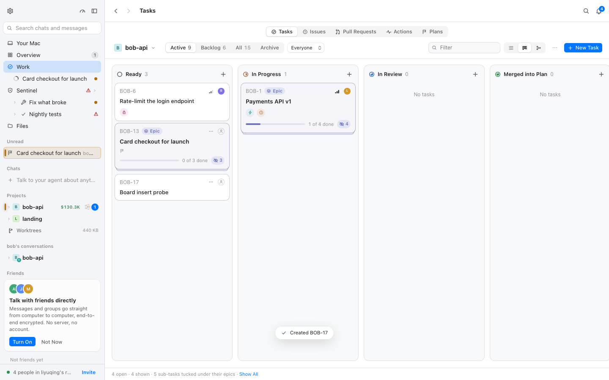
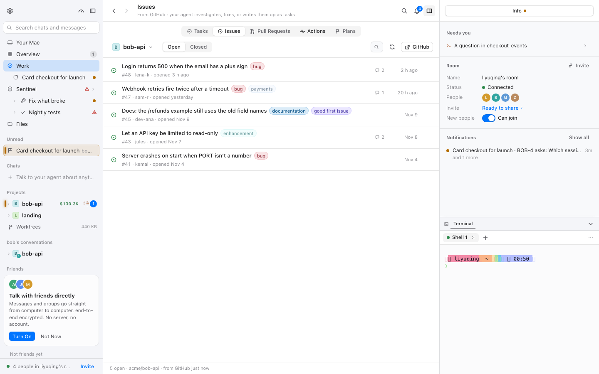
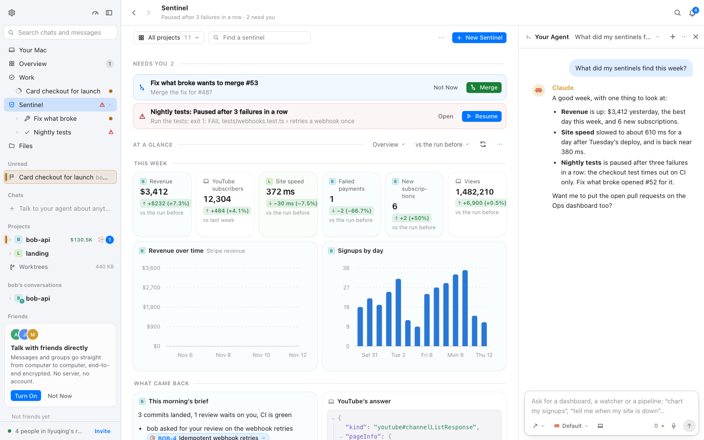

# 沉稳界面 · 任务板、计划与 Sentinel 逐页验收（M3 · BLG-171）

- 采集时间：2026-11-12 01:30–01:50（WIB）
- git：`8076e779b`（BLG-170 提交后的分支 HEAD；`plan/mac-fork` + M3 审计）
- 命令行：`BELUGA_URL=http://localhost:1421 node packages/mac/scripts/calm-check.mjs plan plancanvas tasks taskdetail tasknew issues sentinel sentineldash projecthome usage`（分两次跑：`tasknew` 首次因表单默认走「让 agent 写标题」模式而按钮不可用，改为「Write title and goal myself」后重跑）
- 演示 daemon：`BELUGA_HOME=/tmp/calm-blg170 BELUGA_ALLOW_ORIGINS=http://localhost:1421 npm run dev`（一次性 home，演示数据，已积累若干任务与一条新建任务 BOB-17）；vite 占 1421
- 原始结果：`.context/calm/<场景>.json`、`.context/calm/img/`（gitignore）；代表截图 `docs/calm/img/m3-*.png`
- 机器负载：采集期间 other worktrees 在跑，1 分钟负载约 20–30（10 核）。时序类数字受此影响。

## 验收方法（四步）

1. **逐页录屏**：每场景四组合（`calm-on/full`、`calm-on/reduce`、`calm-off/full`、`calm-off/reduce`），各起独立浏览器 context；记录 CLS 与 sources、`getAnimations()`、2 秒内 JS 改写 style 的元素、首帧 `data-calm`，并在 enter / loaded / hover / select / 场景自定义时刻截图。
2. **时刻覆盖**：进入 → 加载完成 → 悬停/选中 → 展开收起；任务板另做**插入新卡**（tasknew）的前后坐标测量，计划画布另测 React Flow 节点/边的过渡，Sentinel 另测 Ask 面板。
3. **reduced-motion**：`calm-on/reduce` 重看；CSS 动画应为 0，声明的过渡不应把布局拖着走。
4. **问题成表**：文件:行、现象、改法、建议归属（覆盖层 / 挂钩 / 上游 PR）；审计阶段的状态列写「待 BLG-174」，终值由 BLG-175 复核后写在 §6。

## 1 页面清单：场景 ↔ 页面/视图 ↔ 导航路径

| 场景 | 页面 / 视图 | 覆盖的时刻 | 导航（脚本步骤） |
| --- | --- | --- | --- |
| `plan` | Work → Plans（计划列表） | 进入、加载完成、悬停、选中 | 侧栏 `Work` → Work 切换 `Plans` |
| `plancanvas` | 计划页 + React Flow 画布（`Card checkout for launch`） | 进入、加载完成 | 侧栏计划行 `Card checkout for launch` |
| `tasks` | Work → Tasks 看板 | 进入、加载完成 | 侧栏 `Work` → `Tasks` |
| `taskdetail` | 任务详情页（BOB-6） | 进入、加载完成 | `tasks` 后点第一张卡 `[role="button"][aria-label^="BOB-"]` |
| `tasknew` | 看板插入新任务 | **插入新卡**（前后坐标）、加载完成 | `tasks` → `New Task` → `Write title and goal myself` → 标题 `Board insert probe` → `Create Task` |
| `issues` | Work → Issues（GitHub issues） | 进入、加载完成 | 侧栏 `Work` → `Issues` |
| `sentinel` | Sentinel 首页（含停靠的 Ask Sentinel 面板） | 进入、加载完成 | 侧栏 `Sentinel` |

`usage`（用量）、`sentineldash`（Sentinel Dashboard）、`projecthome`（项目主页）属数据区，判定写在 `data.md`；本区运行里顺带采集。任务详情页的编辑/对话框反馈属 BLG-172。

## 2 每页结果

格式：`CLS · CSS 动画数 · JS 动效元素数`；首帧列是 `calm-on/full`。

| 场景 | on/full | on/reduce | off/full | off/reduce | 首帧 data-calm（on） |
| --- | --- | --- | --- | --- | :---: |
| plan | 0.003 · 0 · 0 | 0.000 · 0 · 0 | 0.000 · 1 · 0 | 0.000 · 0 · 42 | ✅ |
| plancanvas | 0.000 · 0 · 0 | 0.000 · 0 · 0 | 0.000 · 1 · 21 | 0.000 · 0 · 0 | ✅ |
| tasks | 0.003 · 0 · 0 | 0.000 · 0 · 0 | 0.000 · 1 · 21 | 0.000 · 0 · 0 | ✅ |
| taskdetail | 0.003 · 0 · 0 | 0.000 · 0 · 0 | 0.000 · 1 · 21 | 0.000 · 0 · 0 | ✅ |
| tasknew | 0.003 · 0 · 0 | 0.000 · 0 · 0 | 0.000 · 1 · 21 | 0.000 · 0 · 0 | ✅ |
| issues | 0.000 · 0 · 0 | 0.000 · 0 · 0 | 0.000 · 1 · 21 | 0.000 · 0 · 0 | ✅ |
| sentinel | 0.037 · 0 · 0 | 0.000 · 0 · 0 | 0.052 · 1 · 21 | 0.000 · 0 · 0 | ✅ |

**新任务插入（tasknew，calm-on/full 实测坐标）**

| 卡片 | 插入前 y / 高 | 插入后 y / 高 |
| --- | --- | --- |
| BOB-6 Rate-limit the login endpoint（Ready） | 197 / 89 | 197 / 89 |
| BOB-13 Card checkout for launch（Ready，Epic） | 292 / 108 | 292 / 108 |
| BOB-1 Payments API v1（In Progress） | 197 / 117 | 197 / 117 |
| BOB-17 Board insert probe（Ready，新） | — | 413 / 62 |

结论：**新卡追加在列底，原有卡片一张都没有被挤开**（y 与高度逐张相同）；本场景只记录到整页 body 0.0028 的固定位移（见 §5）。插入时上游的 `pop-in` 360ms 弹簧动画被 M1 关掉，新卡瞬时出现；`Created BOB-17` 的 toast 是覆盖层 160ms 淡入。

代表截图：

| 计划画布（React Flow） | 任务板 |
| --- | --- |
|  |  |

| 任务详情 | 插入新任务之后 |
| --- | --- |
|  |  |

| Issues | Sentinel 首页 |
| --- | --- |
|  |  |

## 3 仍在播放的动画清单及理由

| 场景 | calm-on/full CSS 动画 | calm-on/reduce | calm-off/full（对照） |
| --- | ---: | ---: | --- |
| plan | 0 | 0 | 1（`_scan_` 4.2s infinite） |
| plancanvas | 0 | 0 | 1（`_scan_`） |
| tasks / taskdetail / tasknew | 0 | 0 | 1（`_scan_`） |
| issues | 0 | 0 | 1（`_scan_`） |
| sentinel | 0 | 0 | 1（`_scan_`） |

calm-on/full 没有 CSS 循环在播。上游会被 M1 关掉、但值得记下来的：任务卡的 `pop-in` 360ms 弹簧与 `tuck-out` 240ms（`tasks.module.css:952-976`）、看板工作指示 `onItTurn`/`onItSlide` 无限循环（`:782,:807`）、计划骨架的 `pop`/`ghostSweep`/`skMilestone`（`plans.module.css`）——在 calm 下全部静止，新卡直接出现、骨架不再扫光。

React Flow 的 520ms 是**过渡**不是动画，见 WK-02；任务卡的 framer 布局滑动见 WK-01。

## 4 reduced-motion 下的结果

| 场景 | on/reduce CSS 动画 | on/reduce JS 动效 | on/reduce CLS | 结论 |
| --- | ---: | ---: | ---: | --- |
| plan | 0 | 0 | 0.000 | 无动画 |
| plancanvas | 0 | 0 | 0.000 | **但**节点过渡仍声明 520ms，见 WK-02 |
| tasks / taskdetail / tasknew | 0 | 0 | 0.000 | framer 的 `layout` 在 reduce 下关闭 |
| issues | 0 | 0 | 0.000 | 无动画 |
| sentinel | 0 | 0 | 0.000 | Ask 面板瞬时停靠，无位移 |

`calm-on/reduce` 没有 CSS 动画或 JS 动效在播；`calm-off/reduce` 下 `plan` 场景的 `jsMotion` 仍有 42 个元素（DotMatrix 由上游 `lib/live-motion.ts` 的 reduce 只读系统设置，不是本覆盖层的职责），calm 开时被 `live-gate` 收束为 0。

**例外**：计划画布的节点在 reduce 下仍保留 520ms 的 `transition`（测量见 WK-02）：上游 `plans.module.css` 的 reduce 媒体查询只重置了 `.react-flow__node`，而 `PlanCanvas.module.css:11-20` 对 milestone/task/gate 的 520ms 规则在层叠上胜出。这是上游缺陷（不尊重 Reduce motion），也是本区 reduce 下唯一还在动的声明。

## 5 CLS 表（calm-on 进入 → 加载完成）

| 场景 | calm-on/full CLS | calm-on/reduce CLS | 记录到的非输入位移 | 归因 / 处置 |
| --- | ---: | ---: | --- | --- |
| plan | 0.003 | 0.000 | body 0.0028 @1.1s | 首屏后的整页微小移动（同 shell.md §5 的 body 0.0028） |
| plancanvas | 0.000 | 0.000 | — | 画布进入没有位移 |
| tasks | 0.003 | 0.000 | body 0.0028 @1.3s | 同上 |
| taskdetail | 0.003 | 0.000 | body 0.0028 @4.7s | 同上 |
| tasknew | 0.003 | 0.000 | body 0.0028 @1.3s | 插入新卡本身 0 位移（§2 的坐标证据） |
| issues | 0.000 | 0.000 | — | 列表加载没有位移 |
| sentinel | 0.037 | 0.000 | Ask 面板 `aside[data-opening]` + 瓦片 `[data-tile]` 0.0141+0.0086+0.0059+0.0049 @3.0s；body 0.0028 | **WK-03**：Ask Sentinel 面板停靠时用宽度动画进入，看板瓦片随之重排 |

`calm-off/full` 的 sentinel 是 0.052（同样的面板，时长 180ms 上游曲线），`calm-on/reduce` 为 0（面板瞬时停靠）——说明这 0.037 全部来自宽度动画期间的重排，不是数据加载。

## 6 问题表（BLG-175 终值）

状态只有三种：**已用覆盖层修好** / **已改上游文件并登记** / **已批准的例外（keep-decor）**。证据来自 2026-11-12 02:35 之后在新 HEAD（`120d2b06d`）上的重跑与 probe（`.context/calm/`）。

| ID | 文件:行 | 现象 | 改法 | 终值 | 复核证据 |
| --- | --- | --- | --- | --- | --- |
| WK-01 | `tasks/TaskBoard.tsx:561`（`layout={reduce ? false : 'position'}`）、`:73` SPRING；`:421` 抬起卡 | 看板卡用 framer layout 动画重排/落下，只读 reduced motion | 挂钩：`reduce` 判据加 `useCalm()`（`docs/fork.md` M3 第 4 行，TOUCHPOINTS）；拖拽跟手保留 | **已改上游文件并登记** | 重跑 `tasknew`：新卡追加列底、原有卡片逐张 0 移动（BOB-17 y413，其余 y/高不变）；`tasks` calm-on/full 动画 0 |
| WK-02 | `plans/PlanCanvas.module.css:11-20`、`plans/plans.module.css:476,1468` | React Flow 节点 520ms、边 160ms 不一致；reduce 下节点仍 520ms | 覆盖层 R3-06/07：节点与边同 `--dur`，reduce 下 0s；上游把 520ms 接 `--dur` 是 PR 候选 | **已用覆盖层修好** | 重跑 `plancanvas`：calm-on/full 节点与边均 `0.16s`、`cubic-bezier(0.3,0.7,0.3,1)`；calm-on/reduce 均 `0s`（原 0.52s）；`plans` e2e 延到最终步骤 |
| WK-03 | `sentinel/home.module.css:37`；`SentinelHome.tsx:147` | Ask 面板停靠的 160ms 宽度动画让看板重排 | 覆盖层 R3-02：`[data-opening]` 时长归零（animationend 仍触发） | **已用覆盖层修好** | 重跑 `sentinel` calm-on/full CLS 0.037→**0.003**；`sentineldash` 0.142→**0.004**；面板仍能打开 |

**迁移出问题表（BLG-173 收敛，BLG-175 落地）**

- **WK-04 → WK-01**：AnimatePresence 的卡片增删与 WK-01 是同一处 `reduce` 判据，合并为一条。

## 7 审计备注

**演示数据的局限**

- 计划画布的 `skeleton` 占位（`plans/PlanPage.tsx:598`）需要「Claude 正在写第一版计划」的状态，演示数据里的计划已经完成，**未观察到**；占位尺寸问题留给能造出该状态的后续审计。
- Sentinel 的 Dashboard 在演示数据里有 14 个瓦片、2 张图；「瓦片换位」的 `glide`（`DashboardPage.tsx:471-482`，220/260ms WAAPI）只在顺序/尺寸变化时触发，本次导航没有触到，见 data.md DA-02。
- `tasknew` 会真的在演示看板上创建 BOB-17；这是演示 home，不影响真实数据。`Created BOB-17` 的 toast 在截图中可见。
- `calm-off/reduce` 的 `plan` 出现 jsMotion 42：上游 live-motion 的 reduce 判断只读系统媒体查询，没有读 calm 的 `data-motion`；calm 开时由 live-gate 收束。不是本覆盖层的问题。

**人工走查**

- 计划画布：`plancanvas` 场景在四种组合里都读到 13 个节点、3 条边；节点过渡 `0.52s` 的曲线是 `cubic-bezier(0.22,1,0.36,1)`，边在 calm 下 0.16s。见 WK-02。
- Ask 面板：`sentinel` 与 `sentineldash` 的 CLS 来源都指向 `aside[data-opening]`，与 M4 的 askIn 例外一致；屏幕上的面板是瞬时/160ms 两种，取决于 reduce。
- 数字宽度：Dashboard 的 `$3,412`（57px）、`12,304`（57px）、`1,482,210`（79px）与百分比（31px）都是 `font-variant-numeric: tabular-nums`（见 data.md DA-04），宽度稳定。

**热点对照（任务上下文点名的三项）**

- **TaskBoard 新卡挤动**：WK-01 + §2 的坐标表。实测新卡追加在列底、原有卡片 0 移动；framer 下落动画是唯一的潜在滑动源，给了挂钩改法。
- **React Flow 520ms 例外定稿**：WK-02。实测节点 520ms/边 160ms，reduce 下节点仍 520ms；给了两条裁决路径（覆盖层 clamp 需 e2e 验证；上游把时长接到 `--dur` 并在 reduce 下归零）。
- **TaskBoard framer**：WK-01（layout 滑动与抬起缩放）。

**交给 BLG-173 的遗留**

- WK-02 的 React Flow 裁决必须与 `overlay.md §10.5` 的「React Flow 520ms 已知例外」合并成一条最终规则，并决定是否重跑 `e2e/plans.spec.ts`。
- WK-03 与 M4 的 `[data-opening]` 功能例外冲突：如果 173 决定沉稳下归零，M4 的「160ms 保持」要一并改写；否则 Sentinel 页面的 CLS 只能记为固有。

**BLG-175 复核补充**

- 复核运行：`BELUGA_URL=http://localhost:1421 node packages/mac/scripts/calm-check.mjs plan plancanvas tasks taskdetail tasknew issues sentinel`（2026-11-12 02:35 起，HEAD `120d2b06d`，全新演示 home）。
- `tasknew` 在全新 home 上再次确认：插入 BOB-17 后，BOB-6（y197/h89）、BOB-13（y292/h108）、BOB-1（y197/h117）逐张不变。
- 计划画布的两条数值是从场景 JSON 的 `flow` 字段读的（`nodeDuration`/`edgeDuration`），不依赖截图目测。
- `calm-off/full` 的 `sentinel` 仍 0.135（面板宽度动画在上游没有被禁），这正是 WK-03 由覆盖层修、上游 PR 候选的原因。

## 8 判定标准 → 证据（BLG-175）

| 判定标准 | 证据 |
| --- | --- |
| 本区报告有截图 | §2 的 `m3-*.png`（plancanvas/tasks/taskdetail/tasknew/issues/sentinel） |
| 报告有仍在播放的动画清单及理由 | §3（calm-on/full CSS 0；React Flow 是过渡，见 WK-02 的实测值） |
| 报告有 reduced-motion 结果 | §4（动画 0；React Flow 过渡 0s） |
| 问题表每条状态是三种之一 | §6 三行：覆盖层 2 条、上游文件 1 条；WK-04 已并入 WK-01 |
| data-calm 从进入到加载完成 CLS 0 或逐条原因 | §5：plan/tasks/taskdetail/tasknew 的 0.003 为 body 固定微移；sentinel 的 0.003 来自剩余的面板/内容；均逐条列了 sources |
| 改动的上游文件登记 fork.md、sync-upstream 无 `!` | TaskBoard 在 `docs/fork.md`「M3 逐页补改」；`sync-upstream --report` 0 个 `!` |
