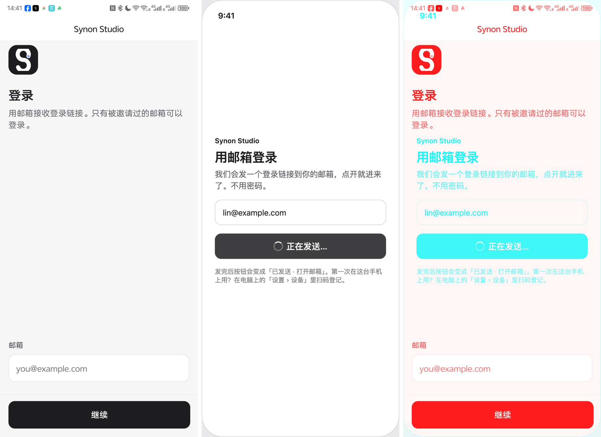
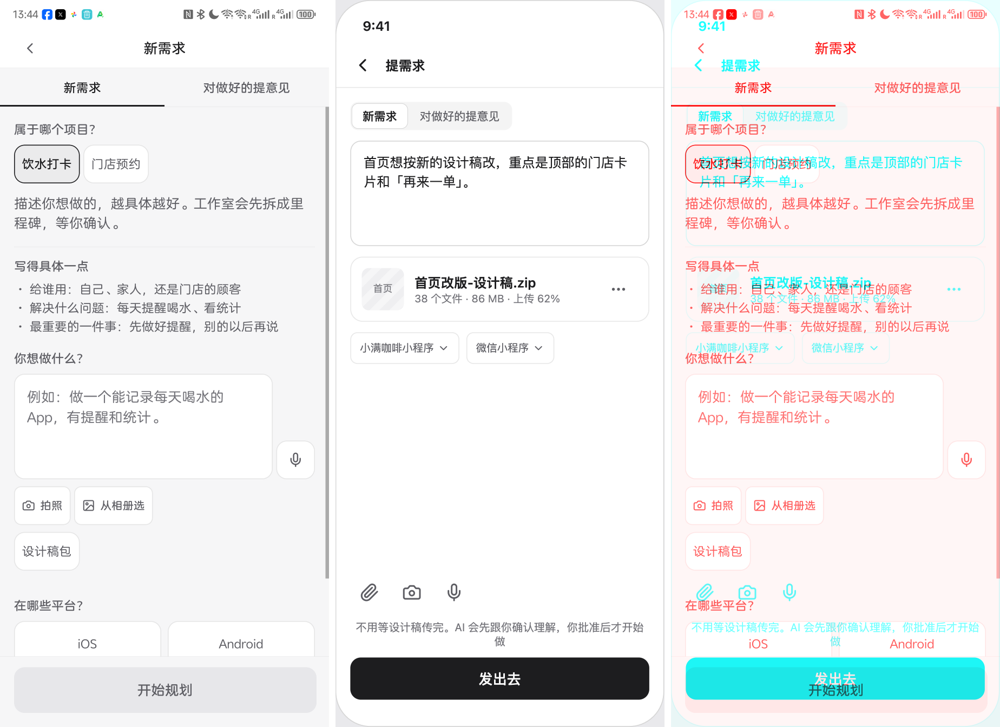
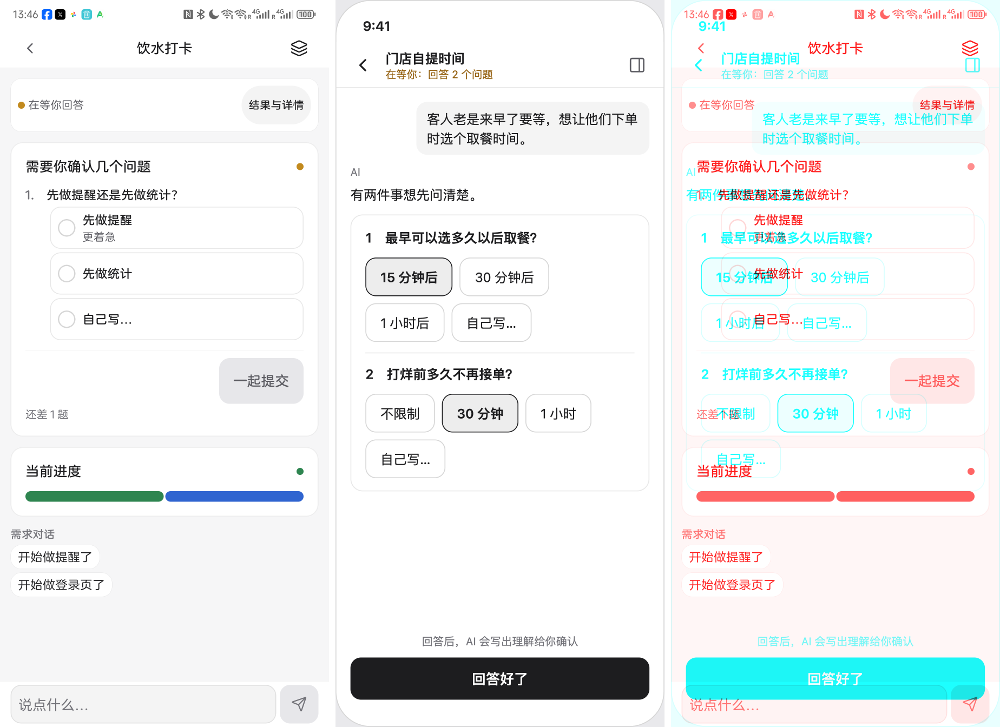
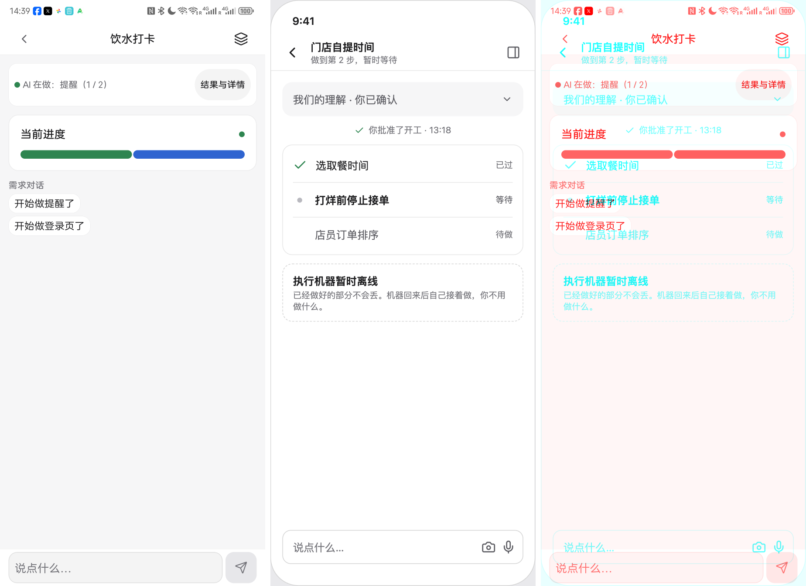
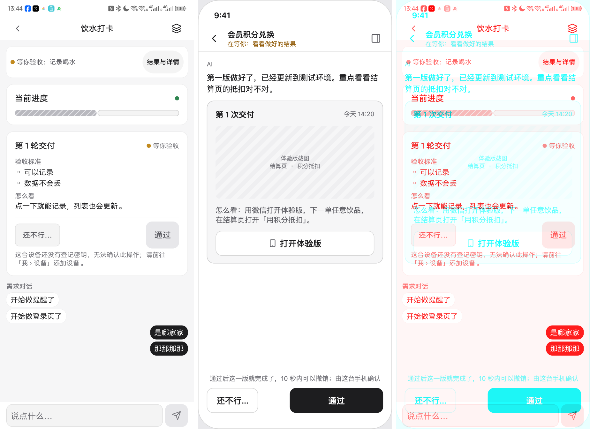
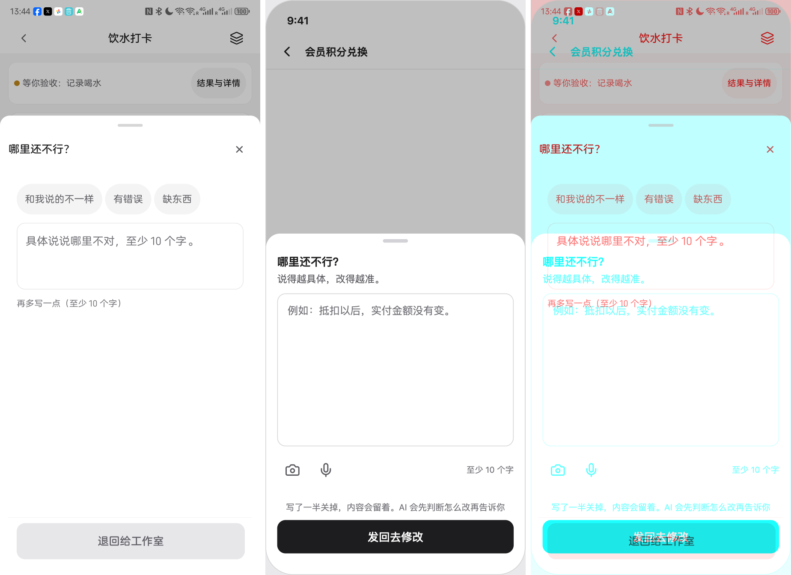
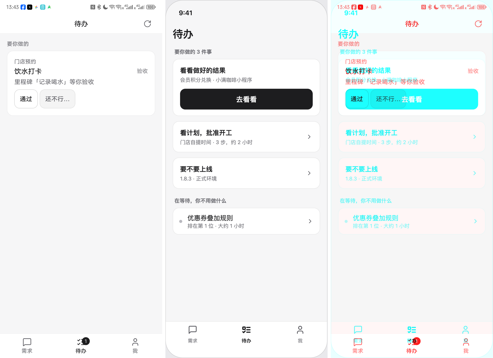
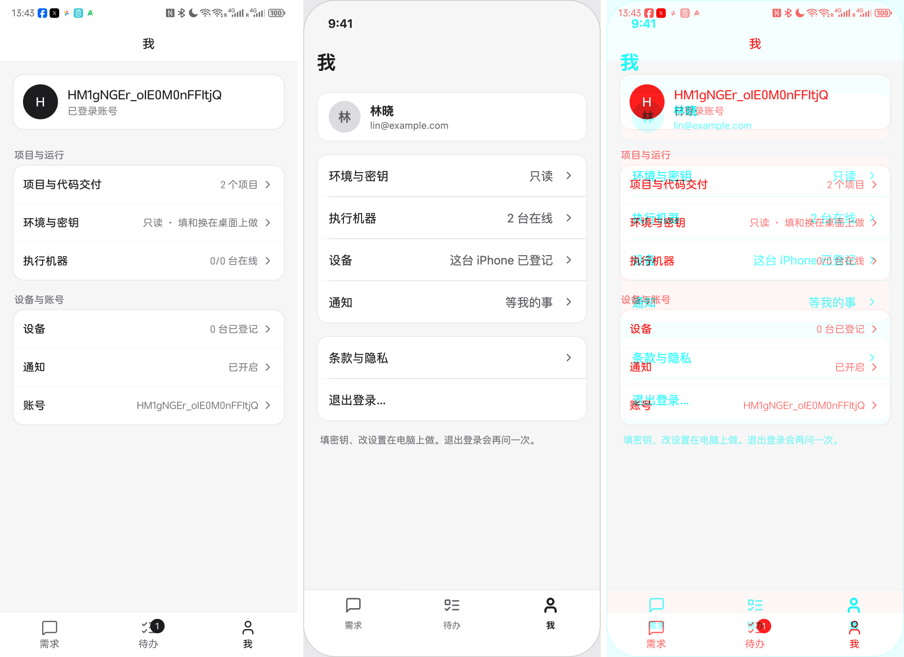
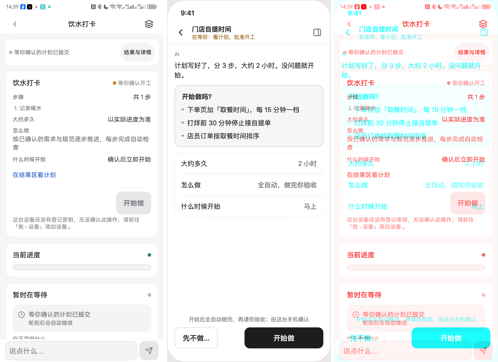
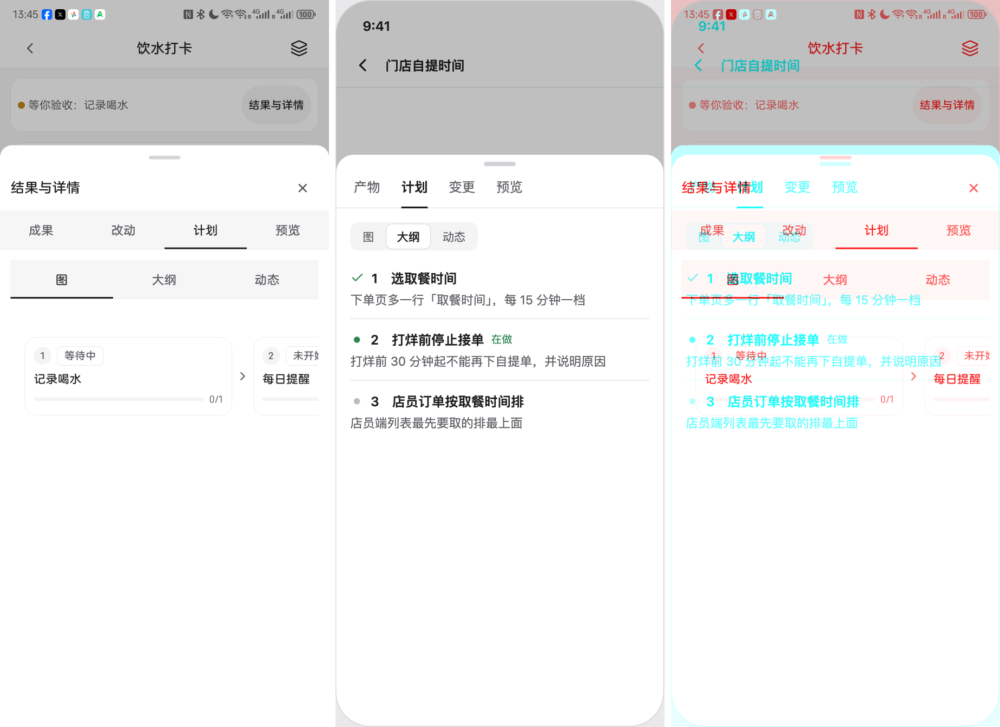

# Synon Studio 手机：安卓真机叠图走查

状态：**第一轮走查（2026-11-21），覆盖 P1、P2、P3、P4、P5、P7、P8、P9、P10、P12。** 差异已拆成整改任务，设计稿里应用做得更好的地方已同步回去。P6、P11 这一轮拍不到，见 §4。

设计稿是 Claude Design 项目「Synon Studio 工作台」的「手机 全流程」。应用是 `plan/synon-studio-ui-p1-p12` 分支上的构建，装在 NX733J（Android 15，1216×2688，520 dpi，即 374×827 dp）上，连本机中台与假 daemon。

## 1. 怎么叠的

1. 设计稿的每个 `.phone` 画面按这台手机的尺寸渲染（宽改成 374 dp、高 827 dp，3.25 倍），和手机截图像素对齐。这样文字折行、间距都按同一个宽度排，不是把 390 的稿子缩小。
2. 手机端用 `adb` 截图，同时用 `uiautomator` 读出每个元素的位置，换算成 dp。
3. 每屏出一张三联图：**手机 · 设计稿 · 叠图**。叠图里**红色只在手机上有，青色只在设计稿里有**，重合处是灰黑。
4. 设计稿里的文字框和手机元素按文字配对，比左边距和垂直中心。样例数据和设计稿的文案不同，能配上的不多，所以结论主要来自看图。

工具在 `scripts/studio-overlay/`，改完应用后重走一遍：

```bash
# 设计稿渲染（SERVE_URL 来自 Claude Design 的预览，不要写进文件）
SERVE_URL=… node scripts/studio-overlay/design-shots.mjs .beluga/scratch/overlay/design
# 推一个计划状态、打开第一条需求并截图（先 `npm run dev:device`）
scripts/studio-overlay/go.sh decide P3
# 叠图和文字框对比
node scripts/studio-overlay/compose.mjs P3
```

## 2. 不算差异的（安卓原生）

「UI 元素跟原生保持一致」按这样理解：**系统外壳用安卓自己的，里面照设计稿。**

| 设计稿画的 | 安卓上 | 处理 |
|---|---|---|
| iOS 状态栏（9:41、电池） | 系统状态栏（时间、通知图标、信号） | 保留系统的，设计稿里留一条空白状态栏高度即可 |
| 屏幕底部 34 pt 横条留白 | 手势导航，没有横条 | 底部页签栏只用系统给的安全区，不再自己加留白 |
| 圆角的手机外框 | 整屏 | 无 |
| PingFang | 系统中文字体 | 字重、字号按设计稿，字形随系统 |
| 点按反馈 | 涟漪 | 保留 |
| 返回 | 左上角箭头 + 系统返回手势都要能用 | 保留 |

## 3. 差异清单

方向：**应用**＝改应用去对齐设计稿；**设计稿**＝应用做得对，改设计稿；**两边**＝各改一部分。整改任务在 Beluga 的计划「手机端：叠图走查整改」。

### 3.1 全局

| # | 差异 | 方向 | 图 |
|---|---|---|---|
| G1 | 详情页顶栏：设计稿是左箭头 + 靠左的标题（17 粗）+ 一行副标题（等你时是琥珀色「在等你：…」）+ 右上角抽屉图标；应用是居中标题 + 分隔线 + 叠层图标，下面又多一条「结果与详情」按钮行 | 应用 | P3 P4 P5 P10 |
| G2 | 页签页（待办、我）：设计稿是 26 号靠左大标题、没有顶栏；应用是居中的 18 号标题放在顶栏里。需求页的描边「提需求」按钮比顶栏还高，压在分隔线上 | 应用 | P8 P9 |
| G3 | 底部页签栏：设计稿顶上有一条细线、当前项文字加粗；应用没有细线。待办的数字角标盖住了图标本身 | 应用 | P8 P9 |
| G4 | 需要你动手时（回答、验收、批准开工），设计稿把动作**固定在屏幕底部**：否定的靠左、主动作靠右、上面一句后果说明，并取代输入框；应用把按钮放在卡片里面，输入框一直在底部 | 应用 | P3 P5 P10 |
| G5 | 应用里还有「工作室」的说法（原因抽屉的「退回给工作室」）。这个说法已经删掉，设计稿写「发回去修改」 | 应用 | P7 |

### 3.2 逐屏

| # | 屏 | 差异 | 方向 |
|---|---|---|---|
| P1-a | 登录 | 设计稿没有顶栏，品牌字样和标题在中间；应用有居中顶栏，品牌方块在左上，输入框和按钮贴在底部拇指区。M5 的规范是输入优先、拇指优先 | **设计稿**：输入框和按钮放到底部，上面是品牌方块和标题；应用：去掉顶栏 |
| P1-b | 登录 | 文案：设计稿「用邮箱登录 / 我们会发一个登录链接…不用密码」，应用「登录 / …只有被邀请过的邮箱可以登录」 | 两边：标题和第一句用设计稿，设计稿补上「只有被邀请过的邮箱可以登录」 |
| P2-a | 提需求 | 设计稿是一个文字卡 + 一张附件卡，下面两个下拉（项目、平台），底部是一排附件 / 拍照 / 语音图标和黑色「发出去」；应用是下划线页签、项目选择块、说明文字、输入框、拍照 / 相册 / 设计稿包三个按钮、2×2 平台宫格、灰色「开始规划」 | 应用 |
| P2-b | 提需求 | 「新需求 / 对做好的提意见」：设计稿是胶囊式分段，应用是下划线 | 应用 |
| P2-c | 提需求 | 应用的「写得具体一点」三条提示设计稿没有 | 设计稿：加进输入框占位，不单占一块 |
| P3 | 回答问题 | **设计稿已改**：问题是具体项目的问法，不做成选项界面；统一成「AI 先给建议答案，客户点底部「就这样」确认，或在某条点「改…」写一句」。应用现在是单选行加「一起提交」在卡片里，要改成这一种交互（`studio-ui.md` §2.4a） | 应用 |
| P4 | 在做 | 设计稿：折叠的「我们的理解 · 你已确认」、一条「你批准了开工 · 13:18」、一张步骤列表（已过 / 等待 / 待做）、一张虚线的「执行机器暂时离线」卡。应用：「当前进度」条 + 「需求对话」气泡，没有这些 | 应用 |
| P5 | 交付验收 | 设计稿：体验版截图、「怎么看」、卡里一个描边「打开体验版」，底部固定「还不行… / 通过」和「通过后…10 秒内可以撤销；由这台手机确认」。应用：验收标准列表、「怎么看」，按钮在卡里；没有登记密钥时在按钮下写原因 | 应用；原因那句保留，放在固定栏上方，设计稿补上这一状态 |
| P7 | 原因抽屉 | 设计稿：抽屉约占 2/3 屏，有副标题、大输入框、拍照 / 语音、「至少 10 个字」，底部「发回去修改」。应用：一排快捷原因（和我说的不一样 / 有错误 / 缺东西）、较矮的输入框、灰色整宽按钮 | 两边：应用补拍照 / 语音、改按钮；设计稿补快捷原因 |
| P8 | 待办 | 设计稿：「要你做的 3 件事」、卡片里「去看看」或带箭头的行、「在等待，你不用做什么」一组。应用：直接在待办卡里放「通过 / 还不行…」两个按钮，没有分组标题 | 应用：待办只做入口，签名的动作回到详情页的固定栏 |
| P9-a | 我 | 账号卡显示的是一串客户编号（`HM1gNGEr…`），设计稿是姓名 + 邮箱。登录接口只回了编号，应用拿不到姓名和邮箱 | 应用（中台与应用一起改） |
| P9-b | 我 | 设计稿一组 4 行，加「条款与隐私」「退出登录…」；应用分「项目与运行」「设备与账号」两组，多了「项目与代码交付」「账号」，退出登录在账号页里并要再确认 | **设计稿**：改成应用的分组 |
| P10 | 批准开工 | 同 G1、G4；设计稿卡里是三行（大约多久 / 怎么做 / 什么时候开始），应用是更长的键值行加一条蓝色「在结果区看计划」链接。「先不做… / 开始做」设计稿固定在底部，应用在卡里 | 应用；链接去掉，抽屉由右上角图标打开 |
| P12-a | 结果抽屉 | 设计稿没有标题行，四个页签直接在抽屉顶上，抽屉高约 2/3；应用有「结果与详情 ×」标题行，页签是下划线，抽屉高约 90% | 应用 |
| P12-b | 结果抽屉 | 计划页签：设计稿默认「大纲」（编号 + 状态 + 说明的列表），分段是药丸；应用默认「图」，横向卡片被右边截断，分段是下划线 | 应用：默认大纲，卡片不截断 |
| P12-c | 结果抽屉 | 页签名：设计稿「产物 / 变更」，应用「成果 / 改动」。已经定了用后者 | **设计稿**（已同步，桌面、手机各页和规范页都改了） |
| P12-d | 结果抽屉 | 页签顺序：设计稿和 `studio-ui.md` 是「成果 · 计划 · 改动 · 预览」，应用是「成果 · 改动 · 计划 · 预览」 | 应用：改成设计稿的顺序 |

### 3.3 小结

- 应用要改的：G1–G5、P1 去顶栏、P2、P3、P4、P5、P7 的拍照语音和按钮、P8、P9-a、P10、P12（含页签顺序）。
- 设计稿要改的，**已全部同步**：P1 底部输入、P1 加受邀说明、P2-c、P5 的「未登记设备」状态（新增 P5b）、P7 的快捷原因、P9-b、P12-c（页签名，全部页面）。
- 应用做得对、设计稿一直缺的，就是上面这几条：登录的拇指区、受邀才能登录的说明、没登记设备时的原因、快捷原因、设置的完整分组、页签名。
- 设计稿里 P5b 是新画的一屏；其余是改原有屏。设计稿现在放在 claude.ai 的「Synon Studio 工作台」，原来的 Claude Design 项目已迁走。

## 4. 这一轮没覆盖的

| 屏 | 原因 |
|---|---|
| P6 撤销 | 要点「通过」，而这台手机没登记设备密钥，按钮是灰的。等设备登记（A6）接上后补拍 |
| P11 批准上线 | 协议里目前只有开工、改动两种批准，没有上线批准，应用里没有这张卡 |
| P1 的「正在发送…」 | 发送太快，截不到；只拍了空白、已填写和已发送三个状态 |
| 其余状态（断网、执行机器离线、排队、用量已满…） | 等整改做完后用 `go.sh` 和假 daemon 逐个推状态再走 |

## 5. 图

| 屏 | 图 |
|---|---|
| P1 登录 |  |
| P2 提需求 |  |
| P3 回答问题 |  |
| P4 在做 |  |
| P5 交付验收 |  |
| P7 原因抽屉 |  |
| P8 待办 |  |
| P9 我 |  |
| P10 批准开工 |  |
| P12 结果抽屉（计划） |  |
